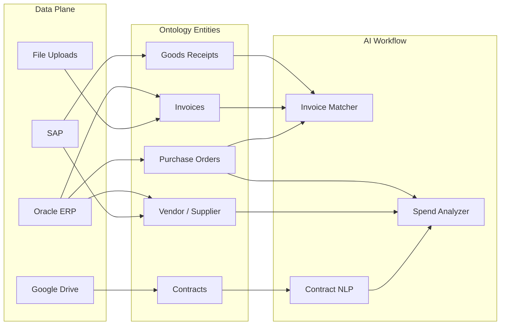

# Procurement & Spend Analytics

AI-powered spend visibility, maverick detection, and intelligent invoice processing.

**Priority:** P2 — Strategic Value  
**Time to Value:** 8-10 weeks  
**Category:** Procurement & Finance

---

## Business Problem

Beverage manufacturing procurement spans raw materials (sugar, concentrate, flavoring), packaging (bottles, cans, labels), and services (logistics, maintenance). Spend is managed across Oracle ERP and SAP with contracts stored in Google Drive:

- **Spend fragmentation** — no unified view of who we buy what from, at what price, across which plants
- **Maverick spending** — purchases made outside negotiated contracts, bypassing preferred vendors
- **Invoice processing burden** — manual three-way matching of PO → Goods Receipt → Invoice across thousands of transactions
- **Price variance blind spots** — commodity price movements not tracked against contracted rates in real time
- **Vendor consolidation missed** — same material sourced from multiple vendors at different prices without visibility

---

## Capabilities

### Spend Cube Analysis
Multi-dimensional spend analysis: vendor × material × plant × time period. Answer: _"How much did we spend on PET bottles across all plants last quarter, and which vendor gave the best unit price?"_

### Maverick Spend Detection
Identify purchases made outside negotiated contracts — wrong vendor, unapproved material, or price above contracted rate — and quantify the cost impact.

### Vendor Consolidation Opportunities
Surface materials sourced from multiple vendors where consolidation to fewer suppliers would yield volume discounts and simplified management.

### AI-Powered Invoice Processing
LLM extraction of invoice data from uploaded PDFs/scans. Automated three-way match (PO → Goods Receipt Note → Invoice) with exception routing for mismatches.

### Price Variance Monitoring
Track actual purchase prices against contracted rates and market indices. Alert when commodity cost shifts create hedging or renegotiation opportunities.

---

## Data Sources & Ontology Mapping

| Ontology Entity | Source System | Key Fields |
|----------------|--------------|------------|
| Vendor / Supplier | Oracle Vendor Master + SAP Vendor Master | Vendor ID, Name, Category, Location, Payment Terms |
| Purchase Orders | Oracle ERP Procurement | PO Number, Vendor, Material, Qty, Unit Price, Plant, Date |
| Goods Receipts | SAP Material Management | GRN Number, PO Reference, Material, Qty Received, Date |
| Invoices | Oracle AP + File Uploads (PDF) | Invoice Number, Vendor, Amount, Line Items, Due Date |
| Contracts | Google Drive (PDF/DOCX) | Vendor, Material, Contracted Price, Volume Commitment, Validity |

---

## AI Workflow

1. **Spend Aggregation** — Consolidate all PO data from Oracle ERP, enrich with SAP material categories, and build the spend cube
2. **Contract Intelligence** — Extract pricing terms, volume tiers, and validity periods from contracts in Google Drive using LLM
3. **Maverick Detection** — Compare each PO against contract terms; flag purchases at non-contracted prices, unapproved vendors, or outside policy thresholds
4. **Invoice Extraction** — OCR + LLM pipeline to extract structured data from uploaded invoice PDFs
5. **Three-Way Match** — Automated PO ↔ GRN ↔ Invoice matching; route exceptions (quantity mismatch, price variance, missing GRN) to AP team
6. **Consolidation Analysis** — Cluster analysis on vendor × material to identify consolidation opportunities with projected savings
7. **Output** — Spend dashboards, maverick reports, invoice processing queue, and vendor consolidation recommendations

---

## Dashboard & Alerts

### Key Metrics

| KPI | Description | Target |
|-----|-------------|--------|
| **Total Addressable Spend** | Total procurement spend under management | 100% visibility |
| **Maverick Spend %** | Spend outside contracted terms / Total spend | < 5% |
| **Invoice Processing Time** | Average days from invoice receipt to approval | < 3 days |
| **Straight-Through Processing Rate** | % of invoices auto-matched without manual intervention | > 75% |
| **Price Variance** | Actual unit price vs. contracted price, weighted by volume | ± 2% |
| **Vendor Concentration Risk** | % of spend with top 3 vendors per category | < 60% |

### Alert Rules

| Alert | Trigger | Severity | Action |
|-------|---------|----------|--------|
| Maverick purchase | PO placed with non-contracted vendor for contracted material | High | Notify procurement manager; block if policy requires |
| Price over-contract | Invoice unit price exceeds contracted rate by >5% | High | Hold payment; route to vendor management for resolution |
| Invoice exception | Three-way match fails (qty or price mismatch >2%) | Medium | Route to AP exception queue with discrepancy detail |
| Commodity price shift | Market index for key raw material moves >15% in 30 days | Medium | Notify procurement; assess hedging / contract renegotiation |
| Consolidation opportunity | Same material sourced from 4+ vendors with >10% price spread | Info | Include in quarterly vendor review agenda |

---

## ROI Model

| Metric | Before | After | Impact |
|--------|--------|-------|--------|
| Maverick spend | 12% of total spend | 4% of total spend | **$480K savings on $60M spend** |
| Invoice processing cost | $12 per invoice | $4 per invoice | **67% reduction → $320K savings** on 40K invoices/year |
| Invoice processing cycle | 8 days average | 2.5 days average | **69% faster** |
| Vendor consolidation savings | — | 3-5% on consolidated categories | **$450K savings** |
| Price variance leakage | $280K / year | $80K / year | **$200K recovered** |

!!! success "Estimated Annual ROI"
    **$1.2M - $1.8M** annually from maverick elimination, processing automation, vendor consolidation, and price compliance — across a mid-size beverage manufacturer with $60M procurement spend.

---

## Implementation Notes

- Spend cube requires clean material categorization; may need initial taxonomy alignment between Oracle and SAP material masters
- Invoice OCR/LLM extraction accuracy depends on invoice format consistency; expect 90%+ for structured invoices, 75-85% for handwritten or non-standard formats
- Contract NLP works best when contracts follow a standard template; recommend standardizing supplier agreements over time
- Maverick spend policy rules must be defined with procurement leadership before automation

---

[← Back to Catalogue](index.md) | [Previous: Customer 360](customer-360.md) | [Next: Production & Quality →](production-quality.md)
