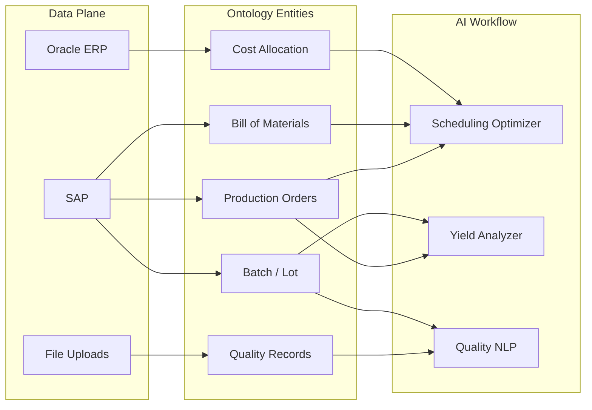

# Production & Quality Control Copilot

AI-assisted production scheduling, yield optimization, and quality deviation detection for beverage manufacturing.

**Priority:** P3 — Operational Excellence  
**Time to Value:** 10-12 weeks  
**Category:** Manufacturing & Quality

---

## Business Problem

Beverage manufacturing involves high-throughput production lines with strict quality standards (food safety, consistency, packaging integrity). Operations teams face:

- **Suboptimal scheduling** — production plans built manually, not accounting for real-time demand shifts, changeover costs, or raw material availability
- **Yield loss opacity** — line-level waste and yield issues detected only in monthly reports, not in real time
- **Quality blind spots** — lab test results trapped in PDFs and spreadsheets, not correlated with production conditions
- **Slow batch traceability** — in the event of a recall, tracing affected batches across the distribution network takes days
- **Reactive maintenance** — equipment issues cause unplanned downtime because degradation patterns are not monitored

---

## Capabilities

### Intelligent Production Scheduling
Optimize production schedules considering demand forecast, raw material availability, line capacity, changeover times, and shelf-life constraints — minimizing total cost while meeting service levels.

### Yield Analysis & Waste Reduction
Real-time monitoring of yield per production line, shift, and SKU. Identify patterns in waste generation and correlate with operator, equipment, and raw material batch variables.

### Quality Deviation Detection
AI extraction of quality test results from lab reports (PDF/Excel uploads). Correlate deviations with production parameters to identify root causes early.

### Batch Traceability
Forward and backward traceability: from raw material batch to finished product distribution. Critical for recall management and regulatory compliance.

### Predictive Maintenance Indicators
Monitor production line performance metrics (throughput, reject rate, cycle time) for early signs of equipment degradation requiring maintenance intervention.

---

## Data Sources & Ontology Mapping

| Ontology Entity | Source System | Key Fields |
|----------------|--------------|------------|
| Production Orders | SAP Production Planning | Order Number, Material, Qty Planned, Qty Produced, Line, Shift, Date |
| Bill of Materials | SAP BOM | Finished Good, Component Materials, Quantities, Unit of Measure |
| Quality Records | File Uploads (PDF/Excel) | Test Type, Result, Specification Limits, Batch, Date, Inspector |
| Batch / Lot | SAP Batch Management | Batch Number, Material, Production Date, Expiry, Status |
| Cost Allocation | Oracle ERP Cost Accounting | Production Order, Material Cost, Labor Cost, Overhead, Variance |

---

## AI Workflow

1. **Demand Integration** — Pull latest demand forecast and open sales orders to define production requirements
2. **Material Availability Check** — Verify raw material and packaging stock in SAP against BOM requirements
3. **Schedule Optimization** — Constraint-based optimization: minimize changeover time + waste while maximizing throughput and meeting delivery dates
4. **Yield Monitoring** — Compare actual output vs. planned output per batch; statistical process control to detect out-of-trend performance
5. **Quality Extraction** — LLM extracts structured test results from uploaded lab reports; flag deviations from specification limits
6. **Root Cause Correlation** — Link quality deviations to production variables (raw material batch, equipment, shift, temperature) using statistical analysis
7. **Output** — Optimized production schedule to SAP PP; yield and quality dashboards; deviation alerts to quality team

---

## Dashboard & Alerts

### Key Metrics

| KPI | Description | Target |
|-----|-------------|--------|
| **OEE (Overall Equipment Effectiveness)** | Availability × Performance × Quality | > 85% |
| **Yield %** | Actual output / Theoretical output (from BOM) | > 97% |
| **Changeover Time** | Average minutes per product changeover | < 30 min |
| **Quality First-Pass Rate** | % of batches passing QC on first test | > 98% |
| **Schedule Adherence** | % of production orders completed on time | > 92% |
| **Batch Traceability Time** | Minutes to complete full forward/backward trace | < 15 min |

### Alert Rules

| Alert | Trigger | Severity | Action |
|-------|---------|----------|--------|
| Yield drop | Line yield drops >3% below 5-batch moving average | High | Notify production supervisor; investigate root cause |
| QC deviation | Lab result outside specification limits | Critical | Hold batch; trigger quality review process |
| Repeated failure | Same quality test fails on 3+ consecutive batches | Critical | Stop line; escalate to quality manager |
| Schedule conflict | Raw material shortage will prevent scheduled production run | High | Reschedule; notify procurement for expedited supply |
| Maintenance indicator | Line throughput degrades >5% over 10 consecutive batches | Medium | Flag for preventive maintenance in next planned window |

---

## ROI Model

| Metric | Before | After | Impact |
|--------|--------|-------|--------|
| OEE | 78% | 86% | **8 percentage point improvement** |
| Production waste | 4.5% of raw material input | 2.8% of raw material input | **38% waste reduction → $340K savings** |
| Unplanned downtime | 22 hours / month | 10 hours / month | **55% reduction → $220K recovered output** |
| Quality holds | 6 batches / month | 2 batches / month | **67% reduction in hold-related delays** |
| Recall traceability | 3-5 days | 2-4 hours | **95% faster response** |
| Schedule adherence | 82% | 93% | **13% improvement → better delivery performance** |

!!! success "Estimated Annual ROI"
    **$700K - $1.2M** annually from waste reduction, recovered output, improved scheduling, and faster quality response — across a mid-size beverage manufacturing operation with 3-5 production lines.

---

## Implementation Notes

- Requires SAP Production Planning (PP) and Quality Management (QM) modules as data sources
- Quality report extraction accuracy depends on lab report formatting; standardized templates improve LLM extraction to 90%+
- OEE calculation requires line-level availability, performance, and quality data — may need PLC/SCADA integration for real-time feeds
- Batch traceability requires consistent lot tracking from raw material receipt through finished goods distribution
- Production scheduling optimization model needs 4-6 weeks of calibration with operations team

---

[← Back to Catalogue](index.md) | [Previous: Procurement Analytics](procurement-analytics.md) | [Next: ESG & Sustainability →](esg-sustainability.md)
