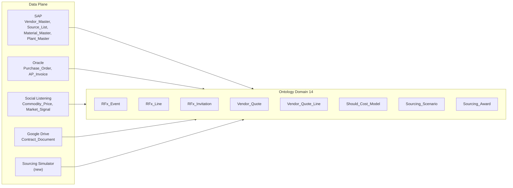

# Sourcing CPQ

AI-first buy-side Configure-Price-Quote for procurement. Launch RFx, build should-cost models, score bids, run award scenarios under policy guardrails, draft contracts, and issue Purchase Orders — all on the existing supply-chain ontology with two new domains and one Sourcing simulator standing in for SAP Ariba.

**Priority:** P1 — High Value
**Time to Value:** 6–8 weeks
**Category:** Procurement / Sourcing
**Solution ID:** `sourcing-cpq`

For the platform framing see [CPQ Overview](../../cpq/def.md) and [CPQ Scope & UAT](../../cpq/scope.md).

---

## Business Problem

Procurement runs on emailed RFQs, spreadsheets, and one-off contract drafts. The fragmentation costs:

- **Cycle time** — 4–6 weeks from need to award.
- **Should-cost blindness** — accepted prices have no benchmark.
- **Concentration risk** — single-source ABC-A vendors slip through.
- **Policy drift** — single-source, payment terms, sustainability certs only checked manually.
- **Contract bottlenecks** — legal cycles drag because drafts start from a blank page.

---

## Capabilities

### Aggregated RFx Launch

`launch_rfx` clusters open `Purchase_Requisition` rows by category and plant into an `RFx_Event` with composed `RFx_Line` records. The companion `recommend_vendor_panel` ranks candidates from `Source_List` ∩ active `Vendor_Master`, filtering critical-risk vendors per `supply-chain-risk-policy.md`.

### Should-Cost Models

`should_cost_model` builds a bottom-up cost benchmark per material from `Commodity_Price` + labor + overhead + freight. Drives savings calculation on every bid.

### Composite Bid Scoring

`score_vendor_response` scores each vendor on price-vs-should-cost (40), lead time (15), risk (20), quality (15), sustainability (10).

### Award Scenarios

`run_award_scenario` builds one scenario per strategy (cost optimal, risk balanced, diversified). `recommend_award_split` picks the Pareto-optimal scenario under the 60 % concentration ceiling from `sourcing-award-policy.md`.

### Contract Drafting

`draft_contract` returns a Markdown contract draft from the elected scenario, terms from `Vendor_Quote_Line`, and the parent `RFx_Event`. The `Contract Generation` workflow persists to Google Drive and hands off to legal.

### PO Conversion

`convert_award_to_po` transitions a `Sourcing_Award` to Issued, kicks off `Purchase_Order` creation in SAP/Oracle, and updates `Source_List` priority.

---

## Data Sources & Ontology

| Entity | Source | Role |
|--------|--------|------|
| `RFx_Event`, `RFx_Line`, `RFx_Invitation` | Sourcing | Event lifecycle |
| `Vendor_Quote`, `Vendor_Quote_Line` | Sourcing | Vendor responses |
| `Should_Cost_Model` | Sourcing | Internal benchmark |
| `Sourcing_Scenario`, `Sourcing_Award` | Sourcing | Award scenarios and decisions |
| `Vendor_Master`, `Source_List` | SAP | Vendor master + approved mapping |
| `Material_Master`, `Plant_Master` | SAP | Master refs |
| `Commodity_Price` | Social Listening | Should-cost input |
| `Contract_Document` | Google Drive | Drafted contract |
| `Purchase_Order` | Oracle | Materialized PO |

---

## AI Workflows

1. [RFx Launch](ontology/workflows.md) — aggregate requisitions, build should-cost, invite vendors.
2. [RFx Bid Evaluation](ontology/workflows.md) — score bids and produce scenarios.
3. [RFx Award](ontology/workflows.md) — route approvals and update Source_List.
4. [Contract Generation](ontology/workflows.md) — draft Contract_Document for legal review.

## Policies

- [Sourcing Award Policy](../../../../nexus-backend/enterprise-knowledge/policies/sourcing-award-policy.md) (POL-CPQ-AWD-001)
- [Procurement Policy](../../../../nexus-backend/enterprise-knowledge/policies/procurement-policy.md) (POL-PROC-001)
- [Supply Chain Risk Policy](../../../../nexus-backend/enterprise-knowledge/policies/supply-chain-risk-policy.md) (POL-SCR-001)

## Integrations

- [Sourcing CPQ ↔ SAP Ariba Sync](../../../../nexus-backend/enterprise-knowledge/integrations/sourcing-sap-ariba-sync.yaml)

---

## KPIs

| KPI | Target | Source |
|-----|--------|--------|
| RFx cycle time (launch → award) | < 10 business days | RFx_Event.Open_Date → Sourcing_Award.Issued_At |
| Savings vs should-cost | > 5 % | Sourcing_Scenario.Modeled_Savings |
| Single-source ABC-A risk | < 2 % | Source_List joined on Material_Plant.ABC_Classification |
| Time to contract | < 3 business days after award | Sourcing_Award.Approved_At → Contract_Document.Effective_Date |
| Vendor concentration ceiling | ≤ 60 % per vendor per category | Sourcing_Scenario.Concentration_Pct |

---

## ReAct Tool Reference

| Tool | Risk | Purpose |
|------|------|---------|
| `launch_rfx` | low-risk write | Create RFx_Event with lines |
| `recommend_vendor_panel` | read | Rank Source_List vendors for an event |
| `solicit_vendors` | low-risk write | Send RFx_Invitations |
| `score_vendor_response` | read | Composite score per bid |
| `should_cost_model` | read | Bottom-up should-cost benchmark |
| `run_award_scenario` | low-risk write | Persist a scenario for a strategy |
| `recommend_award_split` | low-risk write | Run all strategies and pick Pareto-optimal |
| `draft_contract` | read | Compose Markdown contract draft |
| `convert_award_to_po` | high-risk write | Issue award and kick off PO creation |

---

## Console Walkthrough

The Sourcing CPQ app reuses the AppShell with seven sections:

- **RFx Pipeline** — KPIs, status pie, category bar, should-cost models.
- **Bid Matrix & Scenarios** — vendor × line bid matrix, three-scenario comparison.
- **Sourcing Workflows** — RFx Launch, Bid Evaluation, Award, Contract Generation.
- **Awards & Contracts** — pending awards table, contract diff preview.
- **Tools Catalogue** — nine ReAct tools surfaced for direct invocation.
- **Chat** — copilot seeded with the active RFx context.

---

[← Back to Supply Chain Catalogue](index.md)
