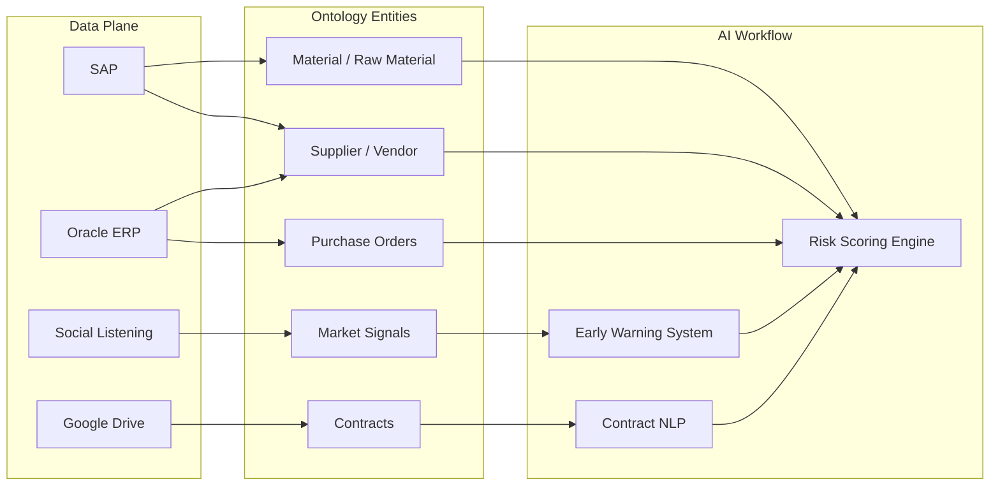
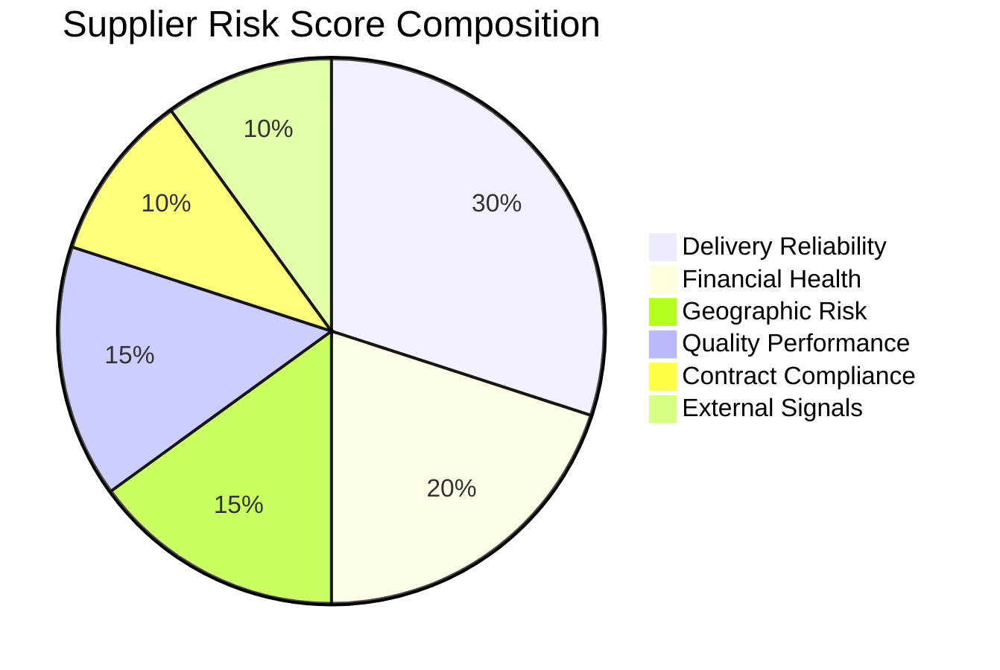

# Supply Chain Risk & Disruption Radar

Real-time supplier risk scoring and early warning system for supply chain disruptions.

**Priority:** P1 — High Value  
**Time to Value:** 6-8 weeks  
**Category:** Risk Management

---

## Business Problem

Beverage supply chains depend on a complex network of raw material suppliers (sugar, flavoring, packaging), logistics providers, and co-manufacturers. Disruptions are costly and often detected too late:

- **Reactive posture** — disruptions discovered only when deliveries fail
- **Single-source risk** — critical materials dependent on one or two suppliers
- **No early warning** — geopolitical events, weather, and market shifts not monitored systematically
- **Contract blind spots** — compliance terms buried in unstructured documents, not actively tracked
- **Emergency procurement premiums** — last-minute sourcing at 15-25% cost premium

---

## Capabilities

### Real-Time Supplier Risk Scoring
Composite risk score per supplier combining financial health indicators, delivery reliability history, geographic risk, and market signals — updated continuously.

### Disruption Early Warning
Monitor external signals (news, weather, port congestion, commodity prices, social media) for events that could impact supply. Generate alerts before disruptions reach the operation.

### Alternative Supplier Recommendation
When a supplier's risk score breaches threshold, automatically surface pre-qualified alternatives from the vendor master with lead time, cost, and capacity comparison.

### Contract Compliance Monitoring
AI extraction of key terms (pricing, SLAs, penalty clauses, volume commitments) from unstructured contracts in Google Drive. Continuous compliance tracking against actual performance.

### Scenario Simulation
Model "what-if" disruption scenarios: _"If our primary sugar supplier is offline for 3 weeks, what is the production impact and what are our alternatives?"_

---

## Data Sources & Ontology Mapping

| Ontology Entity | Source System | Key Fields |
|----------------|--------------|------------|
| Supplier / Vendor | SAP Vendor Master + Oracle Vendor Master | Vendor ID, Name, Location, Category, Lead Time, Rating |
| Purchase Orders | Oracle ERP Procurement | PO Number, Vendor, Material, Qty, Price, Delivery Date, Status |
| Material / Raw Material | SAP Material Master | Material ID, Type, Source List, Min Order Qty, Criticality |
| Contracts | Google Drive (PDF/DOCX) | Vendor, Effective Date, Pricing Terms, SLA, Penalty Clauses |
| Market Signals | Social Listening + News APIs | Source, Event Type, Location, Severity, Timestamp |

---

## AI Workflow

1. **Supplier Profile Assembly** — Merge SAP vendor master, Oracle procurement history, and extracted contract terms into a unified supplier profile
2. **Delivery Reliability Analysis** — Score each supplier on historical on-time delivery rate, quality rejection rate, and lead time variance
3. **External Signal Monitoring** — Continuous NLP scan of news feeds, social media, and commodity indices for supply-relevant events
4. **Contract Intelligence** — Extract and structure key terms from contract documents using LLM; track compliance against actuals
5. **Composite Risk Score** — Weighted model combining financial, operational, geographic, and external risk factors
6. **Alert & Recommendation** — Surface high-risk suppliers with alternative options; trigger scenario simulations for critical materials

---

## Dashboard & Alerts

### Key Metrics

| KPI | Description | Target |
|-----|-------------|--------|
| **Supplier Risk Score** | Composite score (0-100) per supplier | Monitor; act on > 70 |
| **On-Time Delivery Rate** | % of POs delivered within committed lead time | > 92% |
| **Single-Source Materials** | Count of materials with only one qualified supplier | 0 for critical materials |
| **Early Warning Lead Time** | Days between alert generation and actual disruption | > 14 days |
| **Contract Compliance Rate** | % of supplier contracts with no active violations | > 95% |
| **Emergency Procurement %** | % of purchase value sourced via emergency/spot buys | < 3% |

### Alert Rules

| Alert | Trigger | Severity | Action |
|-------|---------|----------|--------|
| Supplier risk critical | Risk score exceeds 80 for any active supplier | Critical | Activate alternative supplier; notify procurement head |
| Disruption detected | External signal matches supply chain geography/commodity | High | Assess impact scope; pre-position safety stock |
| Contract violation | Supplier delivery or quality breaches contracted SLA | High | Issue formal notice; trigger penalty clause review |
| Single-source exposure | Critical material has only one qualified source | Medium | Initiate supplier qualification for backup source |
| Commodity price spike | Key raw material price rises >15% in 30-day window | Medium | Review hedging positions; assess pass-through pricing |

---

## Risk Score Model

| Factor | Weight | Data Source | Indicators |
|--------|--------|-------------|------------|
| Delivery Reliability | 30% | Oracle ERP (PO history) | On-time rate, lead time variance, partial shipment frequency |
| Financial Health | 20% | External data + Oracle AP | Payment behavior signals, credit reports |
| Geographic Risk | 15% | Social Listening + External | Country risk index, natural disaster exposure, trade policy |
| Quality Performance | 15% | SAP Quality Management | Rejection rate, complaint frequency, audit scores |
| Contract Compliance | 10% | Google Drive (contracts) | SLA adherence, pricing compliance, volume commitment |
| External Signals | 10% | Social Listening | News sentiment, commodity trends, regulatory changes |

---

## ROI Model

| Metric | Before | After | Impact |
|--------|--------|-------|--------|
| Supply disruption incidents / year | 8-12 events | 3-5 events | **55% fewer disruptions** |
| Emergency procurement premium | $420K / year | $160K / year | **$260K savings** |
| Production downtime (supply-related) | 18 days / year | 6 days / year | **67% reduction** |
| Supplier quality rejections | 3.2% of receipts | 1.8% of receipts | **44% quality improvement** |
| Contract leakage | $180K / year | $45K / year | **$135K recovered** |

!!! success "Estimated Annual ROI"
    **$800K - $1.5M** annually from disruption avoidance, eliminated premiums, reduced downtime, and contract compliance — across a mid-size beverage distributor with $150M revenue.

---

## Implementation Notes

- External signal monitoring requires news/RSS feed integration and commodity price API access
- Contract NLP works best with standardized supplier agreement templates; expect 85%+ extraction accuracy on structured contracts, lower on ad-hoc documents
- Supplier financial health scoring may require third-party data enrichment (Dun & Bradstreet, CreditSafe)
- Initial risk model calibration requires procurement team input on factor weights and thresholds

---

[← Back to Catalogue](index.md) | [Previous: Order-to-Cash](order-to-cash.md) | [Next: Customer 360 →](customer-360.md)
