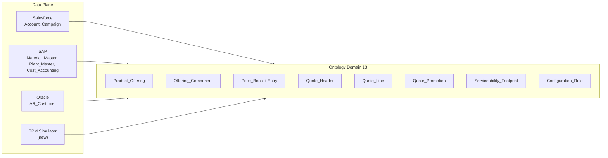

# Trade CPQ

AI-first sell-side Configure-Price-Quote for beverage operators selling to trade customers (Modern Trade, General Trade, HORECA, E-commerce). Trade CPQ extends the existing supply-chain ontology with channel-aware offerings, channel/tier price books, declarative configuration rules, and a quote lifecycle that converts cleanly into the existing Order-to-Cash flow.

**Priority:** P1 — High Value
**Time to Value:** 6–8 weeks
**Category:** Commercial / Trade
**Solution ID:** `trade-cpq`

For the platform framing see [CPQ Overview](../../cpq/def.md) and [CPQ Scope & UAT](../../cpq/scope.md).

---

## Business Problem

Selling beverages to trade customers spans Salesforce, SAP, Oracle, and a Trade Promotion Management overlay. The fragmentation creates:

- **Long quote cycles** — discount approvals bounce between RSM, Commercial Director, and CFO via email.
- **Revenue leakage** — discounts dip below floor or stack beyond policy without detection.
- **Configuration errors** — wrong pack-size for HORECA, missing slotting fee, ineligible channel.
- **Manual proposals** — text-document proposals copy-pasted from templates.
- **Blind hand-off** — Won quotes lose pricing context when they materialize as Opportunities.

---

## Capabilities

### AI-Guided Configuration

Drag offerings from a live `Product_Offering` canvas; the agent (via the `configure_bundle` tool) proposes bundles aligned to the account's channel and tier and validates each line against `Configuration_Rule` in real time.

### Pricing Waterfall

The `price_quote` tool builds a step-by-step waterfall from list price → channel/tier discount → applied discount → promo overlay → fees → unit net → margin. Floor breaches and margin floor breaches are flagged inline.

### Policy-Driven Approval Routing

`route_approval` derives the approval chain from `cpq-quote-approval-policy.md`: auto-approve within tier max, RSM for ≤+5 pp over, Commercial Director for >+5 pp or slotting > $50K, CFO for margin floor breach, VP Sales for trade spend > 8 %.

### LLM-Generated Proposal Documents

`generate_proposal_doc` returns a Markdown proposal grounded in the live quote and account context — ready to drop into PDF.

### Frictionless Order Conversion

`convert_quote_to_order` materializes the Salesforce Opportunity + Opportunity_Line_Items and SAP Delivery, chaining into the existing [Order-to-Cash Monitor](order-to-cash.md).

### AI Upsell / Cross-Sell

`suggest_upsell_crosssell` mines historic `Opportunity_Line_Item` purchases against the offering catalog and recommends additions; `forecast_quote_win_probability` scores each quote 0–1.

---

## Data Sources & Ontology

| Entity | Source | Role |
|--------|--------|------|
| `Product_Offering` | TPM | Sellable bundle/listing |
| `Offering_Component` | TPM | Material rollup per offering |
| `Price_Book` / `Price_Book_Entry` | TPM | Channel × tier grid + cost snapshot |
| `Quote_Header` / `Quote_Line` / `Quote_Promotion` | TPM | Quote lifecycle |
| `Serviceability_Footprint` | TPM | Plant coverage per region × channel |
| `Configuration_Rule` | TPM | Validity rule library |
| `Account` | Salesforce | Customer context |
| `Campaign` | Salesforce | Promotion overlay |
| `Material_Master` | SAP | SKU master |
| `Plant_Master` | SAP | Serving plant |
| `Cost_Accounting` | Oracle | Margin source |
| `AR_Customer` | Oracle | Credit hold |

---

## AI Workflows

1. [Quote Configure & Validate](ontology/workflows.md) — on every quote line edit, run Configuration_Rule, serviceability, inventory feasibility.
2. [Quote Price Calculate](ontology/workflows.md) — produce the pricing waterfall on demand.
3. [Quote Approval Routing](ontology/workflows.md) — derive and route the approval chain.
4. [Quote To Order](ontology/workflows.md) — materialize Won_Converted quotes into Opportunity + Delivery and trigger O2C.

## Policies

- [CPQ Configuration Policy](../../../../nexus-backend/enterprise-knowledge/policies/cpq-configuration-policy.md) (POL-CPQ-CFG-001)
- [CPQ Quote Approval Policy](../../../../nexus-backend/enterprise-knowledge/policies/cpq-quote-approval-policy.md) (POL-CPQ-APR-001)
- [Pricing & Discount Policy](../../../../nexus-backend/enterprise-knowledge/policies/pricing-discount-policy.md) (POL-PRICE-001)

## Integrations

- [CPQ ↔ Salesforce Sync](../../../../nexus-backend/enterprise-knowledge/integrations/cpq-salesforce-sync.yaml)

---

## KPIs

| KPI | Target | Source |
|-----|--------|--------|
| Quote cycle time | < 1 business day | Quote_Header.Created_At → Approval_Completed_At |
| Auto-approval rate | > 70 % | Approval_Chain_JSON |
| Discount leakage | < 1 % | Quote_Line.Discount_Pct vs Price_Book_Entry.Floor_Price |
| Margin floor breach | < 5 % | Quote_Line.Margin_Pct_Line vs 15 % floor |
| Win rate uplift | +5–8 pp | Won_Converted / Submitted |
| Proposal generation latency | < 60 s p95 | generate_proposal_doc trace |

---

## ReAct Tool Reference

| Tool | Risk | Purpose |
|------|------|---------|
| `configure_bundle` | read | Assemble candidate offerings for an account |
| `validate_configuration` | read | Run Configuration_Rule set |
| `check_serviceability` | read | Match Serviceability_Footprint to ship-to |
| `price_quote` | read | Build pricing waterfall |
| `apply_promotion` | low-risk write | Overlay a Campaign on the quote |
| `check_credit_and_margin` | read | Inspect credit limit and margin floor |
| `route_approval` | high-risk write | Compute and persist approval chain |
| `generate_proposal_doc` | read | Compose Markdown proposal |
| `convert_quote_to_order` | high-risk write | Move Approved → Won_Converted and chain to O2C |
| `suggest_upsell_crosssell` | read | Historic-purchase-driven add-on suggestions |
| `forecast_quote_win_probability` | read | Score quote close probability |

---

## Console Walkthrough

The Trade CPQ app reuses the AppShell with seven sections:

- **Quote Pipeline** — KPIs, stage pie, offering mix, configuration canvas, pricing waterfall, approval timeline.
- **Pricing & Margin** — detailed price book and margin analytics.
- **CPQ Workflows** — Configure-Validate, Price-Calculate, Approval-Route, Quote-To-Order journeys.
- **Proposals & Alerts** — generated proposal documents and quote alerts.
- **Tools Catalogue** — eleven ReAct tools surfaced for direct invocation.
- **Chat** — copilot seeded with the active quote context.

---

[← Back to Supply Chain Catalogue](index.md)
