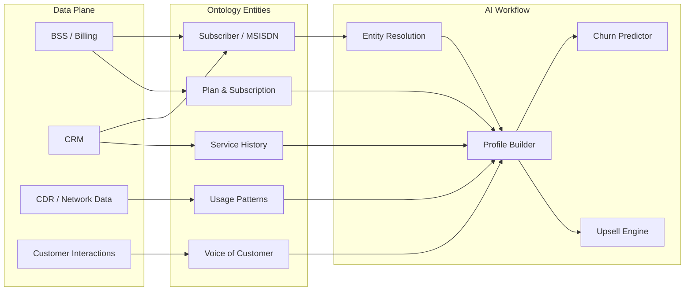

# Customer 360 & Churn Prediction

Unified subscriber profiles with churn prediction, retention campaign targeting, and ARPU growth intelligence.

**Priority:** P0 — Immediate ROI  
**Time to Value:** 4-6 weeks  
**Category:** Customer Management & Retention

---

## Business Problem

Telcos maintain subscriber data across disconnected systems — BSS holds billing and subscriptions, CRM tracks interactions and complaints, CDR captures actual usage behavior, and network systems record quality of experience. This fragmentation creates:

- **No unified view** — a care agent cannot see a subscriber's plan details, usage patterns, recent complaints, and network quality issues in one place
- **Late churn detection** — subscribers port out or let contracts lapse without early warning; by the time ARPU declines, the customer has already decided to leave
- **Blanket retention** — retention offers are applied uniformly rather than targeted to high-value at-risk subscribers, wasting budget on low-risk or low-value customers
- **ARPU blindness** — opportunities to upsell (data add-ons, family plans, device bundles) are missed because usage patterns and propensity signals are not analyzed
- **Disconnected household** — family members on separate accounts are not linked, preventing household-level offers and shared plan optimization

---

## Capabilities

### Unified Subscriber Profile
Single golden record per subscriber combining BSS (plan, billing, tenure), CRM (interactions, complaints, NPS), CDR (voice/data/SMS usage patterns, roaming), and network quality (signal strength, throughput at subscriber's locations).

### Churn Prediction & Risk Scoring
ML model predicting voluntary churn probability for each subscriber within the next 30/60/90 days based on usage trajectory, complaint history, contract status, competitive offers, and network experience quality.

### Retention Campaign Targeting
AI-driven segmentation of at-risk subscribers by churn driver (price sensitivity, network issues, competitor pull, life event) with matched retention offer recommendations (discount, data upgrade, device trade-in, network fix).

### ARPU Growth & Upsell Engine
Identify subscribers with high propensity for plan upgrades, add-ons (data boosters, international packs, streaming bundles), or device financing based on usage patterns, peer cohort behavior, and life-stage signals.

### Household & Account Linking
Discover and map household relationships from shared billing addresses, family plan structures, payment methods, and call/SMS patterns to enable household-level offers and family bundles.

---

## Data Sources & Ontology Mapping

| Ontology Entity | Source System | Key Fields |
|----------------|--------------|------------|
| Subscriber / MSISDN | BSS Customer Master + CRM Account | MSISDN, IMSI, Account ID, Name, Segment, Tenure, Contract End Date |
| Plan & Subscription | BSS Product Catalog | Plan Name, Monthly Fee, Data Allowance, Voice Mins, Add-ons, Status |
| Usage Patterns | CDR / Network Data Lake | Voice Minutes, Data Volume, SMS Count, Roaming Events, Peak Hours, Top Apps |
| Service History | CRM Cases + BSS Tickets | Ticket ID, Category, Resolution Time, Escalation, Repeat Contact Flag |
| Voice of Customer | Customer Interactions (Calls/Chat/Social) | Sentiment Score, Topics, NPS Response, Complaint Themes, Channel |

---

## AI Workflow

1. **Entity Resolution** — Match subscriber identity across BSS (account/MSISDN), CRM (contact/case), and CDR (IMSI/MSISDN) into a single golden record
2. **Household Discovery** — Graph analysis of shared billing addresses, common payment methods, and high-frequency call/SMS pairs to build household structures
3. **Profile Assembly** — Aggregate plan details, 90-day usage trends, complaint history, NPS scores, network quality metrics at subscriber locations, and contract status
4. **Churn Feature Engineering** — Compute features: usage velocity (declining data/voice), complaint frequency trend, days to contract end, competitor port-in activity in area, network quality score at home cell
5. **Churn Scoring** — Gradient-boosted model trained on historical churn events; output 30/60/90-day churn probability per subscriber; segment by churn driver (price, network, competitor, life-event)
6. **Retention Matching** — Map churn drivers to optimal retention offers: price-sensitive → discount/loyalty reward; network-frustrated → priority escalation + coverage fix commitment; competitor-pulled → matched/beat offer
7. **Upsell Scoring** — Propensity model for plan upgrades and add-ons based on usage headroom, peer cohort adoption, and life-stage triggers (e.g., frequent international calls → roaming pack)
8. **Output** — Subscriber 360 dashboard for care agents; churn watchlist pushed to retention team in CRM; upsell recommendations surfaced in digital and agent channels

---

## Dashboard & Alerts

### Key Metrics

| KPI | Description | Target |
|-----|-------------|--------|
| **Monthly Churn Rate** | % of subscribers churning per month | < 1.2% (down from 1.8%) |
| **Churn Prediction Accuracy** | % of actual churners flagged by model 30+ days prior | > 75% |
| **Retention Save Rate** | % of at-risk subscribers retained after intervention | > 35% |
| **ARPU** | Average Revenue Per User per month | 5-8% year-over-year growth |
| **Upsell Conversion Rate** | % of upsell recommendations accepted | > 12% |
| **Household Coverage** | % of subscribers linked to a household group | > 70% |

### Alert Rules

| Alert | Trigger | Severity | Action |
|-------|---------|----------|--------|
| High-value churn risk | Subscriber with ARPU > $60 has churn probability > 0.7 | Critical | Assign to senior retention agent; trigger personalized offer within 24 hours |
| Contract expiry window | High-value subscriber within 30 days of contract end with no renewal activity | High | Push renewal offer via preferred channel; notify assigned agent |
| Usage collapse | Subscriber data usage drops > 50% in 14-day window | High | Flag for churn risk review; check for network quality issues at subscriber locations |
| Port-out cluster | 5+ port-out requests from same cell site area in 7 days | Medium | Investigate network quality; assess competitive activity in area |
| Upsell trigger | Subscriber consistently exceeds data allowance by >30% for 3 consecutive months | Info | Surface data upgrade recommendation in next interaction |

---

## ROI Model

| Metric | Before | After | Impact |
|--------|--------|-------|--------|
| Monthly churn rate | 1.8% | 1.2% | **33% reduction → 36K subscribers retained / year** (on 5M base) |
| Revenue retained from churn reduction | — | — | **$18M / year** (at $42 ARPU × 36K subscribers × 12 months) |
| Retention campaign efficiency | 8% save rate (blanket offers) | 35% save rate (targeted) | **4.4x improvement** |
| Upsell attach rate | 4% | 12% | **3x improvement → $4.2M incremental ARPU** |
| Care agent handle time (360 view) | 8 min average | 4.5 min average | **44% reduction → $2.1M labor savings** |

!!! success "Estimated Annual ROI"
    **$20M - $35M** annually from reduced churn, increased ARPU, campaign efficiency, and care productivity — across a mid-size telco with 5M subscribers and $42 average ARPU.

---

## Implementation Notes

- BSS subscriber extract must include MSISDN-level plan details, billing status, and contract dates; aggregated account-level data is insufficient
- CDR processing requires a mediation layer or data lake that provides aggregated usage metrics (daily/weekly voice, data, SMS) per MSISDN
- Churn model needs minimum 18 months of subscriber lifecycle data including labeled churn events (voluntary port-out, non-renewal, deactivation)
- Network quality per subscriber requires correlating CDR cell IDs with OSS performance counters at those cells
- Household discovery accuracy improves significantly when address normalization is applied to BSS service addresses

---

[← Back to Catalogue](index.md) | [Next: Network Performance →](network-performance.md)
