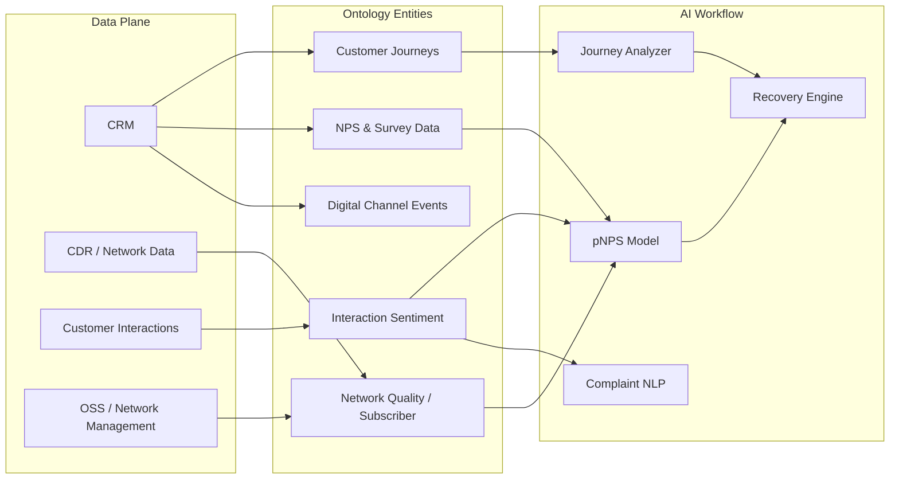

# Customer Experience Management

NPS prediction, journey analytics, proactive service recovery, and sentiment-driven experience optimization.

**Priority:** P1 — High Value  
**Time to Value:** 6-8 weeks  
**Category:** Customer Experience

---

## Business Problem

Telco customer experience is shaped by a combination of network quality, billing accuracy, service interactions, and digital channel usability. Most operators measure experience reactively through post-event surveys with low response rates:

- **NPS sampling bias** — survey response rates of 5-10% skew toward extremes (very happy or very angry), missing the silent majority
- **No journey view** — a customer's experience spans network usage, billing, store visits, app interactions, and care calls — but these are never stitched into a single journey
- **Reactive service recovery** — customers experience failures (dropped calls, billing errors, slow data) and must initiate contact to get resolution; the operator never proactively reaches out
- **Complaint root cause opacity** — complaint categories (billing, network, service) are assigned manually with inconsistent granularity, making systemic root cause analysis unreliable
- **Digital channel gaps** — friction points in self-service apps and web portals (failed payments, confusing plan changes, broken troubleshooting flows) are invisible without journey instrumentation

---

## Capabilities

### Predicted NPS (pNPS)
ML model predicting every subscriber's NPS score continuously — not just the 5-10% who respond to surveys — based on their actual experience signals (network quality, billing accuracy, interaction sentiment, digital behavior).

### Customer Journey Analytics
Reconstruct and analyze multi-channel journeys: customer signs up (store) → activates SIM (digital) → experiences slow data (network) → calls support (care) → files complaint (CRM) → receives credit (billing). Identify journey patterns that lead to churn or delight.

### Proactive Service Recovery
Detect experience failures in real time (network degradation at subscriber location, billing errors, failed digital transactions) and trigger automated recovery actions before the customer contacts support.

### Complaint Intelligence
AI-powered analysis of complaint themes from call center transcripts, chat logs, emails, and social media. Automated categorization, trend detection, and systemic root cause identification.

### Digital Experience Optimization
Monitor self-service channel funnel analytics: where do customers drop off in plan changes, bill payments, troubleshooting flows? Identify friction points and recommend UX improvements.

---

## Data Sources & Ontology Mapping

| Ontology Entity | Source System | Key Fields |
|----------------|--------------|------------|
| Customer Journeys | CRM + BSS + Digital Logs | Subscriber, Touchpoint, Channel, Timestamp, Action, Outcome |
| NPS & Survey Data | CRM / Survey Platform | Subscriber, NPS Score, Verbatim Comment, Survey Date, Channel |
| Interaction Sentiment | Customer Interactions (Calls/Chat/Social) | Transcript, Sentiment Score, Topics, Resolution, Effort Score |
| Network Quality / Subscriber | CDR + OSS | MSISDN, Cell ID, Throughput, Latency, Drop Events, Signal Strength |
| Digital Channel Events | App/Web Analytics | Session ID, Page/Screen, Action, Success/Failure, Duration, Drop-off |

---

## AI Workflow

1. **Journey Reconstruction** — Stitch touchpoints from CRM (interactions, cases), BSS (billing events, plan changes), digital logs (app/web sessions), and CDR (usage events) into per-subscriber journey timelines
2. **Experience Feature Engineering** — Compute per-subscriber experience signals: network quality score (weighted throughput, latency, drops at subscriber locations), billing accuracy (error frequency, credit frequency), interaction effort (repeat calls, escalations, handle time)
3. **pNPS Modeling** — Train regression model on labeled NPS survey responses; predict NPS for all subscribers using experience features; identify top drivers of detraction and promotion
4. **Journey Pattern Mining** — Sequence mining across customer journeys to identify: (a) journey patterns that precede churn, (b) friction patterns that drive repeat contacts, (c) delight patterns that drive upsell acceptance
5. **Proactive Recovery Triggers** — Define event-driven triggers: subscriber experiences 3+ dropped calls in 24 hours → auto-send apology + data credit; billing error detected → auto-correct + notify customer before they call
6. **Complaint Theme Extraction** — NLP on call transcripts, chat logs, and social posts to extract complaint themes, categorize by root cause (network, billing, product, service), and detect emerging trends
7. **Output** — CEM dashboard for VP Customer Experience; pNPS heatmaps by segment/region; proactive recovery automation; complaint trend reports for operations

---

## Dashboard & Alerts

### Key Metrics

| KPI | Description | Target |
|-----|-------------|--------|
| **NPS** | Net Promoter Score (survey-based) | > 35 (industry top quartile) |
| **pNPS Coverage** | % of subscribers with predicted NPS score | > 95% |
| **First Contact Resolution (FCR)** | % of issues resolved in first interaction | > 78% |
| **Customer Effort Score (CES)** | Average effort required to resolve an issue (1-7 scale) | < 2.5 |
| **Proactive Recovery Rate** | % of experience failures resolved before customer contact | > 30% |
| **Repeat Contact Rate** | % of customers contacting support 2+ times for same issue in 14 days | < 12% |

### Alert Rules

| Alert | Trigger | Severity | Action |
|-------|---------|----------|--------|
| NPS crash — segment | Predicted NPS for any segment drops >10 points in 30 days | Critical | Investigate root cause; escalate to CXO; initiate segment-specific recovery |
| Complaint spike | Complaint volume on any theme increases >50% week-over-week | High | Identify systemic root cause; notify responsible team; issue customer communication |
| Service recovery trigger | Subscriber experiences qualifying failure event (drops, billing error, failed digital txn) | High | Execute automated recovery action (credit, apology, fix) |
| Digital funnel breakdown | Self-service flow completion rate drops below 60% | Medium | Notify digital product team; investigate UX issue |
| Detractor cluster | Geographic area shows >30% detractors (pNPS < -50) | Medium | Correlate with network quality; investigate local issues |

---

## ROI Model

| Metric | Before | After | Impact |
|--------|--------|-------|--------|
| NPS | +18 | +32 | **14-point improvement** |
| Repeat contact rate | 22% | 12% | **45% reduction → $3.6M care cost savings** |
| Proactive recovery | 0% (fully reactive) | 30% of failures auto-recovered | **30% fewer inbound complaints** |
| Call center volume | 1.2M calls/month | 900K calls/month | **25% reduction → $7.2M annual savings** |
| Churn from experience issues | 0.4% monthly (experience-driven churn) | 0.25% monthly | **37% reduction → $6M retained revenue** |

!!! success "Estimated Annual ROI"
    **$12M - $20M** annually from reduced care costs, proactive recovery, experience-driven churn reduction, and NPS improvement — across a mid-size telco with 5M subscribers.

---

## Implementation Notes

- pNPS model requires a minimum of 10K labeled NPS survey responses linked to subscriber IDs with at least 6 months of experience data
- Journey reconstruction depends on consistent subscriber identification across all touchpoints (MSISDN or CIF as common key)
- Proactive recovery automation requires integration with BSS for credit issuance and CRM for communication triggers — define business rules with commercial team
- Complaint NLP needs transcription of call center recordings; if not already transcribed, speech-to-text pipeline must be deployed first
- Digital channel instrumentation (app/web event tracking) may require development effort if not already in place

---

[← Back to Catalogue](index.md) | [Previous: Revenue Assurance](revenue-assurance.md) | [Next: Network Capacity →](network-capacity.md)
