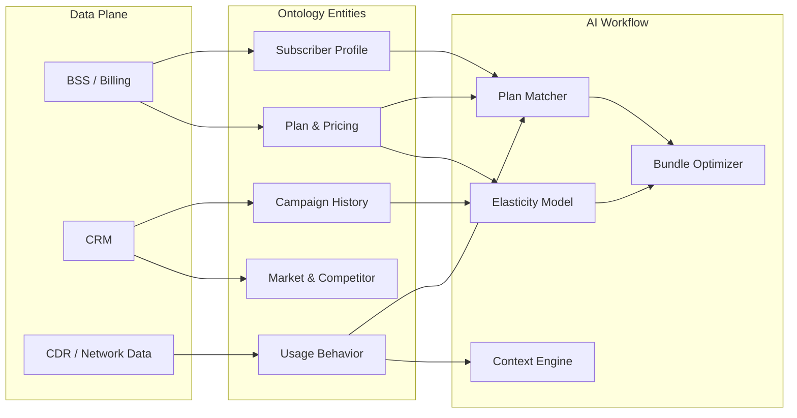

# Dynamic Pricing & Offer Management

Personalized plan recommendations, contextual offers, and price elasticity optimization for telecom commercial teams.

**Priority:** P2 — Strategic Value  
**Time to Value:** 8-10 weeks  
**Category:** Commercial & Revenue Growth

---

## Business Problem

Telco pricing has shifted from simple voice/SMS plans to complex bundles combining data, streaming, devices, and value-added services. Traditional pricing approaches cannot keep pace:

- **One-size-fits-all plans** — a limited portfolio of 5-10 plans serves millions of subscribers with vastly different usage patterns, leaving value on the table for both the operator and the customer
- **Slow plan changes** — new plans take weeks to design, configure in BSS, and launch; competitors respond faster
- **No personalization** — two subscribers paying the same price may have completely different usage profiles; neither is optimally served
- **Price sensitivity blindness** — pricing decisions are based on competitor benchmarking and gut feel, not on measured elasticity per segment
- **Offer fatigue** — subscribers are bombarded with generic promotional offers, leading to declining response rates and brand dilution
- **Bundling without data** — device + plan + VAS bundles are designed based on commercial negotiations rather than subscriber preference data

---

## Capabilities

### Personalized Plan Recommendation
AI model matching each subscriber's actual usage pattern (data heavy, voice heavy, roamer, streamer) to the optimal plan from the current portfolio — surfacing savings or better-fit options in self-service channels.

### Contextual Offer Engine
Real-time, trigger-based offers delivered at the right moment: subscriber runs out of data → instant data booster offer; subscriber travels internationally → roaming pack push; subscriber's contract expires → personalized renewal offer.

### Price Elasticity Modeling
Measure price-response curves per segment: how does plan uptake change at different price points? Identify revenue-maximizing price levels for each plan × segment combination.

### Dynamic Bundle Design
Data-driven identification of optimal product combinations (plan + device + streaming + insurance) that maximize subscriber lifetime value and reduce churn through multi-product stickiness.

### Competitive Pricing Intelligence
Monitor competitor plan offerings, pricing changes, and promotional activity. Alert commercial teams when competitive gaps emerge and model the impact of pricing responses.

---

## Data Sources & Ontology Mapping

| Ontology Entity | Source System | Key Fields |
|----------------|--------------|------------|
| Subscriber Profile | BSS + CRM | MSISDN, Segment, Tenure, Contract End, Device, ARPU, Payment History |
| Plan & Pricing | BSS Product Catalog | Plan ID, Name, Price, Data Cap, Voice Allowance, Validity, Add-ons |
| Usage Behavior | CDR / Network Data Lake | Daily Data (GB), Voice (min), SMS, Top Apps, Peak/Off-Peak Split, Roaming |
| Campaign History | CRM Campaign Management | Campaign, Offer, Channel, Response, Conversion, Date, Segment |
| Market & Competitor | External Sources + CRM | Competitor Plans, Pricing, Promotions, Market Share Estimates |

---

## AI Workflow

1. **Usage Profiling** — Cluster subscribers into behavioral archetypes based on CDR patterns: data-heavy streamer, voice-centric, balanced user, international caller, weekend warrior, always-on IoT
2. **Plan Fit Analysis** — For each subscriber, calculate: current plan utilization (% of allowance used per dimension), monthly overage charges, potential savings on alternative plans, and revenue impact to operator
3. **Contextual Trigger Detection** — Monitor real-time events: data allowance approaching exhaustion, international roaming detected, contract within 30 days of expiry, birthday/anniversary, service complaint just resolved
4. **Offer Selection** — When a trigger fires, select the highest-propensity offer from the eligible catalog based on the subscriber's archetype, price sensitivity, channel preference, and recency of last offer
5. **Elasticity Estimation** — A/B test-driven measurement of price response per segment; build elasticity curves that predict volume impact of price changes within ±15% of current levels
6. **Bundle Optimization** — Association rule mining on subscriber product holding patterns + CLV modeling to identify bundles that maximize 24-month subscriber value; test via limited market trials
7. **Competitive Response** — Monitor competitor plan changes (price, allowance, promo); model subscriber migration risk; recommend defensive or offensive pricing actions
8. **Output** — Personalized offer recommendations in app/web/SMS channels; pricing optimization dashboard for commercial team; bundle proposals for product management; competitive alerts for strategy

---

## Dashboard & Alerts

### Key Metrics

| KPI | Description | Target |
|-----|-------------|--------|
| **ARPU** | Average Revenue Per User per month | 5-10% year-over-year growth |
| **Offer Conversion Rate** | % of contextual offers accepted by subscriber | > 18% |
| **Plan Right-Sizing Rate** | % of subscribers on optimally matched plan | > 65% |
| **Bundle Penetration** | % of subscribers with 2+ products (plan + device/VAS) | > 40% |
| **Promotion ROI** | Incremental revenue / Promotion cost | > 5x |
| **Time to Launch (New Plan)** | Days from plan design to market availability | < 5 days |

### Alert Rules

| Alert | Trigger | Severity | Action |
|-------|---------|----------|--------|
| Competitive threat | Competitor launches plan with >15% better value-for-money in key segment | High | Model subscriber migration risk; fast-track pricing response |
| Offer fatigue detected | Segment-level offer acceptance rate drops below 5% for 4 consecutive weeks | Medium | Pause campaigns for segment; refresh offer creative and targeting criteria |
| Data allowance trigger | Subscriber reaches 90% of data allowance with >3 days remaining in cycle | Medium | Push contextual data booster offer via app notification |
| Contract expiry wave | >10K subscribers in a segment entering 30-day contract expiry window | Medium | Launch targeted renewal campaign; personalize offers by churn risk |
| Price elasticity shift | Measured elasticity for any plan changes >20% from previous quarter | Info | Recalibrate pricing model; assess if market dynamics have shifted |

---

## ROI Model

| Metric | Before | After | Impact |
|--------|--------|-------|--------|
| ARPU | $42 | $46 | **$4 increase → $240M incremental revenue** (5M subscribers) |
| Contextual offer conversion | 5% (batch campaigns) | 18% (real-time contextual) | **3.6x improvement** |
| Overage revenue recovered as plan upgrades | $2M (overage charges with churn risk) | $8M (upgrade revenue with retention) | **$6M net improvement** |
| Bundle penetration | 22% | 38% | **73% increase → reduced churn + higher LTV** |
| Plan launch cycle | 4-6 weeks | 3-5 days | **90% faster time-to-market** |

!!! success "Estimated Annual ROI"
    **$10M - $25M** annually from ARPU growth, improved offer conversion, bundle penetration, and faster commercial response — across a mid-size telco with 5M subscribers.

---

## Implementation Notes

- Personalized plan recommendations require individual-level CDR usage data mapped to current plan parameters from BSS
- Contextual offer engine needs near-real-time data triggers (allowance thresholds, roaming events); integration with BSS policy/charging system and CRM campaign platform
- Price elasticity measurement requires controlled A/B testing infrastructure; ensure statistical rigor (sample size, holdout groups, measurement windows)
- Competitive pricing monitoring requires either automated web scraping of competitor websites or subscription to a competitive intelligence service
- Dynamic plan configuration requires BSS product catalog flexibility; legacy BSS platforms may constrain the speed of plan changes

---

[← Back to Catalogue](index.md) | [Previous: Network Capacity](network-capacity.md) | [Next: Field Operations →](field-operations.md)
