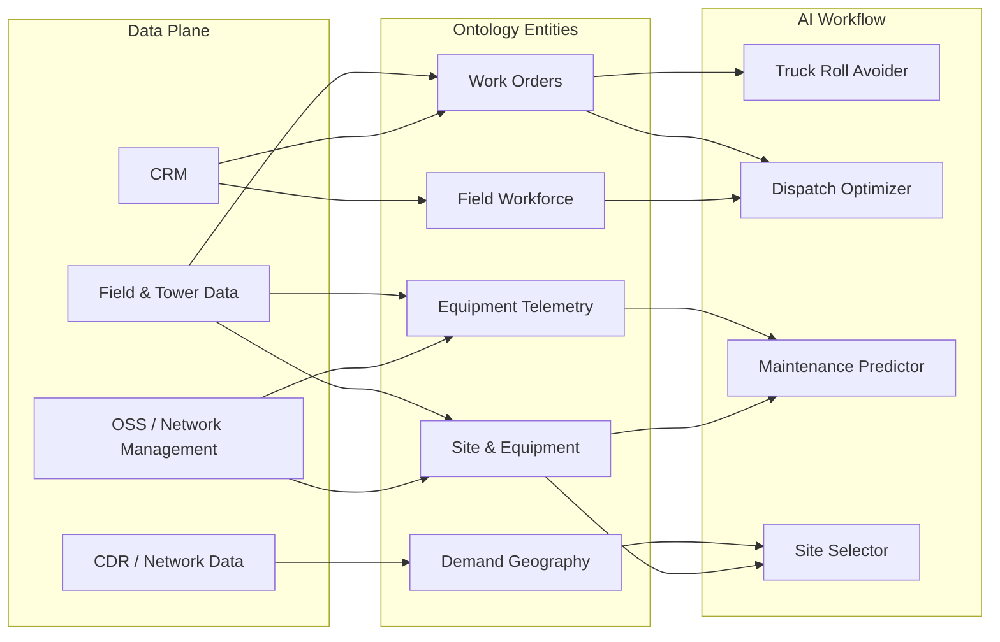

# Field Operations Intelligence

Workforce optimization, predictive maintenance, truck roll reduction, and intelligent site selection for telecom field teams.

**Priority:** P3 — Operational Excellence  
**Time to Value:** 10-12 weeks  
**Category:** Field Operations & Maintenance

---

## Business Problem

Telecom field operations manage thousands of cell sites, fiber routes, and customer premises. Field workforce deployment is the single largest OPEX category after network costs:

- **Unnecessary truck rolls** — 20-30% of dispatched field visits could have been resolved remotely through better diagnostics or customer self-service, costing $100-200 per wasted roll
- **Low first-fix rate** — technicians arrive without the right parts, skills, or information, requiring repeat visits that frustrate customers and multiply costs
- **Reactive maintenance** — tower equipment (power systems, cooling, antennas) is maintained on fixed schedules or after failure rather than based on actual condition
- **Poor site selection** — new cell site locations are chosen based on coverage modeling without integrating real demand data, land cost, power availability, and competitive intelligence
- **Scheduling inefficiency** — work orders are dispatched based on simple queue logic rather than optimized routing, skill matching, and priority weighting
- **Field data silos** — maintenance logs, site visit reports, and equipment condition data are captured in disconnected systems (paper, emails, CMMS) with no unified analysis

---

## Capabilities

### Truck Roll Avoidance
AI-driven remote diagnostics to determine whether a network fault or customer issue can be resolved without a field visit — through remote commands, configuration changes, customer-guided troubleshooting, or automated recovery.

### Intelligent Dispatch & Routing
Optimize field workforce scheduling: match work orders to technicians by skill, proximity, parts availability, and priority. Route optimization across daily job sequences to minimize travel time and maximize jobs completed per day.

### Predictive Site Maintenance
ML models on equipment telemetry (battery voltage trends, generator fuel consumption, cooling system temperatures, antenna tilt drift) to predict failures before they cause outages. Schedule maintenance during planned windows.

### First-Fix Rate Optimization
Ensure technicians have complete pre-visit information: fault history, equipment inventory, recent configuration changes, required parts, and site access instructions — reducing repeat visits.

### Intelligent Site Selection
Data-driven new site identification combining demand heatmaps (CDR-based), coverage gap analysis (OSS), population/traffic density (external data), land availability, power access, and competitive presence.

---

## Data Sources & Ontology Mapping

| Ontology Entity | Source System | Key Fields |
|----------------|--------------|------------|
| Site & Equipment | Field Data + OSS | Site ID, Location, Tower Type, Equipment List, Lease Status, Power Type |
| Work Orders | CRM + Field Systems (CMMS) | WO ID, Type (install/repair/maintenance), Priority, Status, Assigned Tech, SLA |
| Field Workforce | CRM / HR System | Tech ID, Skills, Certifications, Home Location, Vehicle, Availability |
| Equipment Telemetry | Field Sensors + OSS | Battery Voltage, Generator Runtime, Temperature, Humidity, Door Sensor, Tilt |
| Demand Geography | CDR + External Data | Cell Traffic Heatmap, Population Density, New Developments, Competitor Sites |

---

## AI Workflow

1. **Remote Diagnostics** — For each incoming fault ticket, run automated diagnostic checks: remote element ping, configuration verification, performance counter analysis, and subscriber device-side tests. Classify as remotely resolvable vs. requires dispatch.
2. **Dispatch Optimization** — For work orders requiring field visit: match to available technicians by (a) required skill/certification, (b) proximity to site, (c) parts in vehicle inventory, (d) priority/SLA. Optimize daily route across assigned jobs using vehicle routing algorithm.
3. **Pre-Visit Briefing** — Auto-generate technician briefing: fault history for the site, equipment inventory, recent configuration changes, spare parts recommendation based on fault type, site access codes and safety notes.
4. **Equipment Health Scoring** — Continuous monitoring of site equipment telemetry: battery discharge curves, generator fuel burn rate, cooling system delta-T, antenna mechanical tilt vs. configured tilt. Score equipment health 0-100 per site.
5. **Predictive Maintenance** — Flag equipment showing degradation patterns matching historical failure signatures (e.g., battery capacity declining at >5% per month → replacement needed within 60 days). Schedule preventive work order.
6. **Site Selection** — Overlay demand heatmap (from CDR traffic analysis), coverage model (from OSS), population/commercial density (external GIS), land availability, and competitive cell locations. Rank candidate sites by projected ROI.
7. **Output** — Field operations dashboard for regional managers; dispatch queue for coordinators; predictive maintenance calendar for site ops; site selection map for network planning

---

## Dashboard & Alerts

### Key Metrics

| KPI | Description | Target |
|-----|-------------|--------|
| **Truck Roll Avoidance Rate** | % of fault tickets resolved without field dispatch | > 30% |
| **First-Fix Rate** | % of dispatched visits that resolve the issue on first visit | > 85% |
| **Mean Time to Repair (Field)** | Average hours from dispatch to resolution | < 4 hours |
| **Jobs per Technician per Day** | Average completed work orders per tech per day | > 5.5 |
| **Predictive Maintenance Coverage** | % of critical site equipment under predictive monitoring | > 90% |
| **Unplanned Site Outages** | Equipment failures per month that were not predicted | < 10 |

### Alert Rules

| Alert | Trigger | Severity | Action |
|-------|---------|----------|--------|
| Battery failure imminent | Site battery health score drops below 30 with declining trajectory | High | Create preventive maintenance WO; ensure replacement battery in stock |
| Generator fuel low | Generator fuel level <20% with no refill scheduled in next 48 hours | High | Schedule fuel delivery; assess backup power sufficiency |
| First-fix miss cluster | Technician's first-fix rate drops below 70% for 2 consecutive weeks | Medium | Review skill gaps; assess pre-visit briefing quality; consider retraining |
| Dispatch SLA risk | Work order approaching SLA breach with no technician assigned | Medium | Escalate to dispatch coordinator; reassign from lower-priority work |
| New site opportunity | Demand heatmap shows coverage gap with >2,000 potential subscribers | Info | Add to site acquisition pipeline; generate business case |

---

## ROI Model

| Metric | Before | After | Impact |
|--------|--------|-------|--------|
| Truck rolls / month | 12,000 | 8,400 | **30% reduction → $7.2M annual savings** (at $200/roll) |
| First-fix rate | 72% | 87% | **21% improvement → $2.8M fewer repeat visits** |
| Unplanned site outages | 45 / month | 15 / month | **67% reduction → improved availability** |
| Technician utilization | 4.2 jobs/day | 5.8 jobs/day | **38% productivity improvement** |
| Site maintenance OPEX | $18M / year | $14M / year | **$4M from predictive vs. reactive maintenance** |

!!! success "Estimated Annual ROI"
    **$10M - $18M** annually from truck roll avoidance, first-fix improvement, predictive maintenance, and workforce productivity — across a mid-size telco with 8,000+ cell sites and 400+ field technicians.

---

## Implementation Notes

- Truck roll avoidance requires integration with OSS for remote diagnostics and BSS/CRM for automated customer communications
- Dispatch optimization needs real-time technician location (GPS from vehicle/mobile), skill/certification database, and vehicle parts inventory
- Predictive maintenance requires IoT sensor data from site equipment (battery, generator, HVAC); many legacy sites may need sensor retrofitting
- Site selection model benefits from external GIS data layers (population density, commercial activity, competitor sites); data procurement from mapping providers may be needed
- First-fix rate improvement depends on accurate spare parts forecasting and pre-positioning at regional hubs

---

[← Back to Catalogue](index.md) | [Previous: Dynamic Pricing](dynamic-pricing.md) | [Next: Regulatory Compliance →](regulatory-compliance.md)
