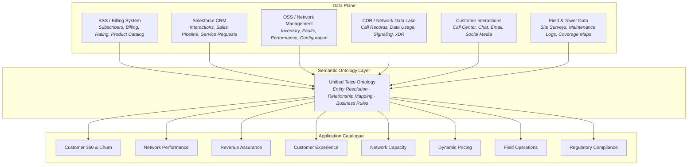
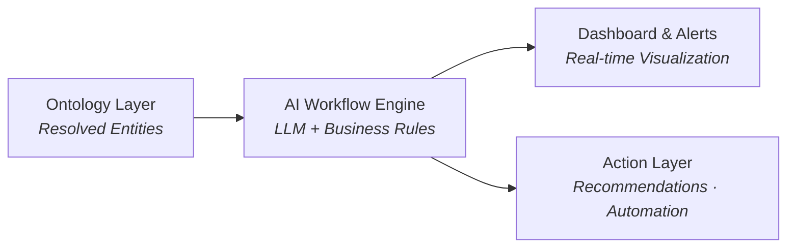

# Telecommunications Application Catalogue

Enterprise AI applications for telecommunications operations, powered by the Semantic Ontology Layer.

---

## Data Plane Overview

The application catalogue draws from a unified data plane spanning BSS / OSS systems, CRM, and network telemetry sources.

---

## Data Plane Components

### Structured Enterprise Systems

- **BSS / Billing** — Amdocs Revenue Manager, Ericsson BSCS, Netcracker, CSG. Subscriber master, billing cycles, rating, product catalog, order management, account hierarchy.
- **CRM** — Salesforce, Siebel, Microsoft Dynamics. Customer interactions, complaints, sales pipeline, retention campaigns, service requests.
- **OSS / Network Management** — Nokia NetAct, Ericsson ENM, Huawei iManager. Network inventory (cells, links, nodes), fault / alarm management, performance counters, configuration.

### Semi-Structured & Unstructured Sources

- **CDR / Network Data Lake** — Mediation platforms, probe data, DPI. Call Detail Records, data session records, signaling traces, xDR.
- **Customer Interactions** — Genesys, NICE, Sprinklr, social APIs. Call center recordings, chat transcripts, email threads, social media mentions.
- **Field & Tower Data** — GIS systems, CMMS, drive-test tools. Cell site surveys, tower maintenance logs, coverage maps, RF measurements.

---

## Application Portfolio

### P0 — Immediate ROI

- **[Customer 360 & Churn Prediction](customer-360.md)** — sources: BSS, CRM, CDR, Interactions. Reduce churn 15–25%, increase ARPU 8–12%. Time to value 4–6 weeks.
- **[Network Performance & Anomaly Detection](network-performance.md)** — sources: OSS, CDR, Field Data. Reduce outages 30–40%, cut MTTR 50%. Time to value 4–6 weeks.

### P1 — High Value

- **[Revenue Assurance & Fraud Management](revenue-assurance.md)** — sources: BSS, CDR, OSS. Recover 1–3% of revenue leakage, reduce fraud losses 40–60%. Time to value 6–8 weeks.
- **[Customer Experience Management](customer-experience.md)** — sources: CRM, CDR, Interactions, OSS. Improve NPS 10–15 points, reduce complaints 25–35%. Time to value 6–8 weeks.

### P2 — Strategic Value

- **[Network Capacity Planning & Optimization](network-capacity.md)** — sources: OSS, CDR, Field Data. Defer CAPEX 15–20%, improve spectral efficiency 10–15%. Time to value 8–10 weeks.
- **[Dynamic Pricing & Offer Management](dynamic-pricing.md)** — sources: BSS, CRM, CDR. Increase ARPU 5–10%, improve conversion 20–30%. Time to value 8–10 weeks.

### P3 — Operational Excellence

- **[Field Operations Intelligence](field-operations.md)** — sources: Field Data, OSS, CRM. Reduce truck rolls 20–30%, improve first-fix rate 15–25%. Time to value 10–12 weeks.
- **[Regulatory & Compliance Automation](regulatory-compliance.md)** — sources: All Systems, CDR, Field Data. 70% reporting effort reduction, zero compliance penalties. Time to value 10–12 weeks.

---

## Ontology Entity Map

Key business entities resolved across systems by the Semantic Ontology Layer:

| Business Entity | BSS / Billing | CRM | OSS / Network Mgmt |
|---|---|---|---|
| **Subscriber** | Customer Account / MSISDN | Account / Contact | — |
| **Service** | Product Instance / Subscription | Service Request | Service Path / Circuit |
| **Network Element** | — | — | Cell Site / Node / Link |
| **Usage Event** | Rated CDR / Billing Record | — | Raw CDR / xDR |
| **Trouble Ticket** | — | Case / Complaint | Alarm / Fault Ticket |
| **Site / Location** | Service Address | Customer Address | Cell Site / Tower / PoP |

---

## Architecture Pattern

Every application in this catalogue follows the same execution pattern:

- **Data Ingestion** — Ontology layer resolves entities across BSS, CRM, OSS, and unstructured sources (CDR correlation, subscriber-to-network mapping, ticket-to-alarm linkage).
- **AI Workflow Execution** — LLM-powered pipelines apply business logic, anomaly detection, predictive models, and network analytics.
- **Presentation** — Dashboards surface KPIs; alerts trigger on threshold breaches, SLA violations, and network degradation.
- **Action** — Recommendations feed back into source systems (proactive retention offers, automated fault tickets, dynamic plan adjustments).

---

[← Back to Home](../../index.md)
