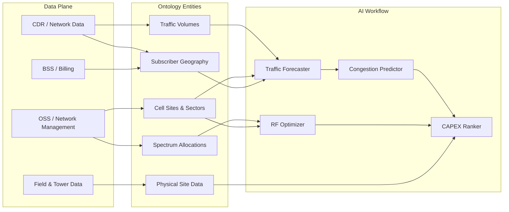

# Network Capacity Planning & Optimization

Traffic forecasting, cell site optimization, and spectrum management for efficient network investment.

**Priority:** P2 — Strategic Value  
**Time to Value:** 8-10 weeks  
**Category:** Network Planning & CAPEX

---

## Business Problem

Network CAPEX is the largest investment category for telcos — cell site builds, equipment upgrades, spectrum acquisition, and fiber deployment. Planning decisions made today determine network performance 2-3 years out. Current planning processes are inefficient:

- **Over-provisioning** — conservative traffic forecasts lead to excess capacity deployed in low-growth areas, wasting CAPEX
- **Under-provisioning** — high-growth areas (new developments, event venues, transit corridors) hit congestion before capacity is deployed
- **Static cell plans** — cell site RF configurations (tilt, power, frequency allocation) are set at deployment and rarely optimized for changing traffic patterns
- **Spectrum fragmentation** — available spectrum is not dynamically allocated to cells/sectors based on demand, leaving capacity on the table
- **Technology migration blindness** — 4G-to-5G migration planning lacks granular data on which cells need upgrading first based on demand and revenue potential
- **No ROI-based prioritization** — site build and upgrade decisions are driven by engineering metrics rather than business impact (revenue, subscriber growth, competitive threat)

---

## Capabilities

### Traffic Demand Forecasting
AI-driven prediction of data traffic growth per cell site, sector, and technology layer (4G/5G) for 6-24 month horizons based on subscriber growth, usage trends, and area development plans.

### Cell Site Congestion Prediction
Identify cells approaching congestion thresholds 3-6 months before they hit — enabling proactive capacity augmentation through carrier adds, spectrum refarming, or small cell deployment.

### RF Optimization Recommendations
AI analysis of cell performance (throughput, interference, handover success) with recommendations for antenna tilt, power adjustments, and frequency retuning to maximize spectral efficiency.

### Spectrum Management & Refarming
Analyze spectrum utilization across cells and recommend refarming opportunities — shifting underutilized spectrum from low-demand cells to congested neighbors, or from legacy technologies (3G) to 4G/5G.

### CAPEX Prioritization Engine
Rank network investment projects (new sites, upgrades, fiber, 5G) by expected ROI: projected traffic served, revenue impact, subscriber experience improvement, and competitive positioning.

---

## Data Sources & Ontology Mapping

| Ontology Entity | Source System | Key Fields |
|----------------|--------------|------------|
| Cell Sites & Sectors | OSS Inventory | Cell ID, Site ID, Sector, Technology (4G/5G), Band, Antenna Config, Status |
| Traffic Volumes | CDR / Network Data Lake | Cell ID, Hour, Data Volume (GB), Voice Erlangs, User Count, PRB Utilization |
| Spectrum Allocations | OSS Configuration | Cell ID, Band, Bandwidth (MHz), Technology, Utilization %, Refarming Eligibility |
| Subscriber Geography | CDR + BSS | MSISDN, Home Cell, Work Cell, ARPU, Plan Type, Device Capability (4G/5G) |
| Physical Site Data | Field & Tower Data | Site ID, Location, Tower Height, Lease Expiry, Power Source, Access Road, Co-location |

---

## AI Workflow

1. **Traffic Aggregation** — Aggregate CDR/xDR data into per-cell, per-hour traffic profiles (data volume, voice erlangs, signaling load, connected users, PRB utilization)
2. **Growth Factor Modeling** — Combine historical traffic trends with external growth drivers: population density changes, new construction permits, subscriber acquisition plans, device upgrade cycles (4G→5G handset penetration)
3. **Traffic Forecasting** — Time-series + regression ensemble predicting 6/12/18/24-month traffic per cell; decompose into organic growth + event-driven + migration (technology shift) components
4. **Congestion Prediction** — Flag cells where forecasted traffic exceeds capacity threshold (e.g., >80% PRB utilization in busy hour) within 3/6/12 months
5. **RF Optimization** — For each congested or underperforming cell, simulate the impact of tilt changes, power adjustments, and frequency reallocation using propagation models + actual traffic data
6. **Spectrum Refarming Analysis** — Identify cells with underutilized spectrum on legacy technologies (2G/3G); model the capacity gain from refarming to 4G/5G
7. **CAPEX ROI Ranking** — Score each investment candidate (new site, upgrade, spectrum refarm) by: traffic served per $ invested, subscribers impacted, revenue at risk from congestion, and competitive necessity
8. **Output** — Capacity planning dashboard for CTO; congestion heatmaps for network planning team; RF optimization recommendations for optimization team; CAPEX priority list for investment committee

---

## Dashboard & Alerts

### Key Metrics

| KPI | Description | Target |
|-----|-------------|--------|
| **Busy Hour PRB Utilization** | Average PRB utilization across cells during peak hour | < 70% (headroom for growth) |
| **Congested Cells %** | % of cells exceeding 80% PRB utilization in busy hour | < 5% |
| **Traffic Forecast Accuracy** | Predicted vs. actual monthly traffic at cell level (MAPE) | < 15% |
| **Spectral Efficiency** | Mbps per MHz per cell (average) | Year-over-year improvement of 5% |
| **CAPEX Efficiency** | GB served per $1K CAPEX invested | Year-over-year improvement of 10% |
| **5G Coverage** | % of subscribers with 5G coverage at home cell | Track against rollout plan |

### Alert Rules

| Alert | Trigger | Severity | Action |
|-------|---------|----------|--------|
| Congestion imminent | Cell projected to exceed 85% PRB utilization within 3 months | High | Fast-track capacity augmentation (carrier add, small cell, spectrum refarm) |
| Forecast miss | Actual cell traffic exceeds forecast by >30% for 2 consecutive months | High | Reforecast; investigate growth driver (new building, event, competitor closure) |
| Spectrum waste | Cell has >40% unused spectrum on decommission-eligible technology | Medium | Include in next refarming cycle; model 4G/5G capacity gain |
| CAPEX overrun risk | Planned site build costs trending >15% above budget | Medium | Review scope; assess alternative solutions (small cell, MOCN sharing) |
| Coverage gap | New residential development with >500 households has no serving cell within 1km | Info | Add to site acquisition pipeline; assess timeline and ROI |

---

## ROI Model

| Metric | Before | After | Impact |
|--------|--------|-------|--------|
| Annual network CAPEX | $120M | $100M (same coverage/quality) | **$20M CAPEX deferral through optimization** |
| Congested cells | 12% of cells | 4% of cells | **67% reduction → better subscriber experience** |
| Spectral efficiency | 2.1 Mbps/MHz/cell | 2.5 Mbps/MHz/cell | **19% improvement → delayed spectrum acquisition** |
| Planning cycle time | 6 months annual plan | Continuous rolling 24-month forecast | **Agile response to demand changes** |
| Revenue from congestion avoidance | $8M lost to degraded experience | $3M remaining | **$5M revenue protected** |

!!! success "Estimated Annual ROI"
    **$15M - $30M** annually from CAPEX deferral, spectral efficiency gains, congestion avoidance, and planning agility — across a mid-size telco with $120M annual network CAPEX.

---

## Implementation Notes

- Requires per-cell, per-hour traffic data from CDRs or OSS counters at minimum; 15-minute granularity is preferred for busy-hour analysis
- Traffic forecasting models need 18-24 months of historical data per cell for reliable predictions
- RF optimization recommendations require an RF propagation model calibrated to the operator's network; integration with existing planning tools (Atoll, Planet) is recommended
- CAPEX ROI ranking methodology must be agreed with finance and network planning leadership before automating investment decisions
- 5G migration planning requires device capability data from BSS (which subscribers have 5G-capable handsets)

---

[← Back to Catalogue](index.md) | [Previous: Customer Experience](customer-experience.md) | [Next: Dynamic Pricing →](dynamic-pricing.md)
