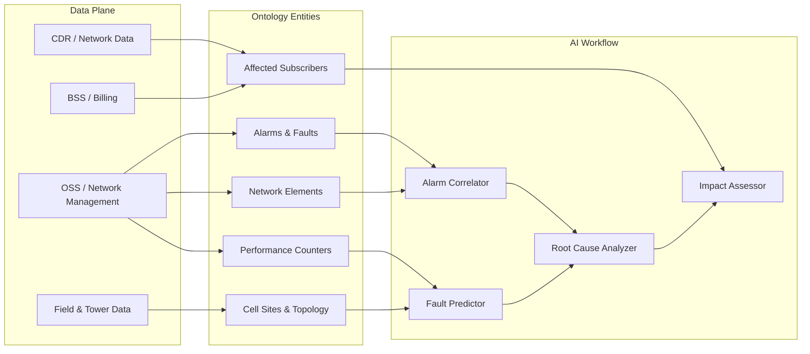

# Network Performance & Anomaly Detection

Real-time network monitoring, predictive fault detection, and automated root cause analysis for telecom infrastructure.

**Priority:** P0 — Immediate ROI  
**Time to Value:** 4-6 weeks  
**Category:** Network Operations

---

## Business Problem

Telecom networks comprise thousands of cell sites, nodes, links, and elements generating millions of performance counters and alarms daily. Traditional threshold-based monitoring struggles to keep pace:

- **Alert storms** — a single root cause (fiber cut, power failure, core node issue) triggers hundreds of correlated alarms across dependent elements, overwhelming NOC operators
- **Reactive fault management** — equipment degradation is detected only when it crosses static thresholds, not when early patterns emerge
- **Slow root cause analysis** — operators manually correlate alarms across network layers (RAN, transport, core) and systems (OSS, NMS, ticketing) taking hours per major incident
- **Silent degradation** — gradual performance decline (increasing packet loss, rising latency, growing handover failures) goes unnoticed until customers complain
- **No customer impact mapping** — network faults are not correlated with affected subscribers, making it impossible to prioritize by business impact

---

## Capabilities

### Real-Time Network Health Dashboard
Consolidated view of network health across RAN, transport, and core layers — aggregating performance counters, active alarms, and SLA metrics with drill-down from national to cell-site level.

### Predictive Fault Detection
ML models trained on historical fault patterns to predict equipment failures 24-72 hours before they occur, based on degrading performance counter trends, environmental signals, and equipment age/type.

### Automated Root Cause Analysis
AI-powered alarm correlation engine that clusters related alarms, identifies the root cause, and suppresses downstream noise — reducing the effective alarm volume by 60-80%.

### Customer Impact Analysis
Real-time mapping of network faults to affected subscribers using CDR cell-site associations and BSS subscriber data — enabling impact-weighted fault prioritization.

### SLA Monitoring & Breach Prediction
Continuous monitoring of network SLAs (availability, latency, throughput, jitter) with prediction of SLA breaches before they occur, enabling preemptive action.

---

## Data Sources & Ontology Mapping

| Ontology Entity | Source System | Key Fields |
|----------------|--------------|------------|
| Network Elements | OSS Inventory | Element ID, Type (eNodeB, gNodeB, Router, Switch), Vendor, Model, Status, Location |
| Alarms & Faults | OSS Fault Management | Alarm ID, Element, Severity, Category, Timestamp, Acknowledgment Status |
| Performance Counters | OSS Performance Management | Element, Counter Name, Value, Timestamp, Granularity (15 min / hourly) |
| Affected Subscribers | CDR + BSS | MSISDN, Cell ID, Session Quality, ARPU, Segment, Plan Type |
| Cell Sites & Topology | Field Data + OSS | Site ID, Location (lat/long), Sector Count, Technology (4G/5G), Capacity, Dependencies |

---

## AI Workflow

1. **Counter Ingestion** — Stream performance counters from OSS (KPIs: throughput, latency, packet loss, handover success rate, call drop rate, RSRP/RSRQ) at 15-minute granularity per cell
2. **Baseline Learning** — Build per-element behavioral baselines accounting for time-of-day, day-of-week, and seasonal patterns using statistical decomposition
3. **Anomaly Detection** — Score each counter reading against its learned baseline using isolation forest + LSTM autoencoder; flag deviations beyond dynamic thresholds
4. **Alarm Correlation** — Cluster incoming alarms by topology (parent-child element relationships), timing (within correlation window), and causality (known fault propagation patterns)
5. **Root Cause Identification** — Apply causal inference models to identify the most probable root cause from correlated alarm clusters; map to topology layer for localization
6. **Customer Impact Scoring** — For each active fault, count affected subscribers by correlating fault cell IDs with recent CDR data; weight by subscriber ARPU and segment
7. **Predictive Alerting** — For degradation patterns that match known pre-failure signatures (e.g., rising temperature + increasing bit error rate → impending hardware failure), generate 24-72 hour advance warnings
8. **Output** — NOC dashboard with correlated alarms and root cause; predictive maintenance queue for field ops; customer impact reports for CEM team; SLA breach predictions for service management

---

## Dashboard & Alerts

### Key Metrics

| KPI | Description | Target |
|-----|-------------|--------|
| **Network Availability** | % of time network elements are operational | > 99.95% |
| **Mean Time to Repair (MTTR)** | Average hours from fault detection to resolution | < 2 hours |
| **Alarm Noise Reduction** | % of raw alarms suppressed by correlation engine | > 70% |
| **Predictive Fault Lead Time** | Hours between prediction and actual failure | > 24 hours |
| **Customer-Impacting Faults** | Number of faults affecting >1,000 subscribers | < 5 per month |
| **SLA Compliance** | % of SLA metrics within committed thresholds | > 99.5% |

### Alert Rules

| Alert | Trigger | Severity | Action |
|-------|---------|----------|--------|
| Major outage | Cell site or node down affecting >5,000 subscribers | Critical | Activate emergency response; notify CTO; initiate customer comms |
| Predictive failure | Element shows pre-failure pattern with >80% confidence in next 48 hours | High | Create preventive maintenance ticket; schedule field dispatch |
| Performance degradation | Cell KPIs degrade >20% from baseline for 4+ consecutive intervals | High | Investigate root cause; assess if capacity or fault issue |
| SLA breach imminent | SLA metric projected to breach within 4 hours at current trajectory | High | Escalate to service management; initiate mitigation |
| Alarm storm | >50 alarms from interconnected elements within 5-minute window | Medium | Trigger correlation engine; suppress noise; identify root cause |

---

## ROI Model

| Metric | Before | After | Impact |
|--------|--------|-------|--------|
| MTTR | 4.5 hours average | 2.0 hours average | **56% reduction** |
| Network outage minutes / month | 420 min | 180 min | **57% reduction → $3.2M avoided revenue loss** |
| NOC operator efficiency | 200 alarms/operator/shift | 60 correlated events/operator/shift | **70% workload reduction** |
| Predictive fault detection | 0% (fully reactive) | 40% of faults predicted 24+ hours ahead | **Preventive maintenance enabled** |
| Customer-impacting incidents | 18 / month | 8 / month | **56% reduction → NPS improvement** |
| Penalty/SLA credits | $1.8M / year | $600K / year | **$1.2M savings** |

!!! success "Estimated Annual ROI"
    **$8M - $15M** annually from reduced outage impact, NOC efficiency, SLA penalty avoidance, and preventive maintenance savings — across a mid-size telco with 8,000+ cell sites.

---

## Implementation Notes

- Requires near-real-time performance counter feeds from OSS at 15-minute granularity; hourly aggregations lose the signal fidelity needed for anomaly detection
- Alarm correlation engine needs the complete network topology model (parent-child relationships, physical/logical dependencies) from OSS inventory
- Customer impact mapping requires CDR-to-cell-site association; this works best when CDR data is available with <30 minute latency
- Predictive fault models need minimum 12 months of historical alarm and counter data with labeled fault outcomes (root cause, resolution, affected equipment)
- Multi-vendor environments (Ericsson RAN + Nokia core, etc.) require normalization of vendor-specific counter names and alarm codes

---

[← Back to Catalogue](index.md) | [Previous: Customer 360](customer-360.md) | [Next: Revenue Assurance →](revenue-assurance.md)
