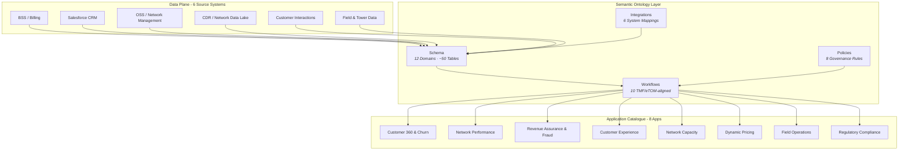

# Telecommunications Semantic Ontology Layer

The Semantic Ontology Layer sits between the Data Plane and the Application Catalogue, providing a unified, standards-aligned knowledge graph that resolves entities across BSS/Billing, Salesforce CRM, OSS/Network Management, CDR/Network Data Lake, Customer Interactions, and Field & Tower Data systems.

---

## Industry Standards Alignment

The telecommunications ontology is aligned to global industry standards and frameworks.

### TMF (TM Forum) Open APIs

The TM Forum defines a suite of Open APIs that standardise telco business and operational interfaces. Every domain, workflow, and policy in this ontology is tagged with its TMF API alignment:

| TMF API | Scope | Ontology Coverage |
|---------|-------|-------------------|
| **TMF629 Customer Management** | Subscriber profiles, segmentation | Customer 360 & Churn, Customer Experience, Dynamic Pricing |
| **TMF622 Product Order** | Plan subscriptions, add-ons | Customer 360 & Churn, Dynamic Pricing |
| **TMF632 Party Management** | Accounts, contacts, households | Customer 360 & Churn, Revenue Assurance & Fraud |
| **TMF638 Service Inventory** | Active services, service paths | Network Performance, Field Operations |
| **TMF639 Resource Inventory** | Network elements, cell sites, equipment | Network Performance, Network Capacity, Field Operations |
| **TMF642 Alarm Management** | Faults, alarms, events | Network Performance, Field Operations |
| **TMF654 Prepay Balance** | Balance, topup, charging events | Revenue Assurance & Fraud, Dynamic Pricing |
| **TMF678 Customer Bill** | Invoices, charges, payments | Revenue Assurance & Fraud, Customer Experience |

### eTOM (enhanced Telecom Operations Map)

The eTOM framework defines end-to-end business processes for telecommunications operators. Ontology workflows and policies map to eTOM Level 1/2 processes:

| eTOM Process | Scope | Ontology Coverage |
|-------------|-------|-------------------|
| **Strategy & Commit** | Product portfolio, pricing | Dynamic Pricing |
| **Infrastructure Lifecycle** | Network planning, build, deploy | Network Capacity, Field Operations |
| **Product Lifecycle** | Plan design, launch | Dynamic Pricing |
| **Operations Support & Readiness** | Resource provisioning | Field Operations |
| **Fulfillment** | Order, service activation | Customer 360 & Churn, Revenue Assurance & Fraud |
| **Assurance** | Fault, performance, QoS | Network Performance, Customer Experience |
| **Billing & Revenue** | Rating, billing, collections | Revenue Assurance & Fraud, Dynamic Pricing |
| **Customer Relations** | CRM, retention, experience | Customer 360 & Churn, Customer Experience |

---

## Architecture

---

## Ontology Components

The ontology consists of four interconnected layers, all stored in `enterprise-knowledge/`:

| Layer | Files | Format | Purpose |
|-------|-------|--------|---------|
| [Schema](schema-reference.md) | `telco-schema.yaml` | YAML | 12 domains, ~50 tables with fields, types, risk levels, constraints, and relationships |
| [Workflows](workflows.md) | `workflows/*.yaml` (10 files) | YAML | Triggered process flows with steps, rules, SLAs, and dependencies |
| [Policies](policies.md) | `policies/*.md` (8 files) | Markdown | Business rules, thresholds, approval chains, and compliance constraints |
| [Integrations](integrations.md) | `integrations/*.yaml` (6 files) | YAML | Field-level sync mappings between source systems with conflict resolution |

### Relationship Types

Entities in the schema are connected via typed relationships that form a knowledge graph:

| Relationship | Meaning | Example |
|-------------|---------|---------|
| `triggers` | Entity event initiates a workflow | `Alarm` severity change triggers `Fault Resolution` workflow |
| `syncs_to` | Entity data flows to another system | `Subscriber_Master` syncs_to `SF_Account` via integration |
| `constrained_by` | Entity operations governed by a policy | `CDR_Record` constrained_by `revenue-assurance-policy` |
| `depends_on` | Entity requires a parent/related entity | `Work_Order` depends_on `Cell_Site` |
| `validates` | Entity validates another in a business process | `Spectrum_License` validates `Cell_Site` for regulatory compliance |

---

## Cross-Application Entity Heatmap

Shows how many of the 8 telco apps require each entity. Higher usage = more foundational.

| Entity | Count | Applications |
|--------|-------|-------------|
| `Subscriber_Master` | **8** | All apps |
| `Cell_Site` | **5** | Network Performance, Network Capacity, Field Operations, Revenue Assurance & Fraud, Regulatory Compliance |
| `CDR_Record` | **5** | Customer 360 & Churn, Revenue Assurance & Fraud, Network Capacity, Customer Experience, Dynamic Pricing |
| `Network_Element` | **4** | Network Performance, Network Capacity, Field Operations, Regulatory Compliance |
| `Alarm` | **3** | Network Performance, Field Operations, Customer Experience |
| `Plan_Product` | **3** | Customer 360 & Churn, Dynamic Pricing, Revenue Assurance & Fraud |
| `Work_Order` | **2** | Field Operations, Customer Experience |
| `Spectrum_License` | **1** | Regulatory Compliance |

`Subscriber_Master` is the most connected entity in the telco ontology — equivalent to `Account` in CRM, `Customer_Master` in Banking, `Patient_Master` in Healthcare, `Product_Master` in Retail.

---

## Schema Statistics

| Metric | Count |
|--------|-------|
| **Domains** | 12 |
| **Tables** | ~50 |
| **Source Systems** | 6 (BSS/Billing, Salesforce CRM, OSS/Network Mgmt, CDR/Data Lake, Customer Interactions, Field & Tower Data) |
| **Workflows** | 10 |
| **Policies** | 8 |
| **Integrations** | 6 |
| **Relationship Types** | 5 (triggers, syncs_to, constrained_by, depends_on, validates) |
| **TMF APIs Covered** | 8+ |

---

## Documentation

| Document | Description |
|----------|-------------|
| [Schema Reference](schema-reference.md) | Complete domain and table reference with fields, types, and relationships |
| [Workflows](workflows.md) | All 10 AI workflow definitions with triggers, steps, and dependencies |
| [Policies](policies.md) | All 8 governance policies with rules, thresholds, and approval chains |
| [Integrations](integrations.md) | All 6 system integration mappings with field-level detail |
| [App-Object Mapping](app-object-mapping.md) | Minimum required objects per application with relationship matrix |
| [Mapping Architecture](mapping-architecture.md) | Schema-first architecture, Semantic RAG pipeline, and ReAct tools |

---

[← Back to Telco Catalogue](../index.md)
