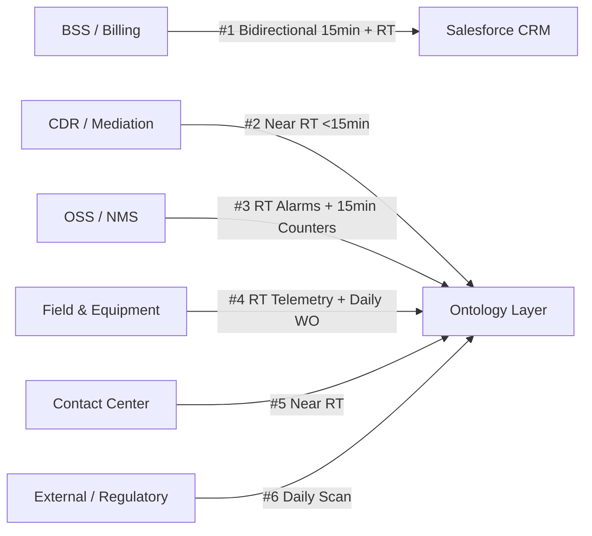
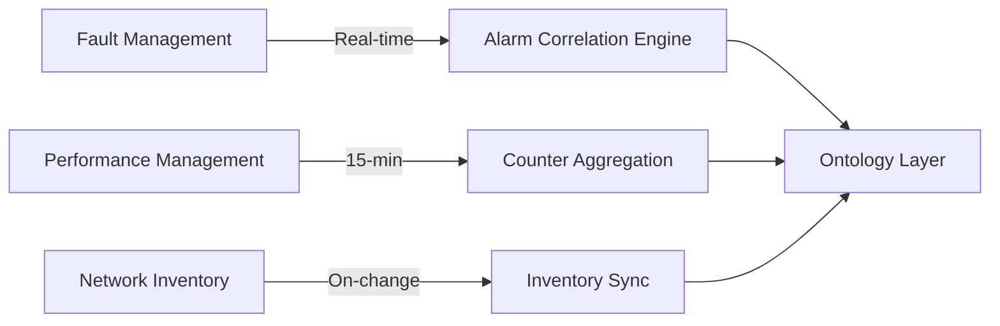
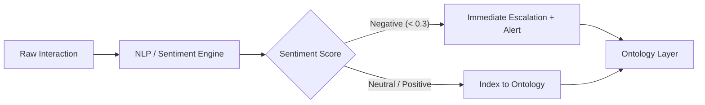
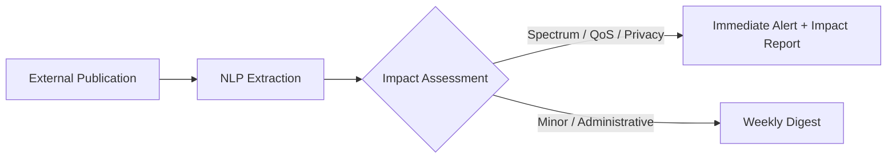

# Integrations

6 system integration mappings that connect the Data Plane source systems to the Semantic Ontology Layer. Each integration is defined in `enterprise-knowledge/integrations/` as a YAML file with field-level mappings, conflict resolution, and failure handling.

---

## Integration Summary

| # | Integration | Source | Target | Type | Frequency |
|---|------------|--------|--------|------|-----------|
| 1 | [BSS-CRM Sync](#1-bss-crm-sync) | BSS / Billing | Salesforce CRM | Bidirectional | 15-min + real-time events |
| 2 | [CDR/Mediation Feed](#2-cdrmediation-feed) | CDR / Mediation | Ontology Layer | Unidirectional | Near real-time (<15 min) |
| 3 | [OSS Alarm & Performance Feed](#3-oss-alarm--performance-feed) | OSS / NMS | Ontology Layer | Unidirectional | Real-time alarms, 15-min counters |
| 4 | [Field & Equipment Telemetry Feed](#4-field--equipment-telemetry-feed) | Field Systems | Ontology Layer | Unidirectional | Real-time telemetry, daily WO sync |
| 5 | [Customer Interaction Feed](#5-customer-interaction-feed) | Contact Center | Ontology Layer | Unidirectional | Near real-time |
| 6 | [External & Regulatory Feed](#6-external--regulatory-feed) | External Sources | Ontology Layer | Unidirectional | Daily scan |

---

## Integration Architecture

---

## 1. BSS-CRM Sync

**ID:** `INTEGRATION_BSS_CRM_V1_0` | **File:** `bss-crm-sync.yaml`

BSS is source of truth for subscriber master, plan/product, billing status, and ARPU. CRM is source of truth for interactions, retention offers, case outcomes, and campaign responses.

### Subscriber Sync (BSS -> CRM)

| BSS Field | CRM Field | Direction | Transformation / Constraint |
|----------|----------|-----------|---------------------------|
| Subscriber_Master.MSISDN | SF_Account.MSISDN__c | BSS -> CRM | — |
| Subscriber_Master.Name | SF_Account.Name | BSS -> CRM | — |
| Subscriber_Master.Segment | SF_Account.Segment__c | BSS -> CRM | — |
| Subscriber_Master.Status | SF_Account.Subscriber_Status__c | BSS -> CRM | Active, Suspended, Churned |
| Plan_Product.Plan_Name | SF_Account.Current_Plan__c | BSS -> CRM | — |
| Billing_Record.ARPU | SF_Account.ARPU__c | BSS -> CRM | Rolling 3-month average |
| Billing_Record.Payment_Status | SF_Account.Payment_Status__c | BSS -> CRM | Read-only in CRM |

### Retention & Campaign Sync (CRM -> BSS)

| CRM Field | BSS Field | Direction | Notes |
|----------|----------|-----------|-------|
| Campaign.Retention_Offer | Subscriber_Master.Active_Offer__c | CRM -> BSS | Applied at next billing cycle |
| Service_Request.Case_Outcome | Subscriber_Master.Last_Case_Outcome | CRM -> BSS | For churn risk scoring |
| Campaign.Response_Status | Campaign_Response.Status | CRM -> BSS | Accepted, Declined, Expired |

**Conflict Resolution:** BSS wins for subscriber/billing/ARPU data; CRM wins for interaction/retention/campaign data

**Failure Handling:** 3 retries at 5-min intervals; dead letter queue; alert telco-integration-alerts@company.com

---

## 2. CDR/Mediation Feed

**ID:** `INTEGRATION_CDR_MEDIATION_V1_0` | **File:** `cdr-mediation-feed.yaml`

Near real-time feed of rated and raw CDR/xDR records from the mediation platform into the Ontology Layer.

### CDR Field Mapping

| Mediation Field | Ontology Field | Target Entity | Notes |
|----------------|---------------|--------------|-------|
| CDR.Call_ID | CDR_Record.CDR_ID | CDR_Record | Unique identifier |
| CDR.A_Number | CDR_Record.Calling_MSISDN | CDR_Record | Originating subscriber |
| CDR.B_Number | CDR_Record.Called_MSISDN | CDR_Record | Terminating number |
| CDR.Duration | CDR_Record.Duration_Seconds | CDR_Record | — |
| CDR.Volume_MB | Data_Session.Volume_MB | Data_Session | Data usage records |
| CDR.Cell_ID | CDR_Record.Cell_ID | CDR_Record | For network correlation |
| CDR.Rating_Status | CDR_Record.Rating_Status | CDR_Record | Rated, Unrated, Error |
| CDR.Charge_Amount | CDR_Record.Charge_Amount | CDR_Record | Post-rating charge |
| CDR.Record_Type | CDR_Record.Record_Type | CDR_Record | Voice, Data, SMS, Roaming, VAS |

### Aggregated Usage Metrics

| Metric | Target Entity | Aggregation | Notes |
|--------|--------------|-------------|-------|
| Total voice minutes (daily) | Aggregated_Usage | Sum per subscriber per day | — |
| Total data MB (daily) | Aggregated_Usage | Sum per subscriber per day | — |
| Total SMS count (daily) | Aggregated_Usage | Count per subscriber per day | — |
| Roaming usage (daily) | Aggregated_Usage | Sum per subscriber per roaming partner | — |

**Frequency:** Near real-time (<15 min); batch reconciliation at end-of-day

---

## 3. OSS Alarm & Performance Feed

**ID:** `INTEGRATION_OSS_ALARM_PERF_V1_0` | **File:** `oss-alarm-perf-feed.yaml`

Real-time alarm feed from fault management and 15-minute performance counters from the performance management system.

### Alarm Feed (Fault Management -> Ontology)

| OSS Field | Ontology Field | Target Entity | Notes |
|----------|---------------|--------------|-------|
| FM_Alarm.Alarm_ID | Alarm.Alarm_ID | Alarm | Unique identifier |
| FM_Alarm.NE_ID | Alarm.Network_Element_ID | Alarm | Source network element |
| FM_Alarm.Severity | Alarm.Severity | Alarm | Critical, Major, Minor, Warning |
| FM_Alarm.Probable_Cause | Alarm.Probable_Cause | Alarm | TMF-aligned cause code |
| FM_Alarm.Timestamp | Alarm.Raised_At | Alarm | — |
| FM_Alarm.Clear_Time | Alarm.Cleared_At | Alarm | Null if still active |

### Performance Counters (PM System -> Ontology)

| PM Field | Ontology Field | Target Entity | Notes |
|---------|---------------|--------------|-------|
| PM.Counter_Name | Performance_Counter.Counter_Name | Performance_Counter | PRB utilization, throughput, etc. |
| PM.NE_ID | Performance_Counter.Network_Element_ID | Performance_Counter | Source network element |
| PM.Cell_ID | Performance_Counter.Cell_ID | Performance_Counter | Cell-level granularity |
| PM.Value | Performance_Counter.Value | Performance_Counter | Numeric measurement |
| PM.Timestamp | Performance_Counter.Measurement_Time | Performance_Counter | 15-min interval boundary |

### Network Inventory (Inventory System -> Ontology)

| Inventory Field | Ontology Field | Target Entity | Notes |
|----------------|---------------|--------------|-------|
| INV.NE_ID | Network_Element.NE_ID | Network_Element | — |
| INV.NE_Type | Network_Element.Type | Network_Element | eNodeB, gNodeB, Router, Switch |
| INV.Site_ID | Cell_Site.Site_ID | Cell_Site | — |
| INV.Location | Cell_Site.Latitude, Cell_Site.Longitude | Cell_Site | GPS coordinates |
| INV.Sector_ID | Sector.Sector_ID | Sector | Per-cell sector |

**OSS Data Pipeline:**

**Frequency:** Alarms: real-time (<1 min); Performance counters: 15-min intervals; Inventory: on-change + daily full sync

---

## 4. Field & Equipment Telemetry Feed

**ID:** `INTEGRATION_FIELD_TELEMETRY_V1_0` | **File:** `field-telemetry-feed.yaml`

Real-time equipment telemetry and daily work order synchronization from field systems.

| Feed | Target Entity | Frequency | Special Rules |
|------|--------------|-----------|---------------|
| Battery voltage and charge level | Equipment_Telemetry | Real-time | Voltage below threshold: immediate alert to NOC |
| Generator fuel level and runtime | Equipment_Telemetry | Real-time | Fuel <20%: dispatch refueling work order |
| HVAC temperature and humidity | Equipment_Telemetry | Real-time | Temperature excursion: immediate alarm + equipment throttle |
| Antenna tilt and azimuth (RET) | Equipment_Telemetry | Real-time | Drift >2° from baseline: investigation ticket |
| Work orders from CMMS | Work_Order | Daily sync + on-event | Status changes pushed in real-time |
| Site survey data | Site_Survey | On-completion | Survey results trigger capacity planning review |
| Technician availability | Technician | Real-time | GPS location + availability status for dispatch optimization |

**Failure Handling:** 3 retries at 5-min intervals; telemetry gap >30 min: alert NOC; dead letter queue for WO sync

---

## 5. Customer Interaction Feed

**ID:** `INTEGRATION_CUSTOMER_INTERACTION_V1_0` | **File:** `customer-interaction-feed.yaml`

Near real-time feed of customer interaction data from all contact channels into the Ontology Layer with sentiment analysis.

| Feed | Target Entity | Frequency | Special Rules |
|------|--------------|-----------|---------------|
| Call recordings (speech-to-text transcription) | Interaction_Record | Near real-time | Transcription confidence >0.85: auto-index; <0.85: manual review |
| Chat transcripts (live chat, chatbot) | Interaction_Record | Near real-time | Bot handoff to agent: flagged for quality review |
| Email threads | Interaction_Record | Near real-time | — |
| Social media mentions (Twitter/X, Facebook) | Interaction_Record | Near real-time | Negative sentiment + >1000 followers: immediate escalation to PR |
| NPS survey responses | NPS_Survey | Near real-time | Detractor (score ≤6): immediate alert to retention team |

**Sentiment Analysis Pipeline:**

**Frequency:** Near real-time (<5 min for most channels); social media: 15-min scan cycle

---

## 6. External & Regulatory Feed

**ID:** `INTEGRATION_EXTERNAL_REGULATORY_V1_0` | **File:** `external-regulatory-feed.yaml`

Daily scan of external and regulatory data sources with automated change intelligence.

| Feed | Target Entity | Frequency | Special Rules |
|------|--------------|-----------|---------------|
| Competitor plan monitoring (pricing, data allowances) | Competitor_Plan | Daily scan | New plan launch by top-3 competitor: immediate alert to Pricing team |
| Market share data (regulator, industry reports) | Market_Share | Monthly / quarterly | Significant share movement (>1% change): alert to CMO |
| Regulatory publications (spectrum, QoS, privacy) | Regulatory_Publication | Daily scan | New regulation with compliance deadline: immediate impact assessment |
| Spectrum auction/assignment data | Spectrum_License | On-event | New license award: immediate update to spectrum inventory |
| GIS / population data (census, coverage maps) | GIS_Data | Quarterly | Population growth >5% in coverage area: trigger capacity review |

**Regulatory Change Pipeline:**

---

## Failure Handling (All Integrations)

All integrations share a common failure handling pattern:

| Setting | Value |
|---------|-------|
| Retry count | 3 |
| Retry interval | 5 minutes |
| Dead letter queue | Enabled |
| Alert on failure | Integration-specific alert email |
| Fallback | Source system value is authoritative; manual update required in target |

---

[← Back to Ontology Overview](index.md)
