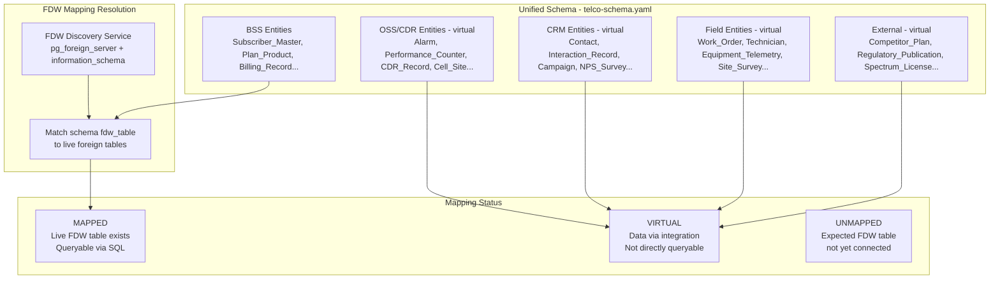
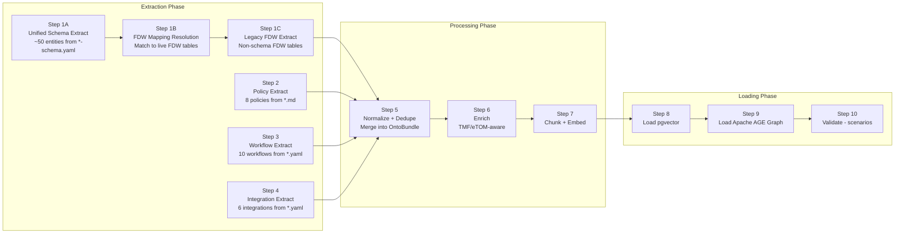

# Mapping Architecture & Semantic Indexing

How the unified telecommunications schema maps to the existing systems of record, how the semantic indexing pipeline processes it, and how the ReAct agent uses the indexed ontology to serve queries and take actions.

---

## Schema-First Architecture

The telecommunications ontology uses a **schema-first** approach — the unified schema is the primary knowledge source, not the FDW foreign tables. FDW becomes a mapping resolution layer that annotates which schema entities have live database connections.

VDL **compositions** (see platform Data Plane docs) express how each canonical entity is built from one or more FDW tables, including join plans and field projections executed at query runtime.



### Entity Mapping Status

| Status | Meaning | Count | Example |
|--------|---------|-------|---------|
| **Mapped** | Live FDW foreign table exists; entity is queryable via `query_table` tool | ~8 | Subscriber_Master, Plan_Product, Billing_Record, CDR_Record, Alarm, Cell_Site, Performance_Counter, Network_Element |
| **Virtual** | Entity data flows via integration sync; not directly queryable via FDW | ~35 | Work_Order, Equipment_Telemetry, Interaction_Record, NPS_Survey, Campaign, Competitor_Plan, Regulatory_Publication |
| **Unmapped** | Schema defines the entity but no FDW table or integration connected yet | ~5 | Aggregated_Usage, KQI (derived/calculated entities) |

---

## Semantic RAG Pipeline (12 Steps)

The pipeline follows the same 12-step process as other vertical ontologies, extended with Steps 1A (Unified Schema Extraction) and 1B (FDW Mapping Resolution):



### Step Details

| Step | File | What It Does |
|------|------|-------------|
| **1A** | `unified_schema_extractor.py` | Reads `telco-schema.yaml`; creates OntoDocuments for every entity with TMF API alignment, eTOM process area, and FDW mapping status annotations |
| **1B** | `fdw_mapping_resolver.py` | Queries `FDWDiscoveryService` to match schema entities to live FDW foreign tables; annotates as mapped/virtual/unmapped; enriches mapped entities with live column metadata |
| **1C** | `fdw_extractor.py` | Original FDW extractor for non-schema tables (backward compatibility) |
| **2** | `policy_extractor.py` | Auto-discovers all `*.md` from `enterprise-knowledge/policies/` — includes 8 telco policies |
| **3** | `workflow_extractor.py` | Auto-discovers all `*.yaml` from `enterprise-knowledge/workflows/` — includes 10 telco workflows |
| **4** | `integration_extractor.py` | Auto-discovers all `*.yaml` from `enterprise-knowledge/integrations/` — includes 6 telco integrations |
| **5** | `normalizer.py` | Merges all extracted documents; deduplicates by ID; merges relationships and `structured_metadata` on collision |
| **6** | `enricher.py` | Schema entities: auto-enriched with TMF API alignment, eTOM process area, and FDW status. Policies/workflows/integrations: LLM-enriched via gpt-4o-mini |
| **7** | `chunker.py` | 1 document = 1 chunk; batch embedded (20/batch) via OpenAI text-embedding-3-small |
| **8** | `vector_loader.py` | Upserted to pgvector `control_plane_embeddings` with content_type: `onto_schema`, `onto_policy`, `onto_workflow`, `onto_integration` |
| **9** | `graph_loader.py` | Nodes (Entity) and edges (triggers/syncs_to/constrained_by/depends_on/validates) merged into Apache AGE `enterprise_onto` graph |
| **10** | `validator.py` | Black-box test scenarios validating retrieval quality across 6 dimensions |

### What Gets Indexed

| Source | Content Type | Approx Count |
|--------|-------------|-------------|
| Unified schema (BSS + OSS + CDR + CRM + Field + External) | `onto_schema` | ~50 |
| Policies (8 telco) | `onto_policy` | ~55+ (split by section) |
| Workflows (10 telco) | `onto_workflow` | ~10 |
| Integrations (6 telco) | `onto_integration` | ~6 |
| **Total** | — | **~120+** |

---

## ReAct Agent and Tools

The ReAct agent uses the indexed ontology to answer questions and take actions. The flow is: **Search ontology -> Reason with policies -> Execute actions -> Validate compliance.**

### Tool Inventory

#### Read Tools

| Tool | Domain | What It Does |
|------|--------|-------------|
| `search_enterprise_knowledge` | Core | Hybrid vector + graph search across all ontology types |
| `search_schema_knowledge` | Core | Vector search over FDW table definitions |
| `discover_tables` / `discover_columns` / `query_table` | Core | FDW table discovery and parameterized SQL queries |
| `check_policy_compliance` | Governance | Validates proposed actions against indexed policies |
| `get_subscriber_360` | Telco | Assemble unified subscriber profile across BSS, CRM, CDR, Interactions |
| `get_network_health` | Telco | Query network-wide health: active alarms, degraded cells, SLA metrics |
| `get_cell_site_performance` | Telco | Retrieve cell site KPIs: PRB utilization, throughput, availability, alarms |
| `get_revenue_leakage` | Telco | Query revenue leakage metrics: CDR integrity, billing reconciliation, fraud |
| `get_churn_risk` | Telco | Retrieve churn risk scores, contributing factors, and recommended actions |

#### Write Tools

| Tool | Risk Level | What It Does |
|------|-----------|-------------|
| `create_retention_offer` | LOW_RISK_WRITE | Create retention offer for at-risk subscriber (policy-constrained) |
| `create_fault_ticket` | LOW_RISK_WRITE | Create fault ticket from correlated alarm group |
| `escalate_alarm` | HIGH_RISK_WRITE | Escalate alarm to NOC or CTO (triggers SLA clock) |
| `update_spectrum_config` | HIGH_RISK_WRITE | Update spectrum configuration (requires regulatory compliance check) |
| `create_work_order` | LOW_RISK_WRITE | Create field work order with dispatch priority and SLA |

### End-to-End ReAct Flow

```mermaid
sequenceDiagram
    participant User
    participant Agent as ReAct Agent
    participant RAG as Ontology Search
    participant Policy as Policy Check
    participant SoR as System of Record

    User->>Agent: "What's driving churn in the South region and are there network issues contributing?"
    Agent->>RAG: search_enterprise_knowledge("churn South region network issues correlation")
    RAG-->>Agent: Churn_Event schema + customer-retention-policy + network-sla-policy + churn-prediction workflow
    Agent->>Agent: REASON: Need churn data by region, network performance, and complaint correlation
    Agent->>SoR: get_churn_risk(region="South")
    SoR-->>Agent: 847 churned subscribers (30d), top factors: network quality (42%), pricing (31%), competitor offer (27%)
    Agent->>SoR: get_network_health(region="South")
    SoR-->>Agent: 12 degraded cells, avg availability 99.87% (below 99.95% SLA), 3 repeat fault sites
    Agent->>Policy: check_policy_compliance("retention_intervention", "Churn_Event", "South region network-driven churn")
    Policy-->>Agent: COMPLIANT — retention intervention authorized per POL-RET-001; network remediation required per POL-SLA-001
    Agent->>User: South region churn is 1.8% (above 1.2% target). Root cause: 42% network-driven — 12 degraded cells with availability below SLA. 3 sites have repeat faults. Recommend: (1) Priority fault resolution for 3 repeat-fault sites, (2) Proactive retention offers to 312 high-CLV subscribers on affected cells, (3) Capacity review for top-traffic cells in South region.
```

---

## UI Integration

### Data Plane Page

- **Vertical selector** filters data sources by domain (All / Telco / Supply Chain / CRM)
- Each source node shows **ontology entity count** and **TMF API coverage**
- Source cards display **FDW mapping status** (mapped / virtual) and **entity count badges**

### Control Plane Page

- **Semantic Layer tab** shows vertical-level stats (Telco: 50 entities, 10 workflows, 8 policies, 6 integrations)
- **TMF API distribution** badges (TMF629 Customer, TMF622 Product, TMF638 Service, TMF639 Resource, TMF642 Alarm, TMF654 Prepay, TMF678 Billing)
- **Knowledge Formation** and **Semantic Explorer** tabs support system and TMF filtering

### Reasoning Page

- **ReAct Tools tab** organizes tools into **Read Tools** and **Write Tools** with domain badges (Core / Telco / Governance)
- **AI Copilot** system prompt includes telco context and tool selection strategy

---

## Configuration

The pipeline is configured via `SemanticRagConfig`:

| Parameter | Default | Purpose |
|-----------|---------|---------|
| `schema_dir` | `enterprise-knowledge/` | Directory containing `*-schema.yaml` files |
| `policy_path` | `enterprise-knowledge/policies/` | Directory with policy Markdown files |
| `workflow_path` | `enterprise-knowledge/workflows/` | Directory with workflow YAML files |
| `integration_path` | `enterprise-knowledge/integrations/` | Directory with integration YAML files |
| `skip_unified_schema` | `false` | Skip Step 1A (unified schema extraction) |
| `skip_fdw_mapping` | `false` | Skip Step 1B (FDW mapping resolution) |
| `enrich_with_llm` | `true` | Enable LLM enrichment for non-schema docs |
| `skip_graph` | `false` | Skip Apache AGE graph loading |

Trigger reindex via: `POST /api/v1/control-plane/reindex`

---

[← Back to Ontology Overview](index.md)
