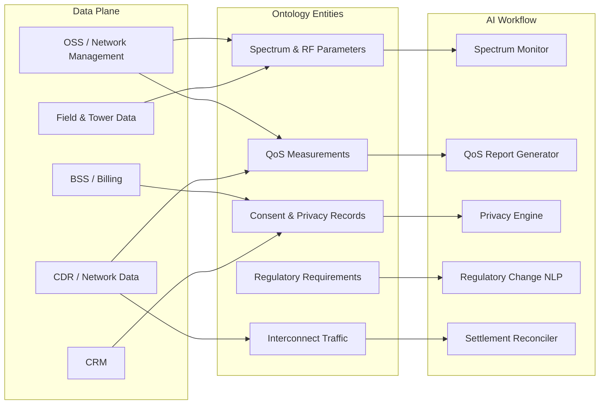

# Regulatory & Compliance Automation

Spectrum compliance, data privacy management, QoS reporting, and regulatory change tracking for telecommunications.

**Priority:** P3 — Operational Excellence  
**Time to Value:** 10-12 weeks  
**Category:** Regulatory & Legal

---

## Business Problem

Telcos operate in one of the most regulated industries — spectrum licensing, quality of service mandates, data privacy laws (GDPR, local equivalents), lawful intercept requirements, and consumer protection rules. Compliance is costly and high-stakes:

- **Spectrum license conditions** — regulators mandate coverage obligations, transmission power limits, and interference thresholds; violations risk license revocation or fines
- **QoS reporting burden** — quarterly/annual QoS reports require aggregation of millions of network performance measurements into regulator-defined metrics, taking weeks of manual effort
- **Data privacy complexity** — GDPR and local privacy regulations require consent management, data retention enforcement, right-to-erasure processing, and breach notification across all systems
- **Regulatory change velocity** — new regulations, amendments, and regulatory consultations are published frequently; impact assessment is manual and often incomplete
- **Interconnect compliance** — voice and data interconnect agreements with other operators require accurate traffic measurement, settlement, and dispute resolution
- **Audit readiness gap** — regulators conduct audits with limited notice; assembling evidence from fragmented systems creates compliance risk

---

## Capabilities

### Spectrum Compliance Monitoring
Continuous monitoring of transmission parameters (power, frequency, bandwidth) against license conditions. Automated detection of out-of-compliance cells and interference events.

### QoS Regulatory Reporting
Automated generation of regulator-mandated Quality of Service reports: call setup success rate, call drop rate, data throughput, coverage metrics — aggregated per the regulator's methodology and format.

### Data Privacy & Consent Management
AI-assisted tracking of subscriber consent status across all data processing activities. Automated enforcement of data retention policies, right-to-erasure requests, and breach detection/notification workflows.

### Regulatory Change Intelligence
NLP-powered monitoring of regulatory publications, consultations, and policy changes. Automated impact assessment against the operator's current network, products, and processes.

### Interconnect Settlement & Assurance
Automated reconciliation of interconnect traffic volumes (voice minutes, SMS, data) between operator and partner measurements. Dispute identification and evidence assembly.

---

## Data Sources & Ontology Mapping

| Ontology Entity | Source System | Key Fields |
|----------------|--------------|------------|
| Spectrum & RF Parameters | OSS + Field Data | Cell ID, Band, Power (dBm), Bandwidth, Antenna Config, License Condition |
| QoS Measurements | OSS + CDR | Call Setup Success Rate, Drop Rate, Throughput (DL/UL), Latency, Coverage (RSRP) |
| Consent & Privacy Records | BSS + CRM | Subscriber, Consent Type, Status, Granted Date, Purpose, Retention Period |
| Regulatory Requirements | External (Regulatory Body Publications) | Regulation ID, Effective Date, Impacted Area, Compliance Status, Deadline |
| Interconnect Traffic | CDR / Mediation | Originating Operator, Terminating Operator, Traffic Type, Volume, Settlement Rate |

---

## AI Workflow

1. **Spectrum Parameter Collection** — Pull real-time RF configuration and measurement data from OSS for every cell: transmit power, frequency assignment, bandwidth, antenna parameters
2. **License Compliance Check** — Compare actual parameters against license conditions per cell and band; flag deviations (over-power, out-of-band emissions, coverage shortfalls in mandated areas)
3. **QoS Metric Aggregation** — Aggregate network performance counters and CDR-derived metrics per the regulator's defined methodology (geographic areas, time windows, measurement technique, exclusions)
4. **Report Generation** — Populate regulator-mandated report templates with calculated metrics; apply validation rules; generate submission-ready files with audit trail
5. **Privacy Compliance Scan** — Scan all data stores (BSS, CRM, CDR) for subscriber data; validate retention periods; process pending erasure requests; verify consent records against processing activities
6. **Regulatory Change Monitoring** — NLP scan of regulatory body publications, consultation papers, and gazette notifications; extract key changes, deadlines, and affected areas; match against operator's current compliance posture
7. **Interconnect Reconciliation** — Compare operator's CDR-based traffic measurements with partner operator's reported volumes; identify discrepancies exceeding tolerance thresholds; generate dispute evidence packages
8. **Output** — Compliance dashboard for regulatory affairs; QoS reports for regulator submission; privacy compliance status for DPO; regulatory change alerts for legal; interconnect reconciliation for carrier relations

---

## Dashboard & Alerts

### Key Metrics

| KPI | Description | Target |
|-----|-------------|--------|
| **Spectrum Compliance Rate** | % of cells operating within all license conditions | 100% |
| **QoS Report Accuracy** | % of regulatory QoS metrics passing internal validation | 100% |
| **Report Filing Timeliness** | % of regulatory reports filed before deadline | 100% |
| **Privacy Request SLA** | % of data subject requests (erasure, access) completed within legal deadline | 100% |
| **Regulatory Change Response** | Days from publication to impact assessment completion | < 10 days |
| **Interconnect Dispute Rate** | % of interconnect billing periods with unresolved disputes | < 2% |

### Alert Rules

| Alert | Trigger | Severity | Action |
|-------|---------|----------|--------|
| Spectrum violation | Cell transmit power exceeds license limit by >1 dB | Critical | Auto-command power reduction if possible; notify RF engineering immediately |
| QoS below regulatory minimum | Any mandated QoS metric falls below regulator's minimum threshold | Critical | Investigate root cause; prepare regulator explanation; initiate remediation |
| Privacy breach detected | Unauthorized access to subscriber data or retention policy violation | Critical | Initiate breach response protocol; notify DPO; assess regulatory notification requirement |
| Filing deadline approaching | Regulatory return due in 10 business days with incomplete data | High | Escalate to regulatory affairs head; mobilize data collection |
| Regulatory change published | New regulation or amendment published affecting operator | High | Notify legal and regulatory affairs; initiate impact assessment |
| Interconnect dispute | Traffic volume discrepancy with partner operator exceeds 5% tolerance | Medium | Generate dispute evidence; notify carrier relations team |

---

## ROI Model

| Metric | Before | After | Impact |
|--------|--------|-------|--------|
| QoS reporting effort | 8 FTEs, 4 weeks per quarterly filing | 2 FTEs, 3 days per filing | **75% headcount savings, 89% time savings** |
| Regulatory fines (last 3 years) | $4.5M in penalties | $0 (target) | **$4.5M risk elimination** |
| Privacy request processing | 15 days average per request | 3 days average | **80% faster → regulatory compliance** |
| Regulatory change response | 60 days to impact assessment | 8 days | **87% faster → proactive compliance** |
| Interconnect disputes | $2.8M in unresolved disputes / year | $800K | **$2M recovery** |

!!! success "Estimated Annual ROI"
    **$5M - $10M** annually from avoided fines, reporting efficiency, faster privacy compliance, and interconnect dispute resolution — across a mid-size telco operating in a multi-regulation environment.

---

## Implementation Notes

- Spectrum compliance monitoring requires per-cell RF parameter data from OSS; some legacy RAN equipment may not expose all required parameters via northbound interfaces
- QoS report methodology varies significantly by country/regulator; the report generator must be configured per local regulatory requirements
- Privacy compliance scan must cover all data stores including CDR archives, which may contain years of subscriber data subject to retention limits
- Regulatory change NLP monitoring requires subscription to regulatory body publication feeds specific to the operator's jurisdiction(s)
- Interconnect reconciliation requires bilateral data exchange agreements with partner operators; standardized formats (GSMA TAP/RAP) simplify matching

---

[← Back to Catalogue](index.md) | [Previous: Field Operations](field-operations.md)
