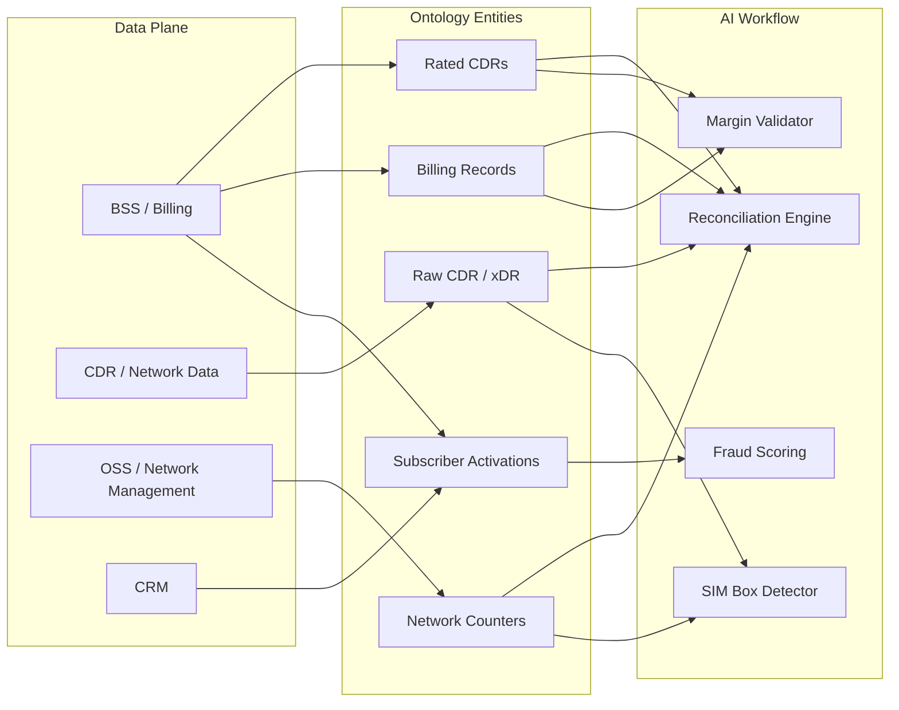

# Revenue Assurance & Fraud Management

Billing leakage detection, subscription fraud prevention, and usage fraud identification for telecom operations.

**Priority:** P1 — High Value  
**Time to Value:** 6-8 weeks  
**Category:** Revenue Protection

---

## Business Problem

Telecom revenue flows through a complex chain — network usage events are captured as CDRs, mediated, rated, and billed. At each step, revenue can leak or be stolen:

- **Billing leakage** — CDRs lost between mediation and billing, incorrect rating rules, unrated usage events, and unbilled services erode 1-5% of gross revenue without detection
- **Subscription fraud** — fraudulent identities used to obtain handsets and services; accounts are never intended to be paid, resulting in bad debt
- **SIM box fraud** — international calls terminated via illegal VoIP gateways using local SIMs, bypassing interconnect revenue
- **Bypass fraud** — traffic routed through unauthorized channels to avoid legitimate settlement charges
- **Dealer/commission fraud** — channel partners inflate activations, churn-and-return, or manipulate commissions through fake subscriptions
- **No end-to-end reconciliation** — network usage volumes, mediated CDR counts, rated events, and billed amounts are checked in silos without cross-system reconciliation

---

## Capabilities

### End-to-End Revenue Reconciliation
Automated reconciliation across the revenue chain: network element counters → mediation CDR counts → rating engine events → billing system charges → payment collections. Identify and quantify leakage at each junction.

### CDR Integrity Monitoring
Real-time monitoring of CDR flow volumes, duplicate detection, gap detection (missing sequences), and format validation to catch mediation and processing issues before they impact billing.

### Subscription Fraud Detection
ML model scoring new activations for fraud risk based on application data patterns, identity verification signals, device IMEI history, and early usage behavior anomalies.

### SIM Box & Bypass Detection
Network traffic pattern analysis to detect SIM box operations (multiple SIMs at same location, short-duration calls to many unique numbers, specific calling patterns) and bypass routing anomalies.

### Margin Assurance
Validate that product pricing, discounts, promotions, and bundle configurations in the billing system match approved business rules — catching configuration errors before they impact revenue.

---

## Data Sources & Ontology Mapping

| Ontology Entity | Source System | Key Fields |
|----------------|--------------|------------|
| Raw CDR / xDR | CDR / Network Data Lake | MSISDN, IMSI, Cell ID, Duration, Volume, Timestamp, Event Type |
| Rated CDRs | BSS Rating Engine | CDR ID, Charge Amount, Rate Plan Applied, Discount, Tax |
| Billing Records | BSS Billing | Invoice ID, Account, Billed Amount, Adjustments, Credits, Payment Status |
| Subscriber Activations | BSS + CRM | Account ID, Activation Date, ID Verification, Device IMEI, Channel, Dealer |
| Network Counters | OSS Performance Management | Element, Traffic Volume (Erlangs, GB), Call Attempts, Call Completions |

---

## AI Workflow

1. **CDR Flow Monitoring** — Count CDR volumes at each processing stage (mediation → rating → billing); detect gaps (missing CDR sequences), duplicates, and format errors in real time
2. **Cross-System Reconciliation** — Compare: (a) network counters vs. mediated CDR count, (b) mediated CDRs vs. rated events, (c) rated events vs. billed charges, (d) billed charges vs. payments collected. Quantify variance at each junction.
3. **Leakage Root Cause** — For identified variances, AI classifies the leakage type: mediation drop, rating error, unbilled service, incorrect discount application, or system timing issue
4. **Fraud Feature Engineering** — For new activations, compute features: ID document anomalies, multiple activations from same identity cluster, device IMEI history (previously associated with fraud), early usage patterns (immediate high international volume)
5. **Fraud Scoring** — Classification model trained on historical fraud cases; score each new activation within 48 hours; flag high-risk accounts for enhanced verification
6. **SIM Box Detection** — Analyze CDR patterns for SIM box signatures: multiple MSISDNs at same cell site with short-duration calls to diverse destinations, specific temporal patterns, and IMEI sharing
7. **Margin Validation** — Compare billing system configurations (rate plans, discounts, bundle logic) against approved pricing rules; flag discrepancies that could cause systematic over/under-charging
8. **Output** — Revenue assurance dashboard for finance; fraud alert queue for security team; SIM box alerts for regulatory/legal; margin discrepancy reports for product management

---

## Dashboard & Alerts

### Key Metrics

| KPI | Description | Target |
|-----|-------------|--------|
| **Revenue Leakage Rate** | Identified leakage / Gross revenue | < 0.5% (industry benchmark 1-5%) |
| **CDR Processing Integrity** | % of CDRs successfully flowing from mediation to billing | > 99.95% |
| **Subscription Fraud Rate** | Fraudulent activations / Total activations | < 0.3% |
| **SIM Box Detection Rate** | Detected SIM boxes / Estimated total SIM box operations | > 70% |
| **Reconciliation Coverage** | % of revenue chain with automated reconciliation | 100% |
| **Mean Time to Detect (Leakage)** | Days from leakage start to detection | < 1 day |

### Alert Rules

| Alert | Trigger | Severity | Action |
|-------|---------|----------|--------|
| CDR volume drop | Mediated CDR volume drops >10% vs. network counter baseline | Critical | Investigate mediation platform; check for processing backlog or failure |
| Revenue variance | Billed amount vs. rated amount variance exceeds $50K in any billing cycle | Critical | Freeze billing cycle for affected accounts; root cause analysis |
| Fraud cluster | 5+ high-risk activations from same dealer/channel in 7 days | High | Suspend dealer; investigate activation records; freeze affected accounts |
| SIM box detected | CDR pattern matches SIM box signature with >85% confidence | High | Block implicated MSISDNs; generate evidence package for legal/regulatory |
| Pricing error | Rate plan configuration deviates from approved pricing sheet | Medium | Alert product management; calculate revenue impact; schedule correction |

---

## ROI Model

| Metric | Before | After | Impact |
|--------|--------|-------|--------|
| Revenue leakage | 2.5% of gross revenue ($12.5M on $500M) | 0.5% ($2.5M) | **$10M recovered revenue** |
| Subscription fraud losses | $3.2M / year | $1.2M / year | **$2M fraud reduction** |
| SIM box revenue loss | $4.5M / year (interconnect bypass) | $1.5M / year | **$3M interconnect recovery** |
| Revenue assurance team | 12 FTEs manual reconciliation | 5 FTEs (AI-augmented) | **$1.4M labor savings** |
| Time to detect leakage | 15-30 days (monthly reconciliation) | < 1 day (real-time) | **95% faster detection** |

!!! success "Estimated Annual ROI"
    **$12M - $20M** annually from recovered leakage, fraud prevention, SIM box elimination, and operational efficiency — across a mid-size telco with $500M annual revenue.

---

## Implementation Notes

- CDR reconciliation requires access to raw CDR feeds before and after mediation, plus network element traffic counters — three independent data points for triangulation
- Subscription fraud model needs minimum 12 months of activation data with labeled fraud outcomes (bad debt write-off within 90 days of activation)
- SIM box detection requires CDR data at individual call level (not aggregated); cell-site location data is critical for geographic clustering
- Margin validation requires machine-readable pricing rules; if pricing is managed in spreadsheets, a pricing rule digitization effort is needed first
- Revenue assurance findings should be linked to financial reporting to quantify P&L impact of each leakage category

---

[← Back to Catalogue](index.md) | [Previous: Network Performance](network-performance.md) | [Next: Customer Experience →](customer-experience.md)
