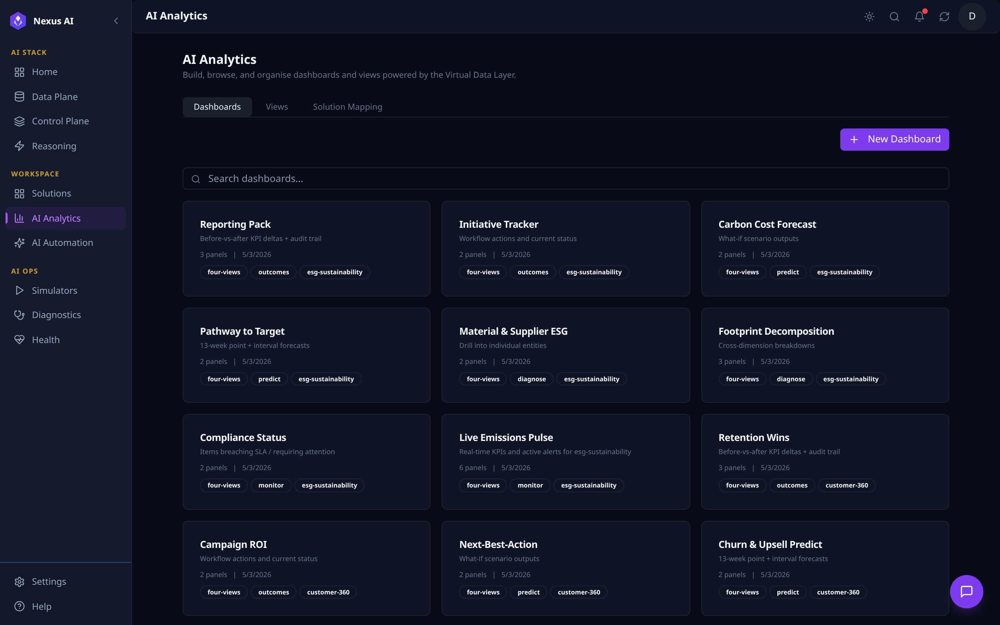
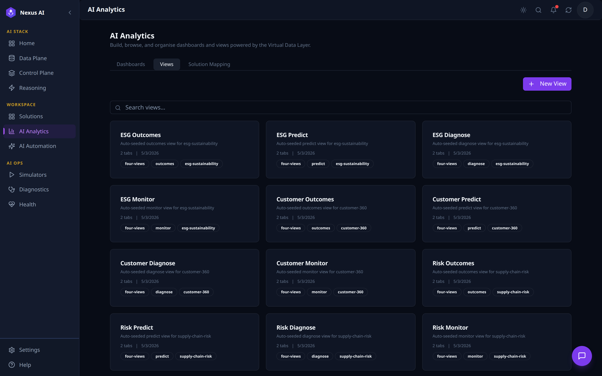
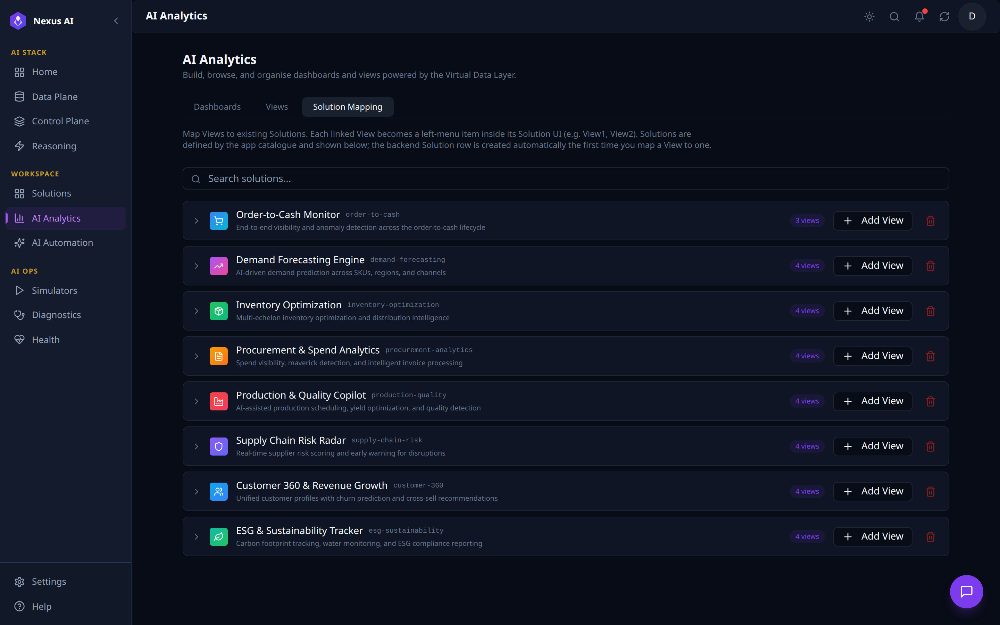
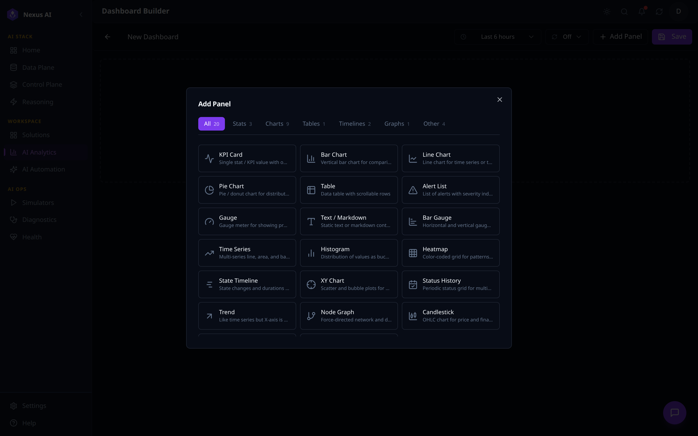
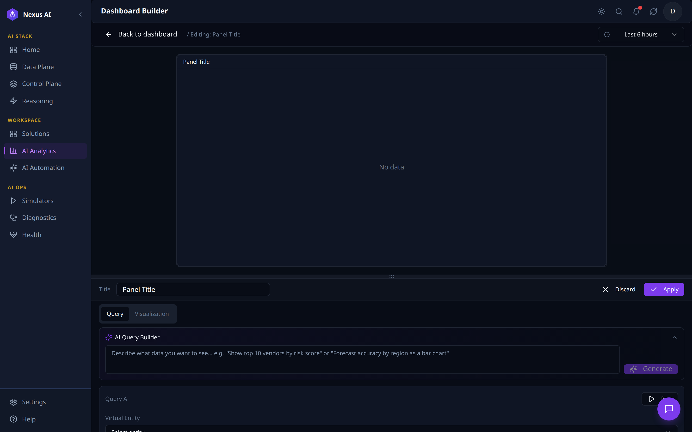
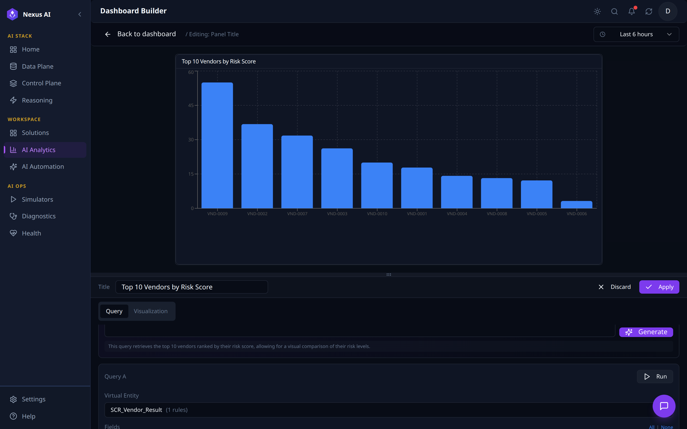

# AI Analytics

The AI Analytics layer is where the Virtual Data Layer is **turned into business insight**. It manages the lifecycle of dashboards and views -- the visual surfaces that consume ontology entities -- and binds them back to specific Solutions so each app gets its own purpose-built navigation.

For the framing in the platform overview, see [Platform Architecture > AI Analytics](../platform-architecture.md#ai-analytics).

## Capabilities

| Component | Description |
|---|---|
| Dashboards | Multi-panel reports built on top of the VDL, classified by intent (Outcomes, Predict, Diagnose, Monitor) |
| Views | Reusable analytical surfaces -- the building blocks that compose into Solution UIs |
| Four-Views Framework | Standard classification (Outcomes / Predict / Diagnose / Monitor) auto-seeded for every Solution |
| Solution Mapping | Bind Views to Solutions so each View shows up as a left-menu item in its Solution UI |
| Search & Tags | Free-text search plus typed tags (`four-views`, `outcomes`, `monitor`, `customer-360`, `esg-sustainability`, etc.) |
| Dashboard Builder | Multi-step canvas with the AI Query Builder for natural-language-to-VDL query authoring |

## Walkthrough

Three tabs in the NexusAI workspace -- covering browsing, authoring, and binding of dashboards and views -- plus a multi-step **Dashboard Builder** drill-down reached from the **+ New Dashboard** action on the Dashboards tab.

### Dashboards

Card grid of every dashboard in the workspace.

- **Card metadata** -- name, one-line description, panel count, last-updated date.
- **Tags** -- classification (`outcomes` / `predict` / `diagnose` / `monitor`) plus the target Solution slug, so dashboards are searchable by intent and by Solution.
- **Author** -- `+ New Dashboard` opens the Dashboard Builder.

### Views

Catalogue of reusable **Views** -- the analytical building blocks that compose into Solution UIs.

- **Four-views framework** -- every Solution is auto-seeded with four Views: *Outcomes*, *Predict*, *Diagnose*, *Monitor*.
- **Card metadata** -- classification + Solution tags, sub-tab count, last-updated date.
- **Author** -- `+ New View` for custom surfaces beyond the auto-seeded set.

### Solution Mapping

Editor for binding Views to Solutions -- each linked View becomes a left-menu item inside its Solution UI.

- **One row per catalogue Solution** with current view count and slug.
- **Per-row actions** -- `+ Add View` to bind another, trash icon to unmap all.
- **Auto-provisioning** -- the backend Solution row is created the first time a View is mapped to it.

## Dashboard Builder

The Dashboard Builder is the multi-step canvas reached by clicking **+ New Dashboard** on the Dashboards tab. It walks the author through three stages: pick a panel type, wire up its data with the **AI Query Builder**, and watch the visualisation render against the Virtual Data Layer.

### 1. Pick a panel type from the Add Panel catalogue

- **20 built-in panel types** across 7 categories (Stats, Charts, Tables, Timelines, Graphs, Other) -- KPI Card, Bar / Line / Pie Chart, Table, Gauge, Heatmap, Time Series, Histogram, Node Graph, etc.
- **Toolbar** -- dashboard title, time-range picker, auto-refresh, `+ Add Panel`, `Save`.

### 2. Wire the panel up with the AI Query Builder

- **Two-pane editor** -- live preview canvas above, configuration pane below with `Query` / `Visualization` tabs.
- **AI Query Builder** -- natural-language prompt that generates a structured query.
- **Structured Query block** -- Virtual Entity selector, fields, filters; runs against the VDL whether authored by hand or via the AI Query Builder.

### 3. Generate, run, and the visualisation renders live

- **Generate** -- the AI Query Builder fills the structured query, auto-titles the panel, and emits a one-line description of what was queried.
- **Live render** -- chart paints against the resolved Virtual Entity (e.g. `SCR_Vendor_Result`).
- **Persist** -- `Apply` adds the panel to the dashboard; `Visualization` tab refines axes / colours / thresholds.

## Related references

- [Solutions Catalogue](solutions-catalogue.md) -- where each Solution's mapped Views become its left navigation.
- [AI Automation](ai-automation.md) -- the Journey runtime; many Dashboards and Views surface its run metrics.
- [Data Plane](../planes/data-plane.md) -- the Virtual Data Layer that every Dashboard query runs against.
- [Implementation Guide](../ai-os/implementation-guide.md) -- production code mapping for the analytics surfaces.
