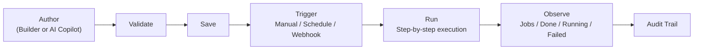

# AI Automation

The journey engine — the runtime that turns reasoning into repeatable, scheduled, multi-step business operations. Where the Reasoning Plane handles ad-hoc agentic queries, AI Automation handles the **production workflows**: scheduled ETL, semantic RAG indexing, and per-Solution operational journeys.

For platform-overview framing see [Platform Architecture > AI Automation](../platform-architecture.md#ai-automation).

## Capabilities

- **Journeys** — multi-step pipelines with persistent run history, success / failure metrics, and audit trail.
- **Journey Templates** — pre-wired starters per Solution and per pipeline type (Semantic RAG, O2C, Demand Forecasting, Inventory Optimisation, Procurement, Production & Quality, Supply Chain Risk, Customer 360, ESG).
- **AI Copilot Journey** — natural-language journey planner that drafts a journey from a goal description.
- **Journey Builder** — visual drag-and-drop builder with a typed Tool Palette, Step Editor, and validate / save / run controls.
- **Triggers** — Manual / Schedule / Webhook execution modes.
- **Tool Palette** — categorised, searchable catalogue of registered tools (Core, Supply Chain, O2C, Write, ...) the journey can call.

## Journey Lifecycle

## Walkthrough

Three tabs cover operations, conversational authoring, and visual authoring — plus a per-journey **Journey Studio** drill-down reached from any Journey card.

### Journeys

- Templates — one `+ New … Journey` per pipeline type (Semantic RAG plus one per Solution).
- Filters — status, type, free-text search.
- Per-card: JRN-id, type chip, status badge, run counters, success rate, average duration.
- Drill-in — `Journey Studio` opens the per-journey operations console.

### AI Copilot Journey

- Natural-language input — describe the goal, get a draft journey back.
- Output is a draft journey of typed steps, ready for refinement in the Journey Builder before save / run.
- Same tool registry as the visual builder — the Copilot is a planner, not a separate engine.

### Journey Builder

- Top toolbar: journey metadata, trigger type (`Manual` / `Schedule` / `Webhook`), run controls (`AI Suggest`, `Validate`, `Save`, `Run`).
- Tool Palette (left): every registered tool grouped by category with per-category counts and free-text search.
- Canvas (centre): step graph; populated by clicking a tool or invoking AI Suggest.
- Step Editor (right): per-step inputs, outputs, policy settings.

### Journey Studio

- Header — name, scope badge (Simulator / Production), id, last-updated, refresh, back.
- KPI tiles — processed volume, success rate, average duration, totals (with completed / failed breakdown).
- Processing Stages (left) — per-stage card with status badge and `Start Stage` action.
- Stage detail (centre) — description and run controls (`Start Processing`, `Schedule`, `View Report`, `View All Jobs`).
- Stage Steps — ordered execution graph with per-step `Logs` drill-in.

## Related References

- [Reasoning Plane](../planes/reasoning-plane.md) — the ad-hoc agent loop. AI Automation is the production-workflow counterpart.
- [Solutions Catalogue](solutions-catalogue.md) — each Solution's Workflow Actions are powered by Journeys defined here.
- [AI Analytics](ai-analytics.md) — many Dashboards and Views surface Journey run metrics.
- [Developer > MCP Tools](../developer/mcp-tools/journeys-tool.md) — the MCP-side runtime: `journeys_tool`, `run_jobs_tool`, `logs_and_reports_tool`.
- [Implementation Guide](../ai-os/implementation-guide.md) — production code mapping.
