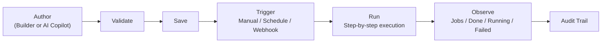
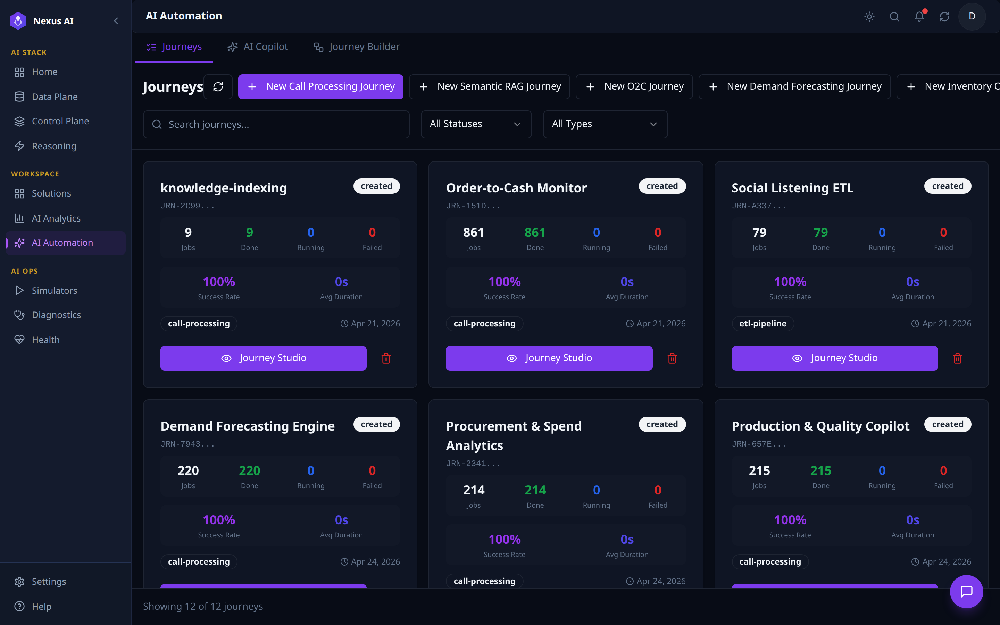
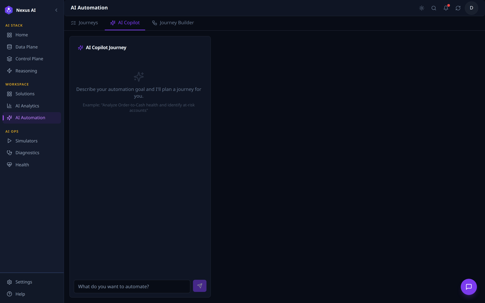
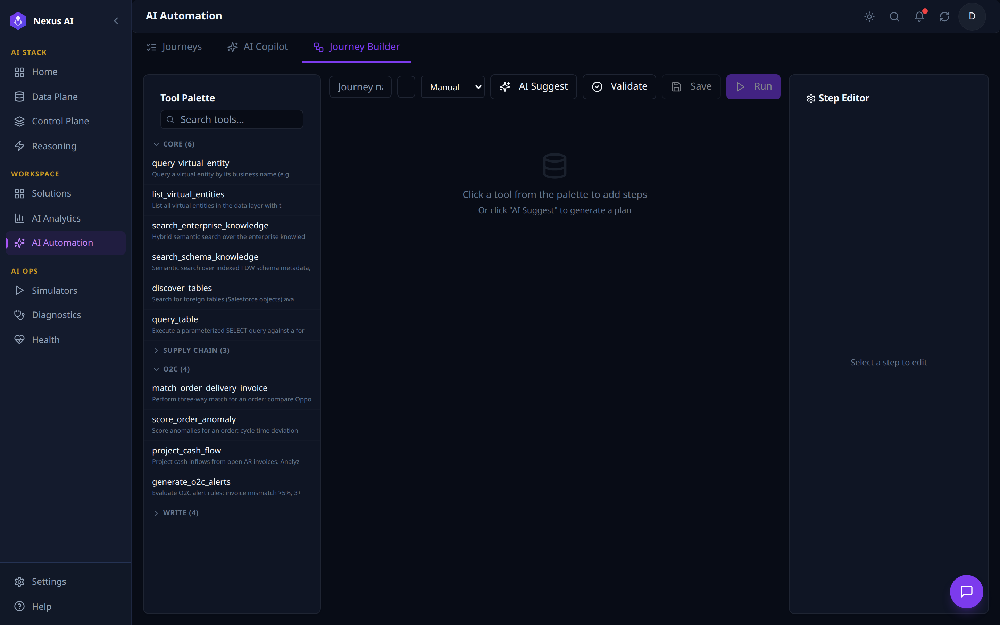
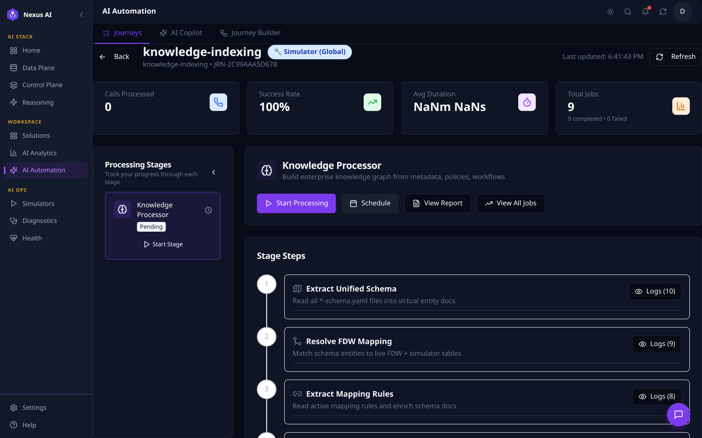

# AI Automation

The AI Automation layer is the **journey engine** -- the runtime that turns reasoning into repeatable, scheduled, multi-step business operations. Where the Reasoning Plane handles ad-hoc agentic queries, AI Automation handles the **production workflows**: scheduled ETL, semantic RAG indexing, and per-Solution operational journeys.

For the framing in the platform overview, see [Platform Architecture > AI Automation](../platform-architecture.md#ai-automation).

## Capabilities

| Component | Description |
|---|---|
| Journeys | Multi-step pipelines with persistent run history, success / failure metrics, and audit trail |
| Journey Templates | Pre-wired journey starters per Solution and per pipeline type (Semantic RAG, O2C, Demand Forecasting, Inventory Optimisation, Procurement, Production & Quality, Supply Chain Risk, Customer 360, ESG) |
| AI Copilot Journey | Natural-language journey planner -- describe the goal, get a draft journey back |
| Journey Builder | Visual drag-and-drop builder with a typed Tool Palette, Step Editor, and validate / save / run controls |
| Triggers | Manual / Schedule / Webhook execution modes |
| Tool Palette | Categorised, searchable catalogue of registered tools (Core, Supply Chain, O2C, Write, ...) the journey can call |

## Journey lifecycle

## Walkthrough

Three tabs in the NexusAI workspace -- covering operations, conversational authoring, and visual authoring -- plus a per-journey **Journey Studio** drill-down view reached from any Journey card.

### Journeys

Operational dashboard for every journey running on the platform.

- **Templates** -- one `+ New … Journey` per pipeline type (Semantic RAG plus one per Solution).
- **Filters** -- status, type, free-text search.
- **Card metadata** -- JRN-id, type chip, status badge, run counters (`Jobs / Done / Running / Failed`), `Success Rate`, `Avg Duration`.
- **Drill-in** -- `Journey Studio` opens the per-journey operations console.

### AI Copilot

Conversational on-ramp to the journey runtime.

- **Natural-language input** -- *"Describe your automation goal and I'll plan a journey for you."*
- **Output** -- a draft journey of typed steps, ready for refinement in the Journey Builder before save / run.
- **Same tool registry** as the visual builder -- the Copilot is a planner, not a separate engine.

### Journey Builder

Three-pane visual authoring surface for journeys.

- **Top toolbar** -- journey metadata, trigger type (`Manual` / `Schedule` / `Webhook`), and run controls (`AI Suggest`, `Validate`, `Save`, `Run`).
- **Tool Palette** (left) -- every registered tool grouped by category (CORE, SUPPLY CHAIN, O2C, WRITE, ...) with per-category counts and free-text search.
- **Canvas** (centre) -- step graph; populated by clicking a tool or invoking `AI Suggest`.
- **Step Editor** (right) -- per-step configuration: inputs, outputs, policy settings.

### Journey Studio

Per-journey operations console -- reached from the `Journey Studio` button on any Journey card.

- **Header** -- journey name, scope badge (Simulator / Production), journey id, last-updated, `Refresh`, `Back`.
- **KPI tiles** -- Calls Processed, Success Rate, Avg Duration, Total Jobs (with completed / failed breakdown).
- **Processing Stages** (left) -- one card per stage with status badge (`Pending` / `Running` / `Done`) and `Start Stage` action.
- **Stage detail** (centre) -- selected stage's description and run controls (`Start Processing`, `Schedule`, `View Report`, `View All Jobs`).
- **Stage Steps** -- ordered execution graph, each step with a `Logs (N)` drill-in for per-step trace.

## Related references

- [Reasoning Plane](../planes/reasoning-plane.md) -- the ad-hoc agent loop. AI Automation is the production-workflow counterpart.
- [Solutions Catalogue](solutions-catalogue.md) -- each Solution's Workflow Actions are powered by Journeys defined here.
- [AI Analytics](ai-analytics.md) -- many Dashboards and Views surface Journey run metrics.
- [Developer > MCP Tools](../developer/mcp-tools/journeys-tool.md) -- the MCP-side runtime: `journeys_tool`, `run_jobs_tool`, `logs_and_reports_tool`.
- [Implementation Guide](../ai-os/implementation-guide.md) -- production code mapping.
