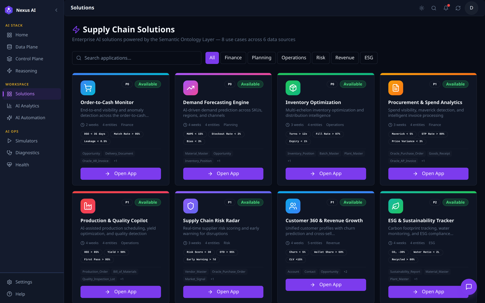
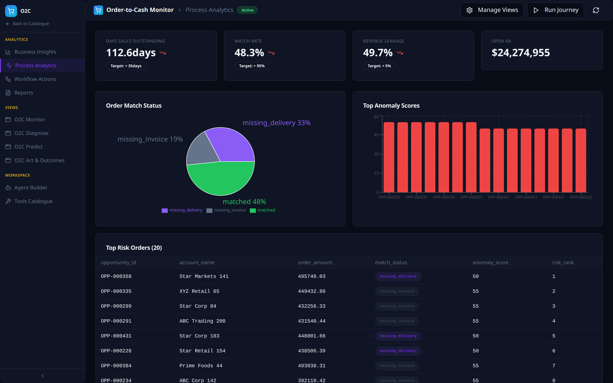
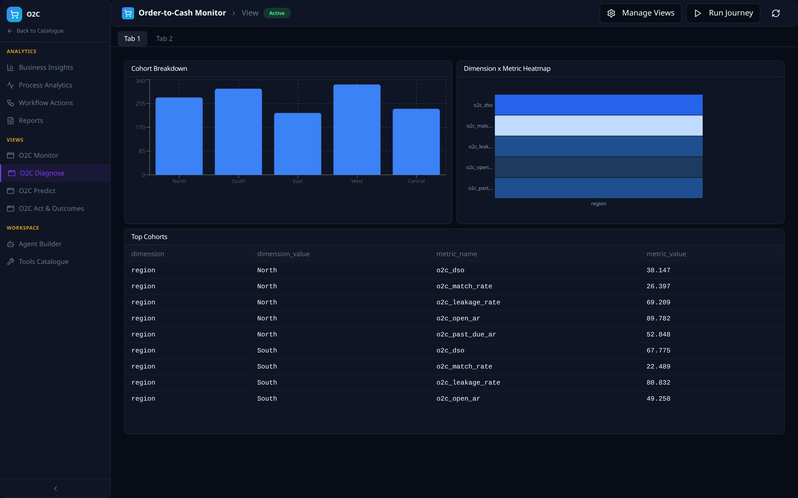
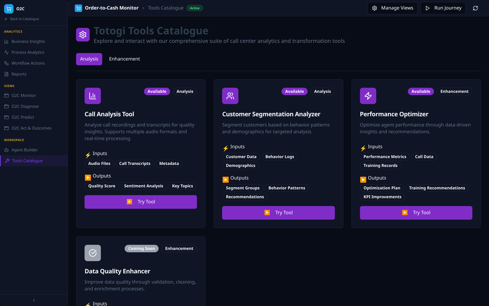

# Solutions Catalogue

The Solutions layer is the **app catalogue** that sits on top of the three planes. Each Solution is a pre-built, vertical-aligned enterprise application powered by the Semantic Ontology Layer — bundling the entities, KPIs, dashboards, and journeys needed to operate one slice of the business end to end.

For platform-overview framing see [Platform Architecture > Solutions](../platform-architecture.md#solutions).

## Capabilities

- **Solution Card** — name, description, setup time, entity count, KPI targets, and source-data dependencies.
- **Vertical Filter** — chips by domain (Finance, Planning, Operations, Risk, Revenue, ESG).
- **Priority Badge** — rollout priority (P0, P1) signalling which Solutions to deploy first.
- **KPI Targets** — headline metrics each Solution moves.
- **Source Data Tags** — ontology entities the Solution consumes.
- **Open App** — one-click launch into the Solution's workspace, where its mapped Views become the left navigation.

## Catalogue Tab

- Vertical chips and free-text search across the catalogue.
- Per-card: icon, priority, status, setup time, entity count, headline KPI targets, source-entity chips.
- `Open App` launches the Solution's workspace.

## Solution App Example — Order-to-Cash Monitor

Each Solution opens into a dedicated workspace with a left nav grouped into **Analytics**, **Views**, and **Workspace**, plus a top **Manage Views** / **Run Journey** action bar. Every Solution follows the same shell, parameterised by its ontology entities, KPI targets, and journeys.

### Analytics — Business Insights (Solution home)

- Hero KPI strip with use-case targets.
- Stat tiles and capability cards (Dashboards, Alerts, Workflows, AI Assistant) as quick entry-points.
- Data Entities strip listing every consumed ontology object.

### Analytics — Process Analytics

- KPI tiles with actuals, deltas, and target thresholds.
- Composition charts and a top-risk drill-down table.

### Analytics — Workflow Actions

- Per-action-type counters (Credit Hold, Dispute Case, SLA Escalation, Dunning, Expedited, Credit Note).
- Action log with type, target entity, and status.

### Analytics — Reports

- Severity counters (Critical / High / Medium / Low).
- Scrollable alert feed with type, target, deviation, and remediation.

### Views — the Four-Views Framework, Instantiated

The four auto-seeded Views (`outcomes` / `predict` / `diagnose` / `monitor` from [AI Analytics](ai-analytics.md)) appear as left-nav items.

### Workspace — Agent Builder

- **Custom Tools** — declare ReAct tools as YAML.
- **Journey Templates** — compose automations.
- **Agent Profiles** — behaviour, permissions, system prompts.
- **Test Harness** — sample-input validation.

### Workspace — Tools Catalogue

- App-curated — only tools relevant to the Solution surface.
- Tool-type tabs (Analysis, Automation, Enhancement) derived from populated tools.
- Each card: typed inputs / outputs, availability, and a `Try Tool` action.

## Browsing the Full Vertical Catalogues

Each industry vertical has its own Solutions catalogue, ontology, and per-Solution apps:

- [Supply Chain](../app-catalogue/supply-chain/index.md) — Demand Forecasting, Inventory Optimisation, Order-to-Cash Monitor, Supply Chain Risk, Customer 360, Procurement, Production & Quality, ESG.
- [Finance & Banking](../app-catalogue/finance-banking/index.md) — Customer 360, Credit Risk, Fraud Detection & AML, Regulatory Compliance, Treasury, Loan Lifecycle, Revenue Optimisation, Operational Risk.
- [Telecommunications](../app-catalogue/telco/index.md) — Customer 360 & Churn, Network Performance, Revenue Assurance & Fraud, Customer Experience, Network Capacity, Dynamic Pricing, Field Operations, Regulatory Compliance.
- [Retail](../app-catalogue/retail/index.md) — Customer 360 & Loyalty, Demand Forecasting, Personalisation, Price Optimisation, Inventory & Fulfilment, Store Operations, Supplier & Merchandising, Sustainability.
- [Healthcare](../app-catalogue/healthcare/index.md) — Patient 360, Clinical Decision Support, Revenue Cycle, Operational Efficiency, Population Health, Supply Chain & Pharmacy, Clinical Quality, Regulatory Compliance.
- [Customer Operations](../app-catalogue/customer-ops/index.md) — Autonomous Issue Resolution, Proactive Agent Assist, Unified Operations Hub.
- [Revenue Operations](../app-catalogue/rev-ops/index.md) — Deal Intelligence, Pipeline Risk Forecasting, Revenue Orchestration.

## Related References

- [AI Analytics](ai-analytics.md) — the four-views framework and Solution Mapping that drive each Solution's left navigation.
- [AI Automation](ai-automation.md) — the Journey runtime that powers each Solution's Workflow Actions.
- [Control Plane](../planes/control-plane.md) — where each Solution's ontology lives.
- [Data Plane](../planes/data-plane.md) — where the entities each Solution consumes are hydrated.
