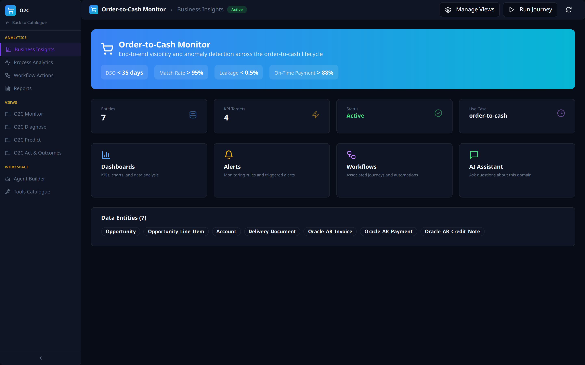
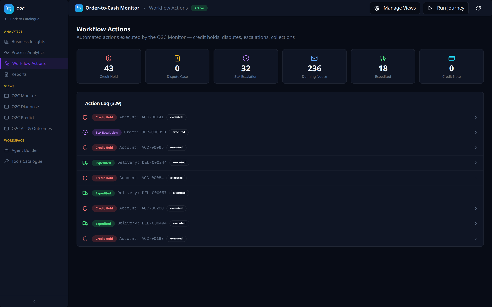
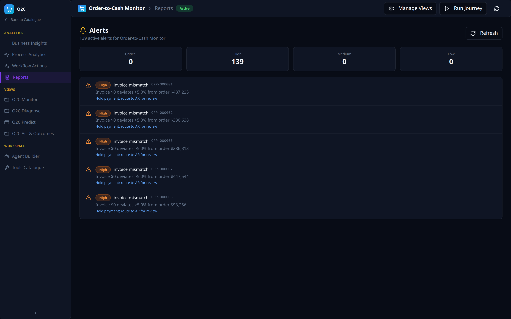
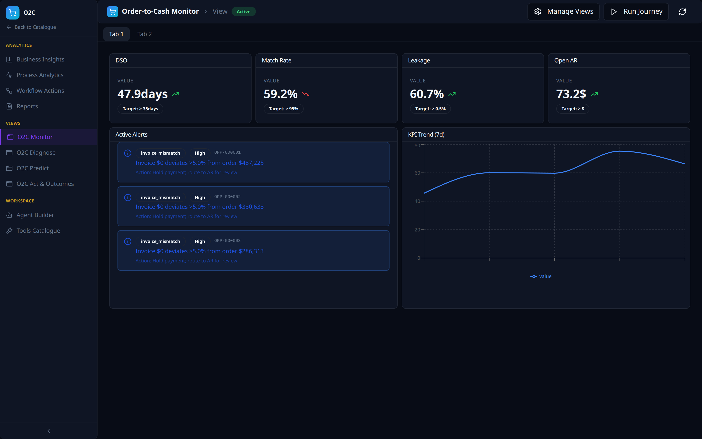
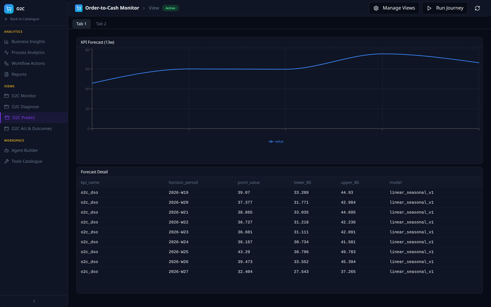
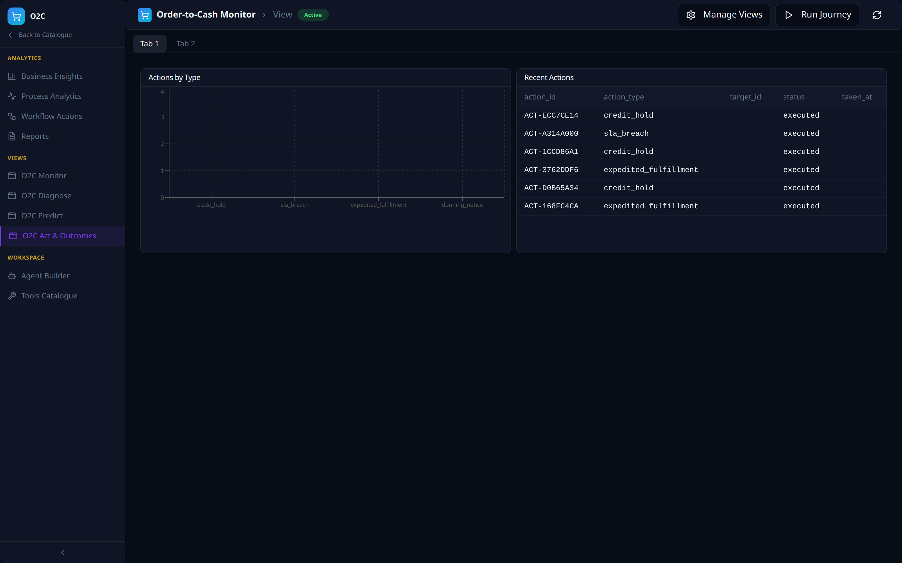
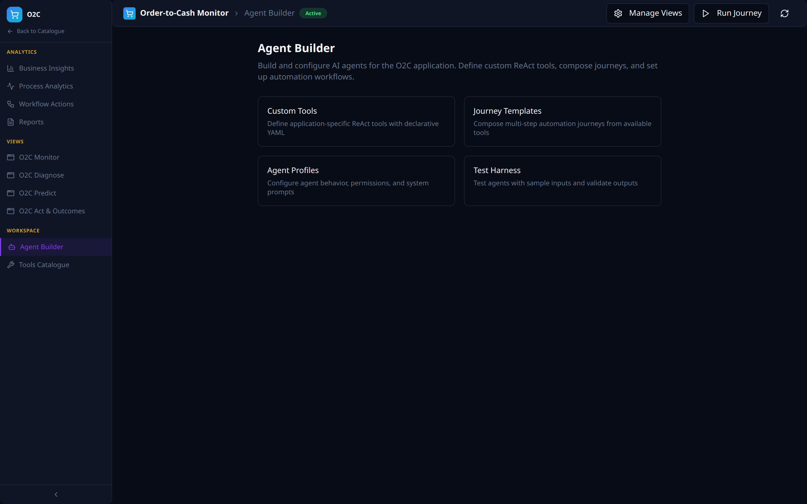

# Solutions Catalogue

The Solutions layer is the **app catalogue** that sits on top of the three planes. Each Solution is a pre-built, vertical-aligned enterprise application powered by the Semantic Ontology Layer -- it bundles the entities, KPIs, dashboards, and journeys needed to operate one slice of the business end-to-end.

For the framing in the platform overview, see [Platform Architecture > Solutions](../platform-architecture.md#solutions).

## Capabilities

| Component | Description |
|---|---|
| Solution Card | Self-contained application with name, description, setup time, entity count, KPI targets, and source-data dependencies |
| Vertical Filter | Filter chips by domain (Finance, Planning, Operations, Risk, Revenue, ESG) |
| Priority Badge | Rollout priority (P0, P1) -- which Solutions to deploy first |
| KPI Targets | Headline metrics each Solution moves (e.g. DSO < 35 days, MAPE < 15%, OEE > 85%) |
| Source Data Tags | Which ontology entities the Solution consumes (e.g. Opportunity, Material Master, Vendor Master) |
| Open App | One-click launch into the Solution's workspace, where its mapped Views become the left navigation |

## Catalogue tab

One-page catalogue of pre-built enterprise apps powered by the Semantic Ontology Layer.

- **Filter** -- vertical chips (Finance, Planning, Operations, Risk, Revenue, ESG) plus free-text search.
- **Card metadata** -- icon, priority (P0 / P1), `Available` status, setup time, entity count, headline KPI targets, source-entity chips.
- **Open App** -- launches the Solution's workspace, where its mapped Views become the left navigation.

## Solution App example -- Order-to-Cash Monitor

Each Solution opens into a dedicated workspace with a left nav grouped into **Analytics**, **Views**, and **Workspace**, plus a top-level **Manage Views** / **Run Journey** action bar. **Order-to-Cash Monitor** below is the canonical example -- every Solution follows the same shell, parameterised by its ontology entities, KPI targets, and journeys.

### Analytics -- Business Insights (Solution home)

- Hero KPI strip showing the use-case targets (DSO, Match Rate, Leakage, On-Time Payment).
- Stat tiles (Entities, KPI Targets, Status, Use Case slug) and capability cards (Dashboards, Alerts, Workflows, AI Assistant) as quick entry points.
- Data Entities strip listing every ontology object the Solution consumes.

### Analytics -- Process Analytics

- KPI tiles with **actual** values, deltas, and target thresholds (e.g. *Days Sales Outstanding 112.6 days vs target < 35 days*).
- Composition charts (Order Match Status donut, Top Anomaly Scores bar) plus a Top Risk Orders drill-down table.

### Analytics -- Workflow Actions

- Per-action-type counters (Credit Hold, Dispute Case, SLA Escalation, Dunning Notice, Expedited, Credit Note).
- Action Log feed of every executed action with type, target entity, and status.

### Analytics -- Reports

- Severity counters (Critical / High / Medium / Low) and a scrollable alert feed.
- Each alert carries type, target order, deviation summary, and remediation action.

### Views -- the four-views framework, instantiated

The four auto-seeded Views (`outcomes` / `predict` / `diagnose` / `monitor` from [AI Analytics](ai-analytics.md)) appear as left-nav items: **O2C Monitor**, **O2C Diagnose**, **O2C Predict**, **O2C Act & Outcomes**. Each is a multi-tab dashboard composed of intent-specific panels against the same VDL.

### Workspace -- Agent Builder

- **Custom Tools** (declare ReAct tools as YAML), **Journey Templates** (compose automations), **Agent Profiles** (behaviour, permissions, system prompts), **Test Harness** (sample-input validation).

### Workspace -- Tools Catalogue

- **App-curated** -- the catalogue surfaces only tools relevant to this Solution, grounded in its ontology entities (for O2C: *Order Match Verifier*, *Order Anomaly Scorer*, *AR Cash Flow Projector*, *O2C Alert Generator*, *Dunning Notice Composer*, *DSO Optimizer*).
- **Tool-type tabs** are derived from the populated tools (Analysis, Automation, Enhancement here).
- Each card surfaces typed **Inputs / Outputs** (e.g. `Opportunity`, `Oracle_AR_Invoice` -> `match_status`, `discrepancy_amount`), availability (`Available` / `Coming Soon`), and a `Try Tool` action.

## Browsing the full vertical catalogues

Each industry vertical has its own Solutions catalogue, ontology, and per-Solution apps:

- [Supply Chain](../app-catalogue/supply-chain/index.md) -- Demand Forecasting, Inventory Optimisation, Order-to-Cash Monitor, Supply Chain Risk, Customer 360, Procurement, Production & Quality, ESG.
- [Finance & Banking](../app-catalogue/finance-banking/index.md) -- Customer 360, Credit Risk, Fraud Detection & AML, Regulatory Compliance, Treasury, Loan Lifecycle, Revenue Optimisation, Operational Risk.
- [Telecommunications](../app-catalogue/telco/index.md) -- Customer 360 & Churn, Network Performance, Revenue Assurance & Fraud, Customer Experience, Network Capacity, Dynamic Pricing, Field Operations, Regulatory Compliance.
- [Retail](../app-catalogue/retail/index.md) -- Customer 360 & Loyalty, Demand Forecasting, Personalisation, Price Optimisation, Inventory & Fulfilment, Store Operations, Supplier & Merchandising, Sustainability.
- [Healthcare](../app-catalogue/healthcare/index.md) -- Patient 360, Clinical Decision Support, Revenue Cycle, Operational Efficiency, Population Health, Supply Chain & Pharmacy, Clinical Quality, Regulatory Compliance.
- [Customer Operations](../app-catalogue/customer-ops/index.md) -- Autonomous Issue Resolution, Proactive Agent Assist, Unified Operations Hub.
- [Revenue Operations](../app-catalogue/rev-ops/index.md) -- Deal Intelligence, Pipeline Risk Forecasting, Revenue Orchestration.

## Related references

- [AI Analytics](ai-analytics.md) -- the four-views framework and Solution Mapping that drive each Solution's left navigation.
- [AI Automation](ai-automation.md) -- the Journey runtime that powers each Solution's Workflow Actions.
- [Control Plane](../planes/control-plane.md) -- where each Solution's ontology lives.
- [Data Plane](../planes/data-plane.md) -- where the entities each Solution consumes are hydrated.
