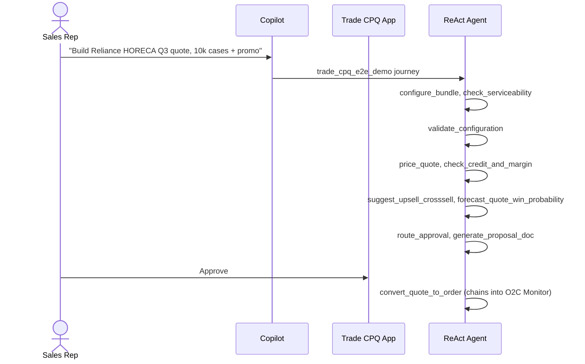
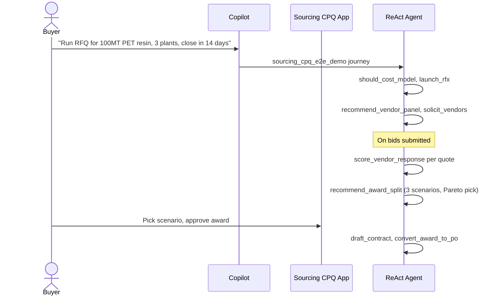

# CPQ Regression & Demo Notes

S8 hardening artifacts for the Supply Chain CPQ platform. Defines the end-to-end demo journeys, regression coverage on existing solutions, and the AI-layer features that landed across the sprint.

For scope, KPIs, and UAT scenarios see [CPQ Scope & UAT](scope.md).

---

## 1. AI Layer Inventory

The eight sprints landed the following AI-first capabilities. Every tool is read-only by default; write-capable tools are gated by `requires_approval` and `connector_api` so they appear on the approval queue.

### Guided Selling (Sell-Side)

| Capability | Tool | Inputs | Output |
|------------|------|--------|--------|
| Bundle assembly | `configure_bundle` | account, target SKUs, channel | Ranked candidate offerings |
| Rule validation | `validate_configuration` | quote | Violations with severity |
| Serviceability | `check_serviceability` | quote | Footprint match + SLA |
| Pricing waterfall | `price_quote` | quote | Per-line waterfall + blended margin |
| Margin & credit | `check_credit_and_margin` | quote | Credit utilization + margin breach flag |
| Approval routing | `route_approval` | quote | Persisted Approval_Chain_JSON |
| LLM proposal | `generate_proposal_doc` | quote | Markdown proposal |
| Quote-to-order | `convert_quote_to_order` | quote | Materialized Opportunity + chain to O2C |
| Cross-sell | `suggest_upsell_crosssell` | quote | Historic-purchase-driven add-ons |
| Win probability | `forecast_quote_win_probability` | quote | 0–1 score with drivers |

### Award Optimization (Buy-Side)

| Capability | Tool | Inputs | Output |
|------------|------|--------|--------|
| RFx launch | `launch_rfx` | category, plants, qty, due | RFx_Event + lines |
| Vendor panel | `recommend_vendor_panel` | event | Ranked candidates by risk + cert |
| Solicit | `solicit_vendors` | event, vendor list | RFx_Invitation rows |
| Should-cost | `should_cost_model` | material, qty | Bottom-up cost + confidence |
| Bid scoring | `score_vendor_response` | vendor_quote | Composite + per-line scores |
| Scenario | `run_award_scenario` | event, strategy | Sourcing_Scenario row |
| Award optimizer | `recommend_award_split` | event | Pareto-optimal scenario subject to 60 % cap |
| Contract draft | `draft_contract` | award | Markdown contract |
| PO conversion | `convert_award_to_po` | award | Issued award + PO chain |

---

## 2. End-to-End Demo Journeys

Two automation YAMLs, one per side, exercise the full happy path:

- Sell: [`automation/cpq-sell/trade_cpq_e2e_demo.yaml`](../../../../nexus-backend/enterprise-knowledge/automation/cpq-sell/trade_cpq_e2e_demo.yaml)
- Buy: [`automation/cpq-buy/sourcing_cpq_e2e_demo.yaml`](../../../../nexus-backend/enterprise-knowledge/automation/cpq-buy/sourcing_cpq_e2e_demo.yaml)

Both journeys are surfaced in the Copilot Journey list and discoverable via the NLQ exemplars in [`nlq-exemplars.yaml`](../../../../nexus-backend/enterprise-knowledge/nlq-exemplars.yaml).

### Sell-side demo flow

### Buy-side demo flow

---

## 3. Regression Coverage on Existing Solutions

Because CPQ chains into existing flows we must verify no regression:

| Existing Flow | Touchpoint | Verification |
|----------------|-------------|---------------|
| [Order-to-Cash Monitor](../app-catalogue/supply-chain/order-to-cash.md) | `convert_quote_to_order` materializes Opportunity + Delivery and emits `closed_won` | Run `automation/order-to-cash/*.yaml`; confirm `match_order_delivery_invoice` resolves for newly-converted quotes |
| [Procurement Analytics](../app-catalogue/supply-chain/procurement-analytics.md) | `convert_award_to_po` triggers PO creation in Oracle/SAP | Run `automation/procurement-analytics/*.yaml`; confirm spend cube reflects the new PO |
| [Supply Chain Risk Radar](../app-catalogue/supply-chain/supply-chain-risk.md) | `recommend_vendor_panel` filters by `Vendor_Master.Risk_Score`; `convert_award_to_po` updates `Source_List` | Run `WORKFLOW_SUPPLIER_RISK_SCORING_V1_0`; confirm risk re-score on awarded vendors |
| [Demand Forecasting](../app-catalogue/supply-chain/demand-forecasting.md) | Won quotes increase `Opportunity` volumes, which influence the next forecast cycle | Run `WORKFLOW_DEMAND_FORECAST_V1_0`; confirm new Opportunity rows are in the feature engineering stage |
| [Inventory Optimization](../app-catalogue/supply-chain/inventory-optimization.md) | Quote-to-order reserves inventory; Source_List updates flow to plant MRP | Run `WORKFLOW_INVENTORY_REBALANCING_V1_0`; confirm Reserved_Qty increments |

---

## 4. Operational Checks

- **Simulator readiness**: `GET /api/v1/tpm-simulator/status` and `GET /api/v1/sourcing-simulator/status` must report `loaded: true` after backend boot.
- **Schema visibility**: hit the data-plane explorer; Domain 13 and Domain 14 entities must appear under TPM_Simulator and Sourcing_Simulator.
- **Tool registry**: `GET /api/v1/control-plane/tools` must list all eleven sell-side and nine buy-side tools, all tagged `bucket=supply-chain`.
- **Reasoning trace**: every CPQ tool invocation must surface as a row in the Reasoning Plane copilot trace with token cost and latency.

---

## 5. Known Limitations (Carry to v2)

- Salesforce CPQ live FDW: deferred. Simulator-toggle pattern lets us swap in later.
- SAP Ariba live FDW: deferred.
- Multi-currency: single currency per quote/RFx in v1.
- Reverse auction live bidding UI: entity supported, only static bid matrix view in v1.
- E-signature: deferred. Proposal/contract is finalized in Markdown/PDF only.
- Should-cost: indexed only on internal `Commodity_Price`. External indices (LME, Bloomberg) are a v2 enhancement.

---

[Back to CPQ index](def.md)
