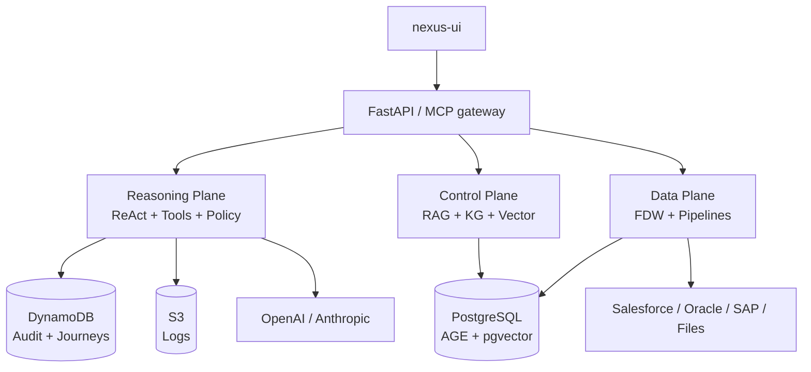

# NexusAI Backend (`nexus-backend`)

The Python / FastAPI service that runs the **Data Plane**, **Control Plane**, and **Reasoning Plane** of the NexusAI Data-AI Platform. Lives at `/opt/mycode/nexus/nexus-backend`.

For the production code-to-architecture mapping, see [Implementation Guide](../../ai-os/implementation-guide.md).

## Responsibilities

- **Data Plane** -- FDW discovery and queries (Multicorn / PostgreSQL FDW), Mapping Rule resolution, Data Pipeline runtime.
- **Control Plane** -- Knowledge Pipeline (extracts schemas, mappings, policies, workflows, integrations -> Apache AGE + pgvector), Policy / Workflow / Integration editors backend, semantic + graph retrieval.
- **Reasoning Plane** -- ReAct agent loop (`agent_executor.py`), Intent + Risk Analyzer, Tool Registry, Policy Engine, Audit Logger.
- **Console APIs** -- `/api/v1/control-plane/*`, `/api/fdw/*`, `/api/v1/journeys/*`, `/api/v1/sfdc-simulator/*`, `/api/v1/config/*`, `/health`.
- **MCP HTTP Gateway** -- the unified MCP entry-point used by external agents and the Reasoning Plane.

## High-level shape



## Quick start

### Prerequisites

- Python 3.11+
- Docker (for LocalStack)
- AWS account (or LocalStack for local dev)

### Configuration system

Centralised provider supports three modes:

| Environment | Config source | Resource pattern |
|---|---|---|
| ECS / EKS | SSM Parameter Store + Secrets Manager | `nexus-ai-prod-*` |
| Local AWS | environment variables | `nexus-ai-dev-*` |
| LocalStack | `.env.local` file | `nexus-ai-local-*` |

### Running the gateway

`gateway.sh` provides a unified interface:

```bash
./gateway.sh start    # start
./gateway.sh stop
./gateway.sh restart
./gateway.sh status
./gateway.sh logs
./gateway.sh test     # smoke test
```

### LocalStack mode (recommended for development)

```bash
docker-compose -f docker-compose-localstack.yml up -d
cp .env.localstack.example .env.local
export USE_LOCALSTACK=true LOCALSTACK_HOST=localhost LOCALSTACK_PORT=4566
pip install -r requirements.txt
python -m tests.localstack_automation.run_automation --setup
./gateway.sh start
./gateway.sh test
```

See [LocalStack > Quick Start](../localstack/QUICKSTART_LOCALSTACK.md) for the full LocalStack walkthrough.

### Real AWS mode

```bash
aws configure                      # or `export AWS_PROFILE=...`
export ENVIRONMENT=dev
export AWS_REGION=ap-southeast-1
pip install -r requirements.txt
./gateway.sh start
```

For env-var details, see [LocalStack Setup](env-local-example.md).

## Directory layout (selected)

| Path | Purpose |
|---|---|
| `src/apis/` | FastAPI routers (Control Plane, FDW, Journeys, Simulator, Config, Health) |
| `src/services/control_plane/` | RAG, vector store, schema indexer, agent executor, policy engine, audit logger, intent analyzer, tool registry |
| `src/services/control_plane/tools/` | Registered ReAct tools (FDW tools, RAG tools, CRM tools) |
| `src/services/fdw_*` | Foreign Data Wrapper services |
| `src/services/sfdc_simulator_service.py` | In-memory SFDC simulator (replaces live FDW for testing) |
| `src/stages/` | Journey stage implementations (subclass `BaseStage`) |
| `src/models/` | Pydantic models for every API surface |
| `tests/` | Unit / property / integration / BDD / endurance / E2E tests |
| `mcp_http_gateway.py` | MCP HTTP server entry-point |

## Adding things

| Adding a... | Where | Tests in |
|---|---|---|
| REST endpoint | `src/apis/` | `tests/integration/python/api/` |
| MCP tool | `src/services/control_plane/tools/` (register in `tool_registry.py`) | `tests/unit/` + `tests/bdd/features/` |
| Journey stage | `src/stages/` (subclass `BaseStage`) | `tests/unit/` |
| Policy rule | `src/services/control_plane/policy_engine.py` | `tests/unit/` |
| Connector | `src/services/connectors/` + UI side in `nexus-ui/src/components/` | `tests/integration/` |

## Common tasks

```bash
# Health
curl http://localhost:8000/health

# List FDW foreign servers
curl http://localhost:8000/api/fdw/servers

# Trigger Knowledge Pipeline (re-index Control Plane)
curl -X POST http://localhost:8000/api/v1/control-plane/index

# Run an agent query
curl -X POST http://localhost:8000/api/v1/control-plane/agent \
  -H 'Content-Type: application/json' \
  -d '{"question":"Show me the first 5 Leads with their name and company"}'

# Run all unit tests
./tests/run_tests.sh unit

# Run integration tests against a remote server
./tests/run_tests.sh integration --server https://my-host:8000
```

## Related references

- [Implementation Guide](../../ai-os/implementation-guide.md) -- the production code-to-architecture mapping for every plane.
- [Platform Architecture](../../platform-architecture.md) -- the user-facing surfaces this backend powers.
- [MCP Tools](../mcp-tools/journeys-tool.md) -- the journey / job / log MCP tool reference.
- [Tests](../../tests/index.md) -- the layered test infrastructure.
- [Operations](../../operational/index.md) -- how this backend is deployed.
