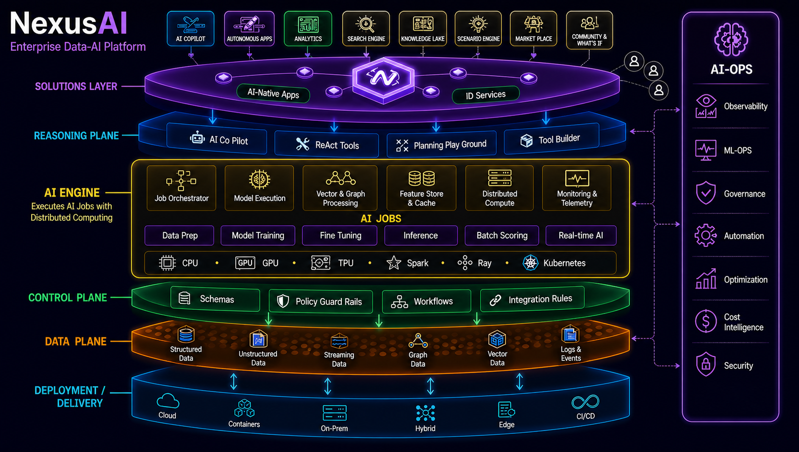
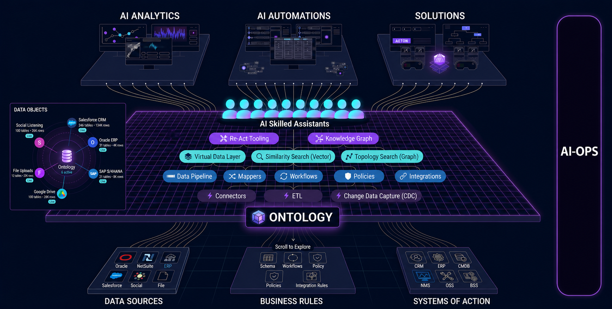

---
hide:
  - toc
---

# NexusAI Data Platform

Welcome to the comprehensive documentation portal for the **NexusAI Data Platform** -- an enterprise-grade AI operating layer that connects your systems, builds semantic context, and deploys autonomous agents that reason and act across your organization.

<picture>
  <source
    type="image/webp"
    srcset="assets/nexus-data-ai-1024.webp 1024w, assets/nexus-data-ai.webp 1667w"
    sizes="(max-width: 1024px) 96vw, min(96vw, 1600px)">
  
</picture>

## Executive Summary

### What is NexusAI?

NexusAI is **the Intelligent AI Operating Layer for the Enterprise**. Rather than replacing existing systems, NexusAI sits on top of your current technology stack -- CRMs, ERPs, data warehouses, and operational tools -- and unifies them into a single, AI-driven intelligence fabric. It transforms siloed enterprise data into connected, actionable knowledge that autonomous agents use to reason, decide, and execute.

### How It Works

NexusAI operates through a four-stage pipeline that turns disconnected enterprise data into autonomous action:

| Stage | Description |
|-------|-------------|
| **Connect** | Plug into existing enterprise systems -- CRM, ERP, data warehouses, SaaS tools -- via pre-built connectors and APIs. No data migration or system replacement required. |
| **Map** | Build a semantic knowledge graph that captures entities, relationships, and business context across all connected systems. |
| **Reason** | The AI Reasoning Engine applies structured reasoning (ReAct) across the connected knowledge graph to analyze situations, identify patterns, and determine optimal actions. |
| **Execute** | Autonomous agents carry out end-to-end workflows -- updating records, triggering processes, escalating exceptions -- with full auditability and human-in-the-loop controls. |

---

## Key Capabilities

!!! abstract "AI Engine for Ontologies"
    Distributed AI engine that runs any ontology as executable AI workloads -- data prep, model training, fine-tuning, inference, batch scoring, and real-time AI. Pluggable compute backends (CPU, GPU, TPU, Spark, Ray, Kubernetes) so the same ontology runs anywhere from a single node to a multi-region cluster.

!!! abstract "AI-Ops Stack for Ontologies"
    Production-grade operating layer wrapped around every ontology and AI workflow: Observability, ML-Ops, Governance, Automation, and Optimization. Policy guardrails, audit trail, drift and cost monitoring, and lifecycle management built in -- not bolted on.

!!! abstract "Enterprise Data Integration"
    Pre-built connectors for CRM, ERP, data warehouses, and SaaS platforms. Unified data access layer with real-time and batch ingestion. Zero-migration architecture -- NexusAI connects to systems in place.

!!! abstract "Semantic Intelligence Layer"
    Automated knowledge graph construction from connected data sources. Entity resolution, relationship mapping, and contextual enrichment. A living semantic model that evolves as your data changes.

!!! abstract "AI Reasoning Engine (ReAct)"
    Structured Reasoning + Acting framework for multi-step decision-making. Cross-system analysis that no single tool can perform alone. Transparent reasoning traces for auditability and compliance.

!!! abstract "AI Analytics"
    Dashboards, Views, and the Four-Views framework (Outcomes / Predict / Diagnose / Monitor) auto-seeded for every Solution. Solution Mapping binds each View into the right Solution UI; the Dashboard Builder with the AI Query Builder turns natural language into Virtual Data Layer queries.

!!! abstract "AI Automation"
    Journey engine for production workflows -- multi-step pipelines with persistent run history, audit trail, and Manual / Schedule / Webhook triggers. The AI Copilot Journey turns a plain-English goal into a draft journey; the Journey Builder offers visual authoring with a typed Tool Palette and per-step validation.

!!! abstract "AI Simulators"
    Built-in enterprise data simulators (starting with the SFDC / CRM simulator) that let development and QA teams exercise the full Data Plane and Reasoning Plane without connecting to live external systems. In-memory stores backed by S3 dumps swap into the same FDW interface, so journeys, dashboards, and agents run unchanged.

---

## Business Impact

| Metric | Impact |
|--------|--------|
| **Workflow Automation** | 40--60% of repetitive workflows automated across departments |
| **Decision Speed** | 50% faster data-driven decisions through unified context |
| **Operational Cost Reduction** | 30--40% reduction in operational overhead |
| **System Replacement** | Zero -- NexusAI overlays existing infrastructure without migration |

---

## Applications

NexusAI delivers value across industries and functions:

| Domain | Use Cases |
|--------|-----------|
| **Customer Operations** | Unified customer 360, intelligent case routing, proactive churn prevention |
| **Revenue Operations** | Pipeline intelligence, quote-to-cash automation, forecast accuracy |
| **Supply Chain** | Demand sensing, supplier risk monitoring, logistics optimization |
| **Finance** | Automated reconciliation, anomaly detection, regulatory reporting |
| **IT Operations** | Incident correlation, predictive capacity management, automated remediation |
| **Healthcare** | Patient journey orchestration, clinical workflow automation, compliance monitoring |
| **Retail** | Inventory optimization, personalized engagement, omnichannel orchestration |
| **Telecommunications** | Network analytics, service assurance, customer experience management |

---

## Documentation

### [Business Documentation](business/index.md)
Executive summaries, business requirements, and business cases that define the strategic value and objectives of the platform.

### [AI Operating System](functional/index.md)
Product requirements, functional specifications, and system design documents that describe how the AI operating layer is structured and behaves.

### [Features & Capabilities](features/index.md)
Detailed documentation on platform capabilities, connector architecture, reasoning engine configuration, and agent frameworks.

### [Technical Documentation](technical/index.md)
Solution architecture, infrastructure requirements, integration guides, database design, and system internals.

### [Operational Documentation](operational/index.md)
Deployment guides, configuration management, monitoring, troubleshooting, and day-to-day operational procedures.

### [Developer Guide](developer/index.md)
Development environment setup, API documentation, SDK references, testing procedures, and contribution guidelines.

---

## Quick Links

| Category | Quick Access |
|----------|-------------|
| **Get Started** | [Installation Guide](operational/index.md) |
| **Architecture** | [Solution Architecture](technical/solution-architecture.md) |
| **Developers** | [Developer Guide](developer/index.md) |
| **Business** | [Executive Summary](business/source/executive-summary.md) |

---
