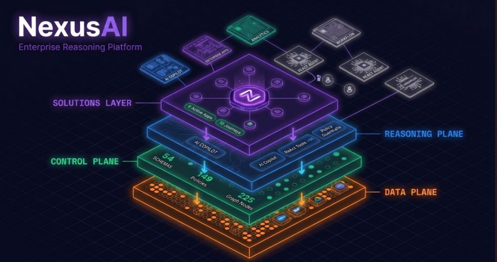
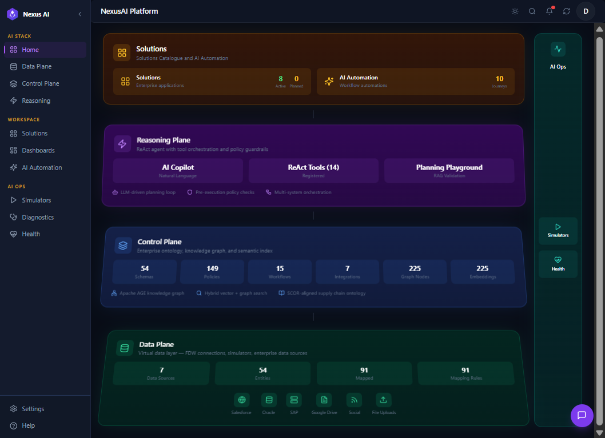

# NexusAI Data Platform

Welcome to the comprehensive documentation portal for the **NexusAI Data Platform** -- an enterprise-grade AI operating layer that connects your systems, builds semantic context, and deploys autonomous agents that reason and act across your organization.

---

## Executive Summary

### What is NexusAI?

NexusAI is **the Intelligent AI Operating Layer for the Enterprise**. Rather than replacing existing systems, NexusAI sits on top of your current technology stack -- CRMs, ERPs, data warehouses, and operational tools -- and unifies them into a single, AI-driven intelligence fabric. It transforms siloed enterprise data into connected, actionable knowledge that autonomous agents use to reason, decide, and execute.

### How It Works

NexusAI operates through a four-stage pipeline that turns disconnected enterprise data into autonomous action:

| Stage | Description |
|-------|-------------|
| **Connect** | Plug into existing enterprise systems -- CRM, ERP, data warehouses, SaaS tools -- via pre-built connectors and APIs. No data migration or system replacement required. |
| **Map** | Build a semantic knowledge graph that captures entities, relationships, and business context across all connected systems. |
| **Reason** | The AI Reasoning Engine applies structured reasoning (ReAct) across the connected knowledge graph to analyze situations, identify patterns, and determine optimal actions. |
| **Execute** | Autonomous agents carry out end-to-end workflows -- updating records, triggering processes, escalating exceptions -- with full auditability and human-in-the-loop controls. |

---

## Key Capabilities

!!! abstract "Enterprise Data Integration"
    Pre-built connectors for CRM, ERP, data warehouses, and SaaS platforms. Unified data access layer with real-time and batch ingestion. Zero-migration architecture -- NexusAI connects to systems in place.

!!! abstract "Semantic Intelligence Layer"
    Automated knowledge graph construction from connected data sources. Entity resolution, relationship mapping, and contextual enrichment. A living semantic model that evolves as your data changes.

!!! abstract "AI Reasoning Engine (ReAct)"
    Structured Reasoning + Acting framework for multi-step decision-making. Cross-system analysis that no single tool can perform alone. Transparent reasoning traces for auditability and compliance.

!!! abstract "Autonomous Execution"
    AI agents that carry out complex, multi-step workflows end to end. Human-in-the-loop guardrails for high-stakes decisions. Full audit trail of every action taken and every decision made.

---

## Business Impact

| Metric | Impact |
|--------|--------|
| **Workflow Automation** | 40--60% of repetitive workflows automated across departments |
| **Decision Speed** | 50% faster data-driven decisions through unified context |
| **Operational Cost Reduction** | 30--40% reduction in operational overhead |
| **System Replacement** | Zero -- NexusAI overlays existing infrastructure without migration |

---

## Applications

NexusAI delivers value across industries and functions:

| Domain | Use Cases |
|--------|-----------|
| **Customer Operations** | Unified customer 360, intelligent case routing, proactive churn prevention |
| **Revenue Operations** | Pipeline intelligence, quote-to-cash automation, forecast accuracy |
| **Supply Chain** | Demand sensing, supplier risk monitoring, logistics optimization |
| **Finance** | Automated reconciliation, anomaly detection, regulatory reporting |
| **IT Operations** | Incident correlation, predictive capacity management, automated remediation |
| **Healthcare** | Patient journey orchestration, clinical workflow automation, compliance monitoring |
| **Retail** | Inventory optimization, personalized engagement, omnichannel orchestration |
| **Telecommunications** | Network analytics, service assurance, customer experience management |

---

## Documentation

### [Business Documentation](business/index.md)
Executive summaries, business requirements, and business cases that define the strategic value and objectives of the platform.

### [AI Operating System](functional/index.md)
Product requirements, functional specifications, and system design documents that describe how the AI operating layer is structured and behaves.

### [Features & Capabilities](features/index.md)
Detailed documentation on platform capabilities, connector architecture, reasoning engine configuration, and agent frameworks.

### [Technical Documentation](technical/index.md)
Solution architecture, infrastructure requirements, integration guides, database design, and system internals.

### [Operational Documentation](operational/index.md)
Deployment guides, configuration management, monitoring, troubleshooting, and day-to-day operational procedures.

### [Application Catalogue](project-scope/index.md)
Application definitions, release notes, and metadata tracking the evolution of platform capabilities and deployed solutions.

### [Developer Guide](developer/index.md)
Development environment setup, API documentation, SDK references, testing procedures, and contribution guidelines.

---

## Quick Links

| Category | Quick Access |
|----------|-------------|
| **Get Started** | [Installation Guide](operational/index.md) |
| **Architecture** | [Solution Architecture](technical/solution-architecture.md) |
| **Developers** | [Developer Guide](developer/index.md) |
| **Business** | [Executive Summary](business/source/executive-summary.md) |

---

## Repositories

The NexusAI Data Platform is maintained across four repositories under the [nexusdataai](https://github.com/nexusdataai) GitHub organization:

| Repository | Description |
|------------|-------------|
| [**nexus-backend**](https://github.com/nexusdataai/nexus-backend) | Core platform services, AI reasoning engine, connectors, and APIs |
| [**nexus-ui**](https://github.com/nexusdataai/nexus-ui) | React-based management console and operational dashboards |
| [**nexus-deployer**](https://github.com/nexusdataai/nexus-deployer) | Infrastructure-as-code, Kubernetes operator, and deployment automation |
| [**nexus-docs**](https://github.com/nexusdataai/nexus-docs) | This documentation site |
