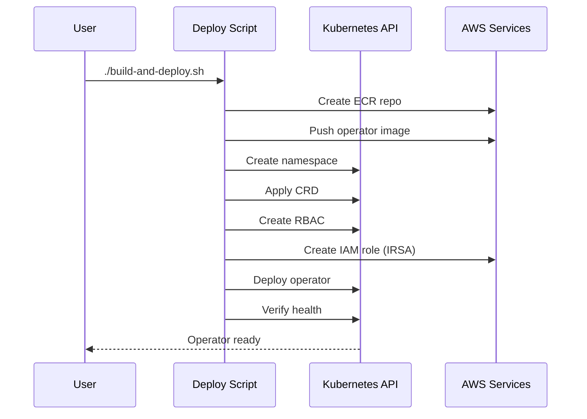
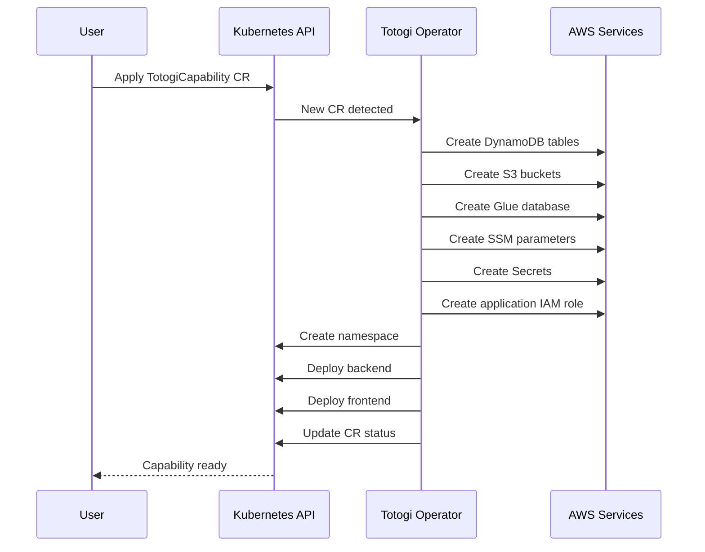
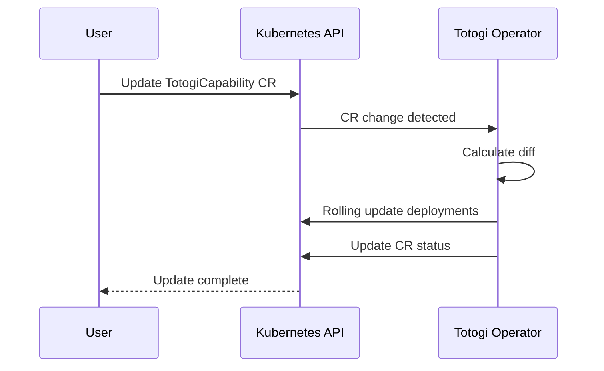
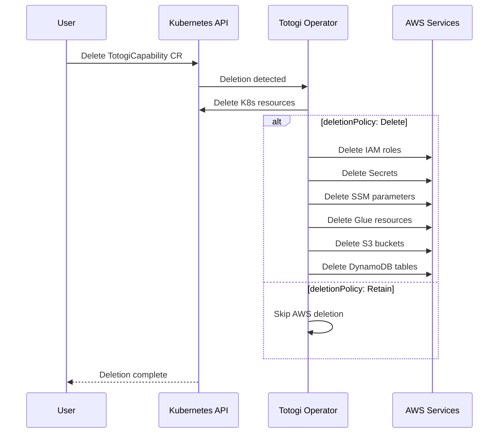

# Operator Architecture

This document describes the architecture of the Totogi Kubernetes Operator.

## High-Level Architecture

```
┌─────────────────────────────────────────────────────────────────┐
│                        EKS Cluster                               │
│  ┌─────────────────────────────────────────────────────────┐    │
│  │                totogi-system namespace                   │    │
│  │  ┌─────────────────────────────────────────────────┐    │    │
│  │  │              Totogi Operator                     │    │    │
│  │  │  - Watches TotogiCapability CRs                 │    │    │
│  │  │  - Provisions AWS resources                     │    │    │
│  │  │  - Deploys K8s workloads                        │    │    │
│  │  │  - Manages lifecycle (create/update/delete)     │    │    │
│  │  └─────────────────────────────────────────────────┘    │    │
│  └─────────────────────────────────────────────────────────┘    │
│                                                                  │
│  ┌─────────────────────────────────────────────────────────┐    │
│  │           {capability}-{env} namespace                   │    │
│  │  ┌──────────────┐    ┌──────────────┐                   │    │
│  │  │   Frontend   │    │   Backend    │                   │    │
│  │  │  Deployment  │    │  Deployment  │                   │    │
│  │  └──────────────┘    └──────────────┘                   │    │
│  │  ┌──────────────┐    ┌──────────────┐                   │    │
│  │  │   Service    │    │   Service    │                   │    │
│  │  │(LoadBalancer)│    │(LoadBalancer)│                   │    │
│  │  └──────────────┘    └──────────────┘                   │    │
│  └─────────────────────────────────────────────────────────┘    │
└─────────────────────────────────────────────────────────────────┘
                              │
                              ▼
┌─────────────────────────────────────────────────────────────────┐
│                        AWS Services                              │
│  ┌──────────┐  ┌──────────┐  ┌──────────┐  ┌──────────┐        │
│  │ DynamoDB │  │    S3    │  │   Glue   │  │   IAM    │        │
│  │  Tables  │  │ Buckets  │  │ Database │  │  Roles   │        │
│  └──────────┘  └──────────┘  └──────────┘  └──────────┘        │
│  ┌──────────┐  ┌──────────┐  ┌──────────┐                      │
│  │   SSM    │  │ Secrets  │  │ Cognito  │                      │
│  │ Params   │  │ Manager  │  │ (opt)    │                      │
│  └──────────┘  └──────────┘  └──────────┘                      │
└─────────────────────────────────────────────────────────────────┘
```

## Operator Components

### Kubernetes Resources

The operator creates these Kubernetes resources in the cluster:

| Resource | Name | Purpose |
|----------|------|---------|
| **Namespace** | `totogi-system` | Operator's home namespace |
| **ServiceAccount** | `totogi-operator` | Identity for operator with IRSA |
| **ClusterRole** | `totogi-operator` | Cluster-wide permissions |
| **ClusterRoleBinding** | `totogi-operator` | Binds role to service account |
| **Deployment** | `totogi-operator` | Operator pod deployment |
| **Service** | `totogi-operator:8080` | Health check endpoint |
| **CRD** | `totogicapabilities.totogi.com` | Custom Resource Definition |

### AWS Resources

The operator creates these AWS resources:

| Resource | Name | Purpose |
|----------|------|---------|
| **IAM Role** | `TotogiOperatorRole` | Operator's AWS permissions (IRSA) |
| **ECR Repository** | `totogi-operator` | Operator container image |

## Operator Flow

### Phase 1: Operator Installation



### Phase 2: Capability Deployment



### Phase 3: Capability Update



### Phase 4: Capability Deletion



## Resource Provisioners

The operator uses modular provisioners for each resource type:

### DynamoDB Provisioner
- Creates transformation-system table
- Creates license table
- Creates wxcc-task-tracking table
- Configures on-demand capacity

### S3 Provisioner
- Creates call-data bucket
- Creates wxcc-simulator bucket
- Creates journey-logs bucket
- Creates journey-reports bucket
- Configures encryption and versioning

### Glue Provisioner
- Creates analytics database
- Creates wxcc_calls table
- Configures crawler settings

### SSM Provisioner
- Creates configuration parameters
- Follows naming convention: `/{capability}/{env}/{category}/{key}`
- Stores non-sensitive configuration

### Secrets Provisioner
- Creates API credentials
- Creates webhook secrets
- Stores sensitive data encrypted

### IAM Provisioner
- Creates application role with IRSA
- Configures least-privilege policies
- Sets up trust policy for EKS service account

### Cognito Provisioner (Optional)
- Creates User Pool
- Creates App Client with OAuth config
- Creates Cognito domain
- Sets up RBAC groups

### Kubernetes Provisioner
- Creates application namespace
- Creates ServiceAccount with IRSA annotation
- Deploys frontend and backend
- Creates LoadBalancer services

## Security Architecture

### Container Security

The operator runs with hardened security context:

```yaml
securityContext:
  runAsNonRoot: true
  runAsUser: 1000        # totogi user
  fsGroup: 1000
  allowPrivilegeEscalation: false
  readOnlyRootFilesystem: true
  capabilities:
    drop: [ALL]
```

### IRSA (IAM Roles for Service Accounts)

The operator uses IRSA for AWS authentication:

- **No credentials in containers** - No AWS access keys
- **Automatic token rotation** - Short-lived credentials
- **Least-privilege policies** - Minimal required permissions
- **Service Account annotations** - Links K8s SA to IAM role

### RBAC

The operator ClusterRole has permissions for:

- TotogiCapability CRD management
- Namespace, Service, Deployment creation
- ConfigMap, Secret management
- CRD access

## Directory Structure

```
kube-operator/
├── src/
│   └── totogi_operator/
│       ├── __init__.py
│       ├── main.py                 # Entry point, Kopf handlers
│       ├── resources/
│       │   ├── __init__.py
│       │   ├── cognito.py          # Cognito provisioner
│       │   ├── dynamodb.py         # DynamoDB provisioner
│       │   ├── glue.py             # Glue provisioner
│       │   ├── iam.py              # IAM provisioner
│       │   ├── kubernetes.py       # K8s resource creator
│       │   ├── s3.py               # S3 provisioner
│       │   ├── secrets.py          # Secrets Manager provisioner
│       │   └── ssm.py              # SSM provisioner
│       └── utils/
│           ├── __init__.py
│           ├── eks_utils.py        # EKS/OIDC utilities
│           └── naming.py           # Resource naming utility
├── manifests/
│   ├── crd.yaml                    # Custom Resource Definition
│   ├── deployment.yaml             # Operator deployment
│   └── rbac.yaml                   # RBAC configuration
├── examples/
│   ├── test-capability.yaml        # Test capability example
│   ├── capability-with-cognito.yaml
│   └── dual-service-backend.yaml
├── Dockerfile                      # Operator container image
├── pyproject.toml                  # Python project config
├── requirements.txt                # Python dependencies
└── operator-starhub-test.sh        # Management script
```

## Technology Stack

| Component | Technology | Purpose |
|-----------|------------|---------|
| **Framework** | Kopf | Kubernetes operator framework |
| **Language** | Python 3.12 | Operator implementation |
| **AWS SDK** | Boto3 | AWS resource provisioning |
| **K8s Client** | kubernetes-python | Kubernetes API access |
| **Web Server** | aiohttp | Health check endpoints |
| **Container** | Docker | Operator packaging |
| **Registry** | Amazon ECR | Container image storage |

---

[← Back to Kubernetes Operator](index.md) | [Next: Custom Resource Reference →](custom-resource.md)
