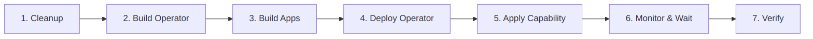
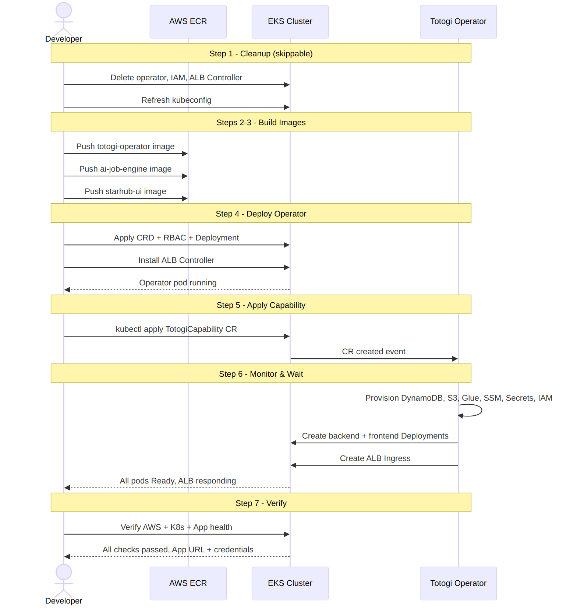

# Kubernetes Operator Deployment

This section covers the Nexus Kubernetes Operator for deploying and managing NexusAI capabilities on Amazon EKS clusters.

!!! tip "Download Complete Documentation"
    **[Download PDF Guide](NexusAI-Kubernetes-Operator-Guide.pdf)** - Complete documentation in a single PDF file for offline reading.

## Overview

The Nexus Operator automates the full lifecycle of NexusAI capabilities in Kubernetes. When you create a `NexusAICapability` custom resource, the operator:

1. Provisions AWS data services (DynamoDB, S3, Glue)
2. Creates SSM Parameters and Secrets Manager secrets
3. Creates IAM roles with IRSA (IAM Roles for Service Accounts)
4. Deploys frontend and backend containers
5. Creates an ALB Ingress with path-based routing
6. Handles updates and deletions with proper cleanup

### Key Features

- **Automated AWS Provisioning** - Creates DynamoDB tables, S3 buckets, Glue databases, and IAM roles
- **Kubernetes Native** - Uses Custom Resource Definitions (CRDs) for declarative management
- **IRSA Integration** - Secure IAM authentication using IAM Roles for Service Accounts
- **ALB Ingress** - Path-based routing with optional HTTPS via ACM certificates
- **Cognito Authentication** - Optional Cognito User Pool provisioning with PKCE OAuth flow
- **Self-Healing** - Reconciles desired state automatically
- **Multi-Environment** - Supports dev, staging, and production environments

## Architecture

```
                        ┌──────────────────────────────┐
                        │     ALB (internet-facing)     │
                        │  /     -> frontend:8080       │
                        │  /api  -> backend:8000        │
                        └────────────┬─────────────────┘
                                     │
┌────────────────────────────────────┼───────────────────────────┐
│  EKS Cluster                       │                           │
│                                    │                           │
│  nexus-system namespace           │                           │
│  ┌────────────────────────┐        │                           │
│  │    Nexus Operator     │        │                           │
│  │  Watches CRs, provisions       │                           │
│  │  AWS + K8s resources   │        │                           │
│  └────────────────────────┘        │                           │
│                                    │                           │
│  {capability}-{env} namespace      │                           │
│  ┌──────────────┐  ┌──────────────┐                           │
│  │  Frontend    │  │  Backend     │                           │
│  │  Deployment  │  │  Deployment  │                           │
│  └──────────────┘  └──────────────┘                           │
│  ┌──────────────┐  ┌──────────────┐  ┌───────────────────┐   │
│  │ frontend-svc │  │ backend-svc  │  │ backend-svc-      │   │
│  │ (ClusterIP)  │  │ (ClusterIP)  │  │ internal (ClusterIP)│ │
│  └──────────────┘  └──────────────┘  └───────────────────┘   │
│  ┌─────────────────────────────────────────┐                  │
│  │  Ingress (ALB)                          │                  │
│  │  / -> frontend-svc   /api -> backend-svc│                  │
│  └─────────────────────────────────────────┘                  │
└───────────────────────────────────────────────────────────────┘
                             │
┌────────────────────────────┼──────────────────────────────────┐
│  AWS Services              │                                   │
│  ┌──────────┐ ┌──────────┐ ┌──────────┐ ┌──────────┐         │
│  │ DynamoDB │ │   S3     │ │  Glue    │ │  IAM     │         │
│  └──────────┘ └──────────┘ └──────────┘ └──────────┘         │
│  ┌──────────┐ ┌──────────┐ ┌──────────┐                      │
│  │   SSM    │ │ Secrets  │ │ Cognito  │                      │
│  │ Params   │ │ Manager  │ │(optional)│                      │
│  └──────────┘ └──────────┘ └──────────┘                      │
└───────────────────────────────────────────────────────────────┘
```

---

## Available Documents

| Document | Description |
|----------|-------------|
| [Quick Start Guide](quick-start.md) | Get the operator running in minutes |
| [AWS Prerequisites](aws-prerequisites.md) | IAM roles, permissions, and OIDC configuration |
| [Architecture](architecture.md) | Detailed architecture and component overview |
| [Custom Resource Reference](custom-resource.md) | Complete reference for NexusAICapability CRD |
| [Deployment Guide](deployment.md) | Step-by-step deployment instructions |
| [Operations](operations.md) | Day-to-day management and operational procedures |
| [Troubleshooting](troubleshooting.md) | Common issues and solutions |

---

## E2E Deployment Pipeline

The `e2e-deploy.sh` script automates the full deployment lifecycle in 7 sequential steps.

```bash
./e2e-deploy.sh                                # Full 7-step deployment
./e2e-deploy.sh --skip-clean                   # Skip cleanup (steps 2-7)
./e2e-deploy.sh --skip-app-build               # Skip app image builds
./e2e-deploy.sh --skip-clean --skip-app-build  # Operator-only redeploy
```

### Pipeline Overview



| Step | Name | Script / Command | What It Does | Skip Flag |
|:----:|------|------------------|--------------|-----------|
| 1 | **Cleanup** | `operator-nexus-dev.sh delete --full` | Remove operator, IAM, ECR, ALB Controller. Refresh kubeconfig. | `--skip-clean` |
| 2 | **Build Operator** | `build-and-push.sh` | Build `nexus-operator` image, push to ECR | -- |
| 3 | **Build Apps** | `nexus-backend/build.sh` + `nexus-ui/build.sh` | Build `ai-job-engine` + `nexus-ui` images, push to ECR | `--skip-app-build` |
| 4 | **Deploy Operator** | `operator-nexus-dev.sh deploy` | Create namespace, apply CRD + RBAC + Deployment, install ALB Controller | -- |
| 5 | **Apply Capability** | `kubectl apply -f capability.yaml` | Create namespace, apply NexusAICapability CR, trigger reconciliation | -- |
| 6 | **Monitor & Wait** | `operator-nexus-dev.sh monitor` | Watch AWS provisioning, wait for pods Ready, ALB DNS, HTTP response | -- |
| 7 | **Verify** | `operator-nexus-dev.sh verify-capability` | Validate AWS resources, K8s workloads, app health, IRSA connectivity | -- |

### Detailed Deployment Sequence



---

## Quick Start

```bash
cd /opt/mycode/nexus/nexus-deployer/kube-operator

# 1. Scan cluster readiness
./operator-nexus-dev.sh scan

# 2. Build and push operator image
./build-and-push.sh

# 3. Deploy operator (auto-configures IRSA + ALB Controller)
./operator-nexus-dev.sh deploy

# 4. Deploy a capability
kubectl create namespace nexus-ai-prod
kubectl apply -f examples/nexus-ai-complete.yaml

# 5. Monitor deployment progress
./operator-nexus-dev.sh monitor

# 6. Verify everything
./operator-nexus-dev.sh verify-capability
```

---

## Management Commands

All commands via `./operator-nexus-dev.sh`:

| Command | Description |
|---------|-------------|
| `scan` | Cluster readiness scan (IRSA, OIDC, nodes, ECR, access) |
| `deploy` | Deploy operator (auto-fixes IRSA, installs ALB Controller) |
| `delete` | Remove operator (keeps IAM, ECR, and your access) |
| `delete --full` | Complete cleanup (removes IAM, ECR, aws-auth, ALB Controller) |
| `update` | Force-redeploy operator with existing image |
| `status` | Check operator pod health |
| `monitor [ns/name]` | Real-time deployment progress for a capability |
| `verify-capability [ns]` | Verify AWS resources, K8s workloads, app health |
| `install-alb-controller` | Install/verify AWS Load Balancer Controller |
| `delete-alb-controller` | Remove ALB Controller and its IAM role |
| `fix-irsa` | Create OIDC provider in IAM if missing |

---

## Operator Reconciliation Flow

When you apply a NexusAICapability, the operator executes these steps (visible via `monitor`):

| Step | Phase | What Happens |
|------|-------|-------------|
| 1. DynamoDB | ProvisioningDataServices | Creates tables: `{cap}-{env}-transformation-system`, `-license`, `-wxcc-task-tracking` |
| 2. S3 | ProvisioningDataServices | Creates buckets: `{cap}-{env}-call-data`, `-wxcc-simulator`, `-journey-logs`, `-journey-reports` |
| 3. Glue | ProvisioningDataServices | Creates database `{cap}_{env}_db` and table `{cap}_{env}_call_records` |
| 4. SSM | ProvisioningSSM | Creates parameters under `/{cap}/{env}/` (region, env, table names, bucket names, etc.) |
| 5. Secrets | ProvisioningSecrets | Creates secrets: `{cap}/{env}/api-keys`, `/wxcc`, `/openai`, `/license`, `/anthropic`, `/github` |
| 6. IAM | ProvisioningIAM | Creates `{cap}-{env}-app-role` with IRSA trust policy |
| 7. Namespace | Deploying | Creates namespace `{cap}-{env}` |
| 8. ServiceAccount | Deploying | Creates SA with IRSA annotation |
| 9. Backend | DeployingBackend | Deploys backend pods + ClusterIP services |
| 10. Frontend | DeployingFrontend | Deploys frontend pods + ClusterIP service |
| 11. Ingress | DeployingFrontend | Creates ALB Ingress with path-based routing |

Final status: `Running` (success) or `Failed` (with error message).

---

## Example Capability

### Minimal Example

```yaml
apiVersion: nexus.ai/v1
kind: NexusAICapability
metadata:
  name: myapp-dev
  namespace: myapp-dev
spec:
  capabilityName: myapp
  version: "1.0.0"
  environment: dev
  region: ap-southeast-1

  frontend:
    replicas: 2
    image: "ACCOUNT.dkr.ecr.REGION.amazonaws.com/myapp-frontend:latest"

  backend:
    replicas: 2
    image: "ACCOUNT.dkr.ecr.REGION.amazonaws.com/myapp-backend:latest"

  dataServices:
    dynamodb: { enabled: true }
    s3: { enabled: true }
    glue: { enabled: true }

  deletionPolicy: Delete
```

### Production Example with ALB Ingress

```yaml
apiVersion: nexus.ai/v1
kind: NexusAICapability
metadata:
  name: nexus-ai-prod
  namespace: nexus-ai-prod
  labels:
    app.kubernetes.io/name: nexus-ai
    app.kubernetes.io/version: "2.5.0"
    nexus.ai/environment: prod
spec:
  capabilityName: nexus-ai
  version: "2.5.0"
  environment: prod
  region: ap-southeast-1
  enableCognito: false

  frontend:
    replicas: 3
    image: "764119721991.dkr.ecr.ap-southeast-1.amazonaws.com/nexus-ui:latest"

  backend:
    replicas: 3
    image: "764119721991.dkr.ecr.ap-southeast-1.amazonaws.com/ai-job-engine:latest"

  ingress:
    enabled: true
    scheme: internet-facing
    healthCheckPath: "/health"

  dataServices:
    dynamodb: { enabled: true }
    s3: { enabled: true }
    glue: { enabled: true }

  deletionPolicy: Delete
```

See `examples/nexus-ai-complete.yaml` for a complete working example.

---

## Resource Naming Conventions

All resources follow consistent naming patterns:

| Resource | Pattern | Example |
|----------|---------|---------|
| DynamoDB Table | `{cap}-{env}-{purpose}` | `nexus-ai-prod-license` |
| S3 Bucket | `{cap}-{env}-{purpose}` | `nexus-ai-prod-call-data` |
| SSM Parameter | `/{cap}/{env}/{category}/{key}` | `/nexus-ai/prod/aws/region` |
| Secret | `{cap}/{env}/{type}` | `nexus-ai/prod/api-keys` |
| Glue Database | `{cap}_{env}_db` | `call_processing_prod_db` |
| IAM Role | `{cap}-{env}-app-role` | `nexus-ai-prod-app-role` |
| K8s Namespace | `{cap}-{env}` | `nexus-ai-prod` |
| K8s Deployment | `{cap}-{env}-{component}` | `nexus-ai-prod-backend` |
| K8s Service | `{cap}-{env}-{component}-svc` | `nexus-ai-prod-frontend-svc` |
| K8s Ingress | `{cap}-{env}-app-ingress` | `nexus-ai-prod-app-ingress` |
| K8s ServiceAccount | `{cap}-{env}-app-sa` | `nexus-ai-prod-app-sa` |

---

## Prerequisites

| Requirement | Details |
|------------|---------|
| **EKS Cluster** | Kubernetes 1.23+ with OIDC provider configured |
| **AWS CLI** | Version 2.x with configured credentials |
| **Python** | Version 3.9+ with `kubernetes`, `boto3`, `pyyaml` |
| **Docker** | For building container images |
| **Helm** | Recommended, for ALB Controller installation |
| **IAM Permissions** | Admin access or specific operator permissions |

## Environment Variables

| Variable | Description | Default |
|----------|-------------|---------|
| `AWS_REGION` | AWS region for resources | `ap-southeast-1` |
| `EKS_CLUSTER_NAME` | Cluster name for OIDC discovery | (auto-detected) |
| `OPERATOR_NAMESPACE` | Namespace for operator | `nexus-system` |
| `LOG_LEVEL` | Logging verbosity | `INFO` |

## Directory Structure

```
kube-operator/
  manifests/
    crd.yaml              # NexusAICapability CRD
    deployment.yaml       # Operator deployment manifest
    rbac.yaml             # ClusterRole and bindings
  src/nexus_operator/
    main.py               # Kopf handlers (create/update/delete)
    resources/
      dynamodb.py         # DynamoDB provisioner
      s3.py               # S3 provisioner
      glue.py             # Glue provisioner
      ssm.py              # SSM parameter provisioner
      secrets.py          # Secrets Manager provisioner
      iam.py              # IAM role provisioner (IRSA)
      kubernetes.py       # K8s resource creator (deployments, services, ingress)
      cognito.py          # Cognito provisioner (optional)
    utils/
      naming.py           # Resource naming conventions
      eks_utils.py        # OIDC provider discovery
  examples/
    nexus-ai-complete.yaml  # Full working example
  operator-nexus-dev.sh        # Management script
  build-and-push.sh               # Build and push operator image
  build-and-deploy.sh             # Build + deploy in one command
  e2e-deploy.sh                   # Full 7-step E2E deployment
  deploy-app-changes.sh           # Quick app rebuild + pod restart
  Dockerfile                      # Operator container image
```

---

[← Back to Operational Documentation](../index.md)
