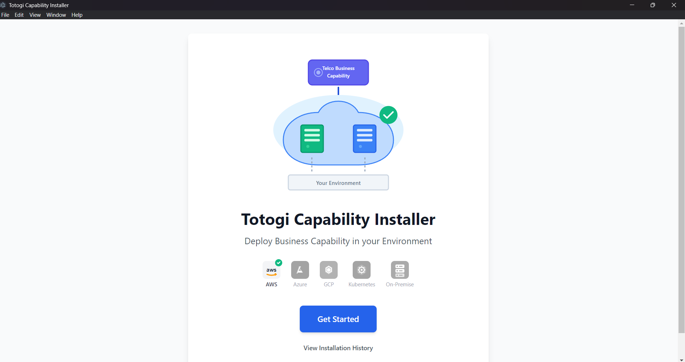
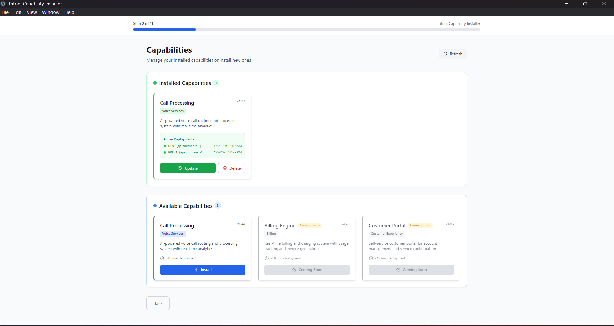
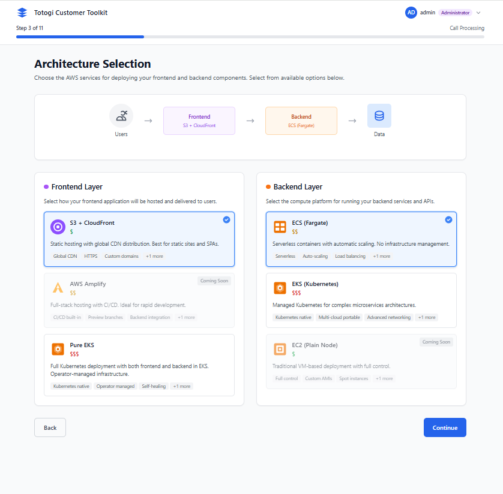
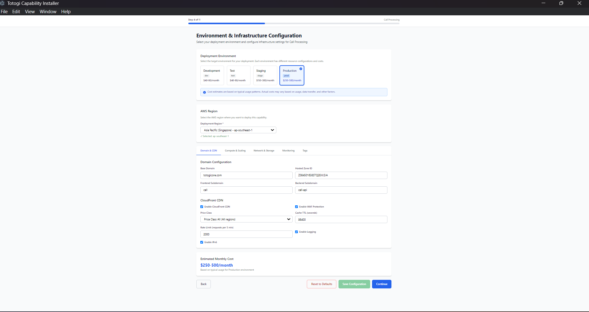
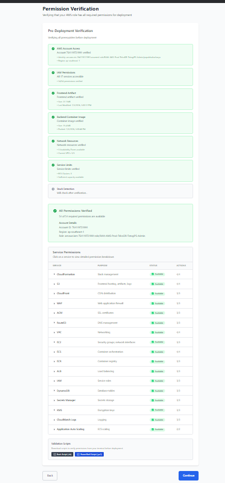
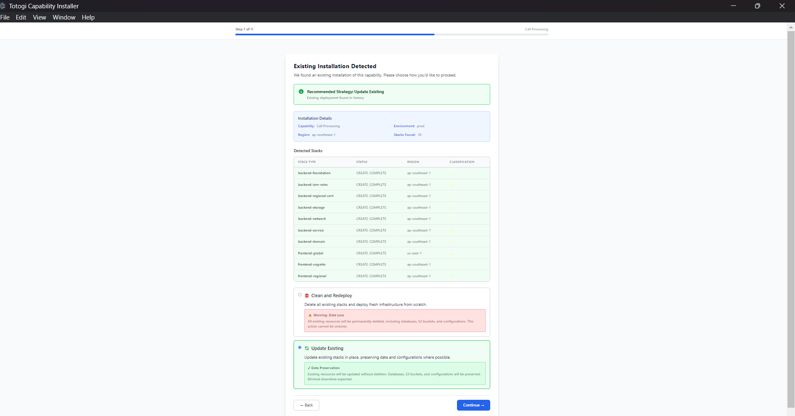
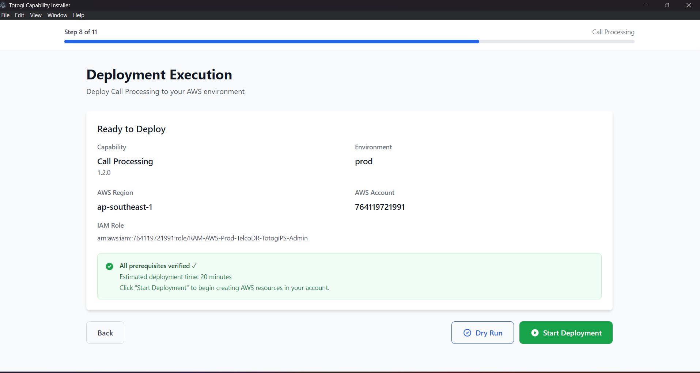
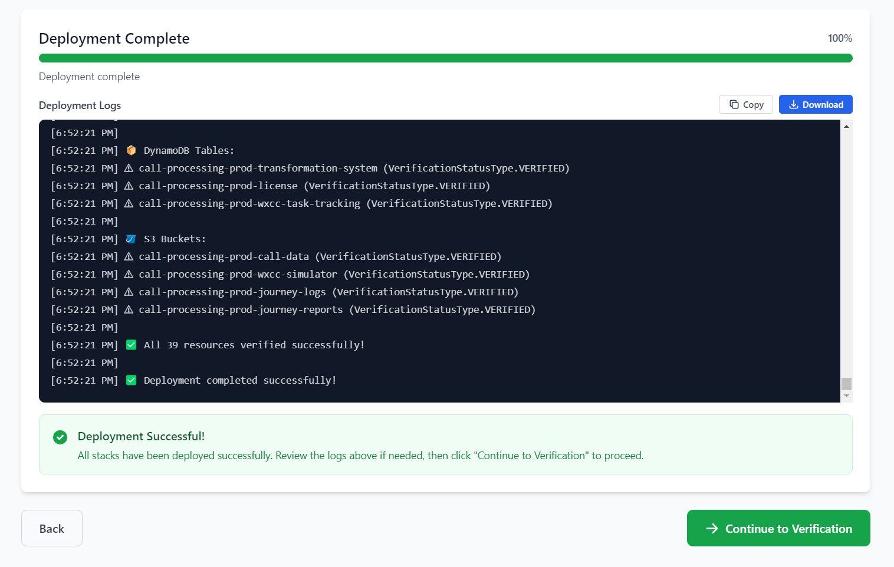
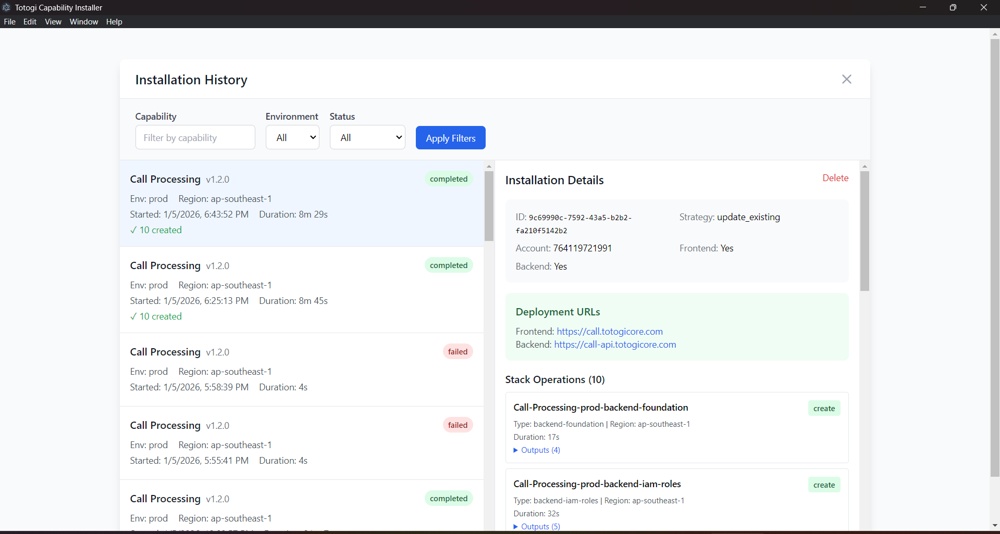

# Getting Started

This guide will help you get up and running with the Totogi Capability Installer.

## Overview

The Totogi Capability Installer is a desktop application that deploys Totogi's telco business capabilities to your AWS environment. The deployment process is guided by a step-by-step wizard that handles all the complexity of AWS infrastructure provisioning.

## Before You Begin

### Prerequisites

Before using the installer, ensure you have:

1. **AWS Account** with administrative access or appropriate IAM permissions
2. **AWS Credentials** using one of the supported authentication methods:
   - IAM Role ARN (recommended for cross-account deployments)
   - AWS Access Keys
   - AWS CLI Profile
   - ADFS/SAML authentication
3. **Network Access** to AWS APIs from your workstation

### Required AWS Permissions

The deployment process requires permissions to create and manage:

- CloudFormation stacks
- IAM roles and policies
- VPC and networking resources
- ECS/Fargate services (for ECS deployments)
- EKS cluster access (for Kubernetes deployments)
- S3 buckets
- DynamoDB tables
- CloudFront distributions
- Route53 DNS records
- ACM certificates
- WAF rules
- CloudWatch logs and alarms

**Additional requirements for EKS (Kubernetes) deployments:**
- `eks:DescribeCluster` and `eks:ListClusters` permissions
- Kubernetes API access to the target cluster
- ECR pull permissions for container images

See [AWS Configuration](./04-aws-configuration.md) for detailed IAM policy requirements.

---

## Application Overview

### Main Screen

When you launch the application, you'll see the Welcome screen:

The home screen provides:

- **Hero illustration** showing the deployment concept
- **Platform icons** indicating supported cloud providers
- **Get Started button** to begin the deployment wizard
- **View Installation History** to see past deployments

### Deployment Wizard Steps

The wizard guides you through these steps:

| Step | Description | Screenshot |
|------|-------------|------------|
| 1. Capability Selection | Choose which capability to deploy | [View](#step-1-launch-the-application) |
| 2. Architecture Selection | Select frontend and backend deployment options | [View](#step-4-choose-architecture) |
| 3. Environment Configuration | Configure domain, region, and environment settings | [View](#step-5-configure-environment) |
| 4. AWS Configuration | Enter and validate AWS credentials | [View](#step-6-enter-aws-credentials) |
| 5. Permission Verification | Verify AWS permissions and prerequisites | [View](#step-7-verify-permissions) |
| 6. Strategy Selection | Choose deployment strategy (for updates) | - |
| 7. Deployment Execution | Monitor real-time deployment progress | [View](#step-8-start-deployment) |
| 8. Post Verification | Verify deployed resources are healthy | - |
| 9. Results | View deployment outputs and next steps | [View](#step-9-access-your-application) |

---

## Quick Start Guide

### Step 1: Launch the Application

Double-click the Totogi Installer icon to launch the application. You will see the welcome screen:

### Step 2: Click "Get Started"

On the welcome screen, click the **Get Started** button to begin the deployment wizard.

### Step 3: Select a Capability

Browse the available capabilities and click **Install** on the one you want to deploy.

The capability selection screen shows:
- **Installed Capabilities** (green section) - Already deployed to your environment
- **Available Capabilities** (blue section) - Ready for installation

### Step 4: Choose Architecture

Select your preferred deployment architecture:

**Recommended Configuration:**
- **Frontend**: CloudFront + S3 (recommended)
- **Backend**: ECS Fargate (recommended)

### Step 5: Configure Environment

Enter your deployment configuration:

Configure the following:
- **Environment**: dev, staging, or prod
- **AWS Region**: Your target AWS region
- **Domain Settings**: Your domain name and subdomains
- **Route53 Hosted Zone ID**: Your DNS zone identifier

### Step 6: Enter AWS Credentials

Choose your authentication method and enter credentials:

**Authentication Options:**
- IAM Role ARN (recommended for production)
- AWS Access Keys
- AWS CLI Profile
- ADFS/SAML

Click **Test Credentials** to validate before proceeding.

### Step 7: Verify Permissions

The installer will verify all prerequisites:

**Verification Checks:**
- AWS account access
- Required IAM permissions
- Artifact availability
- Network resources

All checks must pass (✅) before proceeding.

### Step 8: Start Deployment

Click **Start Deployment** and monitor progress:

The deployment screen shows:
- Real-time progress bar
- Current deployment stage
- Live deployment logs

**Tip:** Deployment typically takes 15-30 minutes. Do not close the application during this process.

### Step 9: Access Your Application

Once complete, you'll receive your deployment outputs:

**You will receive:**
- Frontend application URL
- Backend API URL
- Admin login credentials
- Cognito User Pool information

---

## What Gets Deployed?

A typical capability deployment creates resources based on your architecture selection:

### Frontend Infrastructure (CloudFront + S3)
- S3 bucket for static assets
- CloudFront distribution for global CDN
- WAF rules for security
- ACM certificate for HTTPS
- Route53 DNS records

### Backend Infrastructure - ECS Fargate
- VPC with public/private subnets
- ECS Fargate cluster and services
- Application Load Balancer
- DynamoDB tables
- S3 data buckets
- Secrets Manager secrets
- CloudWatch logs and alarms
- IAM roles and policies

### Backend Infrastructure - EKS (Kubernetes)

When using the Kubernetes Operator deployment:

**Kubernetes Resources:**
- Dedicated namespace (`{capability}-{env}`)
- Frontend Deployment and Service (LoadBalancer)
- Backend Deployment and Service (LoadBalancer)
- ServiceAccount with IRSA annotations
- ConfigMaps and Secrets

**AWS Resources (auto-provisioned by operator):**
- DynamoDB tables for application data
- S3 buckets for storage
- Glue database and catalog
- IAM role with IRSA trust policy
- Secrets Manager entries
- SSM Parameter Store entries

**Operator Components (in `totogi-system` namespace):**
- Totogi Operator deployment
- TotogiCapability CRD
- RBAC roles and bindings

---

## Managing Your Deployments

After your initial deployment, you can manage all deployments from the Installation History:

From here you can:
- **Update** existing deployments to newer versions
- **Delete** deployments you no longer need
- **View Details** of any deployment

---

## Next Steps

- [Installation Guide](./02-installation.md) - Detailed installation instructions
- [Deployment Wizard](./03-deployment-wizard.md) - Complete wizard walkthrough
- [AWS Configuration](./04-aws-configuration.md) - AWS setup and permissions
- [Managing Deployments](./05-managing-deployments.md) - Update, delete, and monitor
- [Kubernetes Deployment](./08-kubernetes-deployment.md) - EKS deployment guide (for Kubernetes option)