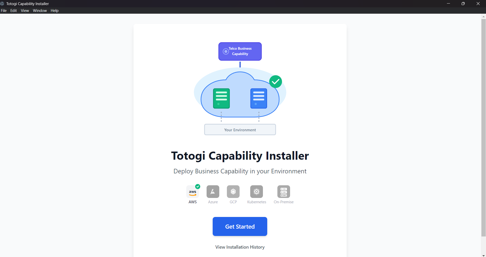

# Installation Guide

This guide covers installing the Totogi Capability Installer on your system.

## Download

Download the installer for your operating system from the provided distribution channel.

### Available Formats

| Platform | Format | File |
|----------|--------|------|
| Windows | NSIS Installer | `Totogi-Installer-Setup-x.x.x.exe` |
| Windows | Portable | `Totogi-Installer-x.x.x-portable.exe` |
| macOS | DMG | `Totogi-Installer-x.x.x.dmg` |
| Linux | AppImage | `Totogi-Installer-x.x.x.AppImage` |
| Linux | DEB | `totogi-installer_x.x.x_amd64.deb` |

---

## Windows Installation

### Using the Installer (Recommended)

1. **Run the installer**
   - Double-click `Totogi-Installer-Setup-x.x.x.exe`
   - If prompted by Windows Defender, click "More info" → "Run anyway"

2. **Choose installation options**
   - Select installation directory (default: `C:\Program Files\Totogi Installer`)
   - Choose whether to create desktop shortcut
   - Choose whether to create Start Menu shortcut

3. **Complete installation**
   - Click "Install" to begin
   - Wait for installation to complete
   - Click "Finish" to launch the application

### Using the Portable Version

1. **Extract the portable executable**
   - No installation required
   - Run directly from any location

2. **Launch the application**
   - Double-click `Totogi-Installer-x.x.x-portable.exe`

### Windows Requirements

- Windows 10 version 1903 or later
- Windows 11 (any version)
- 64-bit operating system
- .NET Framework 4.7.2 or later (usually pre-installed)

---

## macOS Installation

1. **Open the DMG file**
   - Double-click `Totogi-Installer-x.x.x.dmg`

2. **Install the application**
   - Drag the Totogi Installer icon to the Applications folder

3. **First launch**
   - Open from Applications folder
   - If blocked by Gatekeeper:
     - Go to System Preferences → Security & Privacy
     - Click "Open Anyway" for Totogi Installer

### macOS Requirements

- macOS 10.15 (Catalina) or later
- Apple Silicon (M1/M2) or Intel processor
- 4GB RAM minimum

---

## Linux Installation

### Using AppImage

1. **Make executable**
   ```bash
   chmod +x Totogi-Installer-x.x.x.AppImage
   ```

2. **Run the application**
   ```bash
   ./Totogi-Installer-x.x.x.AppImage
   ```

### Using DEB Package (Debian/Ubuntu)

1. **Install the package**
   ```bash
   sudo dpkg -i totogi-installer_x.x.x_amd64.deb
   ```

2. **Install dependencies (if needed)**
   ```bash
   sudo apt-get install -f
   ```

3. **Launch from applications menu or terminal**
   ```bash
   totogi-installer
   ```

### Linux Requirements

- Ubuntu 20.04 LTS or later
- Debian 10 or later
- Other distributions with glibc 2.31+
- X11 or Wayland display server

---

## Verifying Installation

After installation, verify the application works correctly:

### 1. Launch the Application

The welcome screen should appear:



### 2. Check Backend Connectivity

- Click "Get Started"
- The capability list should load successfully:


If you see "Failed to load capabilities", refer to the [Troubleshooting Guide](./06-troubleshooting.md).

---

## Uninstallation

### Windows

**Using installer:**
- Go to Settings → Apps → Totogi Installer → Uninstall

**Or use Control Panel:**
- Control Panel → Programs → Uninstall a program → Totogi Installer

### macOS

- Drag Totogi Installer from Applications to Trash
- Empty Trash

### Linux (DEB)

```bash
sudo apt remove totogi-installer
```

### Linux (AppImage)

- Simply delete the AppImage file

---

## Configuration Files

The application stores configuration in:

| Platform | Location |
|----------|----------|
| Windows | `%APPDATA%\Totogi Installer\` |
| macOS | `~/Library/Application Support/Totogi Installer/` |
| Linux | `~/.config/Totogi Installer/` |

---

## Firewall Configuration

The application requires outbound access to:

| Service | Port | Purpose |
|---------|------|---------|
| AWS APIs | 443 (HTTPS) | CloudFormation, IAM, S3, etc. |
| AWS STS | 443 (HTTPS) | Credential validation |

Ensure your firewall allows outbound HTTPS connections to AWS endpoints.

---

## Proxy Configuration

If your network uses a proxy:

1. **System proxy** - The application uses system proxy settings
2. **Environment variables** - Set `HTTP_PROXY` and `HTTPS_PROXY`

```bash
# Linux/macOS
export HTTP_PROXY=http://proxy.example.com:8080
export HTTPS_PROXY=http://proxy.example.com:8080

# Windows (PowerShell)
$env:HTTP_PROXY = "http://proxy.example.com:8080"
$env:HTTPS_PROXY = "http://proxy.example.com:8080"
```

---

## Troubleshooting Installation

### Windows: "Windows protected your PC"

1. Click "More info"
2. Click "Run anyway"
3. This is normal for new applications

### macOS: "App can't be opened"

1. Go to System Preferences → Security & Privacy
2. Click the lock to make changes
3. Click "Open Anyway" next to Totogi Installer

### Linux: AppImage won't run

1. Ensure it's executable: `chmod +x *.AppImage`
2. Install FUSE if needed: `sudo apt install fuse`

### Application won't start

1. Check system requirements
2. Try running from command line to see errors
3. Check if antivirus is blocking the application

---

## Next Steps

- [Getting Started](./01-getting-started.md) - Quick start guide
- [Deployment Wizard](./03-deployment-wizard.md) - Using the deployment wizard
- [AWS Configuration](./04-aws-configuration.md) - Setting up AWS credentials
