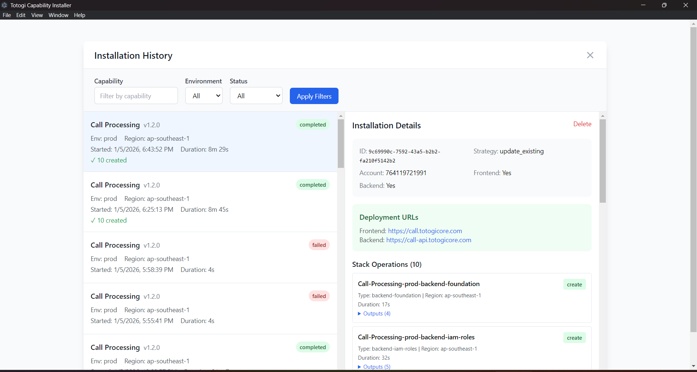
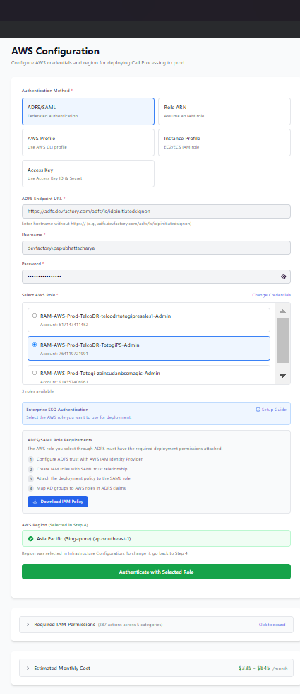
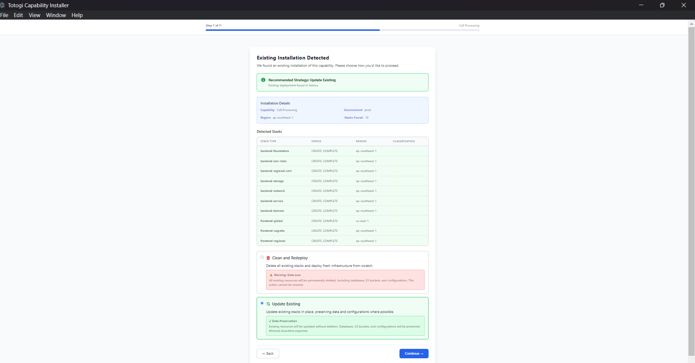
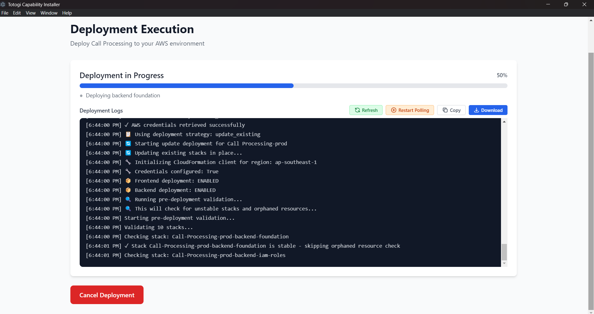
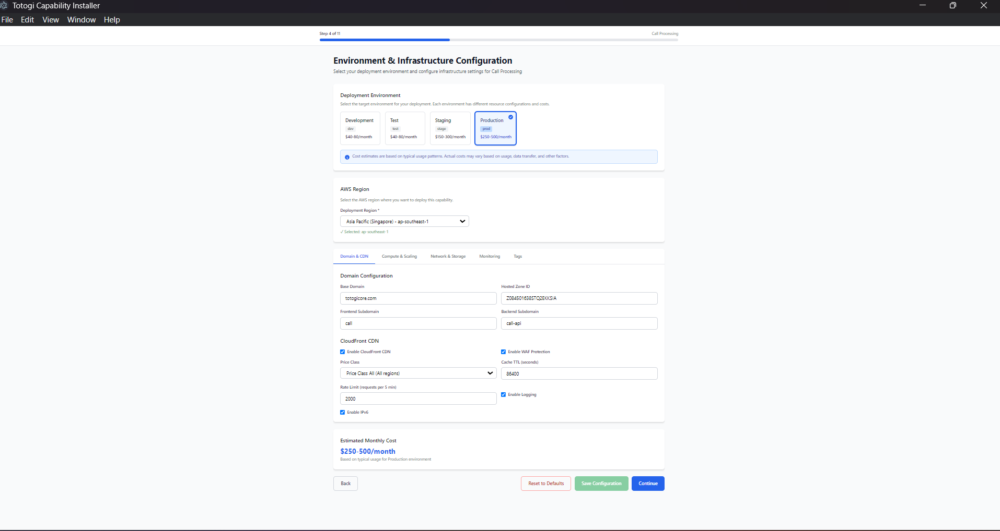
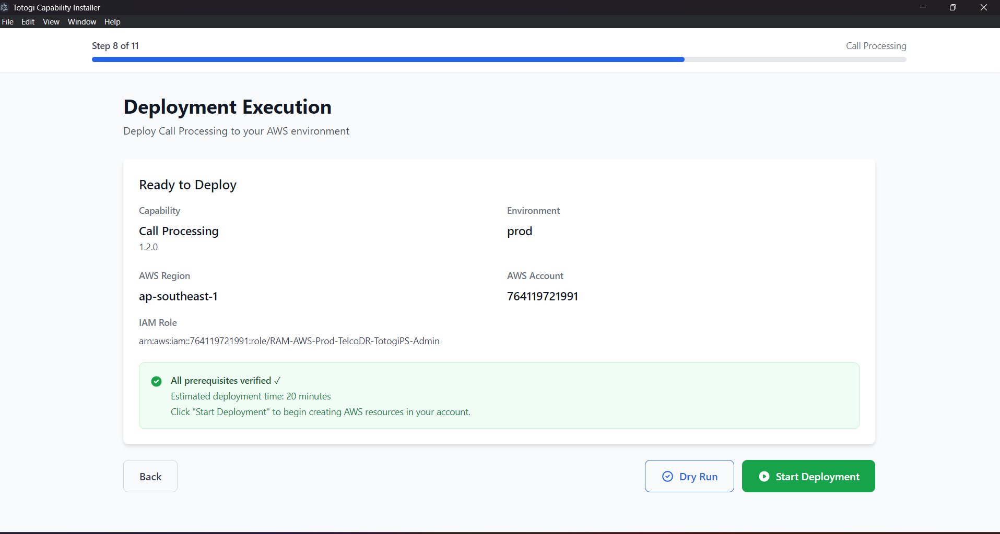

# Managing Deployments

This guide covers how to manage your deployed capabilities, including updates, deletions, and monitoring.

---

## Viewing Deployed Capabilities

### Installation History

Access your deployment history from the Welcome screen by clicking **View Installation History**:



The Installation History displays:
- **Capability Name**: The deployed capability
- **Version**: Deployed version number
- **Environment**: Target environment (dev/staging/prod)
- **Region**: AWS region
- **Deployment Date**: When the deployment occurred
- **Status**: Current deployment status

### Capability Selection Screen

From the main capability screen, you can see all your deployments:


**Installed Capabilities** (green section)
- Currently deployed capabilities
- Active environments
- Last deployment timestamp
- Update and Delete actions

**Available Capabilities** (blue section)
- Capabilities ready to install
- Can install to new environments

---

## Updating Deployments

### When to Update

Update a deployment when:
- New capability version is available
- Configuration changes are needed
- Infrastructure updates are required
- Security patches need to be applied

### Update Process

1. **Go to Capability Selection**

   

2. **Find your installed capability** in the green section

3. **Click "Update"**

4. **Review current configuration**
   - Environment and region are pre-populated

5. **Enter AWS credentials**

   

6. **Verify permissions**

   

7. **Select deployment strategy**

8. **Execute update**

   

### Update Strategies

| Strategy | Use When | Impact |
|----------|----------|--------|
| **Update Existing** | Stacks are healthy | Minimal downtime |
| **Clean Deploy** | Stacks are in failed state | Full recreation, data loss |

### Update vs. Clean Deploy

**Update Existing:**
- Preserves existing resources
- Updates only changed components
- Minimal downtime
- Preserves data

**Clean Deploy:**
- Deletes all existing stacks
- Creates fresh infrastructure
- Causes downtime
- May lose data (backup first!)

---

## Deleting Deployments

### When to Delete

Delete a deployment when:
- Capability is no longer needed
- Environment is being decommissioned
- Starting fresh after issues
- Cost optimization

### Delete Process

1. **Go to Capability Selection**

   

2. **Find your installed capability**

3. **Click "Delete"**

4. **Confirm deletion** (this is destructive!)

5. **Enter AWS credentials**

   

6. **Verify permissions**

7. **Execute deletion**

### What Gets Deleted

The deletion process removes:

**Frontend Resources:**
- S3 buckets (and contents)
- CloudFront distributions
- WAF rules
- ACM certificates
- Route53 records

**Backend Resources:**
- ECS services and clusters
- Load balancers
- VPC and networking
- DynamoDB tables
- S3 data buckets
- Secrets Manager secrets
- CloudWatch logs
- IAM roles

### Data Backup

**Before deleting, backup:**
- DynamoDB tables
- S3 bucket contents
- Secrets Manager values
- CloudWatch logs

### Backup Commands

```bash
# Backup DynamoDB table
aws dynamodb create-backup \
  --table-name capability-prod-data \
  --backup-name capability-backup-$(date +%Y%m%d)

# Sync S3 bucket
aws s3 sync s3://capability-prod-data s3://capability-backup-data

# Export secrets
aws secretsmanager get-secret-value \
  --secret-id capability-prod-secrets \
  --query SecretString \
  --output text > secrets-backup.json
```

---

## Monitoring Deployments

### Deployment Health

After deployment, verify service health:



**Health Status Indicators:**
- ✅ **Healthy** - Service is operational
- ⚠️ **Degraded** - Service has issues
- ❌ **Unhealthy** - Service is down

### CloudWatch Metrics

Monitor your deployment health via CloudWatch:

**ECS Metrics:**
- CPU utilization
- Memory utilization
- Running task count
- Service health

**ALB Metrics:**
- Request count
- Response time
- Error rates (4xx, 5xx)
- Active connections

**CloudFront Metrics:**
- Requests
- Bytes downloaded
- Error rate
- Cache hit ratio

### Setting Up Alarms

Create CloudWatch alarms for:

| Metric | Threshold | Action |
|--------|-----------|--------|
| ECS CPU | > 80% | Scale up |
| ECS Memory | > 80% | Scale up |
| ALB 5xx errors | > 1% | Alert |
| ALB latency | > 2s | Alert |

### Viewing Logs

**ECS Container Logs:**
```bash
aws logs tail /ecs/capability-prod --follow
```

**Application Logs:**
```bash
aws logs tail /aws/application/capability-prod --follow
```

---

## Deployment States

### Understanding Stack States

| State | Description | Actions Available |
|-------|-------------|-------------------|
| `CREATE_COMPLETE` | Successfully created | Update, Delete |
| `UPDATE_COMPLETE` | Successfully updated | Update, Delete |
| `CREATE_IN_PROGRESS` | Being created | Wait |
| `UPDATE_IN_PROGRESS` | Being updated | Wait |
| `DELETE_IN_PROGRESS` | Being deleted | Wait |
| `ROLLBACK_COMPLETE` | Creation failed | Delete only |
| `UPDATE_ROLLBACK_COMPLETE` | Update failed | Delete or Clean Deploy |
| `DELETE_FAILED` | Deletion failed | Manual cleanup |

### Handling Failed States

**ROLLBACK_COMPLETE:**
1. Review CloudFormation events for error
2. Fix the underlying issue
3. Delete the stack
4. Redeploy

**UPDATE_ROLLBACK_COMPLETE:**
1. Review what caused the update to fail
2. Choose Clean Deploy strategy
3. Or manually fix and retry update

**DELETE_FAILED:**
1. Check which resources failed to delete
2. Manually delete stuck resources
3. Retry stack deletion

---

## Multi-Environment Management

### Environment Strategy

| Environment | Purpose | Resources |
|-------------|---------|-----------|
| **dev** | Development | Minimal, cost-optimized |
| **staging** | Pre-production | Production-like |
| **prod** | Production | Full resources, HA |

### Deploying to Multiple Environments

Use the Environment Configuration screen to select your target:



**Recommended Workflow:**

1. **Deploy to dev first**
   - Test new features
   - Validate configuration

2. **Promote to staging**
   - Integration testing
   - Performance testing

3. **Deploy to production**
   - After staging validation
   - During maintenance window

### Environment Isolation

Each environment has:
- Separate AWS resources
- Unique domain names
- Independent scaling
- Isolated data

---

## Cost Management

### Cost Breakdown

| Component | Dev | Staging | Prod |
|-----------|-----|---------|------|
| CloudFront | $5 | $10 | $50+ |
| ALB | $20 | $20 | $20 |
| ECS Fargate | $10 | $50 | $200+ |
| NAT Gateway | $0 | $45 | $45 |
| S3 | $1 | $5 | $20+ |
| DynamoDB | $5 | $10 | $50+ |
| **Total** | ~$41 | ~$140 | ~$385+ |

### Cost Optimization Tips

**Development:**
- Use FARGATE_SPOT for ECS
- Disable NAT Gateway (use public subnets)
- Set auto-scaling minimum to 0
- Use on-demand DynamoDB billing

**Production:**
- Use Reserved Capacity for predictable workloads
- Enable S3 lifecycle policies
- Optimize CloudFront caching
- Right-size ECS tasks

### Cleaning Up Unused Resources

Regularly review and delete:
- Unused ECS task definitions
- Old CloudWatch log groups
- Orphaned S3 buckets
- Unused security groups

---

## Troubleshooting Deployments

### Common Issues

**Deployment Stuck:**
1. Check CloudFormation events
2. Look for resource creation failures
3. Check service limits

**Health Checks Failing:**


1. Verify security group rules
2. Check container logs
3. Validate health check endpoint

**DNS Not Resolving:**
1. Wait for propagation (up to 48 hours)
2. Verify Route53 records
3. Check hosted zone configuration

**SSL Certificate Issues:**
1. Verify domain ownership
2. Check DNS validation records
3. Wait for certificate validation

### Getting Help

1. **Check deployment logs** in the installer

   

2. **Review CloudFormation events** in AWS Console
3. **Check CloudWatch logs** for application errors
4. **Contact support** with deployment ID and logs

---

## Managing Kubernetes (EKS) Deployments

If you deployed using the **EKS (Kubernetes)** option, your capability runs as a `TotogiCapability` custom resource managed by the Kubernetes Operator.

### Viewing Kubernetes Deployments

```bash
# List all deployed capabilities
kubectl get totogicapabilities -A

# Short form
kubectl get tc -A

# Get detailed status
kubectl describe tc <capability-name> -n <namespace>
```

### Checking Application Pods

```bash
# List pods in capability namespace
kubectl get pods -n <capability>-<environment>

# Example: call-processing-dev
kubectl get pods -n call-processing-dev

# View pod logs
kubectl logs -f deployment/<capability>-frontend -n <namespace>
kubectl logs -f deployment/<capability>-backend -n <namespace>
```

### Updating Kubernetes Deployments

```bash
# Scale replicas
kubectl patch tc <name> -n <namespace> --type=merge \
  -p '{"spec":{"backend":{"replicas":3}}}'

# Update image version
kubectl patch tc <name> -n <namespace> --type=merge \
  -p '{"spec":{"backend":{"image":"new-image:tag"}}}'

# Or edit directly
kubectl edit tc <name> -n <namespace>
```

### Deleting Kubernetes Deployments

```bash
# Delete capability (operator handles cleanup)
kubectl delete tc <name> -n <namespace>
```

**Note:** AWS resources (DynamoDB, S3) are deleted or retained based on the `deletionPolicy` in the capability spec.

### Operator Management

```bash
# Check operator status
kubectl get pods -n totogi-system

# View operator logs
kubectl -n totogi-system logs -f deployment/totogi-operator

# Restart operator
kubectl -n totogi-system rollout restart deployment/totogi-operator
```

### Kubernetes-Specific Monitoring

**Application Metrics:**
```bash
# CPU and memory usage
kubectl top pods -n <namespace>

# Events
kubectl get events -n <namespace> --sort-by='.lastTimestamp'
```

**Service URLs:**
```bash
# Get LoadBalancer URLs
kubectl get svc -n <namespace>

# Frontend URL
kubectl get svc <capability>-frontend -n <namespace> \
  -o jsonpath='{.status.loadBalancer.ingress[0].hostname}'
```

For detailed Kubernetes deployment instructions, see [Kubernetes Deployment Guide](./08-kubernetes-deployment.md).

---

## Best Practices

### Deployment

- ✅ Always test in dev/staging first
- ✅ Use consistent naming conventions
- ✅ Document configuration changes
- ✅ Backup data before updates

### Monitoring

- ✅ Set up CloudWatch alarms
- ✅ Enable detailed monitoring
- ✅ Review logs regularly
- ✅ Track costs monthly

### Security

- ✅ Rotate credentials regularly
- ✅ Review IAM permissions
- ✅ Enable AWS Config rules
- ✅ Use AWS Security Hub

### Kubernetes-Specific

- ✅ Monitor operator health regularly
- ✅ Use `deletionPolicy: Retain` for production data
- ✅ Configure resource limits in capability spec
- ✅ Set up Pod Disruption Budgets for HA

---

## Next Steps

- [AWS Configuration](./04-aws-configuration.md) - Detailed AWS setup
- [Troubleshooting](./06-troubleshooting.md) - Common issues and solutions
- [FAQ](./07-faq.md) - Frequently asked questions
- [Kubernetes Deployment](./08-kubernetes-deployment.md) - EKS deployment guide