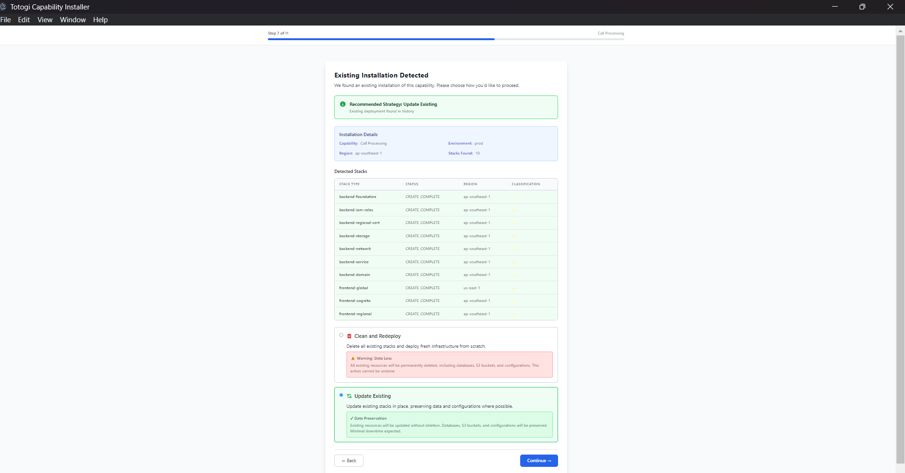
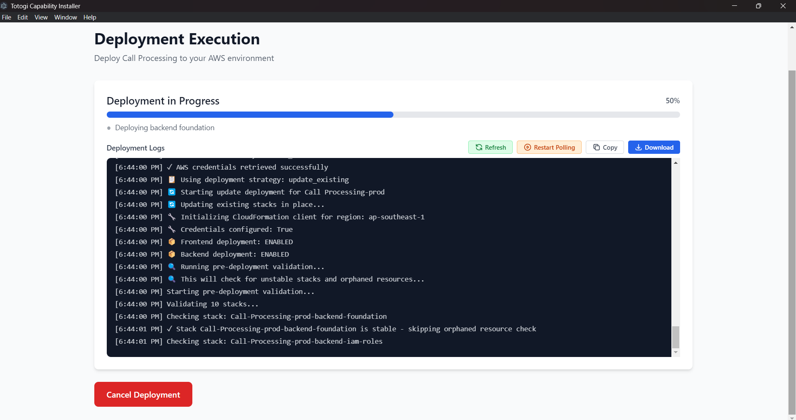
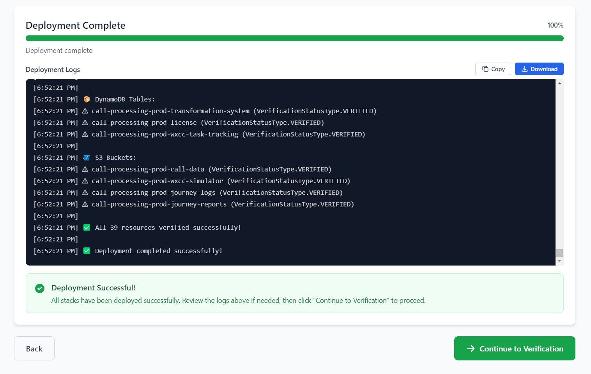
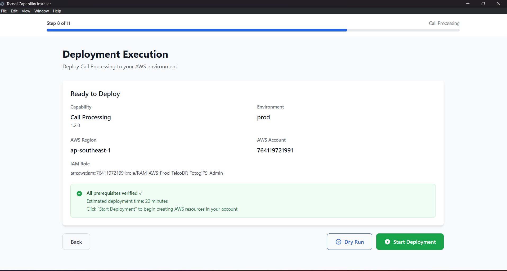

# Troubleshooting Guide

This guide helps you diagnose and resolve common issues with the Totogi Capability Installer.

---

## Application Issues

### Application Won't Start

**Symptoms:**
- Application doesn't open
- Splash screen appears then closes
- Error message on startup

**Solutions:**

1. **Check system requirements**
   - Windows 10/11, macOS 10.15+, or Linux
   - 4GB RAM minimum
   - 500MB disk space

2. **Run as administrator** (Windows)
   - Right-click → Run as administrator

3. **Check antivirus**
   - Add application to exclusions
   - Temporarily disable and test

4. **Reinstall application**
   - Uninstall completely
   - Download fresh installer
   - Install again

### "Failed to Load Capabilities"

**Symptoms:**
- Capability list is empty
- Error message about backend connection

**Expected View:**


**Solutions:**

1. **Check network connection**
   - Verify internet access
   - Check firewall settings

2. **Restart application**
   - Close completely
   - Wait 10 seconds
   - Reopen

3. **Check proxy settings**
   - Configure system proxy
   - Set HTTP_PROXY environment variable

### Application Freezes

**Symptoms:**
- UI becomes unresponsive
- "Not Responding" in title bar

**Solutions:**

1. **Wait for operation to complete**
   - Some operations take time
   - Check progress indicators

2. **Force close and restart**
   - Task Manager → End Task (Windows)
   - Force Quit (macOS)

3. **Check system resources**
   - Close other applications
   - Free up memory

---

## Authentication Issues

### "Access Denied" Error

**Symptoms:**
- Credential validation fails
- "Access Denied" message

**Where This Occurs:**


**Solutions:**

1. **Verify credentials**
   - Check Access Key ID is correct
   - Verify Secret Access Key
   - Ensure no extra spaces

2. **Check IAM permissions**
   - Verify policy is attached
   - Check for explicit denies
   - Review permission boundaries

3. **Check account status**
   - Ensure account is active
   - Verify no billing issues

### "Invalid Role ARN"

**Symptoms:**
- Role assumption fails
- "Invalid ARN" error

**Solutions:**

1. **Verify ARN format**
   ```
   arn:aws:iam::123456789012:role/RoleName
   ```

2. **Check role exists**
   - Open IAM Console
   - Verify role is present

3. **Check trust policy**
   - Role must trust your source credentials
   - Verify principal is correct


### "Session Expired"

**Symptoms:**
- Operations fail mid-deployment
- "Credentials expired" error

**Solutions:**

1. **Re-authenticate**
   - Go back to AWS Configuration
   - Enter credentials again
   - Validate before continuing

2. **For ADFS users**
   - Sessions expire after 1 hour
   - Re-authenticate if deployment is long

3. **Use longer session duration**
   - Configure role with longer max session
   - Up to 12 hours for IAM roles

### "MFA Required"

**Symptoms:**
- Authentication fails
- "MFA token required" error

**Solutions:**

1. **Use MFA-enabled authentication**
   - Get MFA code from authenticator
   - Enter when prompted

2. **Use role assumption**
   - Create role without MFA requirement
   - Assume role from MFA-protected user

---

## Permission Verification Issues

### Verification Checks Failing

**What You'll See:**


**Status Indicators:**
- ⏳ **Checking** - Verification in progress
- ✅ **Passed** - Check successful
- ❌ **Failed** - Check failed (see details)
- ⚠️ **Warning** - Non-blocking issue

### Common Verification Failures

| Check | Common Cause | Solution |
|-------|--------------|----------|
| AWS Account Access | Invalid credentials | Re-enter credentials |
| IAM Permissions | Missing policy | Attach required policy |
| Frontend Artifact | S3 access denied | Check S3 permissions |
| Backend Image | ECR access denied | Check ECR permissions |
| Network Resources | VPC limits | Request limit increase |
| Service Limits | ECS quota exceeded | Request quota increase |

### Handling Failures

1. Review the error message
2. Click "View Details" for more information
3. Fix the issue in AWS Console
4. Click **Re-verify** to check again

---

## Deployment Issues

### Deployment Stuck at 0%

**Symptoms:**
- Progress bar doesn't move
- No logs appearing

**Expected View:**



**Solutions:**

1. **Check network connectivity**
   - Verify AWS API access
   - Check firewall rules

2. **Verify credentials are valid**
   - Go back and re-validate
   - Check session hasn't expired

3. **Check CloudFormation in AWS Console**
   - May show more details
   - Look for stack events

### "Stack Already Exists"

**Symptoms:**
- Deployment fails immediately
- "Stack already exists" error

**Solutions:**

1. **Use Update instead of Install**
   - Go to Capability Selection
   - Click Update on existing capability

2. **Delete existing stack first**
   - Use Delete action
   - Then try Install again

3. **Use Clean Deploy strategy**
   - Automatically handles existing stacks

### "Resource Limit Exceeded"

**Symptoms:**
- Deployment fails
- "Limit exceeded" error

**Solutions:**

1. **Check service quotas**
   - AWS Console → Service Quotas
   - Request increase if needed

2. **Common limits:**
   - VPCs per region: 5
   - Elastic IPs: 5
   - ECS clusters: 10000
   - S3 buckets: 100

3. **Clean up unused resources**
   - Delete old deployments
   - Remove orphaned resources

### "Certificate Validation Failed"

**Symptoms:**
- Deployment stuck at certificate step
- "Pending validation" status

**Solutions:**

1. **Check Route53 hosted zone**
   - Verify zone ID is correct
   - Ensure domain matches

2. **Check DNS records**
   - CNAME records should be created
   - May take up to 30 minutes

3. **Manual validation**
   - Go to ACM Console
   - Check validation status
   - Create DNS records manually if needed

### "ECS Tasks Not Starting"

**Symptoms:**
- Deployment completes but service unhealthy
- Tasks keep stopping

**Solutions:**

1. **Check container logs**
   ```bash
   aws logs tail /ecs/capability-prod --follow
   ```

2. **Verify container image**
   - Check ECR repository
   - Ensure image exists and is accessible

3. **Check task definition**
   - Memory/CPU settings
   - Environment variables
   - Health check configuration

4. **Check security groups**
   - Allow inbound on health check port
   - Allow outbound to required services

---

## Post-Deployment Issues

### Health Checks Failing

**What You'll See:**



**Status Indicators:**
- ✅ **Healthy** - Service is operational
- ⚠️ **Degraded** - Service has issues
- ❌ **Unhealthy** - Service is down

**Solutions:**

1. **Wait and retry**
   - Services may still be starting
   - Click "Re-verify"

2. **Check individual services**
   - Open URLs directly
   - Check for specific errors

3. **Review CloudWatch logs**
   - Application errors
   - Connection issues

### Application Not Accessible

**Symptoms:**
- Frontend URL returns error
- "Site can't be reached"

**Solutions:**

1. **Wait for DNS propagation**
   - Can take up to 48 hours
   - Usually 5-15 minutes

2. **Check CloudFront distribution**
   - Status should be "Deployed"
   - Check origin configuration

3. **Verify S3 bucket**
   - Files should be uploaded
   - Bucket policy allows CloudFront

### "502 Bad Gateway"

**Symptoms:**
- Application loads but shows 502
- API calls fail

**Solutions:**

1. **Check ECS service**
   - Tasks should be running
   - Health checks passing

2. **Check ALB target group**
   - Targets should be healthy
   - Check health check path

3. **Check security groups**
   - ALB can reach ECS tasks
   - Correct ports are open

### Login Not Working

**Symptoms:**
- Can't log in with admin credentials
- "Incorrect username or password"

**Check Your Credentials:**



**Solutions:**

1. **Verify credentials**
   - Check Results screen for correct values
   - Credentials are case-sensitive

2. **Check Cognito User Pool**
   - User should exist
   - Status should be "Confirmed"

3. **Reset password**
   - Use Cognito Console
   - Admin → Reset password

---

## Recovery Procedures

### Recovering from Failed Deployment

1. **Review error message**
   - Note the specific error
   - Check which stack failed

2. **Check CloudFormation Console**
   - View stack events
   - Find root cause

3. **Choose recovery strategy**
   - **Retry**: If transient error
   - **Clean Deploy**: If stack is corrupted
   - **Manual fix**: If specific resource issue

### Recovering from DELETE_FAILED

1. **Identify stuck resources**
   ```bash
   aws cloudformation describe-stack-events \
     --stack-name capability-prod-backend \
     --query 'StackEvents[?ResourceStatus==`DELETE_FAILED`]'
   ```

2. **Manually delete resources**
   - Disable deletion protection
   - Empty S3 buckets
   - Remove dependencies

3. **Retry deletion**
   ```bash
   aws cloudformation delete-stack \
     --stack-name capability-prod-backend
   ```

### Recovering from UPDATE_ROLLBACK_COMPLETE

1. **Review what caused failure**
   - Check CloudFormation events
   - Identify problematic change

2. **Options:**
   - **Fix and retry**: If you can fix the issue
   - **Clean Deploy**: If stack is too corrupted
   - **Rollback manually**: Revert configuration

---

## Getting Help

### Information to Collect

When contacting support, provide:

1. **Deployment ID** from the installer
2. **Error messages** (screenshots or text)
3. **Deployment logs** (download from installer)

   

4. **CloudFormation events** (from AWS Console)
5. **Application version**
6. **Operating system**

### Log Locations

**Application logs:**
- Windows: `%APPDATA%\Totogi Installer\logs\`
- macOS: `~/Library/Logs/Totogi Installer/`
- Linux: `~/.config/Totogi Installer/logs/`

**AWS logs:**
- CloudFormation: AWS Console → CloudFormation → Events
- ECS: CloudWatch → Log groups → /ecs/capability-*
- Application: CloudWatch → Log groups → /aws/application/*

### Support Channels

- **Documentation**: This user guide
- **Support Portal**: [support.totogi.com](https://support.totogi.com)
- **Email**: support@totogi.com

---

## Common Error Messages

| Error | Cause | Solution |
|-------|-------|----------|
| "Access Denied" | Missing permissions | Check IAM policy |
| "Stack already exists" | Previous deployment | Use Update or Delete first |
| "Resource limit exceeded" | AWS quota reached | Request limit increase |
| "Certificate validation failed" | DNS not configured | Check Route53 |
| "Task failed to start" | Container issue | Check ECS logs |
| "502 Bad Gateway" | Backend not responding | Check ECS service health |
| "Session expired" | Credentials timed out | Re-authenticate |
| "Invalid ARN" | Malformed role ARN | Check ARN format |

---

## Next Steps

- [AWS Configuration](./04-aws-configuration.md) - Detailed AWS setup
- [Managing Deployments](./05-managing-deployments.md) - Update and delete deployments
- [FAQ](./07-faq.md) - Frequently asked questions
