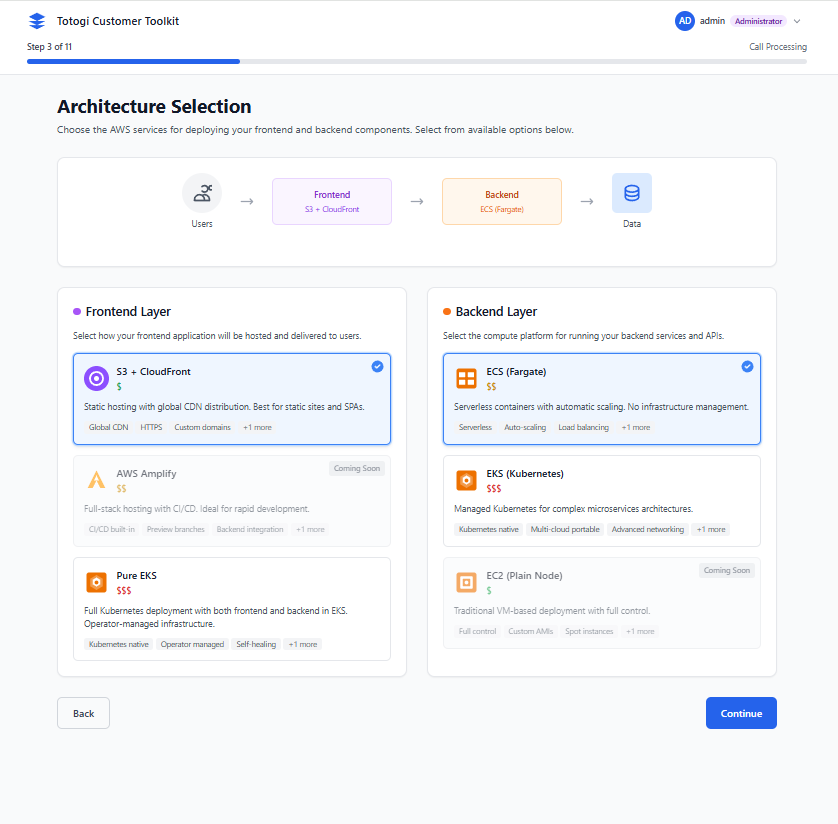

# Kubernetes (EKS) Deployment Guide

This guide covers deploying Totogi capabilities to Amazon EKS using the Kubernetes Operator.

---

## Overview

When you select **EKS (Kubernetes)** as your backend architecture, the Totogi Kubernetes Operator handles the deployment. The operator uses the Kubernetes pattern to:

- Provision AWS data services (DynamoDB, S3, Glue)
- Create SSM Parameters and Secrets Manager secrets
- Deploy frontend and backend containers
- Manage IAM roles with IRSA (IAM Roles for Service Accounts)
- Handle updates and deletions with proper cleanup

---

## Prerequisites

### EKS Cluster Requirements

| Requirement | Description |
|-------------|-------------|
| **EKS Version** | 1.23 or higher |
| **OIDC Provider** | Must be configured on the cluster |
| **Node Groups** | At least one node group with available capacity |
| **kubectl Access** | Configured access to the cluster |

### IAM Permissions

The deployment user needs these permissions:

```json
{
  "Effect": "Allow",
  "Action": [
    "eks:DescribeCluster",
    "eks:ListClusters",
    "eks:AccessKubernetesApi"
  ],
  "Resource": "*"
}
```

### Verify Prerequisites

```bash
# Check EKS cluster access
aws eks describe-cluster --name your-cluster-name --region ap-southeast-1

# Check kubectl access
kubectl get nodes

# Verify OIDC provider
aws eks describe-cluster --name your-cluster-name \
  --query "cluster.identity.oidc.issuer" --output text
```

---

## Architecture

When deploying to EKS, the following resources are created:

```
┌─────────────────────────────────────────────────────────────┐
│                     EKS Cluster                              │
│  ┌─────────────────────────────────────────────────────┐    │
│  │              totogi-system namespace                 │    │
│  │  ┌─────────────────────────────────────────────┐    │    │
│  │  │           Totogi Operator                    │    │    │
│  │  │  - Watches TotogiCapability CRs             │    │    │
│  │  │  - Provisions AWS resources                 │    │    │
│  │  │  - Deploys K8s workloads                    │    │    │
│  │  └─────────────────────────────────────────────┘    │    │
│  └─────────────────────────────────────────────────────┘    │
│                                                              │
│  ┌─────────────────────────────────────────────────────┐    │
│  │         {capability}-{env} namespace                 │    │
│  │  ┌──────────────┐    ┌──────────────┐              │    │
│  │  │   Frontend   │    │   Backend    │              │    │
│  │  │  Deployment  │    │  Deployment  │              │    │
│  │  └──────────────┘    └──────────────┘              │    │
│  │  ┌──────────────┐    ┌──────────────┐              │    │
│  │  │   Service    │    │   Service    │              │    │
│  │  │ (LoadBalancer)│   │ (LoadBalancer)│              │    │
│  │  └──────────────┘    └──────────────┘              │    │
│  └─────────────────────────────────────────────────────┘    │
└─────────────────────────────────────────────────────────────┘
                              │
                              ▼
┌─────────────────────────────────────────────────────────────┐
│                      AWS Services                            │
│  ┌──────────┐  ┌──────────┐  ┌──────────┐  ┌──────────┐    │
│  │ DynamoDB │  │    S3    │  │   Glue   │  │   IAM    │    │
│  └──────────┘  └──────────┘  └──────────┘  └──────────┘    │
│  ┌──────────┐  ┌──────────┐  ┌──────────┐                  │
│  │   SSM    │  │ Secrets  │  │ Cognito  │                  │
│  │ Params   │  │ Manager  │  │ (Auth)   │                  │
│  └──────────┘  └──────────┘  └──────────┘                  │
└─────────────────────────────────────────────────────────────┘
```

---

## Deployment Flow

### Step 1: Select EKS Architecture

In the Architecture Selection step, choose:
- **Frontend**: CloudFront + S3 (recommended)
- **Backend**: EKS (Kubernetes)



### Step 2: Configure EKS Settings

When EKS is selected, additional configuration options appear:

| Setting | Description | Default |
|---------|-------------|---------|
| **Cluster Name** | Your EKS cluster name | Required |
| **Namespace** | Kubernetes namespace for deployment | `{capability}-{env}` |
| **Replicas** | Number of pod replicas | 2 |

### Step 3: Operator Activation

The installer will:
1. Check if the Totogi Operator is installed
2. If not, deploy the operator to `totogi-system` namespace
3. Create the TotogiCapability custom resource

### Step 4: Monitor Deployment

The deployment screen shows Kubernetes-specific stages:

```
 5%  - Initialization
15%  - Operator Verification
25%  - Namespace Creation
40%  - AWS Resources (DynamoDB, S3, Glue)
55%  - IAM Role with IRSA
70%  - Secrets and Config
85%  - Application Deployment
95%  - Service Creation
100% - Complete!
```

---

## TotogiCapability Custom Resource

The operator manages deployments through `TotogiCapability` custom resources:

```yaml
apiVersion: totogi.com/v1
kind: TotogiCapability
metadata:
  name: call-processing-prod
  namespace: call-processing-prod
spec:
  capabilityName: call-processing
  version: "1.0.0"
  environment: prod
  region: ap-southeast-1
  
  frontend:
    enabled: true
    replicas: 2
    image: "123456789.dkr.ecr.ap-southeast-1.amazonaws.com/totogi-frontend:1.0.0"
    resources:
      requests:
        cpu: "100m"
        memory: "128Mi"
      limits:
        cpu: "500m"
        memory: "512Mi"
  
  backend:
    enabled: true
    replicas: 2
    image: "123456789.dkr.ecr.ap-southeast-1.amazonaws.com/totogi-backend:1.0.0"
    resources:
      requests:
        cpu: "250m"
        memory: "256Mi"
      limits:
        cpu: "1000m"
        memory: "1Gi"
  
  dataServices:
    dynamodb:
      enabled: true
    s3:
      enabled: true
    glue:
      enabled: true
  
  deletionPolicy: Delete  # or Retain for production
```

---

## Managing EKS Deployments

### View Deployments

```bash
# List all capabilities
kubectl get totogicapabilities -A

# Short form
kubectl get tc -A

# Detailed status
kubectl describe tc call-processing-prod -n call-processing-prod
```

### Check Application Status

```bash
# View pods
kubectl get pods -n call-processing-prod

# View services
kubectl get svc -n call-processing-prod

# Get application URLs
kubectl get svc -n call-processing-prod \
  -o jsonpath='{.items[*].status.loadBalancer.ingress[0].hostname}'
```

### View Logs

```bash
# Frontend logs
kubectl logs -f deployment/call-processing-frontend -n call-processing-prod

# Backend logs
kubectl logs -f deployment/call-processing-backend -n call-processing-prod

# Operator logs
kubectl -n totogi-system logs -f deployment/totogi-operator
```

### Scale Deployments

```bash
# Scale via kubectl
kubectl patch tc call-processing-prod -n call-processing-prod \
  --type=merge -p '{"spec":{"backend":{"replicas":5}}}'

# Or edit directly
kubectl edit tc call-processing-prod -n call-processing-prod
```

### Update Image Version

```bash
kubectl patch tc call-processing-prod -n call-processing-prod \
  --type=merge -p '{"spec":{"backend":{"image":"123456789.dkr.ecr.ap-southeast-1.amazonaws.com/totogi-backend:2.0.0"}}}'
```

### Delete Deployment

```bash
kubectl delete tc call-processing-prod -n call-processing-prod
```

**Note:** AWS resources are deleted or retained based on `deletionPolicy`.

---

## Operator Management

### Check Operator Status

```bash
# Operator pods
kubectl get pods -n totogi-system

# Operator deployment
kubectl get deployment totogi-operator -n totogi-system

# Operator logs
kubectl -n totogi-system logs -f deployment/totogi-operator
```

### Restart Operator

```bash
kubectl -n totogi-system rollout restart deployment/totogi-operator
```

### Update Operator

The installer automatically updates the operator when needed. For manual updates:

```bash
# Apply new manifests
kubectl apply -f manifests/deployment.yaml
```

---

## IRSA (IAM Roles for Service Accounts)

The operator configures IRSA for secure AWS access:

### How It Works

1. Operator creates an IAM role with trust policy for the service account
2. Service account is annotated with the IAM role ARN
3. Pods assume the IAM role automatically via OIDC

### Trust Policy

```json
{
  "Version": "2012-10-17",
  "Statement": [{
    "Effect": "Allow",
    "Principal": {
      "Federated": "arn:aws:iam::ACCOUNT:oidc-provider/oidc.eks.REGION.amazonaws.com/id/CLUSTER_ID"
    },
    "Action": "sts:AssumeRoleWithWebIdentity",
    "Condition": {
      "StringEquals": {
        "oidc.eks.REGION.amazonaws.com/id/CLUSTER_ID:sub": "system:serviceaccount:NAMESPACE:SERVICE_ACCOUNT"
      }
    }
  }]
}
```

### Verify IRSA

```bash
# Check service account annotation
kubectl get sa -n call-processing-prod -o yaml

# Test AWS access from pod
kubectl exec -it deployment/call-processing-backend -n call-processing-prod -- aws sts get-caller-identity
```

---

## Troubleshooting

### Operator Not Running

```bash
# Check operator status
kubectl get pods -n totogi-system

# Check for errors
kubectl describe pod -l app.kubernetes.io/name=totogi-operator -n totogi-system

# View operator logs
kubectl -n totogi-system logs deployment/totogi-operator --tail=100
```

### Capability Stuck in Provisioning

```bash
# Check capability status
kubectl describe tc <name> -n <namespace>

# Check operator logs for errors
kubectl -n totogi-system logs deployment/totogi-operator | grep <capability-name>
```

### Pods Not Starting

| Issue | Cause | Solution |
|-------|-------|----------|
| `ImagePullBackOff` | Image not found | Verify ECR image exists |
| `CrashLoopBackOff` | Application error | Check pod logs |
| `Pending` | No resources | Check node capacity |

```bash
# Describe pod for details
kubectl describe pod <pod-name> -n <namespace>

# Check events
kubectl get events -n <namespace> --sort-by='.lastTimestamp'
```

### LoadBalancer Pending

```bash
# Check service
kubectl describe svc <name> -n <namespace>

# Verify AWS Load Balancer Controller (if using)
kubectl get pods -n kube-system | grep aws-load-balancer
```

### IRSA Not Working

```bash
# Verify OIDC provider
aws eks describe-cluster --name <cluster> \
  --query "cluster.identity.oidc.issuer"

# Check service account
kubectl get sa -n <namespace> -o yaml

# Test from pod
kubectl exec -it <pod> -n <namespace> -- aws sts get-caller-identity
```

---

## Best Practices

### Production Deployments

- ✅ Use `deletionPolicy: Retain` to preserve data
- ✅ Set appropriate resource limits
- ✅ Configure at least 2 replicas
- ✅ Set up Pod Disruption Budgets
- ✅ Enable auto-scaling (HPA)

### Security

- ✅ Use IRSA instead of access keys
- ✅ Restrict namespace access with RBAC
- ✅ Enable network policies
- ✅ Use private ECR repositories

### Monitoring

- ✅ Set up Prometheus/Grafana
- ✅ Configure CloudWatch Container Insights
- ✅ Set up alerting for pod failures
- ✅ Monitor operator logs

---

## Comparison: ECS vs EKS

| Feature | ECS Fargate | EKS (Kubernetes) |
|---------|-------------|------------------|
| **Setup Time** | ~15 minutes | ~5 minutes (with existing cluster) |
| **Cluster Required** | No | Yes |
| **Learning Curve** | Low | Medium |
| **Flexibility** | Medium | High |
| **Cost** | Pay-per-use | Cluster fee + nodes |
| **Scaling** | Auto-managed | Custom HPA/VPA |
| **Networking** | VPC-native | CNI-based |

**Choose ECS Fargate when:**
- No existing Kubernetes infrastructure
- Prefer serverless approach
- Simple deployment needs

**Choose EKS when:**
- Existing EKS cluster
- Kubernetes expertise on team
- Need custom K8s configurations
- Multi-cloud strategy

---

## Next Steps

- [Managing Deployments](./05-managing-deployments.md) - Update and monitor deployments
- [Troubleshooting](./06-troubleshooting.md) - Common issues and solutions
- [AWS Configuration](./04-aws-configuration.md) - AWS setup and permissions
