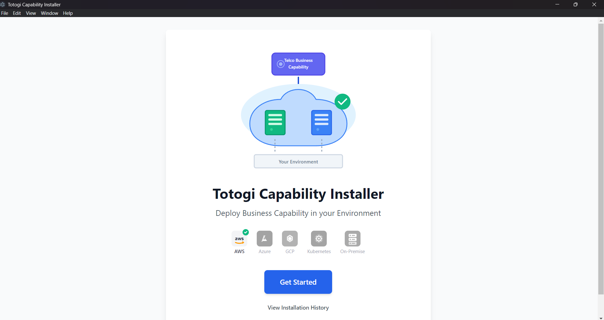
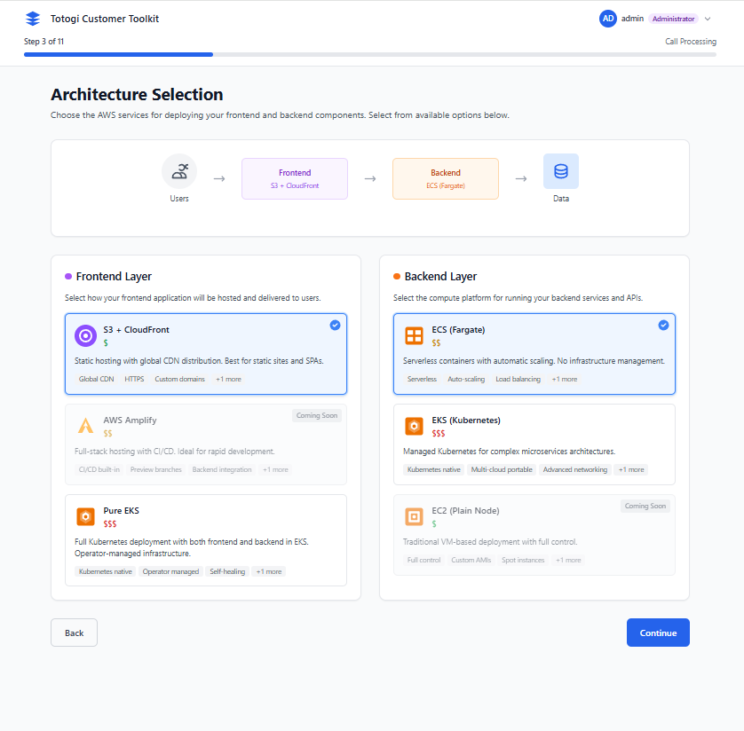
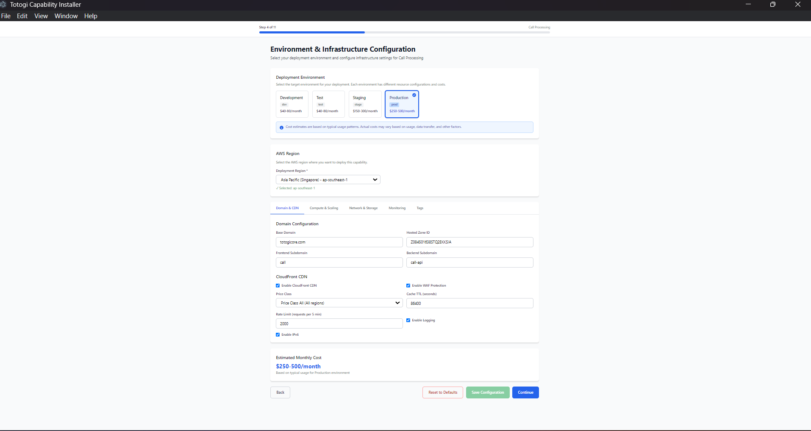
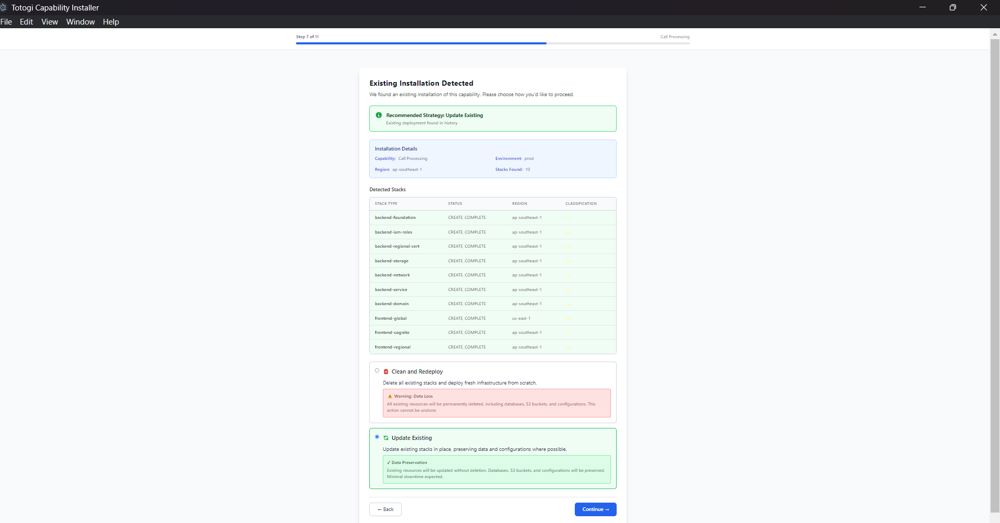
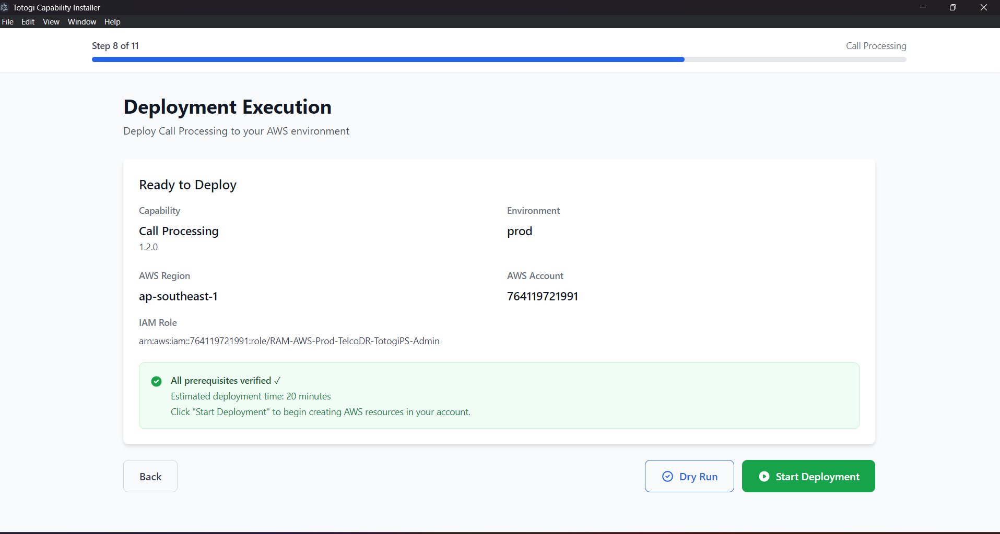
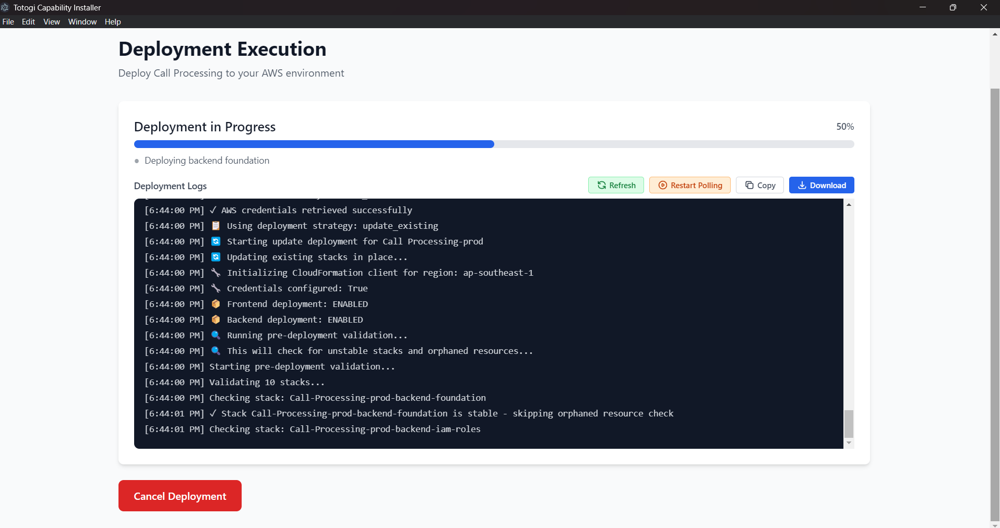
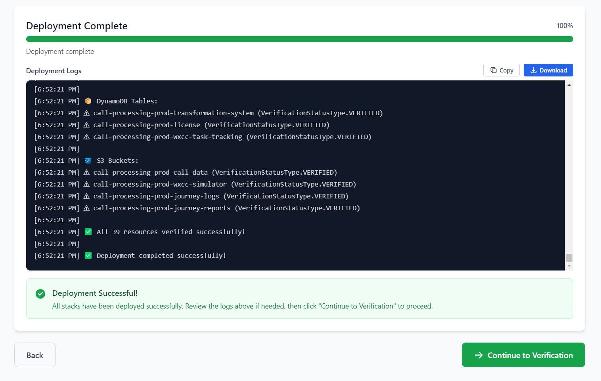
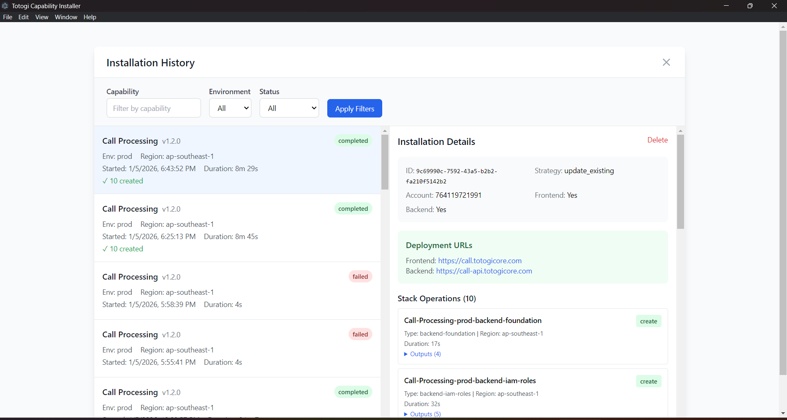

# Totogi Capability Installer - User Guide

Welcome to the Totogi Capability Installer! This comprehensive guide will help you deploy Totogi business capabilities to your AWS environment using our desktop application.

!!! tip "Download Complete Documentation"
    **[Download PDF Guide](Totogi-Toolkit-User-Guide.pdf)** - Complete documentation in a single PDF file for offline reading.

---

## Table of Contents

1. [Getting Started](#getting-started)
2. [Home Screen Overview](#home-screen-overview)
3. [Deployment Wizard Walkthrough](#deployment-wizard-walkthrough)
   - [Step 1: Capability Selection](#step-1-capability-selection)
   - [Step 2: Architecture Selection](#step-2-architecture-selection)
   - [Step 3: Environment Configuration](#step-3-environment-configuration)
   - [Step 4: AWS Configuration](#step-4-aws-configuration)
   - [Step 5: Permission Verification](#step-5-permission-verification)
   - [Step 6: Deployment Execution](#step-6-deployment-execution)
   - [Step 7: Post Verification](#step-7-post-verification)
   - [Step 8: Deployment Results](#step-8-deployment-results)
4. [Installation History](#installation-history)
5. [Additional Resources](#additional-resources)
6. [Support](#support)

---

## Getting Started

The Totogi Capability Installer is a desktop application that enables you to deploy Totogi's telco business capabilities directly into your own AWS environment. Before you begin, ensure you have:

- An AWS account with administrative access or appropriate IAM permissions
- AWS credentials (IAM Role ARN, Access Keys, CLI Profile, or ADFS)
- Network access to AWS APIs from your workstation

### Quick Start Summary

1. **Launch** the application and click "Get Started"
2. **Select** a capability to deploy
3. **Choose** your architecture (frontend and backend options)
4. **Configure** your environment settings
5. **Enter** and validate your AWS credentials
6. **Verify** permissions and prerequisites
7. **Deploy** and monitor progress in real-time
8. **Access** your deployed application

---

## Home Screen Overview

When you launch the Totogi Capability Installer, you are greeted with the Welcome screen.



The home screen provides:

- **Hero Illustration**: A visual representation of the deployment concept showing how capabilities are deployed to your cloud infrastructure
- **Platform Icons**: Indicators showing supported cloud providers (AWS currently supported, with Azure, GCP, Kubernetes, and On-Premise coming soon)
- **Get Started Button**: Click this to begin the deployment wizard
- **View Installation History**: Access your past deployments and their status

To begin deploying a capability, click the **Get Started** button.

---

## Deployment Wizard Walkthrough

The deployment wizard guides you through a step-by-step process to deploy capabilities to your AWS environment. Each step is designed to collect the necessary information while providing clear guidance.

### Step 1: Capability Selection

The first step presents you with available capabilities to deploy.


This screen is divided into two sections:

**Installed Capabilities** (shown with green border)
- Displays capabilities already deployed to your environment
- Shows deployment status, environment, and region
- Provides **Update** and **Delete** actions for each installed capability

**Available Capabilities** (shown with blue border)
- Lists capabilities ready for installation
- Displays name, version, description, and estimated deployment time
- Click **Install** to begin deploying a capability

**Actions Available:**
| Action | Description |
|--------|-------------|
| Install | Deploy a new capability to your environment |
| Update | Update an existing deployment to a newer version |
| Delete | Remove a deployed capability from your environment |
| Refresh | Reload the capability and deployment status |

Select the capability you wish to deploy and click **Install** to proceed.

---

### Step 2: Architecture Selection

Choose your preferred deployment architecture for both frontend and backend components.



**Frontend Options:**

| Option | Description | Recommended For |
|--------|-------------|-----------------|
| CloudFront + S3 | Static hosting with global CDN | Most deployments (recommended) |
| AWS Amplify | Managed hosting with CI/CD | Teams needing built-in CI/CD |
| Skip Frontend | Deploy backend only | API-only deployments |

**Backend Options:**

| Option | Description | Recommended For |
|--------|-------------|-----------------|
| ECS Fargate | Serverless containers with auto-scaling | Quick setup, serverless (recommended) |
| EKS (Kubernetes) | Kubernetes Operator-based deployment | Teams with K8s expertise, cloud-native |
| EC2 Instances | Traditional virtual machines | Legacy compatibility |
| Skip Backend | Deploy frontend only | Static site deployments |

#### EKS (Kubernetes) Deployment - NEW

When you select **EKS (Kubernetes)** as your backend option, the Totogi Kubernetes Operator handles the deployment:

| Feature | Description |
|---------|-------------|
| **Operator Pattern** | Uses custom TotogiCapability resources for declarative deployments |
| **Auto-Provisioning** | Automatically creates DynamoDB, S3, Glue, and IAM resources |
| **IRSA Integration** | Secure IAM Roles for Service Accounts |
| **LoadBalancer Services** | Automatic service exposure via AWS Load Balancers |
| **Lifecycle Management** | Handles updates and deletions with proper cleanup |

**Requirements for EKS:**
- Existing EKS cluster (v1.23+) with OIDC provider configured
- kubectl access to the cluster
- Node groups with EC2 instances or Fargate profiles

**Tip:** Choose **CloudFront + S3** for frontend and **ECS Fargate** for backend for the quickest setup. Choose **EKS (Kubernetes)** if you already have an EKS cluster and prefer Kubernetes-native operations.

See [Kubernetes Deployment Guide](./08-kubernetes-deployment.md) for detailed EKS deployment instructions.

Select your preferred options and click **Next** to continue.

---

### Step 3: Environment Configuration

Configure your deployment environment settings including domain, region, and environment type.



**Environment Selection:**

| Environment | Purpose | Characteristics |
|-------------|---------|-----------------|
| dev | Development and testing | Lower resources, faster iteration |
| staging | Pre-production validation | Production-like configuration |
| prod | Production workloads | Full resources, high availability |

**Domain Configuration:**

| Field | Example | Description |
|-------|---------|-------------|
| Base Domain | `example.com` | Your registered domain name |
| Frontend Subdomain | `app` | Creates `app.example.com` |
| Backend Subdomain | `api` | Creates `api.example.com` |
| Route53 Hosted Zone ID | `Z1234567890ABC` | Your Route53 hosted zone identifier |

**AWS Region Selection:**

Choose your deployment region based on:
- **Latency**: Select the region closest to your users
- **Compliance**: Some data must remain in specific regions
- **Cost**: Pricing varies by region
- **Service Availability**: Some services have regional limitations

Complete all required fields and click **Next** to proceed.

---

### Step 4: AWS Configuration

Enter and validate your AWS credentials to authorize the deployment.


The installer supports multiple authentication methods:

**1. IAM Role ARN (Recommended)**
- Best for cross-account deployments and security best practices
- Enter the Role ARN: `arn:aws:iam::123456789012:role/DeploymentRole`
- Select source credentials to assume the role

**2. AWS Access Keys**
- Direct authentication using IAM user credentials
- Enter Access Key ID and Secret Access Key
- Suitable for quick setup and development environments

**3. AWS CLI Profile**
- Use credentials from your existing AWS CLI configuration
- Select a profile from `~/.aws/credentials`
- Ideal for developers with existing AWS CLI setup

**4. ADFS/SAML Authentication**
- Enterprise SSO authentication
- Enter ADFS URL and credentials
- Select from available AWS roles

**Validation:**

Click **Test Credentials** to validate your credentials before proceeding. The system verifies:
- ✅ AWS account access
- ✅ STS identity verification
- ✅ Account ID confirmation

**Security Best Practices:**
- Use IAM Role ARN for production deployments
- Never share or commit access keys to source control
- Rotate credentials regularly
- Enable MFA when possible

---

### Step 5: Permission Verification

The installer verifies that all prerequisites are met before deployment begins.


**Verification Checks:**

| Check | Description |
|-------|-------------|
| AWS Account Access | Verifies STS identity and account access |
| IAM Permissions | Tests required AWS service permissions |
| Frontend Artifact | Confirms S3 artifact availability |
| Backend Image | Verifies ECR container image exists |
| Network Resources | Checks availability zones and VPCs |
| Service Limits | Validates ECS capacity and quotas |

**Status Indicators:**

| Icon | Status | Meaning |
|------|--------|---------|
| ⏳ | Checking | Verification in progress |
| ✅ | Passed | Check completed successfully |
| ❌ | Failed | Check failed - see details for resolution |
| ⚠️ | Warning | Non-blocking issue detected |

**If a check fails:**
1. Review the error message displayed
2. Click "View Details" for more information
3. Resolve the issue in AWS Console
4. Click **Re-verify** to check again

All checks must pass before you can proceed to deployment.

---

### Step 6: Deployment Execution

Monitor your deployment progress in real-time.



**Pre-Deployment Summary:**

Before deployment begins, review:
- Capability name and version
- Target environment and region
- AWS account ID
- Estimated deployment time

**Progress Tracking:**

The deployment screen provides:

- **Progress Bar**: Shows overall completion percentage with color indicators (blue = in progress, green = success, red = error)
- **Current Stage**: Displays the active deployment stage
- **Live Logs**: Terminal-style log viewer with timestamped entries



**Deployment Stages:**

```
 5%  - Initialization
15%  - Starting Deployment
30%  - Frontend Global (CloudFront, S3, ACM, WAF)
45%  - Frontend Cognito (User Pool, Auth)
60%  - Frontend Regional (Route53, Regional)
70%  - Frontend Upload (Artifacts, Cache)
40%  - Backend Foundation (VPC, IAM, Certs)
55%  - Backend Storage (ECR, DynamoDB, S3)
70%  - Backend Network (ALB, Security Groups)
85%  - Backend Service (ECS, Auto-scaling)
95%  - Verification (Health Checks)
100% - Complete!
```

**Available Actions During Deployment:**

| Action | Description |
|--------|-------------|
| Refresh | Manually refresh the log display |
| Restart Polling | Restart automatic log refresh |
| Copy Logs | Copy deployment logs to clipboard |
| Download Logs | Save logs to a local file |
| Cancel | Cancel deployment (requires confirmation) |

**Important:** Do not close the application during deployment. Typical deployment time is 15-30 minutes.

---

### Step 7: Post Verification

After deployment completes, the installer verifies that all services are healthy.



**Health Checks Performed:**

| Service | Verification |
|---------|--------------|
| Frontend Availability | Application loads correctly |
| Authentication Service | Cognito responds to requests |
| Backend API | API health endpoint responds |
| Database Connectivity | DynamoDB is accessible |
| SSL Certificates | HTTPS is working correctly |

**Status Indicators:**

| Status | Meaning |
|--------|---------|
| ✅ Healthy | Service is fully operational |
| ⚠️ Degraded | Service has minor issues |
| ❌ Unhealthy | Service is not responding |

**Tips:**
- All services should show healthy status
- DNS propagation may take a few minutes
- SSL certificates may take up to 30 minutes to fully validate

If any service shows unhealthy, click **Re-verify** after a few minutes or check the troubleshooting guide.

---

### Step 8: Deployment Results

Upon successful deployment, you receive all the information needed to access your application.



**Deployment Outputs:**

| Output | Description |
|--------|-------------|
| Frontend URL | Your application's web address |
| Backend API URL | API endpoint for backend services |
| Cognito User Pool ID | Authentication pool identifier |
| AWS Region | Region where resources are deployed |

**Admin Credentials:**

For first-time login:
- **Admin Email**: `admin@capability-name.local`
- **Temporary Password**: Displayed on screen

**Important:** Change your password immediately upon first login!

**Next Steps:**

1. **Access Application**: Open the frontend URL in your browser
2. **Login**: Use the admin credentials provided
3. **Change Password**: Set a new secure password on first login
4. **Create Users**: Add additional users through Cognito

**Available Actions:**

| Button | Action |
|--------|--------|
| View Dashboard | Open the management dashboard |
| New Deployment | Start another deployment |
| Copy | Copy values to clipboard |

---

## Installation History

Access your deployment history to view, manage, and track all past deployments.



The Installation History screen displays:

- **Capability Name**: The deployed capability
- **Version**: Deployed version number
- **Environment**: Target environment (dev/staging/prod)
- **Region**: AWS region
- **Deployment Date**: When the deployment occurred
- **Status**: Current deployment status

**Available Actions:**

| Action | Description |
|--------|-------------|
| Update | Update the deployment to a newer version |
| Delete | Remove the deployment from your environment |
| View Details | See detailed deployment information |

**Tip:** Use the Installation History to quickly manage multiple deployments across different environments.

---

## Additional Resources

For more detailed information, refer to these additional guides:

| Guide | Description |
|-------|-------------|
| [Getting Started](./01-getting-started.md) | Detailed prerequisites and overview |
| [Installation](./02-installation.md) | Application installation instructions |
| [Deployment Wizard](./03-deployment-wizard.md) | Complete wizard walkthrough |
| [AWS Configuration](./04-aws-configuration.md) | AWS setup and IAM permissions |
| [Managing Deployments](./05-managing-deployments.md) | Update, delete, and monitor deployments |
| [Troubleshooting](./06-troubleshooting.md) | Common issues and solutions |
| [FAQ](./07-faq.md) | Frequently asked questions |
| [Kubernetes Deployment](./08-kubernetes-deployment.md) | EKS deployment with Kubernetes Operator |

---

## Supported Platforms

| Platform | Status |
|----------|--------|
| AWS (ECS Fargate) | ✅ Fully Supported |
| AWS (EKS/Kubernetes) | ✅ Fully Supported |
| Azure | 🔜 Coming Soon |
| GCP | 🔜 Coming Soon |
| On-Premise | 🔜 Coming Soon |

**New in v1.1:** Kubernetes deployment is now fully supported via the Totogi Kubernetes Operator. Choose EKS (Kubernetes) in the Architecture Selection step to deploy using the operator pattern.

---

## System Requirements

| Requirement | Specification |
|-------------|---------------|
| Operating System | Windows 10/11, macOS 10.15+, or Linux (Ubuntu 20.04+) |
| Memory | 4GB RAM minimum |
| Disk Space | 500MB for application |
| Network | Internet connection for AWS API access |
| AWS Account | With appropriate IAM permissions |

---

## Support

If you need assistance:

| Resource | Details |
|----------|---------|
| Documentation | This user guide and linked resources |
| Support Portal | [support.totogi.com](https://support.totogi.com) |
| Email | support@totogi.com |

When contacting support, please provide:
- Deployment ID (from the installer)
- Error messages or screenshots
- Deployment logs (downloadable from the installer)
- Application version and operating system

---

*Version 1.1.0 | Last Updated: February 2026*
