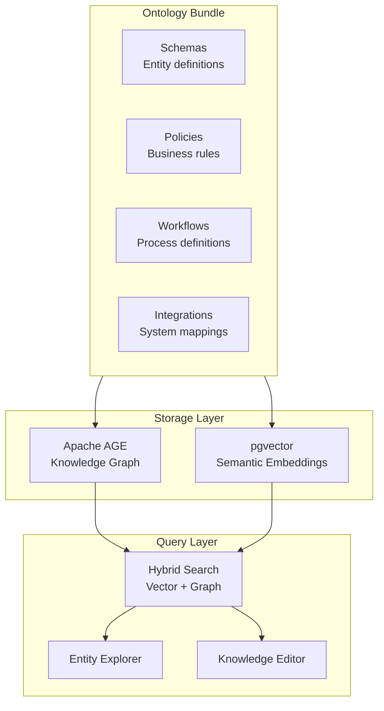
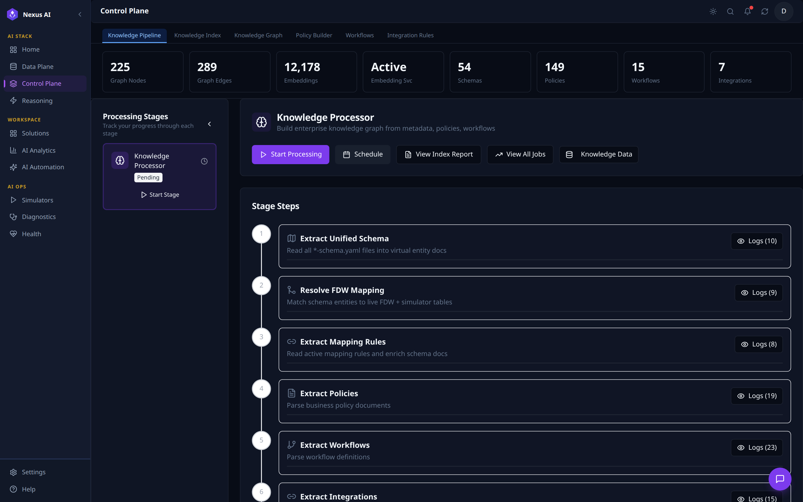
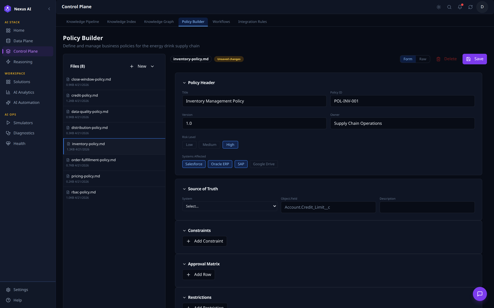
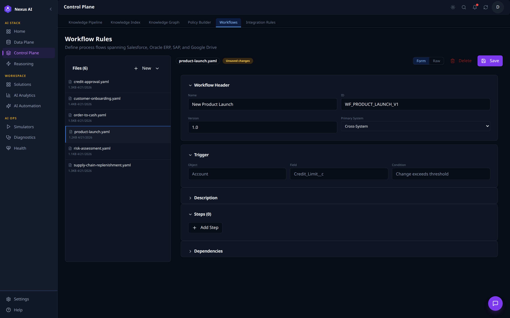
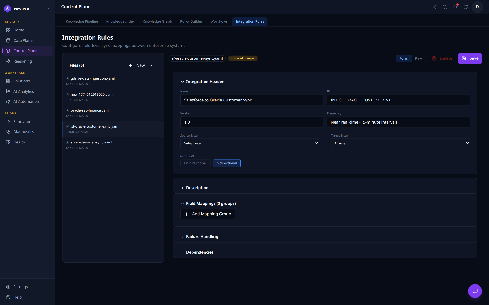

# Control Plane

Builds a **semantic understanding** of the enterprise by combining an ontology layer, a knowledge graph, and a vector embedding index — the brain that gives AI the context to reason about your business.

For platform-overview framing see [Platform Architecture > Control Plane](../platform-architecture.md#control-plane). For retrieval-engineering principles see [AI Operating System > Semantic RAG](../ai-os/semantic-rag.md).

## Capabilities

- **Ontology Schemas** — YAML-defined business entity definitions (customers, orders, assets, contracts).
- **Policies** — business rules, guardrails, and compliance constraints.
- **Workflows** — multi-step business process definitions.
- **Integrations** — system-to-system sync mappings.
- **Knowledge Graph** — Apache AGE on PostgreSQL for entity relationships and graph traversal.
- **Semantic Index** — pgvector on PostgreSQL for hybrid (vector + graph) search.
- **Hybrid retrieval** — combine semantic similarity and graph traversal in a single query.

## Architecture

## Console Walkthrough

Six tabs cover ingestion, retrieval, governance, and orchestration of the semantic layer.

### Knowledge Pipeline

- Real-time graph and embedding counters.
- Six-stage pipeline: Extract Unified Schema → Resolve FDW Mapping → Extract Mapping Rules → Extract Policies → Extract Workflows → Extract Integrations.
- Trigger manually or schedule.

### Knowledge Index

- Filter chips swap between Schemas, Policies, Workflows, Integrations.
- Document detail shows metadata plus the canonical YAML body that feeds embeddings.

### Knowledge Graph

- Nodes colour-coded by source system.
- Typed edges (`triggers`, `syncs_to`, `depends_on`, `constrained_by`, `owned_by`).
- Full-text search and per-source filtering.

### Policy Builder

- Per-policy header: name, ID, risk level, target systems.
- Source-of-truth field binding.
- Editable Constraints, Approval Matrix, and Restrictions blocks.

### Workflows

- Per-workflow header, trigger definition, steps, and dependencies.
- Cross-system orchestration as first-class.

### Integration Rules

- Per-rule header: source/target system, frequency, direction (one-way or bidirectional).
- Field mappings, failure handling, dependencies in collapsible sections.

## Related References

- [Semantic RAG](../ai-os/semantic-rag.md) — retrieval engineering principles (canonical knowledge model, hybrid retrieval, black-box validation).
- [Semantic RAG Pipeline](../semantic-layer/semantic-rag-pipeline.md) — the production pipeline implementation.
- [Implementation Guide](../ai-os/implementation-guide.md) — production code mapping (`schema_indexer.py`, `vector_store.py`, `embedding_service.py`, `rag_service.py`).
- [Data Plane](data-plane.md) — the data layer this plane consumes.
- [Reasoning Plane](reasoning-plane.md) — the layer that consumes Control Plane retrievals.
