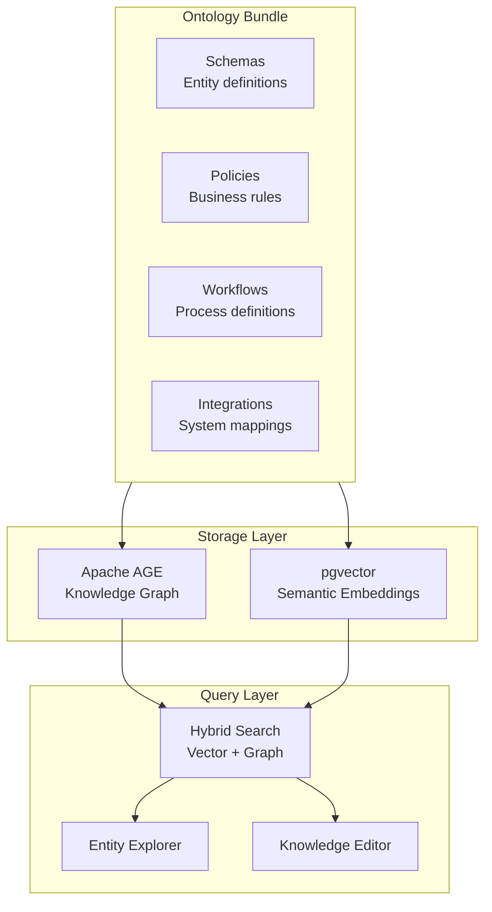
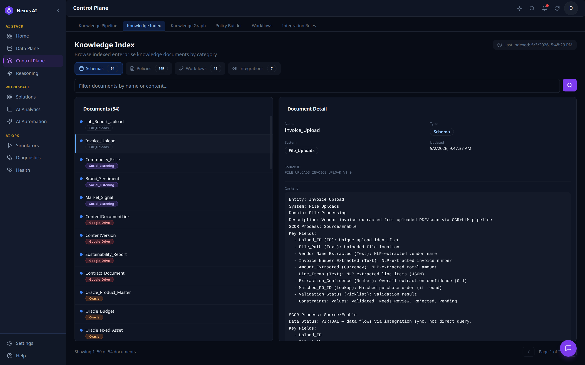
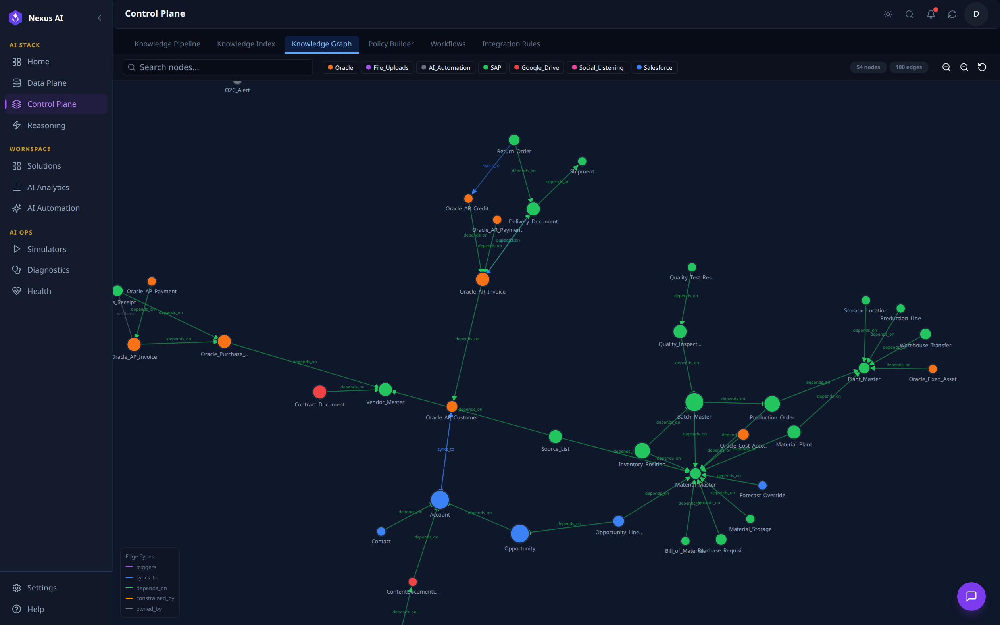

# Control Plane

The Control Plane builds a **semantic understanding** of the enterprise by combining an ontology layer, a knowledge graph (Apache AGE), and a vector embedding index (pgvector). It is the brain that gives AI the context to reason about business data.

For the framing in the platform overview, see [Platform Architecture > Control Plane](../platform-architecture.md#control-plane). For the underlying retrieval-engineering principles, see [AI Operating System > Semantic RAG](../ai-os/semantic-rag.md).

## Capabilities

| Component | Technology | Purpose |
|---|---|---|
| Ontology Schemas | YAML-defined | Business entity definitions (customers, orders, assets, contracts) |
| Policies | Rule engine | Business rules, guardrails, compliance constraints |
| Workflows | Orchestration | Multi-step business process definitions |
| Integrations | Connector config | System-to-system integration mappings |
| Knowledge Graph | Apache AGE (PostgreSQL) | Entity relationships, graph traversal, connected reasoning |
| Semantic Index | pgvector (PostgreSQL) | Vector embeddings for hybrid search (semantic + graph) |

## Architecture

## Key metrics

- **Schemas** -- ontology entity schemas loaded (e.g., Customer, Order, Product, Contract).
- **Policies** -- business rule policies active.
- **Workflows** -- defined workflow templates.
- **Integrations** -- integration connector configurations.
- **Graph Nodes** -- entities in the Apache AGE knowledge graph.
- **Embeddings** -- vector embeddings in the pgvector semantic index.

## Console walkthrough

Six tabs in the NexusAI workspace, covering ingestion, retrieval, governance, and orchestration of the platform's semantic layer.

### Knowledge Pipeline

Operational dashboard for the ingestion process that builds the knowledge graph and embedding index. Top counters surface real-time graph size (**225** nodes, **289** edges), embeddings (**12,178**), and ontology totals (**54** Schemas, **149** Policies, **15** Workflows, **7** Integrations). The **Knowledge Processor** card lets you trigger the pipeline manually or schedule it; **Stage Steps** below shows the six-stage flow -- Extract Unified Schema -> Resolve FDW Mapping -> Extract Mapping Rules -> Extract Policies -> Extract Workflows -> Extract Integrations -- with per-stage logs.

### Knowledge Index

Search and browse interface for every document indexed by the platform. Filter chips swap between **Schemas**, **Policies**, **Workflows**, and **Integrations**. With **Invoice_Upload** selected here, the right pane shows the document's full metadata -- Name, Type, System, Updated timestamp, Source ID -- plus the canonical YAML body (Entity, Domain, Description, SCOR Process, Key Fields, etc.) that feeds the embedding pipeline.

### Knowledge Graph

Interactive visualisation of the live ontology graph, **94 nodes / 100 edges** in this view. Nodes are colour-coded by source system (Salesforce, Oracle, SAP, Google Drive, File Uploads, Social Listening, AI_Automation), and edges carry typed relationships (`triggers`, `syncs_to`, `depends_on`, `constrained_by`, `owned_by`). The toolbar offers full-text search and per-source filtering.

### Policy Builder

Visual editor for business policies stored as Markdown files. The left panel lists every policy in the bundle (8 in this view); selecting **inventory-policy.md** loads its **Policy Header** (*Inventory Management Policy*, ID `POL-INV-001`, Risk Level **High**, applied to Salesforce / Oracle ERP / SAP), **Source of Truth** binding (`Account.Credit_Limit__c`), and the editable **Constraints**, **Approval Matrix**, and **Restrictions** blocks.

### Workflows

Visual editor for multi-system process flows stored as YAML. **Files (6)** lists the workflow templates; selecting **product-launch.yaml** loads its **Workflow Header** (*New Product Launch*, ID `WF_PRODUCT_LAUNCH_V1`, Primary System: Cross-System) and **Trigger** definition (`Account.Credit_Limit__c` change exceeds threshold). **Description**, **Steps**, and **Dependencies** sections are editable below.

### Integration Rules

Configures field-level sync mappings between enterprise systems. **Files (5)** lists the sync rules; selecting **sf-oracle-customer-sync.yaml** loads its **Integration Header** (*Salesforce to Oracle Customer Sync*, ID `INT_SF_ORACLE_CUSTOMER_V1`, Frequency: near real-time 15-minute interval, **bidirectional**), with Source System **Salesforce** -> Target System **Oracle** wired up. **Field Mappings**, **Failure Handling**, and **Dependencies** are managed in the collapsible sections below.

## Related references

- [Semantic RAG](../ai-os/semantic-rag.md) -- the retrieval engineering principles (canonical knowledge model, hybrid retrieval, black-box validation).
- [Semantic RAG Pipeline](../semantic-layer/semantic-rag-pipeline.md) -- the production pipeline implementation.
- [Implementation Guide](../ai-os/implementation-guide.md) -- production code mapping (`schema_indexer.py`, `vector_store.py`, `embedding_service.py`, `rag_service.py`).
- [Data Plane](data-plane.md) -- the data layer this plane consumes.
- [Reasoning Plane](reasoning-plane.md) -- the layer that consumes Control Plane retrievals.
