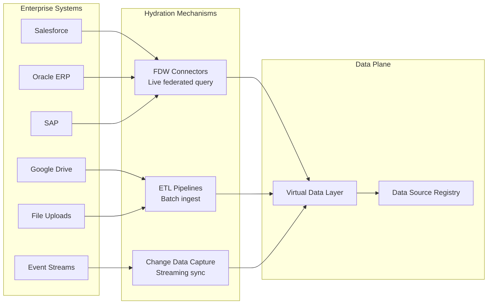

# Data Plane

Unifies disparate enterprise systems into a single **Virtual Data Layer (VDL)** so every entity is queryable through one API regardless of where it lives.

For platform-overview framing see [Platform Architecture > Data Plane](../platform-architecture.md#data-plane). For the FDW vs ETL vs CDC decision framework see [AI Operating System > Data Sources](../ai-os/data-sources.md).

## Capabilities

- **Single virtual entity API** — every connected system is queried the same way.
- **Three hydration mechanisms** — pick FDW, ETL, or CDC per source based on latency and payload shape.
- **Connector catalogue** — Salesforce, Oracle ERP, SAP S/4HANA, Google Drive, Office 365, Webex, Knowledge Base, Langflow, plus a generic external-systems writeback channel.
- **Simulator mode** — swap any live source for an in-memory simulator without code changes.
- **Live row preview** — inspect resolved rows for any virtual entity from inside the console.

## Hydration Mechanisms

- **FDW Connectors** — live federated reads against transactional systems of record (millisecond latency). Use for Salesforce, Oracle ERP, SAP S/4HANA, BSSMagic CRM.
- **ETL Pipelines** — bulk ingest, transform, and enrich file or document sources (minutes-to-hours latency). Use for Google Drive, file uploads, market signals, sustainability reports.
- **Change Data Capture (CDC)** — streaming incremental changes from operational systems (sub-second latency). Use for Kafka / Debezium event streams and transactional change feeds.

## Data Flow

## Console Walkthrough

Six tabs cover the hydration lifecycle.

### Data Sources

- Filter by vertical and toggle between **Real FDW** and **Simulator** modes.
- Per-source health status and last-sync indicators.
- Add a new source from the toolbar.

### Virtual Data

- Per-vertical breakdown of entity, workflow, policy, and integration counts.
- Per-source integration mode shown at a glance: **FDW**, **Schema Overlay**, or **Ingestion**.

### Entity Explorer

- Entities grouped by source system, tagged as **virtual** or **mapped**.
- Schema fields with data type, semantic, risk class, and constraints.
- Typed relationships (`depends_on`, `triggers`, `syncs_to`, `constrained_by`).

### Mapping Rules

- Rule list grouped by source with **Auto-Map**, **Audit**, and **New Rule** quick actions.
- Per-rule editor: virtual entity, source table, field mappings, business logic SQL, filter expression, status.
- Live preview of resolved rows.

### Data Pipelines

- Stage flow per pipeline: Extract → Validate → Transform → Load → Verify.
- Active / Completed / Running counters and recent run history.

### Connectors

- Each card lists configuration inputs and produced outputs.
- One-click `Configure` to wire a connector into the platform.

## Related References

- [Data Sources](../ai-os/data-sources.md) — FDW vs ETL vs CDC decision framework.
- [Implementation Guide](../ai-os/implementation-guide.md) — production code mapping (FDW services, BSSMagic CRM operations, REST endpoints).
- [SFDC Simulator](../simulators/sfdc/index.md) — mock CRM source for offline development.
- [Control Plane](control-plane.md) — the semantic layer that consumes the VDL.
