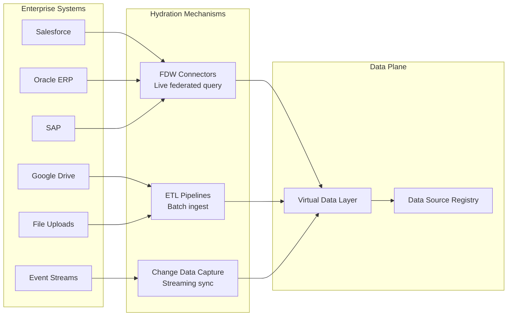

# Data Plane

Unifies disparate enterprise systems into a single **Virtual Data Layer (VDL)** so every entity is queryable through one API regardless of where it lives.

For platform-overview framing see [Platform Architecture > Data Plane](../platform-architecture.md#data-plane). For the FDW vs ETL vs CDC decision framework see [AI Operating System > Data Sources](../ai-os/data-sources.md).

## Capabilities

- **Single virtual entity API** — every connected system is queried the same way.
- **Three hydration mechanisms** — pick FDW, ETL, or CDC per source based on latency and payload shape.
- **Connector catalogue** — Salesforce, Oracle ERP, SAP S/4HANA, Google Drive, Office 365, Webex, Knowledge Base, Langflow, plus a generic external-systems writeback channel.
- **Simulator mode** — swap any live source for an in-memory simulator without code changes.
- **Live row preview** — inspect resolved rows for any virtual entity from inside the console.

## Hydration Mechanisms

- **FDW Connectors** — live federated reads against transactional systems of record (millisecond latency). Use for Salesforce, Oracle ERP, SAP S/4HANA, BSSMagic CRM.
- **ETL Pipelines** — bulk ingest, transform, and enrich file or document sources (minutes-to-hours latency). Use for Google Drive, file uploads, market signals, sustainability reports.
- **Change Data Capture (CDC)** — streaming incremental changes from operational systems (sub-second latency). Use for Kafka / Debezium event streams and transactional change feeds.

## Data Flow

## VDL compositions

VDL entities are defined in the catalog (fields, relationships). **Compositions** describe how each entity is formed at query time:

- One composition per `virtualEntity` (no duplicate actives).
- **Sources** — one or more physical tables (`schema.table`) with SQL aliases.
- **Joins** — optional `LEFT` / `INNER` join plan between aliases.
- **Projections** — each VDL field maps to a SQL expression (single-table passthrough or multi-source).
- **Runtime** — `POST /api/v1/vdl/query` and the Data Plane preview resolve the active composition and execute read-only SQL (FDW) or an in-memory join (simulator).

Console: **Data Plane → VDL → Virtual data layer** (merged entity list + composition editor). Legacy mapping rules remain API-compatible and are migrated to compositions on startup.

## Console Walkthrough

Six tabs cover the hydration lifecycle.

### Data Sources

- Filter by vertical and toggle between **Real FDW** and **Simulator** modes.
- Per-source health status and last-sync indicators.
- Add a new source from the toolbar.

### Virtual Data

- Per-vertical breakdown of entity, workflow, policy, and integration counts.
- Per-source integration mode shown at a glance: **FDW**, **Schema Overlay**, or **Ingestion**.

### Entity Explorer

- Entities grouped by source system, tagged as **virtual** or **mapped**.
- Schema fields with data type, semantic, risk class, and constraints.
- Typed relationships (`depends_on`, `triggers`, `syncs_to`, `constrained_by`).

### Mapping Rules

- Rule list grouped by source with **Auto-Map**, **Audit**, and **New Rule** quick actions.
- Per-rule editor: virtual entity, source table, field mappings, business logic SQL, filter expression, status.
- Live preview of resolved rows.

### Data Pipelines

- **Flow Studio** (`?tab=pipeline-studio`): Canvas for **classic ETL** (`source.*` → `transform.*` → `sink.*`) and optional **`nexus.*` / `nifi.*` processors**. The UI enforces catalog-based connection rules (no source→source links; sinks cannot chain onward). **Save draft** persists work-in-progress graphs even when validation fails; **Review & deploy** requires a valid compile. **Test on sample** runs `etl_pipeline` or `nexus_flow` based on graph content. Google Drive sources expose connector test (`POST /api/v1/data-flow/sources/google-drive/test`) and schema-driven params in the inspector. Preview (`POST /api/v1/data-flow/flow/preview-run`) uses the linear Nexus journey runner when `NEXUS_FLOW_RUNTIME_EXECUTION=true` (default **false** on local K3s unless `localEmulation.flowRuntimeExecution` is set).
- **Library** (`?tab=pipelines`): existing jobs — run, delete, Open in Studio (`pipelineId=`). Templates jump to Studio with a starter graph.
- **Processor registry** (`?tab=nexus-processors`; legacy `?tab=nifi-processors` redirects): table + detail drawer (metadata, inputs/properties, output relationships, Python source, probe). Live processors: `GET …/source`, `POST …/{id}/probe`, batch `POST /api/v1/nifi-processors/probe-batch`. Resync: `POST /api/v1/nifi-processors/resync`.
- **Nexus assets** (`?tab=nexus-data-assets`; legacy `?tab=nifi-assets` redirects): Jolt specs, docs, example flows (`NIFIASSET#`).
- REST: `GET /api/v1/data-flow/catalog` (ETL + NiFi), `GET /api/v1/nifi-processors`, validate/compile/pipelines/journeys as before.
- Copilot sidebar: `POST /api/v1/data-flow/plan` proposes patches; **Review & deploy** writes `productionGraphSnapshot`.
- Runtime: ETL jobs execute `etl_pipeline`. Nine core NiFi transforms run in Python (`src/services/flow_processors/`); remaining harvested processors are catalog stubs (deploy blocked). Harvest: `backend/scripts/nifi_harvest.py` against vendored `/opt/mycode/nexus/nifi`.
- Stage flow (ETL): Extract → Validate → Transform → Load → Verify (plus Register VDL / Materialize warehouse for external sources).

### Connectors

- Each card lists configuration inputs and produced outputs.
- One-click `Configure` to wire a connector into the platform.

## Related References

- [Data Sources](../ai-os/data-sources.md) — FDW vs ETL vs CDC decision framework.
- [Implementation Guide](../ai-os/implementation-guide.md) — production code mapping (FDW services, BSSMagic CRM operations, REST endpoints).
- [SFDC Simulator](../simulators/sfdc/index.md) — mock CRM source for offline development.
- [Control Plane](control-plane.md) — the semantic layer that consumes the VDL.
