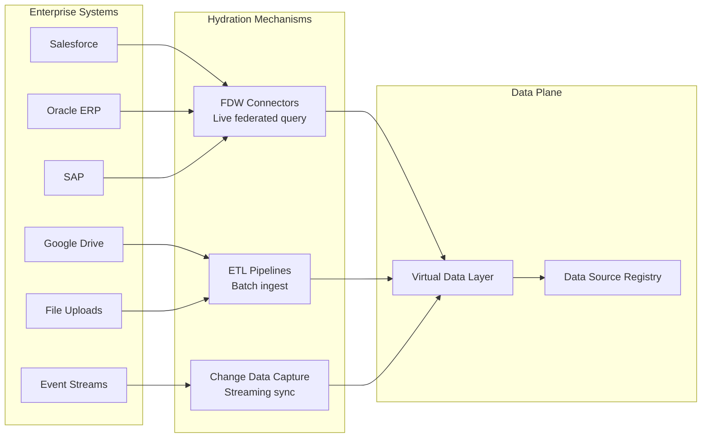
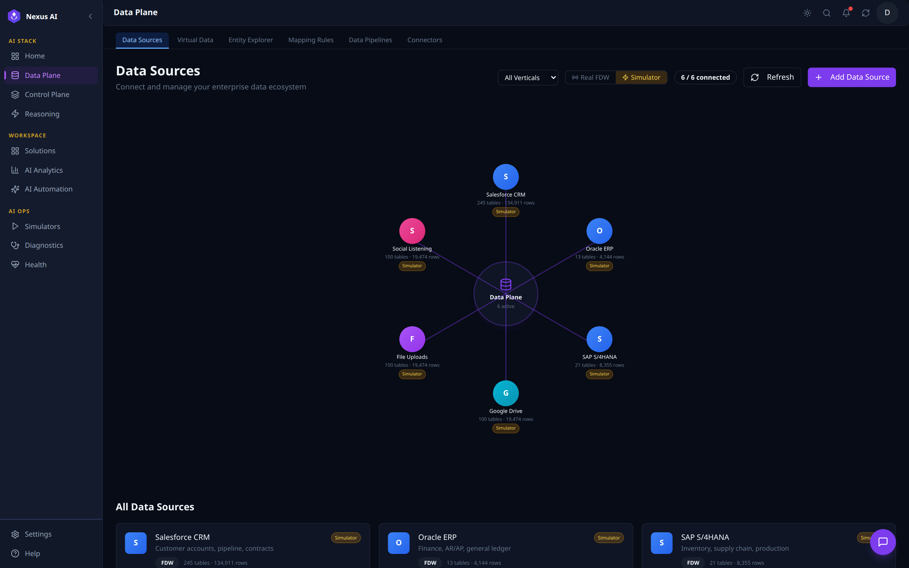
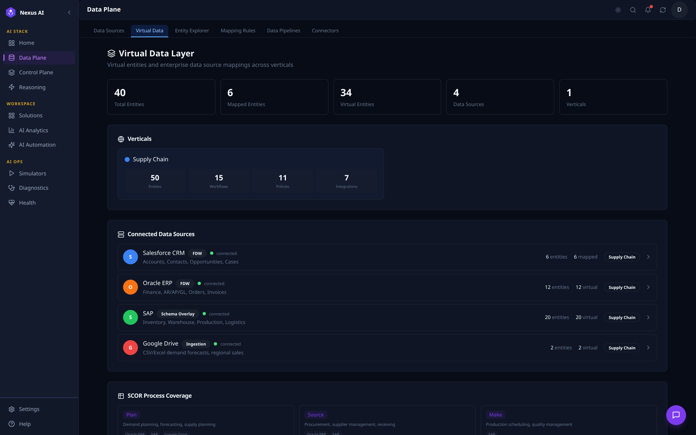
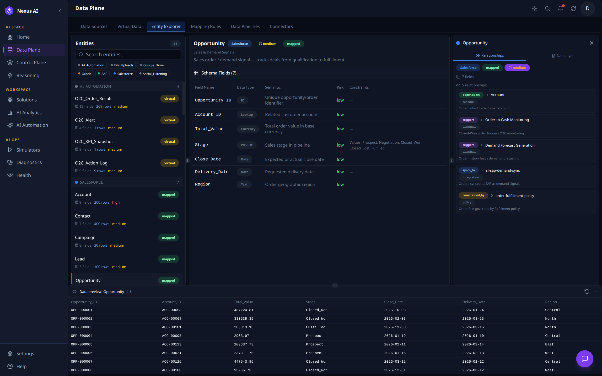
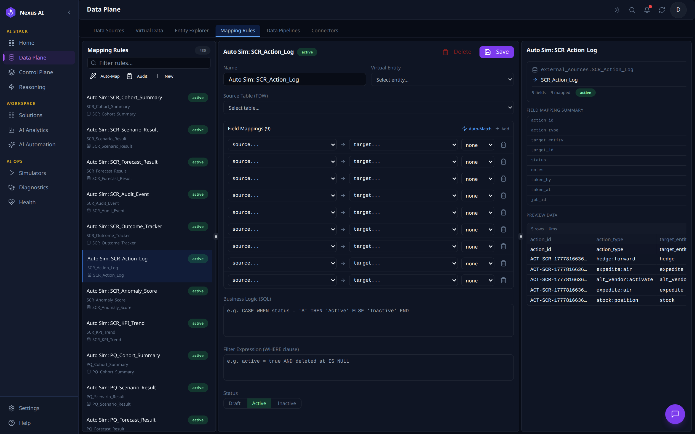
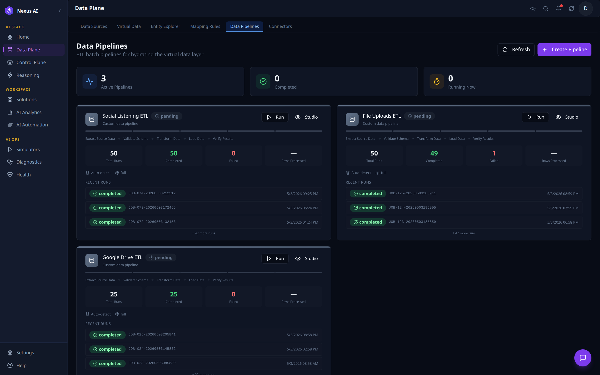
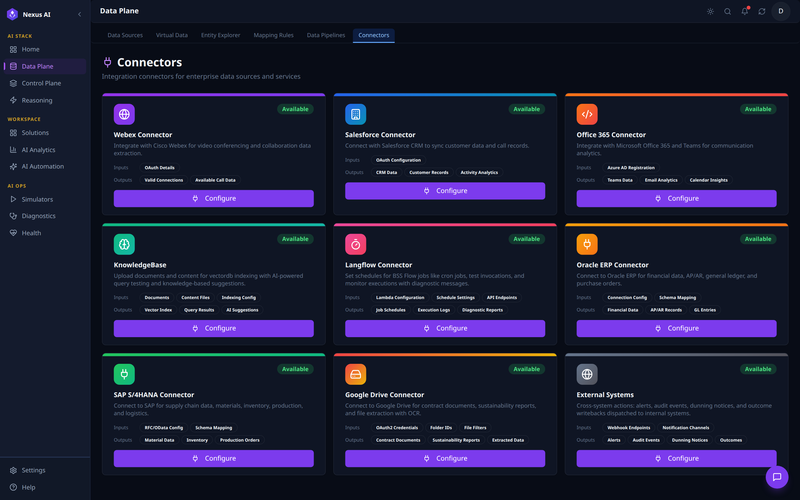

# Data Plane

The Data Plane unifies disparate enterprise systems into a single **Virtual Data Layer (VDL)**. Source data is hydrated into the VDL through three complementary mechanisms -- **FDW Connectors**, **ETL Pipelines**, and **Change Data Capture (CDC)** -- chosen per source based on latency, payload shape, and read/write patterns. Once hydrated, every entity is queryable through the same API regardless of how it arrived.

For the framing in the platform overview, see [Platform Architecture > Data Plane](../platform-architecture.md#data-plane). For the FDW vs ETL vs CDC decision framework, see [AI Operating System > Data Sources](../ai-os/data-sources.md).

## VDL hydration mechanisms

| Mechanism | When to use | Latency | Typical sources |
|---|---|---|---|
| **FDW Connectors** | Live federated reads against transactional systems of record | Milliseconds | Salesforce, Oracle ERP, SAP S/4HANA, BSSMagic CRM |
| **ETL Pipelines** | Bulk ingest, transformation, and enrichment of file or document sources | Minutes to hours | Google Drive, file uploads, market signals, sustainability reports |
| **Change Data Capture (CDC)** | Streaming incremental changes from operational systems | Seconds | Kafka / Debezium event streams, transactional change feeds |

## Data flow

## Key metrics

- **Data Sources** -- number of connected enterprise systems (Salesforce, Oracle, SAP, etc.).
- **Entities** -- virtual entities discovered across all data sources.
- **Mapped** -- entities mapped to the ontology schema in the Control Plane.
- **Mapping Rules** -- active rules that define how source entities map to ontology objects (FDW, ETL, or CDC).

## Console walkthrough

Six tabs in the NexusAI workspace, each focused on a distinct part of the hydration lifecycle.

### Data Sources

A hub-and-spoke view of every connected enterprise system, with table and row counts per source. The top toolbar filters by vertical, toggles between **Real FDW** and **Simulator** mode, refreshes status, or adds a new source. The **6 / 6 connected** indicator confirms all sources are healthy; the **All Data Sources** list below shows each system's mode (FDW vs simulated) at a glance.

### Virtual Data

Top-line counters summarise total, mapped, and virtual entities along with active data sources and verticals. Each vertical (Supply Chain in this view) breaks out its entity, workflow, policy, and integration counts. The **Connected Data Sources** list shows how many entities each system contributes and which integration mode is in use -- **FDW**, **Schema Overlay**, or **Ingestion**.

### Entity Explorer

A three-pane browser for inspecting every virtual entity in the platform. The left panel groups entities by source (Salesforce, SAP, Oracle, AI_Automation, etc.) and tags each as **virtual** or **mapped**. With the **Opportunity** entity selected above, the centre pane shows its **Schema Fields** (7 fields, each with data type, semantic, risk, and constraints), the right pane lists its 5 **Relationships** -- `depends_on Account`, `triggers Order-to-Cash Monitoring`, `triggers Demand Forecast Generation`, `syncs_to sf-sap-demand-sync`, and `constrained_by order-fulfillment-policy` -- and the bottom pane previews live row data.

### Mapping Rules

Manages the rules that map raw source fields onto ontology objects. The left panel lists every active rule grouped by source, with quick actions for **Auto-Map**, **Audit**, and adding a **New** rule. With **Auto Sim: SCR_Action_Log** selected here, the centre pane opens the rule editor (Name, Virtual Entity, Source Table, 9 source-to-target Field Mappings, Business Logic SQL, Filter Expression, Status), while the right pane summarises the resolved mapping (`external_sources.SCR_Action_Log -> SCR_Action_Log`, 9 of 9 fields mapped) and shows a live preview of the first 5 rows.

### Data Pipelines

ETL batch pipelines that hydrate the Virtual Data Layer from non-FDW sources. Counters at the top track **Active**, **Completed**, and **Running Now** pipelines. Each pipeline card visualises its stage flow (Extract -> Validate -> Transform -> Load -> Verify) and a rolling history of recent runs with completion status, timestamps, and row counts.

### Connectors

Catalogue of integration connectors available for hydration and outbound action. Each card describes the connector's typical **Inputs** (e.g., OAuth Configuration, RFC / OData Config) and **Outputs** (e.g., CRM Data, Material Data, Vector Index), with a **Configure** action to wire it up. Built-in connectors include Salesforce, Office 365, Oracle ERP, SAP S/4HANA, Google Drive, Webex, KnowledgeBase, Langflow, and a generic External Systems writeback channel.

## Related references

- [Data Sources](../ai-os/data-sources.md) -- FDW vs ETL vs CDC decision framework.
- [Implementation Guide](../ai-os/implementation-guide.md) -- production code mapping (FDW services, BSSMagic CRM operations, REST endpoints).
- [SFDC Simulator](../simulators/sfdc/index.md) -- mock CRM source for offline development.
- [Control Plane](control-plane.md) -- the semantic layer that consumes the VDL.
