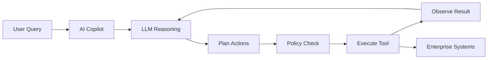
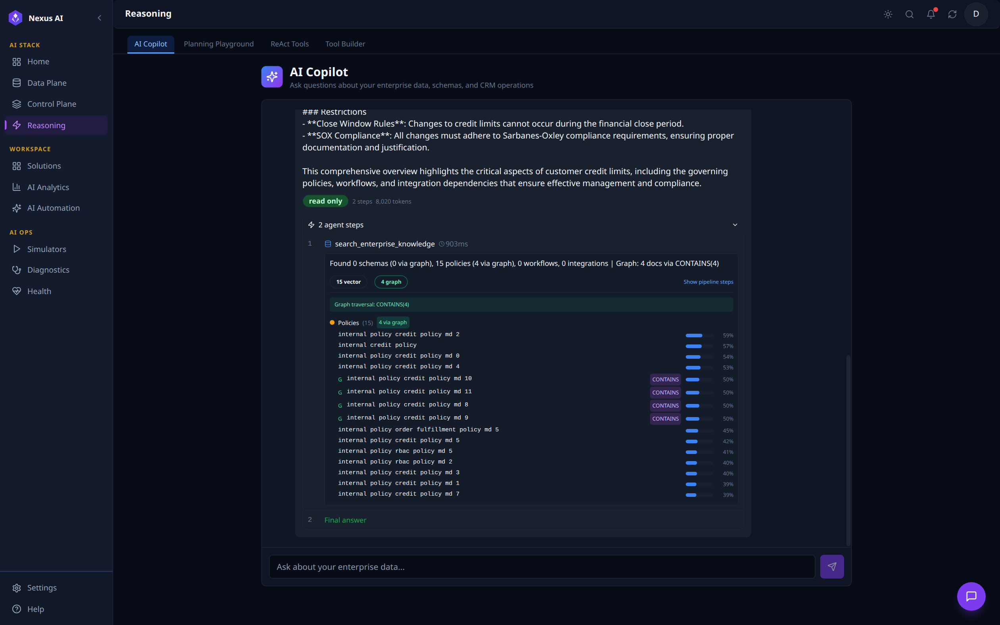
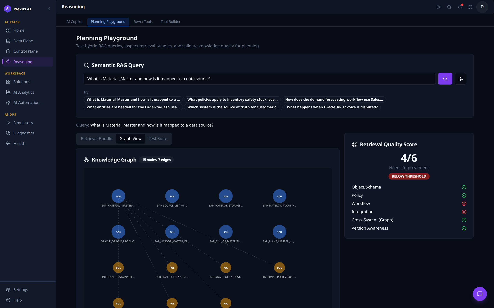
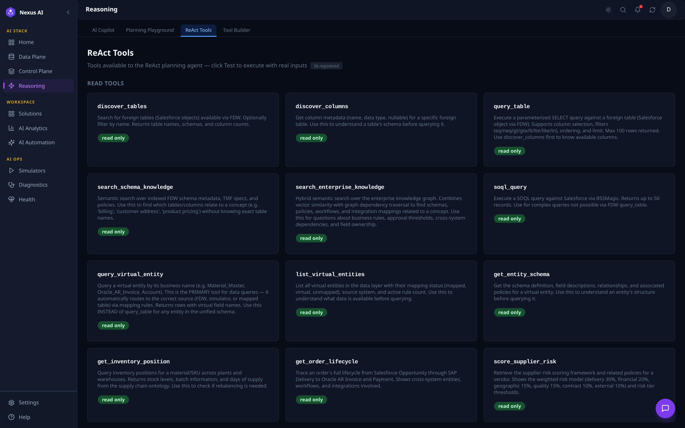
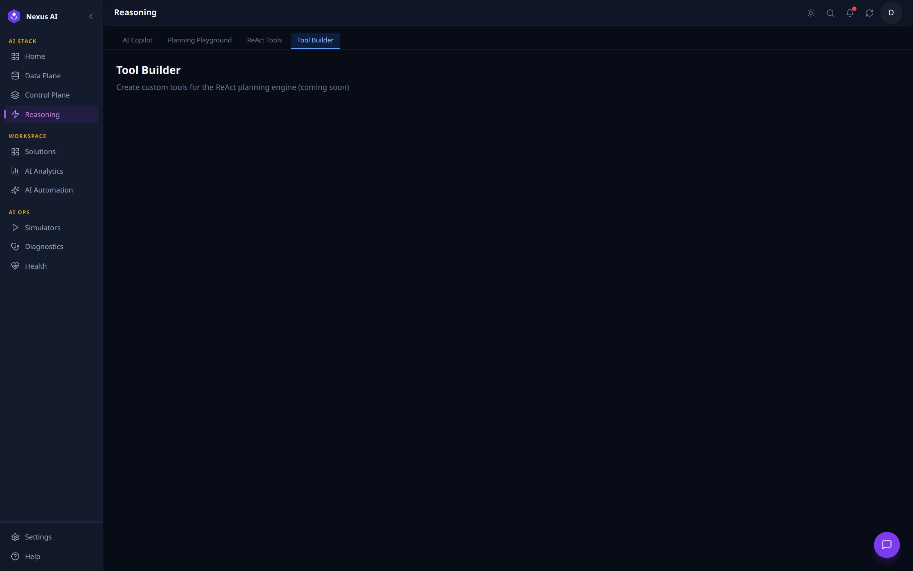

# Reasoning Plane

Where AI **reasons and acts** on enterprise data — a ReAct (Reason + Act) agent loop powered by LLMs, with registered tools that can query data, execute workflows, and interact with external systems under policy guardrails.

For platform-overview framing see [Platform Architecture > Reasoning Plane](../platform-architecture.md#reasoning-plane). For loop mechanics and safety guarantees see [AI Operating System > ReAct Layer](../ai-os/re-act-layer.md).

## Capabilities

- **AI Copilot** — natural-language interface for querying data, running analysis, and executing actions.
- **ReAct Tools** — registered tool functions the AI can call.
- **Planning Playground** — RAG validation and testing environment for reasoning chains.
- **Policy Guardrails** — pre-execution policy checks before any tool action runs.
- **Multi-system Orchestration** — coordinate actions across multiple systems in a single reasoning chain.
- **Inspectable agent traces** — per-step tool call, latency, hits, and token cost surfaced for traceability.

## ReAct Loop

## Registered Tool Categories

- **Data Plane queries** — query virtual entities across connected systems.
- **Ontology queries** — search the knowledge graph and semantic index.
- **Journey tools** — execute and manage data-processing journeys (Order-to-Cash, Demand Forecasting, etc.).
- **Logs & Reports tools** — query execution logs and generate reports.
- **Solution-app tools** — per-Solution app-curated tools (e.g. for Order-to-Cash: Order Match Verifier, AR Cash Flow Projector, O2C Alert Generator, Dunning Notice Composer).
- **Write-capable tools** — high-risk-write actions (e.g. `create_salesforce_lead`) gated by approval.

## Console Walkthrough

Four tabs cover interactive copilot use, RAG validation, the tool registry, and custom tool authoring.

### AI Copilot

- Natural-language input box with an expandable agent-steps card per response.
- Per-step trace: tool call name, latency, retrieval hits, relevance scores.
- Read-only / write badge and token-cost surfaced for traceability.

### Planning Playground

- Semantic RAG query input with quick-fill scenario chips.
- Tabs for **Retrieval Bundle**, **Graph View**, and **Test Suite**.
- Retrieval Quality Score with per-dimension breakdown so engineers can iterate.

### ReAct Tools

- Per-tool card: purpose, read-only or write tag.
- Built-in tools cover schema discovery, query, semantic search, and Solution-specific actions.

### Tool Builder

## Related References

- [ReAct Layer](../ai-os/re-act-layer.md) — loop mechanics, policy gating, failure modes.
- [Semantic RAG](../ai-os/semantic-rag.md) — what the retrieval bundle must contain to enable safe orchestration.
- [Implementation Guide](../ai-os/implementation-guide.md) — production code (`agent_executor.py`, `policy_engine.py`, `tool_registry.py`, `intent_analyzer.py`, ...).
- [Console > AI Analytics](../console/ai-analytics.md) — dedicated console drill-down.
- [Control Plane](control-plane.md) — the semantic layer this plane queries on every cycle.
