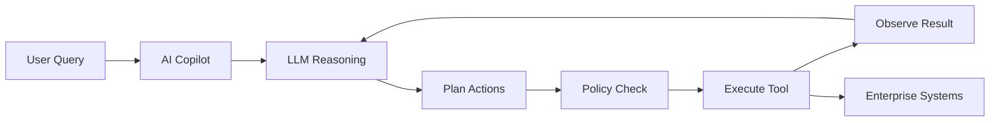

# Reasoning Plane

The Reasoning Plane is where AI **reasons and acts** on enterprise data. It uses a ReAct (Reason + Act) agent loop powered by LLMs, with registered tools that can query data, execute workflows, and interact with external systems -- all under policy guardrails.

For the framing in the platform overview, see [Platform Architecture > Reasoning Plane](../platform-architecture.md#reasoning-plane). For the loop mechanics and safety guarantees, see [AI Operating System > ReAct Layer](../ai-os/re-act-layer.md).

## Capabilities

| Component | Description |
|---|---|
| AI Copilot | Natural-language interface for querying data, running analysis, and executing actions |
| ReAct Tools | Registered tool functions the AI can call (data queries, journey execution, log analysis, simulator control) |
| Planning Playground | RAG validation and testing environment for reasoning chains |
| Policy Guardrails | Pre-execution policy checks before any tool action is executed |
| Multi-system Orchestration | Coordinate actions across multiple enterprise systems in a single reasoning chain |

## ReAct loop

## Registered tools (categories)

| Category | Purpose |
|---|---|
| Data Plane queries | Query virtual entities across connected systems |
| Ontology queries | Search the knowledge graph and semantic index |
| Journey tools | Execute and manage data-processing journeys (Order-to-Cash, Demand Forecasting, etc.) |
| Logs & Reports tools | Query execution logs, generate reports |
| Solution-app tools | Per-Solution app-curated tools (e.g. for Order-to-Cash: Order Match Verifier, AR Cash Flow Projector, O2C Alert Generator, Dunning Notice Composer) |
| Write-capable tools | Specific high-risk-write actions (e.g. `create_salesforce_lead`) gated by approval |

## Console walkthrough

Four tabs in the NexusAI workspace, covering interactive copilot use, RAG validation, the tool registry, and custom tool authoring.

### AI Copilot

A conversational interface to the ReAct planning engine. The user submits a natural-language question -- here, *"Which system is the source of truth for customer credit limits and what policies govern it?"* -- and the agent returns a markdown reply followed by an inspectable, expandable **2 agent steps** card. Step 1 shows the actual tool call: `search_enterprise_knowledge` (903 ms) returning **15 vector** + **4 graph** hits across credit / order-fulfilment / RBAC policies via the `CONTAINS` graph traversal, with relevance scores per document. Step 2 is the **Final answer**. The **read only** badge and token count (**8,020 tokens**) are surfaced for traceability.

### Planning Playground

Hybrid RAG testing environment. The query *"What is Material_Master and how is it mapped to a data source?"* is run from the **Semantic RAG Query** input (with quick-fill chips for common scenarios). Below, the **Retrieval Bundle / Graph View / Test Suite** tabs let you inspect what was retrieved -- the **Graph View** here renders a **15-node, 7-edge** subgraph mixing schema and policy nodes. The right-hand **Retrieval Quality Score** scores the bundle **4 / 6** (*Below Threshold*) with a per-dimension breakdown (Object/Schema, Policy, Cross-System Graph, Version Awareness all pass; Workflow and Integration fail) so engineers can iterate on the bundle before promoting it.

### ReAct Tools

Catalogue of all **36 registered tools** the planning agent can call. Each card describes a tool's purpose and tags it as **read only** or write-capable. Visible read-only tools here include `discover_tables`, `discover_columns`, `query_table`, `search_schema_knowledge`, `search_enterprise_knowledge`, `soql_query`, `query_virtual_entity`, `list_virtual_entities`, `get_entity_schema`, `get_inventory_position`, `get_order_lifecycle`, and `score_supplier_risk`.

### Tool Builder

Authoring surface for adding custom tools to the ReAct planning engine -- currently labelled **coming soon**.

## Related references

- [ReAct Layer](../ai-os/re-act-layer.md) -- loop mechanics, policy gating, failure modes.
- [Semantic RAG](../ai-os/semantic-rag.md) -- what the retrieval bundle must contain to enable safe orchestration.
- [Implementation Guide](../ai-os/implementation-guide.md) -- production code (`agent_executor.py`, `policy_engine.py`, `tool_registry.py`, `intent_analyzer.py`, ...).
- [Console > AI Copilot](../console/ai-analytics.md) -- the dedicated console drill-down.
- [Control Plane](control-plane.md) -- the semantic layer this plane queries on every cycle.
