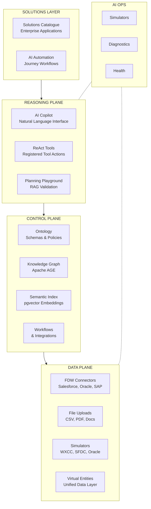
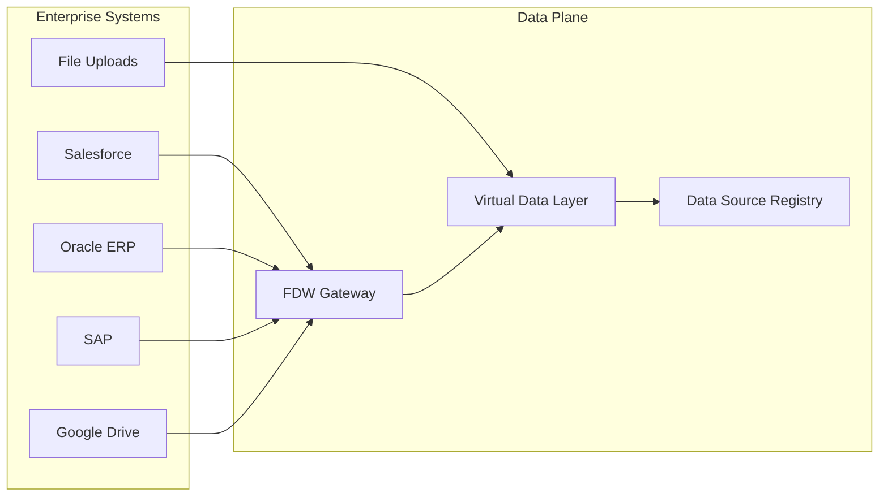
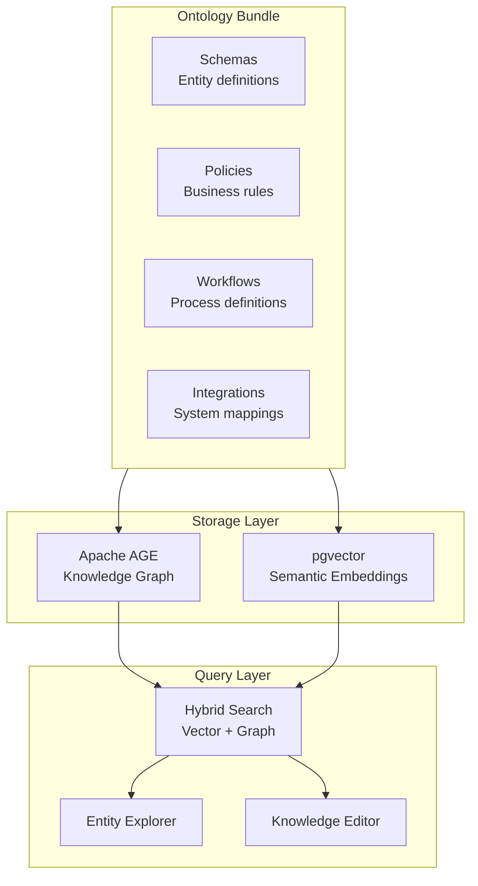
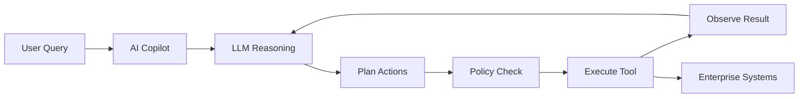
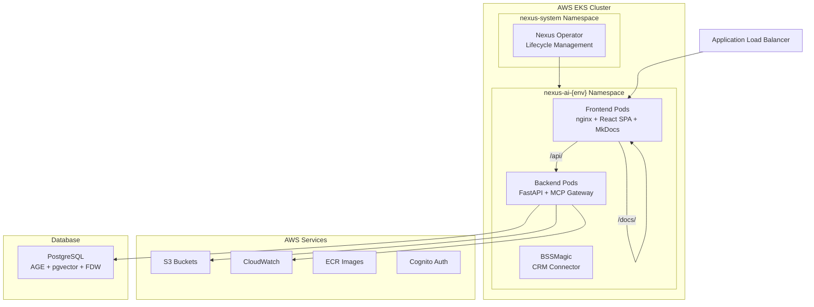

# Platform Architecture

The NexusAI Data Platform is a layered AI operating system built around three core planes: **Data Plane**, **Control Plane**, and **Reasoning Plane**. Each plane handles a distinct concern, and together they form an intelligent stack that connects enterprise data, builds semantic context, and enables autonomous AI reasoning.

---

## Three-Plane Architecture

---

## Data Plane

The Data Plane provides a **virtual data layer** that connects to enterprise systems without replacing them. It uses PostgreSQL Foreign Data Wrappers (FDW) to create live, read-time connections to external databases and APIs.

### Capabilities

| Component | Technology | Purpose |
|-----------|-----------|---------|
| FDW Connections | PostgreSQL FDW | Live connections to Oracle, Salesforce, SAP, MySQL, external APIs |
| File Uploads | S3 + extraction pipeline | Ingest CSV, PDF, documents into the data layer |
| Simulators | Mock data generators | WXCC (contact center), SFDC (CRM), Oracle ERP, SAP test data |
| Virtual Entities | FDW discovery + mapping | Unified entity view across all connected data sources |

### Data Flow

### Key Metrics

- **Data Sources** -- Number of connected enterprise systems (Salesforce, Oracle, SAP, etc.)
- **Entities** -- Virtual entities discovered across all data sources
- **Mapped** -- Entities mapped to the ontology schema in the Control Plane
- **Mapping Rules** -- Active rules that define how source entities map to ontology objects

### Backend APIs

| API | Path | Purpose |
|-----|------|---------|
| Data Plane API | `/api/v1/data-plane/` | Manage data sources, connections, virtual entities |
| FDW API | `/api/v1/fdw/` | Foreign Data Wrapper connection management |
| Mapping Rules API | `/api/v1/mapping-rules/` | Define entity-to-ontology mappings |

---

## Control Plane

The Control Plane builds a **semantic understanding** of the enterprise by combining an ontology layer, a knowledge graph (Apache AGE), and a vector embedding index (pgvector). It is the brain that gives AI the context to reason about business data.

### Capabilities

| Component | Technology | Purpose |
|-----------|-----------|---------|
| Ontology Schemas | YAML-defined | Business entity definitions (customers, orders, assets, contracts) |
| Policies | Rule engine | Business rules, guardrails, compliance constraints |
| Workflows | Orchestration | Multi-step business process definitions |
| Integrations | Connector config | System-to-system integration mappings |
| Knowledge Graph | Apache AGE (PostgreSQL) | Entity relationships, graph traversal, connected reasoning |
| Semantic Index | pgvector (PostgreSQL) | Vector embeddings for hybrid search (semantic + graph) |

### Architecture

### Key Metrics

- **Schemas** -- Ontology entity schemas loaded (e.g., Customer, Order, Product, Contract)
- **Policies** -- Business rule policies active
- **Workflows** -- Defined workflow templates
- **Integrations** -- Integration connector configurations
- **Graph Nodes** -- Entities in the Apache AGE knowledge graph
- **Embeddings** -- Vector embeddings in the pgvector semantic index

### Backend APIs

| API | Path | Purpose |
|-----|------|---------|
| Control Plane API | `/api/v1/control-plane/` | Stats, entity counts, graph overview |
| Ontology API | `/api/v1/onto/` | Schema, policy, workflow, integration management |
| Ontology Data API | `/api/v1/onto-data/` | Entity data CRUD via ontology layer |

---

## Reasoning Plane

The Reasoning Plane is where AI **reasons and acts** on enterprise data. It uses a ReAct (Reason + Act) agent loop powered by LLMs, with registered tools that can query data, execute workflows, and interact with external systems -- all under policy guardrails.

### Capabilities

| Component | Description |
|-----------|------------|
| AI Copilot | Natural language interface for querying data, running analysis, and executing actions |
| ReAct Tools | Registered tool functions the AI can call (data queries, journey execution, log analysis, simulator control) |
| Planning Playground | RAG validation and testing environment for reasoning chains |
| Policy Guardrails | Pre-execution policy checks before any tool action is executed |
| Multi-system Orchestration | Coordinate actions across multiple enterprise systems in a single reasoning chain |

### ReAct Loop

### Registered Tools

| Tool | Purpose |
|------|---------|
| Journey Tool | Execute and manage data processing journeys |
| Logs & Reports Tool | Query execution logs, generate reports |
| WXCC Simulator Tool | Control contact center test data simulation |
| Data Plane Queries | Query virtual entities across connected systems |
| Ontology Queries | Search knowledge graph and semantic index |

### Backend APIs

| API | Path | Purpose |
|-----|------|---------|
| Copilot Journey API | `/api/v1/copilot/` | AI copilot interactions and journey execution |
| Tools API | `/api/v1/tools/` | Registered ReAct tools management |
| Prompts API | `/api/v1/prompts/` | Prompt template management |

---

## Solutions Layer

The Solutions layer sits on top of the three planes, providing **pre-built enterprise applications** and **AI automation workflows**.

### Solutions Catalogue

Pre-built applications organized by industry vertical:

- **Supply Chain** -- Demand forecasting, inventory optimization, procurement analytics
- **Finance & Banking** -- Credit risk, fraud detection, regulatory compliance
- **Telecommunications** -- Customer 360, network performance, revenue assurance
- **Retail** -- Personalization, price optimization, store operations
- **Healthcare** -- Patient 360, clinical decision support, revenue cycle
- **Customer Operations** -- Autonomous issue resolution, proactive agent assist
- **Revenue Operations** -- Deal intelligence, pipeline risk, revenue orchestration

### AI Automation

Journey-based workflow engine for multi-step AI operations:

- Journey Builder -- Visual workflow definition
- Stage execution -- Multi-stage data processing pipelines
- Schedule management -- Cron-based automated execution
- Audit trail -- Full execution logging and reporting

---

## AI Ops

Cross-cutting operational capabilities that monitor and test the platform:

| Component | Purpose |
|-----------|---------|
| Simulators | Generate test data for WXCC (contact center), SFDC (CRM), Oracle ERP, SAP |
| Diagnostics | System health checks, FDW connection testing, API diagnostics |
| Health | Pod status, service health, infrastructure monitoring |

---

## Technology Stack

| Layer | Technologies |
|-------|-------------|
| Frontend | React + TypeScript, Vite, Tailwind CSS, shadcn/ui |
| Backend | Python 3.11+, FastAPI, MCP HTTP Gateway |
| Database | PostgreSQL with Apache AGE (graph) + pgvector (embeddings) |
| Data Integration | PostgreSQL FDW (Foreign Data Wrappers) |
| AI/LLM | OpenAI / Anthropic via ReAct agent loop |
| Infrastructure | AWS EKS, ECR, S3, CloudWatch, Cognito |
| Orchestration | Nexus Kubernetes Operator (NexusCapability CRD) |
| CI/CD | GitHub Actions, Docker, Helm |

---

## Deployment Architecture

---

## Repository Structure

| Repository | Description |
|-----------|------------|
| [nexus-ui](https://github.com/nexusdataai/nexus-ui) | React frontend -- dashboard, planes UI, solutions catalogue |
| [nexus-backend](https://github.com/nexusdataai/nexus-backend) | Python backend -- APIs, services, ReAct tools, FDW, ontology |
| [nexus-deployer](https://github.com/nexusdataai/nexus-deployer) | Kubernetes operator, deployment scripts, infrastructure |
| [nexus-docs](https://github.com/nexusdataai/nexus-docs) | MkDocs documentation (this site) |
