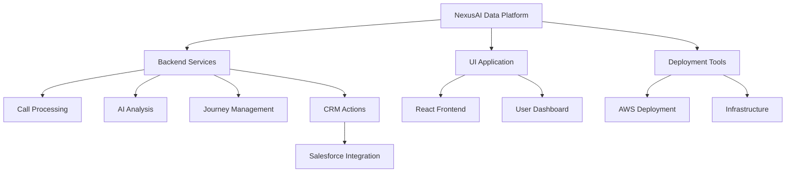
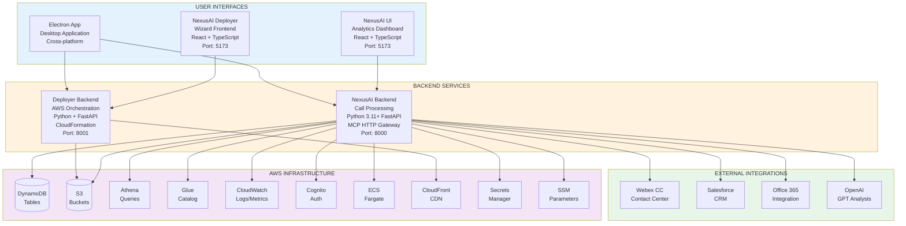
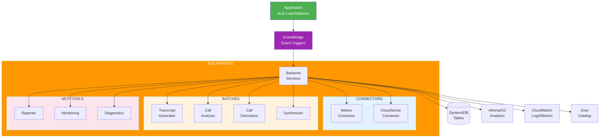
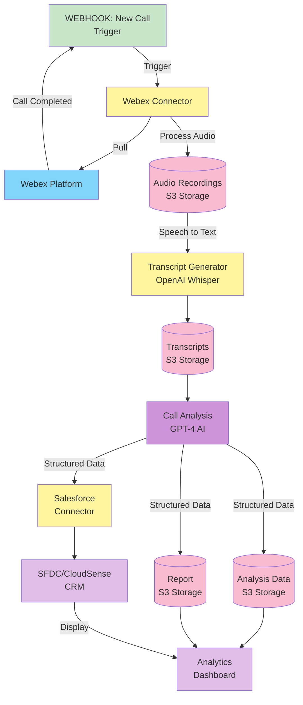

# Platform Architecture

This page provides a comprehensive overview of the NexusAI Data Platform architecture, including high-level system design, deployment architecture, and data flow patterns.

---

## Overview

The NexusAI Data Platform is an enterprise-grade AI operating platform that delivers:

- **Modular AI capabilities** deployed into customer-owned cloud infrastructure
- **Real-time AI insights** on operational data, compliance, and performance
- **Multi-million dollar revenue impact** with measurable ROI
- **Automated quality assurance** and compliance monitoring
- **AI-powered analytics** with actionable recommendations
- **Enterprise system integration** (Salesforce, Office 365, Webex, and more)

---

## High-Level Architecture

<div style="min-height: 1200px; width: 100%; margin: 3em auto;">



</div>

---

## System Architecture

<div style="min-height: 1400px; width: 100%; margin: 3em auto;">



</div>

---

## Repository Structure

The platform consists of three primary repositories:

| Repository | Application | Purpose | Technology Stack |
|------------|-------------|---------|------------------|
| **nexus-ui** | NexusAI | Analytics Dashboard & Visualization | React 18, TypeScript, Vite, Tailwind CSS, Recharts |
| **nexus-backend** | NexusAI | Call Processing & MCP Server | Python 3.11+, FastAPI, boto3, MCP Protocol |
| **nexus-deployer** | NexusAI Toolkit | Deployment Wizard & AWS Orchestration | React + Python FastAPI + Electron |

### Repository Mapping

```
Application 1: NexusAI
├── nexus-ui (Frontend)
│   └── React-based analytics dashboard
└── nexus-backend (Backend)
    └── Python-based call processing engine

Application 2: NexusAI Toolkit
└── nexus-deployer (Complete Application)
    ├── Frontend (React wizard)
    ├── Backend (Python orchestrator)
    └── Desktop (Electron wrapper)
```

---

## Core Components

### NexusAI UI (Analytics Dashboard)

**Technology Stack:**
- **Frontend**: React 18, TypeScript, Vite
- **UI Components**: Radix UI, shadcn/ui, Tailwind CSS
- **Charts**: Recharts, Mapbox GL
- **State Management**: React Query, Context API
- **Authentication**: AWS Amplify, Cognito

**Key Features:**
- Call Analytics Dashboard with real-time metrics
- Journey Management and visualization
- WXCC Simulator interface
- AI Workspace for insights
- Tools Catalogue (Webex, Salesforce, O365 connectors)
- Processed Calls View with transcripts and analysis

**Component Structure:**
```
nexus-ui/src/
├── components/
│   ├── dashboards/          # Analytics dashboards
│   ├── journeys/            # Journey management UI
│   ├── processed-calls/     # Call analysis views
│   ├── wxcc-simulator/      # Simulator interface
│   ├── settings/            # Configuration panels
│   └── ui/                  # Reusable UI components
├── services/
│   ├── callProcessingJourneyService.ts
│   ├── transformationJourneyService.ts
│   ├── wxccSimulatorService.ts
│   ├── licenseService.ts
│   └── webexConnectorService.ts
├── context/
│   ├── AuthContext.tsx
│   ├── DashboardContext.tsx
│   └── EnterpriseAuthContext.tsx
└── types/
    ├── transformationJourney.ts
    ├── processedCalls.ts
    └── license.ts
```

---

### NexusAI Backend (Call Processing Engine)

**Technology Stack:**
- **Framework**: Python 3.11+, FastAPI
- **Protocol**: Model Context Protocol (MCP) with HTTP Gateway
- **AWS SDK**: boto3 for AWS service integration
- **AI**: OpenAI GPT for transcription and analysis

**MCP Tools:**
| Tool | Description |
|------|-------------|
| `journeys_tool` | Journey, stage, and job management |
| `logs_and_reports_tool` | Logs and report generation |
| `wxcc_simulator_tool` | WXCC simulator operations |
| `license_tool` | License activation and validation |

**REST APIs:**
| Endpoint | Description |
|----------|-------------|
| `/api/v1/journeys/*` | Journey management |
| `/api/v1/license/*` | License management |
| `/api/v1/simulator/*` | WXCC Simulator APIs |
| `/api/v1/analytics/*` | Analytics and metrics |
| `/api/v1/calls/*` | Processed calls data |
| `/health` | Health check |

**Call Processing Stages:**
1. **Fetch Tasks** - Retrieve tasks from Webex CC
2. **Deduplication** - Check for already-processed tasks
3. **Process Recordings** - Download, transcribe, upload
4. **Register Metadata** - Create metadata and Glue partitions
5. **AI Analysis** - GPT-powered call analysis

---

## ECS Fargate Deployment Architecture

<div style="min-height: 1300px; width: 100%; margin: 3em auto;">



</div>

---

## Data Flow - Call Processing

<div style="min-height: 1400px; width: 100%; margin: 3em auto;">



</div>

---

## Data Organization

### S3 Data Structure

```
s3://nexus-ai-{env}-call-data/
├── audio/
│   └── year=YYYY/month=MM/day=DD/
│       └── {call-id}-audio.wav
├── transcripts/
│   └── year=YYYY/month=MM/day=DD/
│       └── {call-id}-transcript.json
├── analysis/
│   └── year=YYYY/month=MM/day=DD/
│       └── {call-id}-analysis.json
├── diarized/
│   └── year=YYYY/month=MM/day=DD/
│       └── {call-id}-diarized.json
└── sfdcaction/
    └── year=YYYY/month=MM/day=DD/
        └── {call-id}-sfdcaction.json
```

### DynamoDB Tables

| Table | Purpose | Key Schema |
|-------|---------|------------|
| `nexus-ai-{env}-transformation-system` | Journey/Stage/Job tracking | PK: journey_id, SK: entity_type |
| `nexus-ai-{env}-license` | License management | PK: license_key |
| `nexus-ai-{env}-wxcc-tracking` | WXCC task tracking | PK: task_id |

---

## Integration Architecture

### API Integration Points

| Source | Target | Protocol | Purpose |
|--------|--------|----------|---------|
| NexusAI UI | NexusAI Backend | HTTP/REST | Call analytics, journey management |
| NexusAI UI | NexusAI Deployer | HTTP/REST | Deployment status, capability info |
| NexusAI Backend | AWS Services | boto3 SDK | DynamoDB, S3, Glue, CloudWatch |
| NexusAI Backend | Webex CC | REST API | Call recordings, task data |
| NexusAI Backend | OpenAI | REST API | Transcription, AI analysis |
| NexusAI Deployer | AWS CloudFormation | boto3 SDK | Stack provisioning |

---

## AWS Deployment Architecture

The complete infrastructure deployed by NexusAI Deployer:

### VPC Architecture
- **VPC CIDR**: 10.0.0.0/16
- **Public Subnet**: ALB, NAT Gateway
- **Private Subnet**: ECS Fargate, RDS (optional)

### Compute Layer
- **ALB**: Application Load Balancer for traffic distribution
- **ECS Fargate**: Serverless container execution
- **EventBridge**: Event-driven automation

### Storage Layer
- **S3 Buckets**: call-data, wxcc-simulator, deployment artifacts
- **DynamoDB**: Transformation system, license, tracking tables

### Security & Identity
- **Cognito**: User authentication and authorization
- **Secrets Manager**: API keys and credentials
- **SSM Parameter Store**: Configuration management

### Monitoring & Analytics
- **CloudWatch**: Logs, metrics, alarms, dashboards
- **Athena**: SQL analytics on S3 data
- **Glue**: Data catalog and ETL

### Content Delivery
- **CloudFront**: CDN for frontend distribution
- **S3 Static Hosting**: Frontend assets

### Deployment Options

| Component | Option 1 | Option 2 |
|-----------|----------|----------|
| **Frontend** | CloudFront + S3 | AWS Amplify |
| **Backend** | ECS Fargate | EKS (Kubernetes) |
| **Database** | DynamoDB | RDS PostgreSQL |

---

## Security Architecture

### Authentication & Authorization

**Authentication Layer:**
- **Cognito User Pool**: Primary identity provider
- **MFA**: TOTP/SMS multi-factor authentication
- **SSO**: SAML/OIDC integration
- **License Validation**: Cryptographic validation

**Authorization Layer:**
- **Role-Based Access Control (RBAC)**
  - Administrator: Full access
  - Operator: Deploy and manage
  - Viewer: Read-only access

**Data Protection:**
- **Encryption at Rest**: AES-256 (S3, DynamoDB)
- **Encryption in Transit**: TLS 1.2+
- **Secrets Management**: AWS Secrets Manager
- **IAM Roles**: Least privilege principle
- **Audit Logging**: CloudWatch Logs + CloudTrail

### Security Features

| Feature | Implementation |
|---------|----------------|
| **Authentication** | AWS Cognito with MFA support |
| **API Security** | API Key + JWT tokens |
| **Encryption at Rest** | AES-256 (S3, DynamoDB) |
| **Encryption in Transit** | TLS 1.2+ |
| **Secrets Management** | AWS Secrets Manager |
| **Audit Logging** | CloudWatch Logs + CloudTrail |
| **License Enforcement** | Cryptographic validation |

---

## Environment Configuration

### Configuration Sources

| Environment | Config Source | Resource Pattern |
|-------------|---------------|------------------|
| **ECS/AWS** | SSM Parameter Store + Secrets Manager | `nexus-ai-prod-*` |
| **Local AWS** | Environment variables | `nexus-ai-dev-*` |
| **LocalStack** | `.env.local` file | `nexus-ai-local-*` |

### Key Environment Variables

| Variable | Description | Default |
|----------|-------------|---------|
| `ENVIRONMENT` | Environment name | `dev` |
| `AWS_REGION` | AWS region | `ap-southeast-1` |
| `USE_LOCALSTACK` | Enable LocalStack mode | `false` |
| `GATEWAY_PORT` | HTTP gateway port | `8000` |
| `API_KEY` | Gateway API key | (secure) |

---

## Monitoring & Operations

### Health Endpoints

| Service | Endpoint | Purpose |
|---------|----------|---------|
| NexusAI Backend | `/health` | Service health |
| NexusAI Backend | `/ready` | Readiness probe |
| NexusAI Backend | `/live` | Liveness probe |
| NexusAI Deployer | `/` | Root health check |
| NexusAI Deployer | `/api/health` | Detailed health |

### CloudWatch Integration

- **Logs**: Application logs streamed to CloudWatch Logs
- **Metrics**: Custom metrics for data processing and AI analysis
- **Alarms**: Automated alerts for failures
- **Dashboards**: Real-time monitoring dashboards

---

## Architecture Highlights

### Scalability
- **ECS Fargate** for auto-scaling containerized workloads
- **DynamoDB** for high-performance NoSQL data storage
- **S3** for scalable object storage
- **CloudFront** for global content delivery
- **Event-driven architecture** with EventBridge

### Integration
- **Webex Contact Center** for call data and recordings
- **Salesforce** for CRM automation
- **OpenAI** for AI-powered transcription and analysis
- **Office 365** for email integration

### Monitoring & Observability
- **CloudWatch** for logs, metrics, and alarms
- **Athena** for ad-hoc analytics
- **Glue** for data cataloging
- **X-Ray** for distributed tracing (optional)

### Security
- **Cognito** for authentication and authorization
- **Secrets Manager** for secure credential storage
- **IAM** for fine-grained access control
- **CloudTrail** for audit logging
- **VPC** for network isolation### High Availability
- **Multi-AZ deployment** for resilience
- **Auto-scaling** for compute resources
- **Load balancing** for traffic distribution
- **S3 replication** for data durability
- **DynamoDB global tables** (optional)---## Version Information| Application | Component | Version | Status |
|-------------|-----------|---------|--------|
| **NexusAI** | NexusAI UI | 1.0.0 | Production Ready |
| **NexusAI** | NexusAI Backend | 2.0.0 | Production Ready |
| **NexusAI Toolkit** | NexusAI Deployer | 1.0.0 | Production Ready |---*Last Updated: January 2026*  
*Document Version: 2.0*