---
hide:
  - toc
---

## Introduction

The **Nexus Data-AI Platform** is a layered AI operating system for the enterprise, built around **Ontologies** that put structure on existing data and turn it into the foundation for AI Analytics and AI Automation — without ripping or replacing what is already in place.

<picture>
  <source
    type="image/webp"
    srcset="../assets/nexus-data-ai-1024.webp 1024w, ../assets/nexus-data-ai.webp 1667w"
    sizes="(max-width: 1024px) 96vw, min(96vw, 1600px)">
  
</picture>

### Top-Line Capabilities

- **Solutions Layer** — Pre-built AI-native apps and ID services that consume the platform end-to-end (AI Copilot, Autonomous Apps, Analytics, Search Engine, Knowledge Lake, Scenario Engine, Marketplace, Community & "What-If").

- **Reasoning Plane** — AI Copilot, ReAct Tools,Planning Playground and Tool Builder for governed multi-step reasoning.

- **AI Engine** — Distributed compute layer that runs every AI workload type: Data Prep, Model Training, Fine Tuning, Inference, Batch Scoring, Real-time AI — across CPU, GPU, TPU, Spark, Ray, and Kubernetes.

- **Control Plane** — Schemas, Policies, Workflows , Integration Rules that capture the semantic structure of the business.

- **Data Plane** — Uniform access to Structured, Unstructured, Streaming, Graph, Vector, and Logs/Events data via FDW/ETL/CDC.

- **Deployment** — Runs the same way on Cloud, Containers, On-Prem, Hybrid, Edge, and CI/CD pipelines.

- **AI-OPS** — Observability, ML-Ops, Governance, Automation, Optimization, Cost Intelligence, and Security wrapped around every layer.

---

## Ontology Support

NexusAI is an **Ontology Operating System (Ontology OS)**: a foundational AI engine plus a full AI-Ops stack purpose-built to design, deploy, and govern enterprise ontologies at scale.

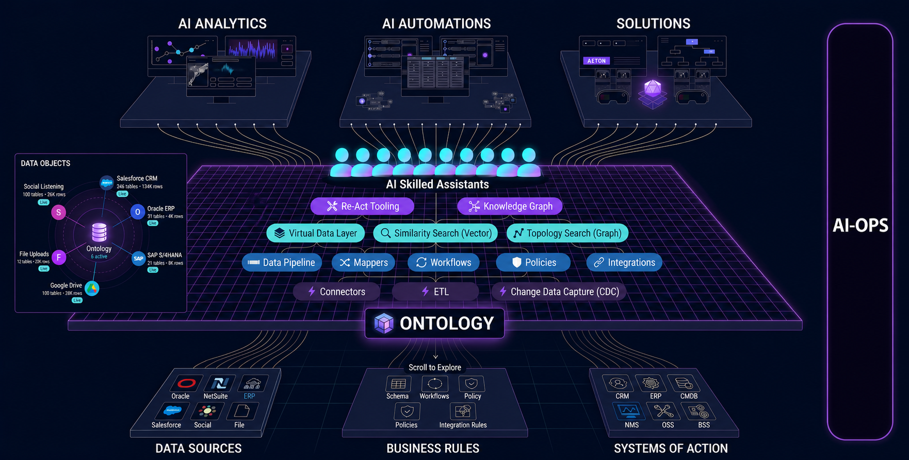

### Capabilities

- **Three-plane architecture** — Data Plane, Control Plane, Reasoning Plane, each with a distinct domain of responsibility.
- **Built to host external ontologies** — the platform's primary purpose is to onboard and run customer-owned ontologies that conform to the unified Data / Control / Reasoning plane contract. Bring your own schema, policies, workflows, and integration rules; the platform wires them through every plane.
- **Example domain Foundries shipped in the box** — opinionated reference ontologies plus pre-built apps. Useful as day-one accelerators and as templates that customers fork into their own Foundries.
- **Customer-owned Ontology OS** — design, deploy, and govern your own ontology layer alongside or instead of the shipped Foundries.
- **Distributed AI engine** — runs any ontology as executable AI workloads.
- **AI-Ops at every layer** — observability, governance, lifecycle, cost, and policy guardrails built in.

### Shipped Foundries

| Foundry | Focus |
|---|---|
| [Supply Chain](app-catalogue/supply-chain/index.md) | Demand forecasting, inventory optimisation, order-to-cash, procurement, production & quality, ESG |
| [Finance & Banking](app-catalogue/finance-banking/index.md) | Customer 360, credit risk, fraud & AML, regulatory compliance, treasury, loan lifecycle |
| [Telecommunications](app-catalogue/telco/index.md) | Customer 360 & churn, network performance, revenue assurance, customer experience, dynamic pricing |
| [Retail](app-catalogue/retail/index.md) | Customer 360 & loyalty, demand forecasting, personalisation, price optimisation, store operations |
| [Healthcare](app-catalogue/healthcare/index.md) | Patient 360, clinical decision support, revenue cycle, operational efficiency, population health |
| [Customer Operations](app-catalogue/customer-ops/index.md) | Autonomous issue resolution, unified operations hub, proactive agent assist |
| [Revenue Operations](app-catalogue/rev-ops/index.md) | Deal intelligence, pipeline risk forecasting, revenue orchestration |

---

## Total System Architecture

End-to-end runtime view of how user intent becomes governed action.

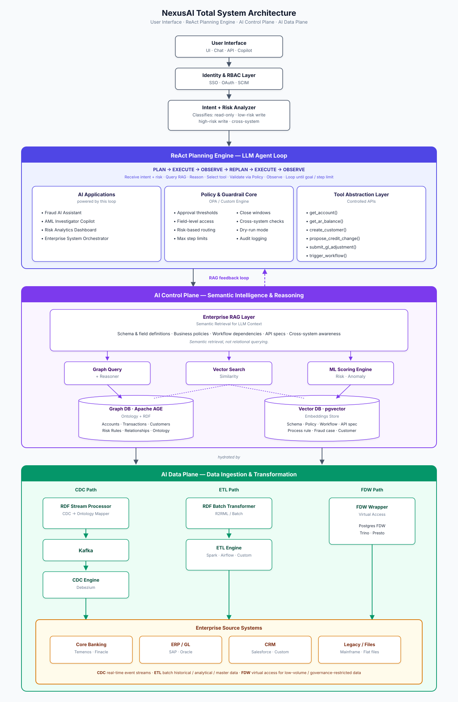

### Ontology Layers

- **User Interface** — UI, Chat, API, and Copilot entry-points.
- **Identity & RBAC Layer** — SSO, OAuth, SCIM.
- **Intent + Risk Analyzer** — classifies every request as read-only, low-risk write, high-risk write, or cross-system.
- **ReAct Planning Engine** — Plan → Execute → Observe → Replan loop with tool selection and policy validation.
- **AI Control Plane** — semantic context retrieval (graph + vector).
- **AI Data Plane** — live access to enterprise systems via federated and ingested paths.
- **Cross-cutting AI-Ops** — telemetry, policy, audit, and cost across every plane.

---

## System Components

A layered decomposition of the platform — from Enterprise Systems at the bottom to Business Capabilities at the top.

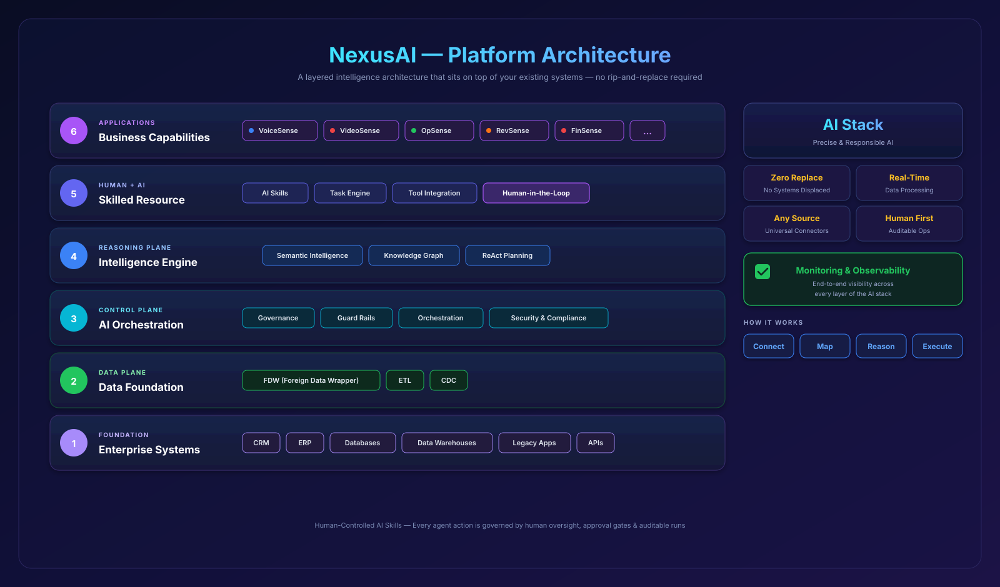

### Capabilities

- **Enterprise Systems (foundation)** — CRM, ERP, data warehouses, SaaS apps, file stores, and event streams.
- **Data Plane** — uniform virtual data access via FDW, ETL, and CDC.
- **Control Plane** — semantic ontology, knowledge graph, and embedding index.
- **Reasoning Plane** — Agent loops, ReAct tools, Tool registry, and planner.
- **Skilled Resources layer** — AI Copilots, Agents, and ReAct tools that act on the planes.
- **Business Capabilities layer** — Solutions delivered as turn-key apps to business users.

## Product Home Overview

NexusAI sits as a thin, intelligent layer on top of the systems you already run — no rip-and-replace, no data migration, no silos.

### Capabilities

- **No rip-and-replace** — overlays your existing systems instead of replacing them.
- **No data migration** — connects in place via federated reads and event streams.
- **Composable Business Capabilities** — each delivered as a packaged Solution.
- **Human-in-the-loop oversight** — explicit approvals on high-risk actions.
- **Governance and observability by default** — every plane is wired into the AI-Ops sidebar.

---

## Data Plane

Unifies disparate enterprise systems into a single **Virtual Data Layer (VDL)** so every entity is queryable through one API regardless of where it lives.

### Hydration Mechanisms

- **FDW Connectors** — live federated reads against transactional systems of record (millisecond latency).
- **ETL Pipelines** — bulk ingest, transform, and enrich file or document sources (minutes-to-hours latency).
- **Change Data Capture (CDC)** — streaming incremental changes from operational systems (sub-second latency).

### Capabilities

- **Single virtual entity API** — every connected system queryable the same way.
- **Per-source mode selection** — choose FDW, ETL, or CDC based on latency and payload shape.
- **Connector catalogue** — Salesforce, Oracle ERP, SAP S/4HANA, Google Drive, Office 365, Webex, Knowledge Base, Langflow, plus a generic external-systems writeback channel.
- **Simulator mode** — swap any live source for an in-memory simulator without code changes.

### Data Plane Walkthrough

Six tabs cover the full hydration lifecycle.

#### Data Sources

- Filter by vertical and toggle between **Real FDW** and **Simulator** modes.
- Per-source health status and last-sync indicators.
- Add a new source from the toolbar.

#### Virtual Data

- Per-vertical breakdown of entity, workflow, policy, and integration counts.
- Per-source integration mode shown at a glance: **FDW**, **Schema Overlay**, or **Ingestion**.

#### Entity Explorer

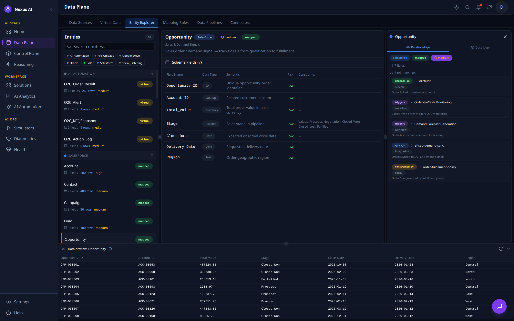

- Entities grouped by source system, tagged as **virtual** or **mapped**.
- Schema fields with data type, semantic, risk class, and constraints.
- Typed relationships (`depends_on`, `triggers`, `syncs_to`, `constrained_by`).

#### Mapping Rules

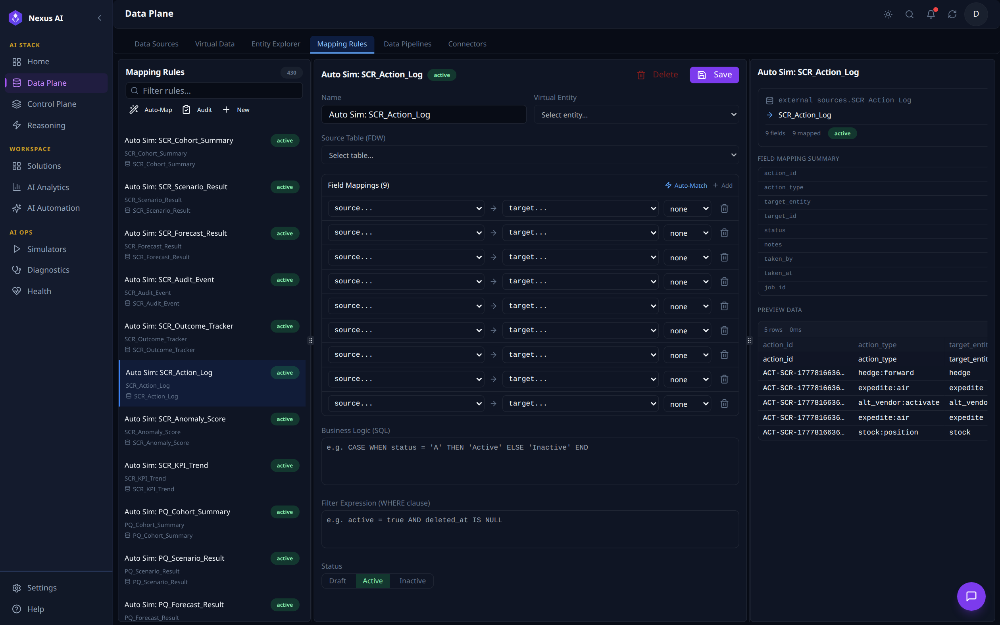

- Rule list grouped by source with **Auto-Map**, **Audit**, and **New Rule** quick actions.
- Per-rule editor: virtual entity, source table, field mappings, business logic SQL, filter expression, status.
- Live preview of resolved rows.

#### Data Pipelines

- Stage flow per pipeline: Extract → Validate → Transform → Load → Verify.
- Active / Completed / Running counters and recent run history.

#### Connectors

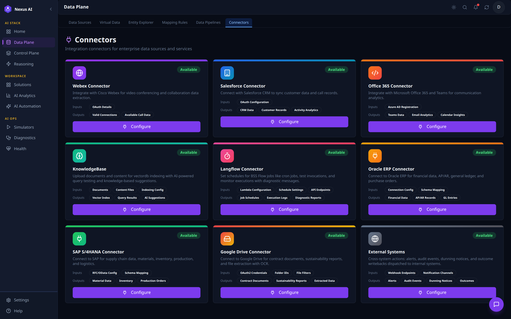

- Each card lists configuration inputs and produced outputs.
- One-click `Configure` to wire a connector into the platform.

---

## Control Plane

Builds a **semantic understanding** of the enterprise by combining an ontology, a knowledge graph, and a vector embedding index — the brain that gives AI the context to reason about your business.

### Capabilities

- **Ontology Schemas** — YAML-defined business entity definitions.
- **Policies** — business rules, guardrails, and compliance constraints.
- **Workflows** — multi-step business process definitions.
- **Integrations** — system-to-system sync mappings.
- **Knowledge Graph** — Apache AGE on PostgreSQL for entity relationships and graph traversal.
- **Semantic Index** — pgvector on PostgreSQL for hybrid (vector + graph) search.

### Control Plane Walkthrough

Six tabs cover ingestion, retrieval, governance, and orchestration of the semantic layer.

#### Knowledge Pipeline

- Real-time graph and embedding counters.
- Six-stage pipeline: Extract Unified Schema → Resolve FDW Mapping → Extract Mapping Rules → Extract Policies → Extract Workflows → Extract Integrations.
- Trigger manually or schedule.

#### Knowledge Index

- Filter chips swap between Schemas, Policies, Workflows, Integrations.
- Document detail shows metadata plus the canonical YAML body that feeds embeddings.

#### Knowledge Graph

- Nodes colour-coded by source system.
- Typed edges (`triggers`, `syncs_to`, `depends_on`, `constrained_by`, `owned_by`).
- Full-text search and per-source filtering.

#### Policy Builder

- Per-policy header: name, ID, risk level, target systems.
- Source-of-truth field binding.
- Editable Constraints, Approval Matrix, and Restrictions blocks.

#### Workflows

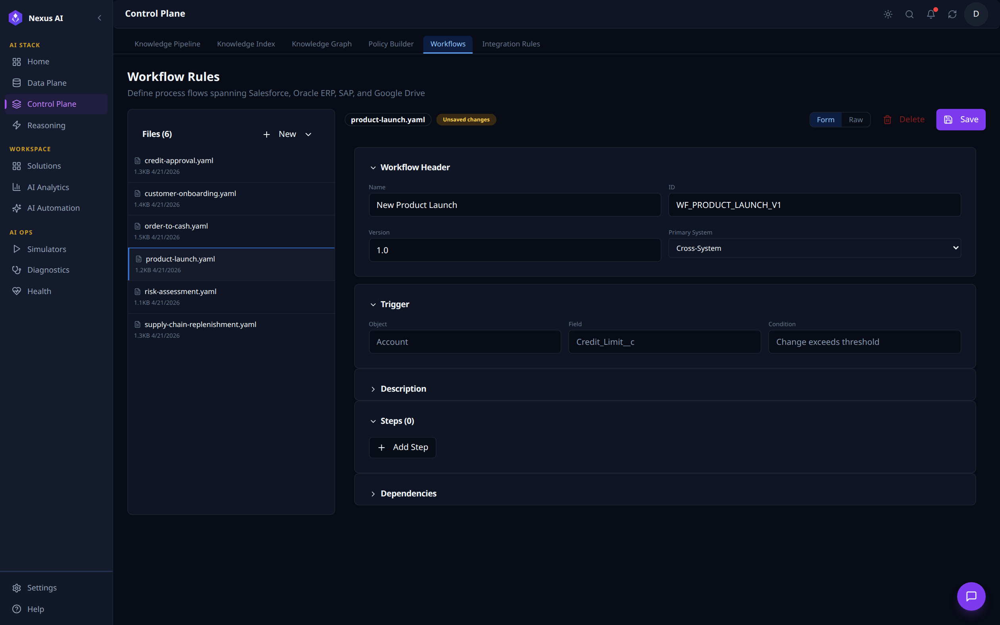

- Per-workflow header, trigger definition, steps, and dependencies.
- Cross-system orchestration as first-class.

#### Integration Rules

- Per-rule header: source/target system, frequency, direction (one-way or bidirectional).
- Field mappings, failure handling, dependencies in collapsible sections.

---

## Reasoning Plane

Where AI **reasons and acts** on enterprise data — a ReAct (Reason + Act) agent loop powered by LLMs, with registered tools that can query data, execute workflows, and interact with external systems under policy guardrails.

### Capabilities

- **AI Copilot** — natural-language interface for querying data, running analysis, and executing actions.
- **ReAct Tools** — registered tool functions the AI can call.
- **Planning Playground** — RAG validation and testing environment.
- **Policy Guardrails** — pre-execution policy checks before any tool action runs.
- **Multi-system Orchestration** — coordinate actions across multiple systems in a single reasoning chain.

### ReAct Loop

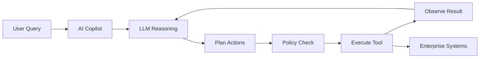

### Reasoning Plane Walkthrough

Four tabs cover interactive copilot use, RAG validation, the tool registry, and custom tool authoring.

#### AI Copilot

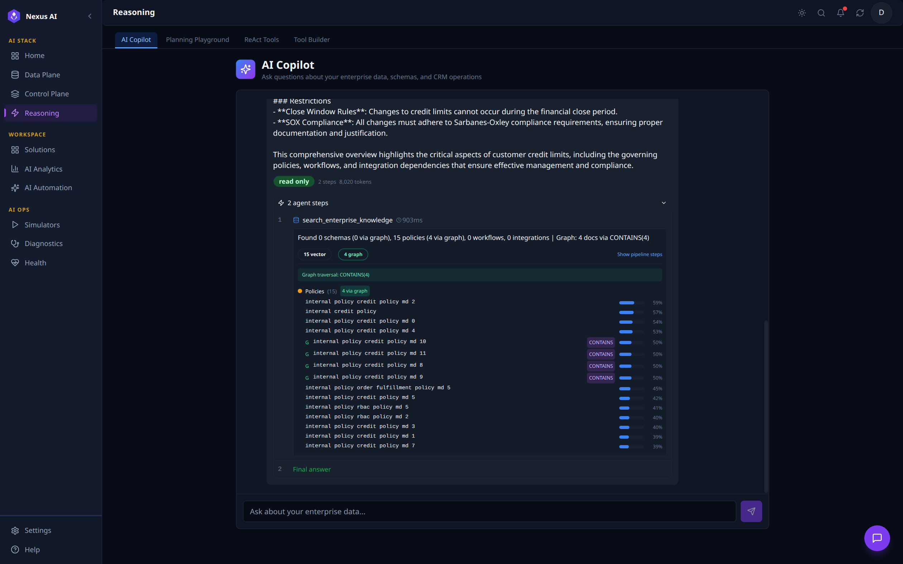

- Natural-language input box with an expandable agent-steps card per response.
- Per-step trace: tool call name, latency, retrieval hits, relevance scores.
- Read-only / write badge and token-cost surfaced for traceability.

#### Planning Playground

- Semantic RAG query input with quick-fill scenario chips.
- Tabs for **Retrieval Bundle**, **Graph View**, and **Test Suite**.
- Retrieval Quality Score with per-dimension breakdown.

#### ReAct Tools

- Per-tool card: purpose, read-only or write tag.
- Built-in tools cover schema discovery, query, semantic search, and Solution-specific actions.

#### Tool Builder

---

## Solutions

The Solutions layer is the **app catalogue** that sits on top of the three planes — pre-built, vertical-aligned enterprise applications powered by the Semantic Ontology Layer.

### Capabilities

- **Solution Card** — name, description, setup time, entity count, KPI targets, source-data dependencies.
- **Vertical Filter** — quick chips by domain (Finance, Planning, Operations, Risk, Revenue, ESG).
- **Priority Badge** — rollout priority (P0, P1).
- **KPI Targets** — headline metrics each solution moves.
- **Source Data Tags** — ontology entities the solution consumes.
- **Open App** — one-click launch into the solution's workspace, where its mapped Views become the left navigation.

### Solutions Walkthrough

#### Solutions Catalogue

- Vertical chips and free-text search.
- Per-card: icon, priority, status, setup time, entity count, headline KPI targets, source-entity chips.
- `Open App` launches the workspace.

#### Solution App — Order-to-Cash Monitor (example)

Each Solution opens into a dedicated workspace with a left nav grouped into **Analytics**, **Views**, and **Workspace**, plus a top **Manage Views** / **Run Journey** action bar. Order-to-Cash Monitor is the canonical example — every Solution follows the same shell.

**Analytics — Business Insights** (Solution home)

- Hero KPI strip with use-case targets.
- Stat tiles and capability cards (Dashboards, Alerts, Workflows, AI Assistant) as quick entry-points.
- Data Entities strip listing every consumed ontology object.

**Analytics — Process Analytics**

- KPI tiles with actuals, deltas, and target thresholds.
- Composition charts and a top-risk drill-down table.

**Analytics — Workflow Actions**

- Per-action-type counters (Credit Hold, Dispute Case, SLA Escalation, Dunning, Expedited, Credit Note).
- Action log with type, target entity, and status.

**Analytics — Reports**

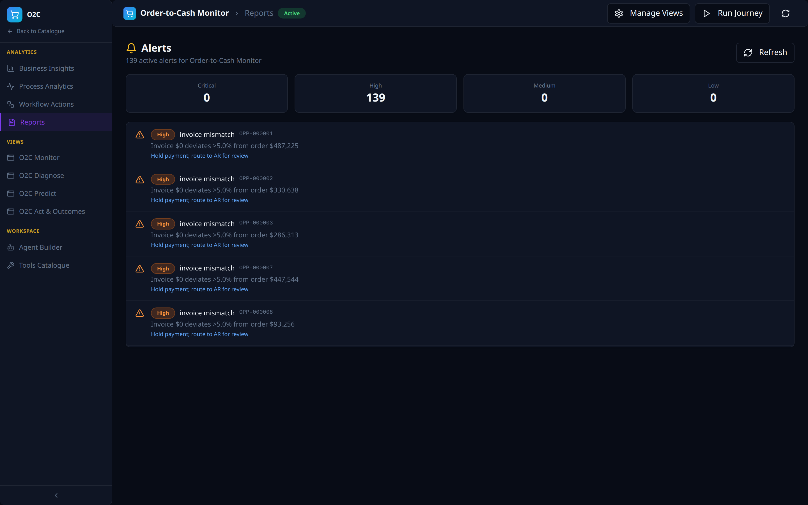

- Severity counters (Critical / High / Medium / Low).
- Scrollable alert feed with type, target, deviation, and remediation.

**Views — the four-views framework, instantiated**

The four auto-seeded Views appear as left-nav items: **Monitor**, **Diagnose**, **Predict**, **Act & Outcomes**.

**Workspace — Agent Builder**

- Custom Tools (declare ReAct tools as YAML).
- Journey Templates (compose automations).
- Agent Profiles (behaviour, permissions, system prompts).
- Test Harness (sample-input validation).

**Workspace — Tools Catalogue**

- App-curated registry — only tools relevant to the Solution's ontology.
- Tool-type tabs derived from the populated tools (Analysis, Automation, Enhancement).
- Each card lists typed inputs / outputs, availability, and a `Try Tool` action.

---

## AI Analytics

Turns the Virtual Data Layer into business insight — manages dashboards and views and binds them back to specific Solutions.

### Capabilities

- **Dashboards** — multi-panel reports built on the VDL.
- **Views** — reusable analytical surfaces, the building blocks of Solution UIs.
- **Four-Views Framework** — Outcomes / Predict / Diagnose / Monitor, auto-seeded per Solution.
- **Solution Mapping** — bind Views to Solutions so each becomes a left-menu item.
- **Search & Tags** — free-text search and typed tags.
- **Dashboard Builder** — multi-step canvas with the AI Query Builder.

### AI Analytics Walkthrough

#### Dashboards

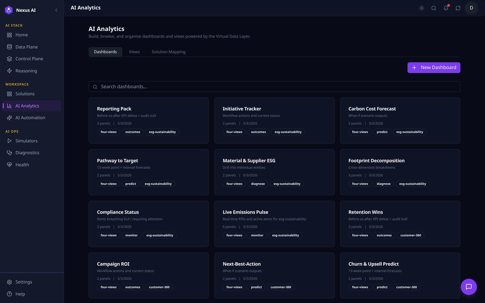

- Per-card: name, panel count, last-updated date.
- Tags by intent and Solution.
- `+ New Dashboard` opens the Builder.

#### Views

- Auto-seeded four-views per Solution.
- `+ New View` for custom surfaces.

#### Solution Mapping

- One row per catalogue Solution.
- `+ Add View` and trash actions per row.
- Auto-provisions backend Solution rows on first bind.

#### Dashboard Builder

Multi-step canvas reached via `+ New Dashboard`.

**1. Pick a panel type.**

- Built-in panel types across categories: Stats, Charts, Tables, Timelines, Graphs, Other.
- Toolbar with title, time range, auto-refresh, save.

**2. Wire the panel up with the AI Query Builder.**

- Two-pane editor with live preview and configuration.
- Natural-language prompt that generates a structured query.
- Structured Query block with virtual entity selector, fields, filters.

**3. Render live against the VDL.**

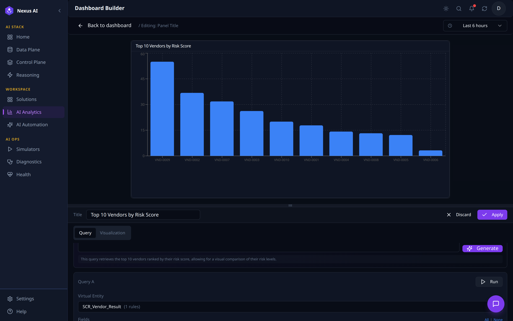

- AI Query Builder fills the structured query and auto-titles the panel.
- Visualisation tab refines axes, colours, thresholds.

---

## AI Automation

The journey engine — the runtime that turns reasoning into repeatable, scheduled, multi-step business operations.

### Capabilities

- **Journeys** — multi-step pipelines with persistent run history, success/failure metrics, and audit trail.
- **Journey Templates** — pre-wired starters per Solution and per pipeline type.
- **AI Copilot Journey** — natural-language journey planner that drafts a journey from a goal description.
- **Journey Builder** — visual drag-and-drop builder with a typed Tool Palette and Step Editor.
- **Triggers** — Manual / Schedule / Webhook execution modes.
- **Tool Palette** — categorised, searchable catalogue of registered tools.

### Journey Lifecycle

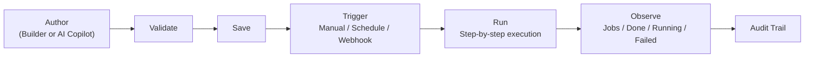

### AI Automation Walkthrough

#### Journeys

- Templates per pipeline type and per Solution.
- Filters: status, type, free-text search.
- Per-card: id, type, status, run counters, success rate, average duration.

#### AI Copilot Journey

- Describe the goal, get back a draft journey of typed steps.
- Same tool registry as the visual builder — the Copilot is a planner, not a separate engine.

#### Journey Builder

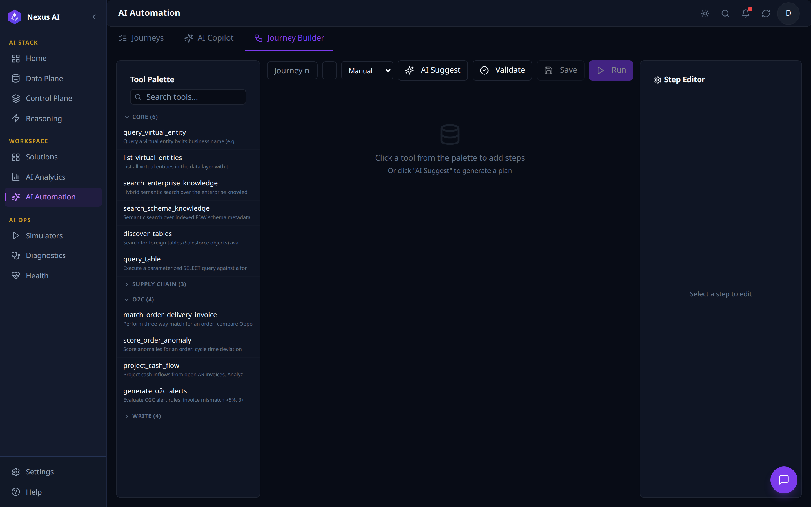

- Top toolbar: metadata, trigger type, run controls (`AI Suggest`, `Validate`, `Save`, `Run`).
- Tool Palette grouped by category with per-category counts and search.
- Canvas with step graph; populated by clicking a tool or invoking AI Suggest.
- Step Editor for inputs, outputs, policy settings.

#### Journey Studio

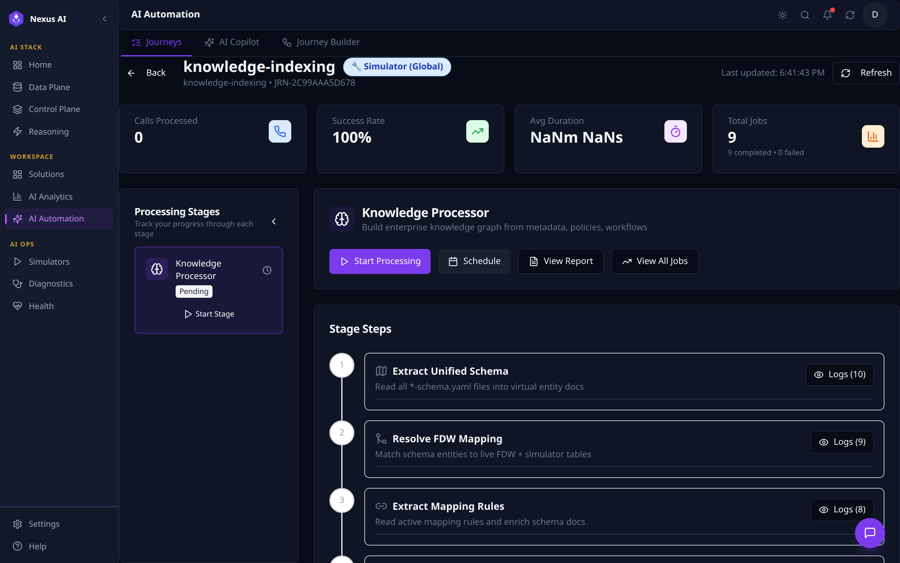

- Header with scope badge (Simulator / Production), id, last-updated.
- KPI tiles for processed volume, success rate, average duration, totals.
- Processing stages and per-stage step graph with drill-in logs.

---

## AI Ops

Cross-cutting operational capabilities that monitor and test the platform.

### Capabilities

- **Simulators** — generate test data for WXCC (contact center), SFDC (CRM), Oracle ERP, and SAP without touching live systems.
- **Diagnostics** — system health checks, FDW connection testing, API diagnostics.
- **Health** — pod status, service health, infrastructure monitoring.
- **Observability** — telemetry across every plane.
- **Governance** — policy and audit at every layer.
- **Cost Intelligence** — workload-level cost tracking.

---

## Technology Stack

| Layer | Technologies |
|-------|-------------|
| Frontend | React + TypeScript, Vite, Tailwind CSS, shadcn/ui |
| Backend | Python 3.11+, FastAPI, MCP HTTP Gateway |
| Database | PostgreSQL with Apache AGE (graph) + pgvector (embeddings) |
| Data Integration | PostgreSQL FDW, ETL pipelines, Change Data Capture (CDC) |
| AI/LLM | OpenAI / Anthropic via ReAct agent loop |
| Infrastructure | AWS EKS, ECR, S3, CloudWatch, Cognito |
| Orchestration | Nexus Kubernetes Operator (NexusCapability CRD) |
| CI/CD | GitHub Actions, Docker, Helm |
