---
hide:
  - toc
---

## Introduction

The Nexus Data-AI Platform shape your data layer for AI diffusion.It's a layered AI operating system built around Ontologies, that put a structure on your existing data and enables you to perform seamless AI Analytics and AI Automations.

<picture>
  <source
    type="image/webp"
    srcset="../assets/nexus-data-ai-1024.webp 1024w, ../assets/nexus-data-ai.webp 1667w"
    sizes="(max-width: 1024px) 96vw, min(96vw, 1600px)">
  
</picture>


## Ontology Support

At its core, the Nexus Data-AI Platform functions as an **Ontology Operating System (Ontology OS)**. It provides the foundational AI engine—powered by **distributed computing**—alongside comprehensive **AI Operations (AI-OS)** capabilities required for modern ontology-driven systems.

The platform structures ontologies within a unified, layered architecture comprising three distinct planes: the **Data Plane**, the **Control Plane**, and the **Reasoning Plane**. Each plane addresses a specific domain of responsibility, and together they establish an intelligent stack that integrates enterprise data, constructs rich semantic context, and enables autonomous AI-driven analytics and automation.

While the platform includes sample ontologies to accelerate initial adoption, its primary purpose is to enable enterprises to design, deploy, and govern their own Ontology OS layer at scale.


## Total System Architecture

This is the end-to-end NexusAI runtime in a single picture. It captures how user intent is classified, how the ReAct engine plans and acts under policy, how the Control Plane retrieves semantic context, and how the Data Plane keeps everything grounded in live enterprise systems.


### ASCII reference

```text
                         ┌────────────────────────────┐
                         │       User Interface       │
                         │  (UI/ Chat / API / Copilot)│
                         └──────────────┬─────────────┘
                                        │
                                        ▼
                         ┌────────────────────────────┐
                         │  Identity & RBAC Layer      │
                         │  (SSO, OAuth, SCIM)         │
                         └──────────────┬───────────────┘
                                        │
                                        ▼
                         ┌────────────────────────────┐
                         │  Intent + Risk Analyzer     │
                         │  (Classifies: read-only,    │
                         │   low-risk write, high-risk │
                         │   write, cross-system)      │
                         └──────────────┬───────────────┘
                                        │
                                        ▼
         ┌───────────────────────────────────────────────────────────────┐
         │              ReAct Planning Engine (LLM Agent Loop)           │
         │                                                               │
         │  PLAN → EXECUTE → OBSERVE → REPLAN → EXECUTE → OBSERVE       │
         │                                                               │
         │  1. Receives user intent + risk classification                │
         │  2. Queries Enterprise RAG for context ──────────────┐       │
         │  3. Reasons about next action                         │       │
         │  4. Selects tool from Tool Abstraction Layer          │       │
         │  5. Policy Engine validates before execution          │       │
         │  6. Observes result, replans if needed                │       │
         │  7. Loops until goal achieved or step limit reached   │       │
         │                                                       │       │
         │  ┌────────────────────────────────────────────────┐   │       │
         │  │  AI Applications (powered by this loop)        │   │       │
         │  │  - Fraud AI Assistant                          │   │       │
         │  │  - AML Investigator Copilot                    │   │       │
         │  │  - Risk Analytics Dashboard                    │   │       │
         │  │  - Enterprise System Orchestrator              │   │       │
         │  └────────────────────────────────────────────────┘   │       │
         │                                                       │       │
         │  ┌────────────────────────────────────────────────┐   │       │
         │  │  Policy & Guardrail Core                       │   │       │
         │  │  (OPA / Custom Engine)                         │   │       │
         │  │  - Approval thresholds  - Close windows        │   │       │
         │  │  - Field-level access   - Cross-system checks  │   │       │
         │  │  - Risk-based routing   - Dry-run mode         │   │       │
         │  │  - Max step limits      - Audit logging        │   │       │
         │  └────────────────────────────────────────────────┘   │       │
         │                                                       │       │
         │  ┌────────────────────────────────────────────────┐   │       │
         │  │  Tool Abstraction Layer (Controlled APIs)      │   │       │
         │  │  - get_account()      - propose_credit_change()│   │       │
         │  │  - get_ar_balance()   - submit_gl_adjustment() │   │       │
         │  │  - create_customer()  - trigger_workflow()     │   │       │
         │  │  LLM never calls raw APIs — only safe tools    │   │       │
         │  └────────────────────────────────────────────────┘   │       │
         └──────────────────────┬─────────────────────────────────┘──────┘
                                │                  ▲
                                │          (RAG feedback loop)
                                ▼                  │
  ┌──────────────────────────────────────────────────────────────────────────┐
  │                                                                          │
  │                         AI-CONTROL-PLANE                                 │
  │            (Semantic Intelligence & Reasoning Layer)                     │
  │                                                                          │
  │  ┌───────────────────────────────────────────────────────────────┐       │
  │  │              Enterprise RAG Layer                             │       │
  │  │         (Semantic Retrieval for LLM Context)                  │       │
  │  │                                                               │       │
  │  │  Retrieves from Vector DB + Graph DB to provide:              │       │
  │  │  - Schema & field definitions                                 │       │
  │  │  - Business policies & approval rules                         │       │
  │  │  - Workflow dependencies & process rules                      │       │
  │  │  - API specs & integration mappings                           │       │
  │  │  - Cross-system dependency awareness                          │       │
  │  │                                                               │       │
  │  │  Answers: "Which object stores credit risk?"                  │       │
  │  │           "What triggers approval workflow?"                  │       │
  │  │           "What fields are required for customer creation?"   │       │
  │  │           "What is the ERP sync dependency?"                  │       │
  │  │                                                               │       │
  │  │  This is semantic retrieval, not relational querying.         │       │
  │  └──────────────────────┬────────────────────────────────────────┘       │
  │                         │                                                │
  │              ┌──────────┼──────────────────────┐                         │
  │              │          │                      │                         │
  │      ┌──────────────┐ ┌──────────────┐  ┌──────────────┐                │
  │      │  Graph Query │ │ Vector Search│  │  ML Scoring  │                │
  │      │  + Reasoner  │ │ (Similarity) │  │  Engine      │                │
  │      └──────┬───────┘ └──────┬───────┘  └──────┬───────┘                │
  │             │                │                  │                        │
  │  ┌───────────────────────────────────────────────────────────────┐       │
  │  │                 Intelligence Layer                            │       │
  │  │                                                               │       │
  │  │  ┌──────────────────┐     ┌────────────────────────────┐     │       │
  │  │  │   Graph DB       │     │       Vector DB            │     │       │
  │  │  │ (Ontology + RDF) │     │ (Embeddings Store)         │     │       │
  │  │  │                  │     │                            │     │       │
  │  │  │ Structural       │     │ Semantic Knowledge:        │     │       │
  │  │  │ Knowledge:       │     │  - Schema embeddings       │     │       │
  │  │  │  - Accounts      │     │  - Policy embeddings       │     │       │
  │  │  │  - Transactions  │     │  - Workflow embeddings     │     │       │
  │  │  │  - Customers     │     │  - API spec embeddings     │     │       │
  │  │  │  - Risk Rules    │     │  - Process rule embeddings │     │       │
  │  │  │  - Relationships │     │  - Fraud case embeddings   │     │       │
  │  │  │  - Ontology      │     │  - Customer embeddings     │     │       │
  │  │  │                  │     │                            │     │       │
  │  │  └────────┬─────────┘     └──────────┬─────────────────┘     │       │
  │  └───────────┼────────────────────────────┼───────────────────────┘       │
  │              │                            │                              │
  └──────────────┼────────────────────────────┼──────────────────────────────┘
                 │                            │
  ┌──────────────────┼────────────────────────────────┼───────────────────┐
  │                  │                                │                   │
  │                  │     AI-DATA-PLANE              │                   │
  │                  │     (Data Ingestion & Transformation)              │
  │                  │                                │                   │
  │     ┌────────────┴──────────┬─────────────────────┴────────────┐     │
  │     │                       │                                  │     │
  │     │  CDC Path             │  ETL Path              FDW Path  │     │
  │     │                       │                                  │     │
  │     ▼                       ▼                                  ▼     │
  │ ┌──────────────┐     ┌───────────────────┐      ┌───────────────────┐│
  │ │ RDF Stream   │     │ RDF Batch         │      │ FDW Wrapper       ││
  │ │ Processor    │     │ Transformer       │      │ (Virtual Access)  ││
  │ │ (CDC→Ontology│     │ (R2RML / Batch)   │      │                   ││
  │ │  Mapper)     │     │                   │      │ Postgres FDW /    ││
  │ └──────┬───────┘     └────────┬──────────┘      │ Trino / Presto    ││
  │        │                      │                  └────────┬──────────┘│
  │        ▼                      ▼                           │          │
  │ ┌──────────────┐     ┌───────────────────┐                │          │
  │ │ Kafka        │     │ ETL Engine        │                │          │
  │ │              │     │ (Spark / Airflow  │                │          │
  │ └──────┬───────┘     │  / Custom)        │                │          │
  │        │             └────────┬──────────┘                │          │
  │        ▼                      │                           │          │
  │ ┌──────────────┐              │                           │          │
  │ │ CDC Engine   │              │                           │          │
  │ │ (Debezium)   │              │                           │          │
  │ └──────┬───────┘              │                           │          │
  │        │                      │                           │          │
  │        ▼                      ▼                           ▼          │
  │ ┌─────────────────────────────────────────────────────────────────┐  │
  │ │                     Enterprise Source Systems                    │  │
  │ │                                                                 │  │
  │ │  ┌──────────────┐  ┌──────────────┐  ┌──────────┐ ┌──────────┐│  │
  │ │  │ Core Banking │  │  ERP / GL    │  │  CRM     │ │  Legacy  ││  │
  │ │  │ (Temenos /   │  │ (SAP /       │  │(Salesforce│ │ Systems  ││  │
  │ │  │  Finacle)    │  │  Oracle)     │  │ / Custom)│ │ / Files  ││  │
  │ │  └──────────────┘  └──────────────┘  └──────────┘ └──────────┘│  │
  │ │                                                                 │  │
  │ │  CDC: Real-time event streams from transaction-heavy systems    │  │
  │ │  ETL: Batch extraction for historical, analytical & master data │  │
  │ │  FDW: Virtual access for low-volume / governance-restricted data│  │
  │ └─────────────────────────────────────────────────────────────────┘  │
  │                                                                      │
  └──────────────────────────────────────────────────────────────────────┘
```

## System Components

The diagram below decomposes the NexusAI platform into six numbered layers — from Enterprise Systems at the foundation, through the Data, Control, and Reasoning Planes, up to the Skilled Resource and Business Capability layers that users interact with.


## Product Home Overview

NexusAI sits as a thin, intelligent layer on top of the systems you already run — no rip-and-replace, no data migration, no silos. The image below shows the same platform from a product perspective: how the planes compose into an end-to-end stack that enterprises consume as Business Capabilities, with governance, observability, and human oversight built in by default.

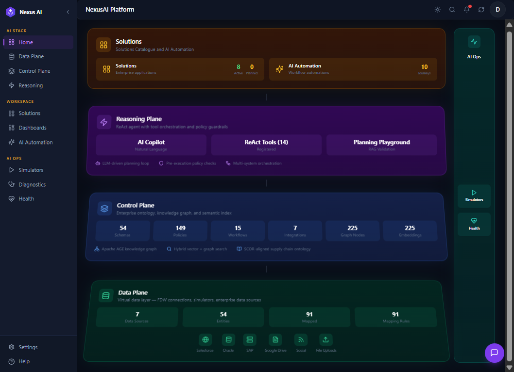


## Data Plane

The Data Plane unifies disparate enterprise systems into a single **Virtual Data Layer (VDL)**. Source data is hydrated into the VDL through three complementary mechanisms -- **FDW Connectors**, **ETL Pipelines**, and **Change Data Capture (CDC)** -- chosen per source based on latency, payload shape, and read/write patterns. Once hydrated, every entity is queryable through the same API regardless of how it arrived.


### VDL Hydration Mechanisms

| Mechanism | When to use | Latency | Typical sources |
|-----------|-------------|---------|-----------------|
| **FDW Connectors** | Live federated reads against transactional systems of record | Milliseconds | Salesforce, Oracle ERP, SAP S/4HANA, BSSMagic CRM |
| **ETL Pipelines** | Bulk ingest, transformation, and enrichment of file or document sources | Minutes to hours | Google Drive, file uploads, market signals, sustainability reports |
| **Change Data Capture (CDC)** | Streaming incremental changes from operational systems | Seconds | Kafka/Debezium event streams, transactional change feeds |


### Data Plane Walkthrough

The Data Plane is exposed through six tabs in the NexusAI workspace, each focused on a distinct part of the hydration lifecycle.

#### Data Sources

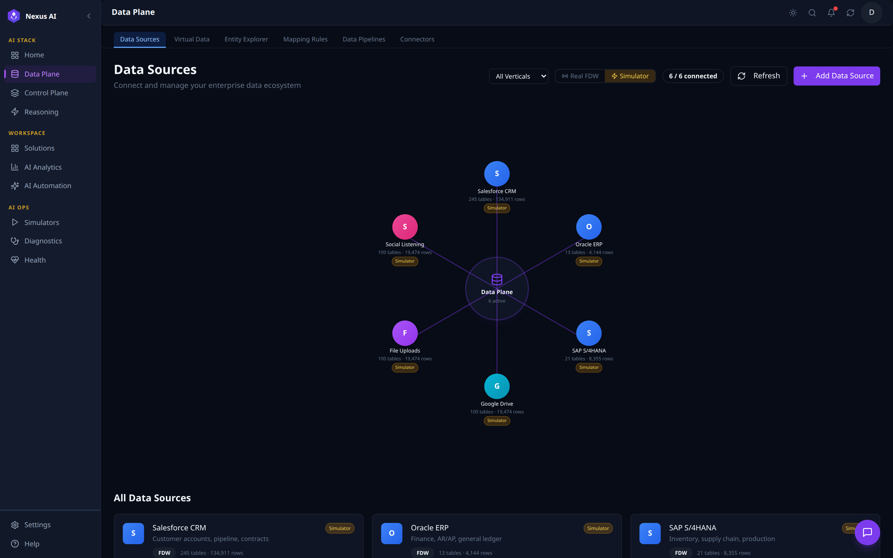

A hub-and-spoke view of every connected enterprise system, with table and row counts per source. The top toolbar filters by vertical, toggles between **Real FDW** and **Simulator** mode, refreshes status, or adds a new source. The **6 / 6 connected** indicator confirms all sources are healthy; the **All Data Sources** list below shows each system's mode (FDW vs. simulated) at a glance.

#### Virtual Data

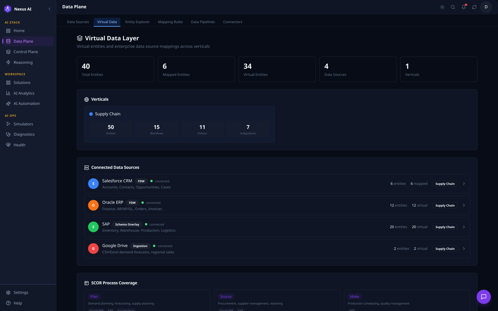

Top-line counters summarise total, mapped, and virtual entities along with active data sources and verticals. Each vertical (Supply Chain in this view) breaks out its entity, workflow, policy, and integration counts. The **Connected Data Sources** list shows how many entities each system contributes and which integration mode is in use -- **FDW**, **Schema Overlay**, or **Ingestion**.

#### Entity Explorer


A three-pane browser for inspecting every virtual entity in the platform. The left panel groups entities by source (Salesforce, SAP, Oracle, AI_Automation, etc.) and tags each as **virtual** or **mapped**. With the **Opportunity** entity selected above, the centre pane shows its **Schema Fields** (7 fields, each with data type, semantic, risk, and constraints), the right pane lists its 5 **Relationships** -- `depends_on Account`, `triggers Order-to-Cash Monitoring`, `triggers Demand Forecast Generation`, `syncs_to sf-sap-demand-sync`, and `constrained_by order-fulfillment-policy` -- and the bottom pane previews live row data.

#### Mapping Rules


Manages the rules that map raw source fields onto ontology objects. The left panel lists every active rule grouped by source, with quick actions for **Auto-Map**, **Audit**, and adding a **New** rule. With **Auto Sim: SCR_Action_Log** selected here, the centre pane opens the rule editor (Name, Virtual Entity, Source Table, 9 source-to-target Field Mappings, Business Logic SQL, Filter Expression, Status), while the right pane summarises the resolved mapping (`external_sources.SCR_Action_Log -> SCR_Action_Log`, 9 of 9 fields mapped) and shows a live preview of the first 5 rows.

#### Data Pipelines

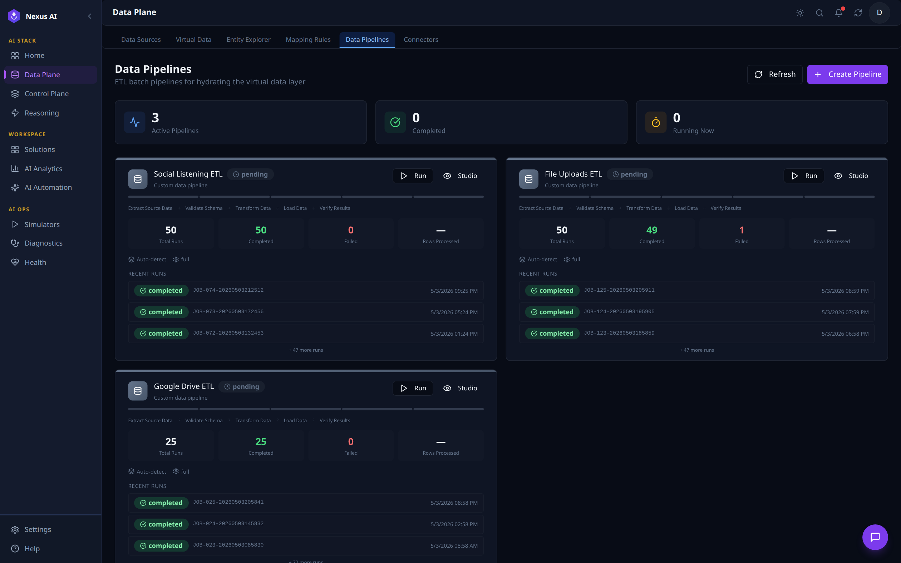

ETL batch pipelines that hydrate the Virtual Data Layer from non-FDW sources. Counters at the top track **Active**, **Completed**, and **Running Now** pipelines. Each pipeline card visualises its stage flow (Extract -> Validate -> Transform -> Load -> Verify) and a rolling history of recent runs with completion status, timestamps, and row counts.

#### Connectors


Catalogue of integration connectors available for hydration and outbound action. Each card describes the connector's typical **Inputs** (e.g., OAuth Configuration, RFC/OData Config) and **Outputs** (e.g., CRM Data, Material Data, Vector Index), with a **Configure** action to wire it up. Built-in connectors include Salesforce, Office 365, Oracle ERP, SAP S/4HANA, Google Drive, Webex, KnowledgeBase, Langflow, and a generic External Systems writeback channel.


## Control Plane

The Control Plane builds a **semantic understanding** of the enterprise by combining an ontology layer, a knowledge graph (Apache AGE), and a vector embedding index (pgvector). It is the brain that gives AI the context to reason about business data.

### Capabilities

| Component | Technology | Purpose |
|-----------|-----------|---------|
| Ontology Schemas | YAML-defined | Business entity definitions (customers, orders, assets, contracts) |
| Policies | Rule engine | Business rules, guardrails, compliance constraints |
| Workflows | Orchestration | Multi-step business process definitions |
| Integrations | Connector config | System-to-system integration mappings |
| Knowledge Graph | Apache AGE (PostgreSQL) | Entity relationships, graph traversal, connected reasoning |
| Semantic Index | pgvector (PostgreSQL) | Vector embeddings for hybrid search (semantic + graph) |

### Control Plane Walkthrough

The Control Plane is exposed through six tabs in the NexusAI workspace, covering ingestion, retrieval, governance, and orchestration of the platform's semantic layer.

#### Knowledge Pipeline

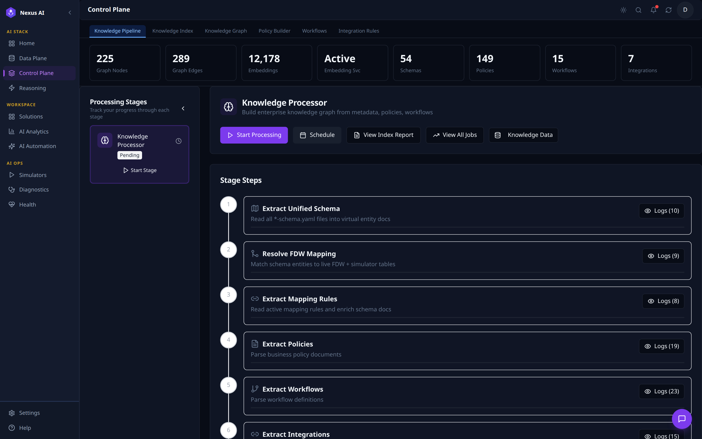

Operational dashboard for the ingestion process that builds the knowledge graph and embedding index. Top counters surface real-time graph size (**225** nodes, **289** edges), embeddings (**12,178**), and ontology totals (**54** Schemas, **149** Policies, **15** Workflows, **7** Integrations). The **Knowledge Processor** card lets you trigger the pipeline manually or schedule it; **Stage Steps** below shows the six-stage flow -- Extract Unified Schema -> Resolve FDW Mapping -> Extract Mapping Rules -> Extract Policies -> Extract Workflows -> Extract Integrations -- with per-stage logs.

#### Knowledge Index

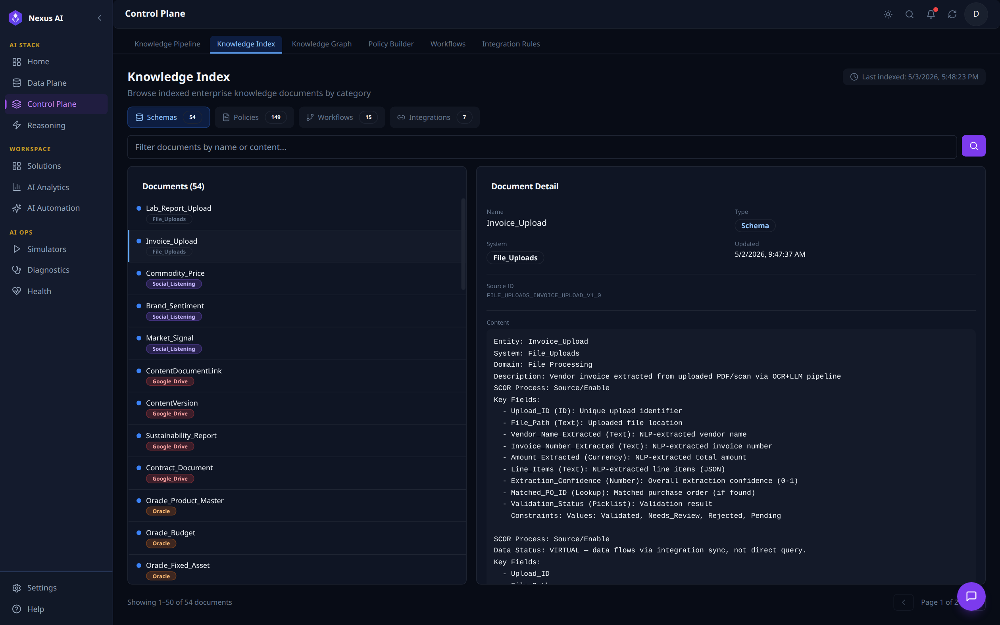

Search and browse interface for every document indexed by the platform. Filter chips swap between **Schemas**, **Policies**, **Workflows**, and **Integrations**. With **Invoice_Upload** selected here, the right pane shows the document's full metadata -- Name, Type, System, Updated timestamp, Source ID -- plus the canonical YAML body (Entity, Domain, Description, SCOR Process, Key Fields, etc.) that feeds the embedding pipeline.

#### Knowledge Graph

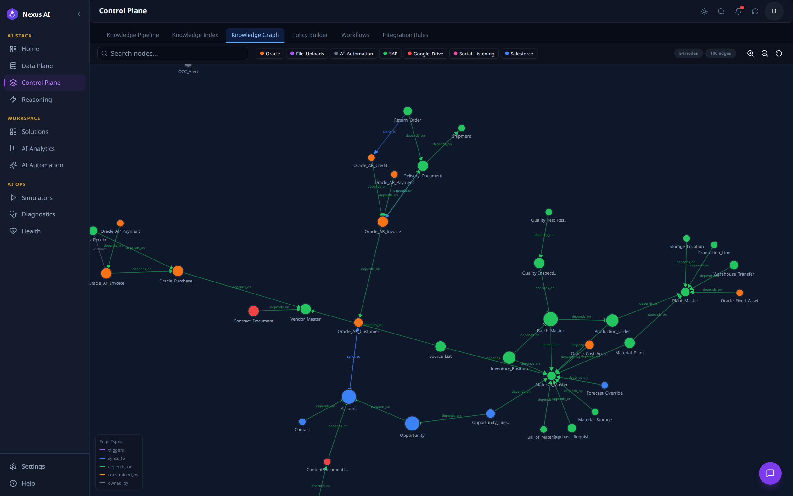

Interactive visualisation of the live ontology graph, **94 nodes / 100 edges** in this view. Nodes are colour-coded by source system (Salesforce, Oracle, SAP, Google Drive, File Uploads, Social Listening, AI_Automation), and edges carry typed relationships (`triggers`, `syncs_to`, `depends_on`, `constrained_by`, `owned_by`). The toolbar offers full-text search and per-source filtering.

#### Policy Builder

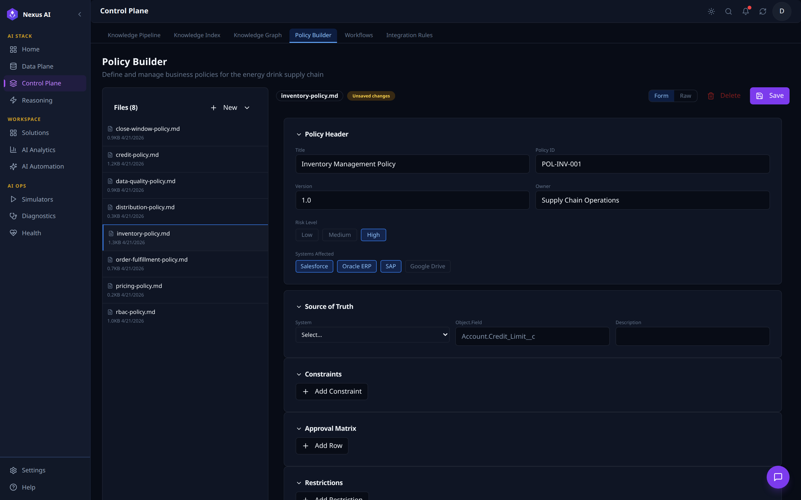

Visual editor for business policies stored as Markdown files. The left panel lists every policy in the bundle (8 in this view); selecting **inventory-policy.md** loads its **Policy Header** (*Inventory Management Policy*, ID `POL-INV-001`, Risk Level **High**, applied to Salesforce / Oracle ERP / SAP), **Source of Truth** binding (`Account.Credit_Limit__c`), and the editable **Constraints**, **Approval Matrix**, and **Restrictions** blocks.

#### Workflows


Visual editor for multi-system process flows stored as YAML. **Files (6)** lists the workflow templates; selecting **product-launch.yaml** loads its **Workflow Header** (*New Product Launch*, ID `WF_PRODUCT_LAUNCH_V1`, Primary System: Cross-System) and **Trigger** definition (`Account.Credit_Limit__c` change exceeds threshold). **Description**, **Steps**, and **Dependencies** sections are editable below.

#### Integration Rules

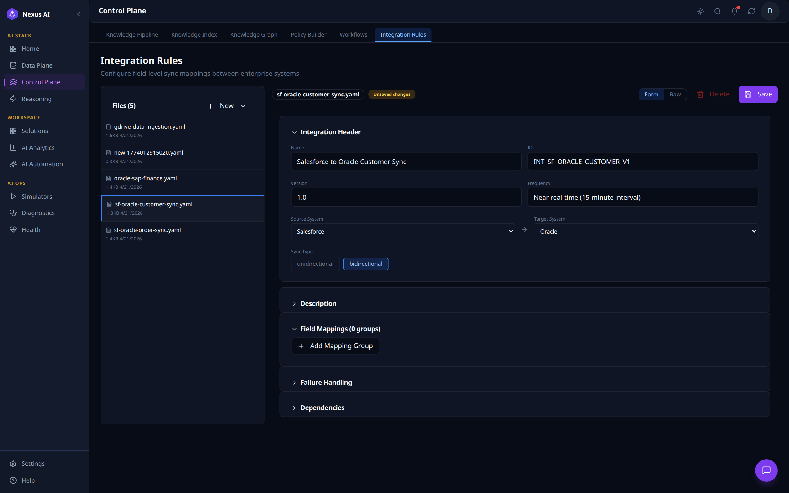

Configures field-level sync mappings between enterprise systems. **Files (5)** lists the sync rules; selecting **sf-oracle-customer-sync.yaml** loads its **Integration Header** (*Salesforce to Oracle Customer Sync*, ID `INT_SF_ORACLE_CUSTOMER_V1`, Frequency: near real-time 15-minute interval, **bidirectional**), with Source System **Salesforce** -> Target System **Oracle** wired up. **Field Mappings**, **Failure Handling**, and **Dependencies** are managed in the collapsible sections below.

---

## Reasoning Plane

The Reasoning Plane is where AI **reasons and acts** on enterprise data. It uses a ReAct (Reason + Act) agent loop powered by LLMs, with registered tools that can query data, execute workflows, and interact with external systems -- all under policy guardrails.

### Capabilities

| Component | Description |
|-----------|------------|
| AI Copilot | Natural language interface for querying data, running analysis, and executing actions |
| ReAct Tools | Registered tool functions the AI can call (data queries, journey execution, log analysis, simulator control) |
| Planning Playground | RAG validation and testing environment for reasoning chains |
| Policy Guardrails | Pre-execution policy checks before any tool action is executed |
| Multi-system Orchestration | Coordinate actions across multiple enterprise systems in a single reasoning chain |

### ReAct Loop

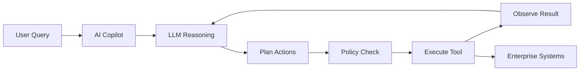

### Registered Tools

| Tool | Purpose |
|------|---------|
| Journey Tool | Execute and manage data processing journeys |
| Logs & Reports Tool | Query execution logs, generate reports |
| WXCC Simulator Tool | Control contact center test data simulation |
| Data Plane Queries | Query virtual entities across connected systems |
| Ontology Queries | Search knowledge graph and semantic index |

### Console Walkthrough

The Reasoning Plane is exposed through four tabs in the NexusAI workspace, covering interactive copilot use, RAG validation, the tool registry, and custom tool authoring.

#### AI Copilot


A conversational interface to the ReAct planning engine. The user submits a natural-language question -- here, *"Which system is the source of truth for customer credit limits and what policies govern it?"* -- and the agent returns a markdown reply followed by an inspectable, expandable **2 agent steps** card. Step 1 shows the actual tool call: `search_enterprise_knowledge` (903 ms) returning **15 vector** + **4 graph** hits across credit / order-fulfilment / RBAC policies via the `CONTAINS` graph traversal, with relevance scores per document. Step 2 is the **Final answer**. The **read only** badge and token count (**8,020 tokens**) are surfaced for traceability.

#### Planning Playground

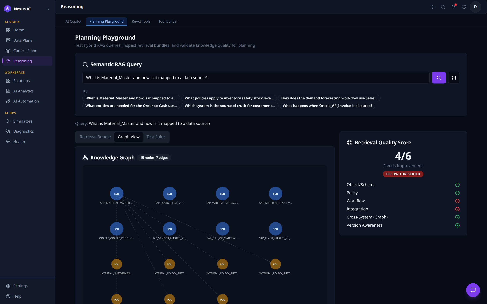

Hybrid RAG testing environment. The query *"What is Material_Master and how is it mapped to a data source?"* is run from the **Semantic RAG Query** input (with quick-fill chips for common scenarios). Below, the **Retrieval Bundle / Graph View / Test Suite** tabs let you inspect what was retrieved -- the **Graph View** here renders a **15-node, 7-edge** subgraph mixing schema and policy nodes. The right-hand **Retrieval Quality Score** scores the bundle **4 / 6** (*Below Threshold*) with a per-dimension breakdown (Object/Schema, Policy, Cross-System Graph, Version Awareness all pass; Workflow and Integration fail) so engineers can iterate on the bundle before promoting it.

#### ReAct Tools

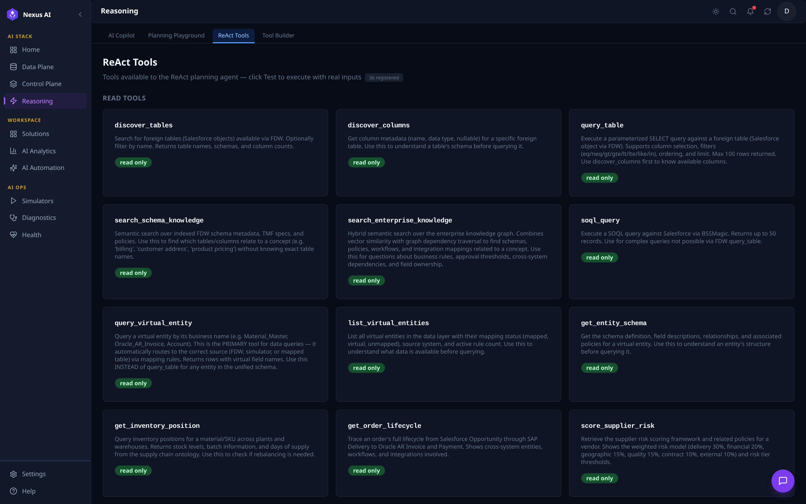

Catalogue of all **36 registered tools** the planning agent can call. Each card describes a tool's purpose and tags it as **read only** or write-capable. Visible read-only tools here include `discover_tables`, `discover_columns`, `query_table`, `search_schema_knowledge`, `search_enterprise_knowledge`, `soql_query`, `query_virtual_entity`, `list_virtual_entities`, `get_entity_schema`, `get_inventory_position`, `get_order_lifecycle`, and `score_supplier_risk`.

#### Tool Builder

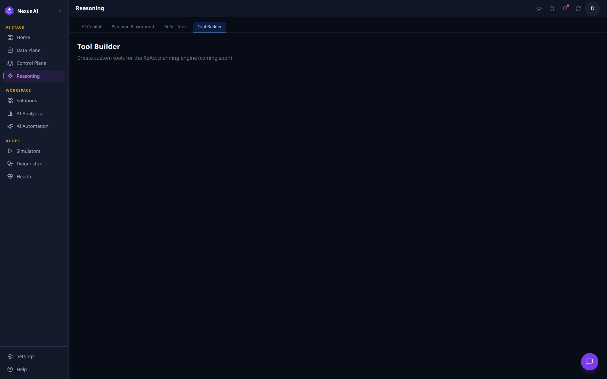

Authoring surface for adding custom tools to the ReAct planning engine -- currently labelled **coming soon**.


## Solutions

The Solutions layer is the **app catalogue** that sits on top of the three planes. Each Solution is a pre-built, vertical-aligned enterprise application powered by the Semantic Ontology Layer -- it bundles the entities, KPIs, dashboards, and journeys needed to operate one slice of the business end-to-end.

### Capabilities

| Component | Description |
|-----------|------------|
| Solution Card | Self-contained application with name, description, setup time, entity count, KPI targets, and source-data dependencies |
| Vertical Filter | Quick filter chips by domain (Finance, Planning, Operations, Risk, Revenue, ESG) |
| Priority Badge | Rollout priority (P0, P1) -- which solutions to deploy first |
| KPI Targets | Headline metrics each solution moves (e.g., DSO < 35 days, MAPE < 15%, OEE > 85%) |
| Source Data Tags | Which ontology entities the solution consumes (e.g., Opportunity, Material Master, Vendor Master) |
| Open App | One-click launch into the solution's workspace, where its mapped Views become the left navigation |

### Solutions Walkthrough

The Solutions section is exposed as a catalogue view of all available enterprise apps, plus a per-Solution drill-down workspace reached via the **Open App** action on each card.

#### Solutions Catalogue

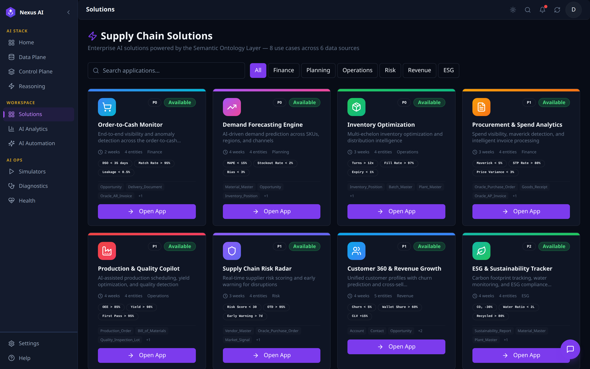

One-page catalogue of pre-built enterprise apps powered by the Semantic Ontology Layer.

- **Filter** -- vertical chips (Finance, Planning, Operations, Risk, Revenue, ESG) plus free-text search.
- **Card metadata** -- icon, priority (P0 / P1), `Available` status, setup time, entity count, headline KPI targets, source-entity chips.
- **Open App** -- launches the solution's workspace, where its mapped Views become the left navigation.

#### Solution App -- Order-to-Cash Monitor (example)

Each Solution opens into a dedicated workspace with a left nav grouped into **Analytics**, **Views**, and **Workspace**, plus a top-level **Manage Views** / **Run Journey** action bar. **Order-to-Cash Monitor** below is the canonical example -- every Solution follows the same shell, parameterised by its ontology entities, KPI targets, and journeys.

**Analytics -- Business Insights** (the Solution home)

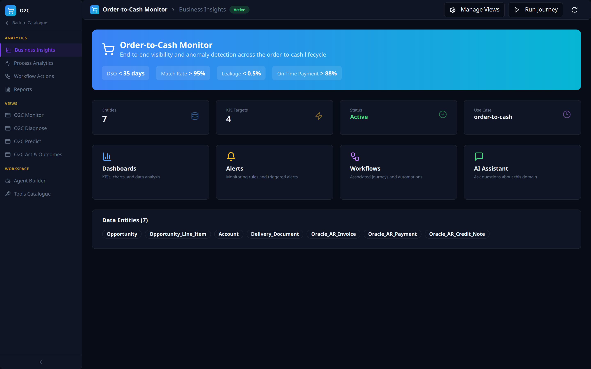

- Hero KPI strip showing the use-case targets (DSO, Match Rate, Leakage, On-Time Payment).
- Stat tiles (Entities, KPI Targets, Status, Use Case slug) and capability cards (Dashboards, Alerts, Workflows, AI Assistant) as quick entry-points.
- Data Entities strip listing every ontology object the Solution consumes.

**Analytics -- Process Analytics**

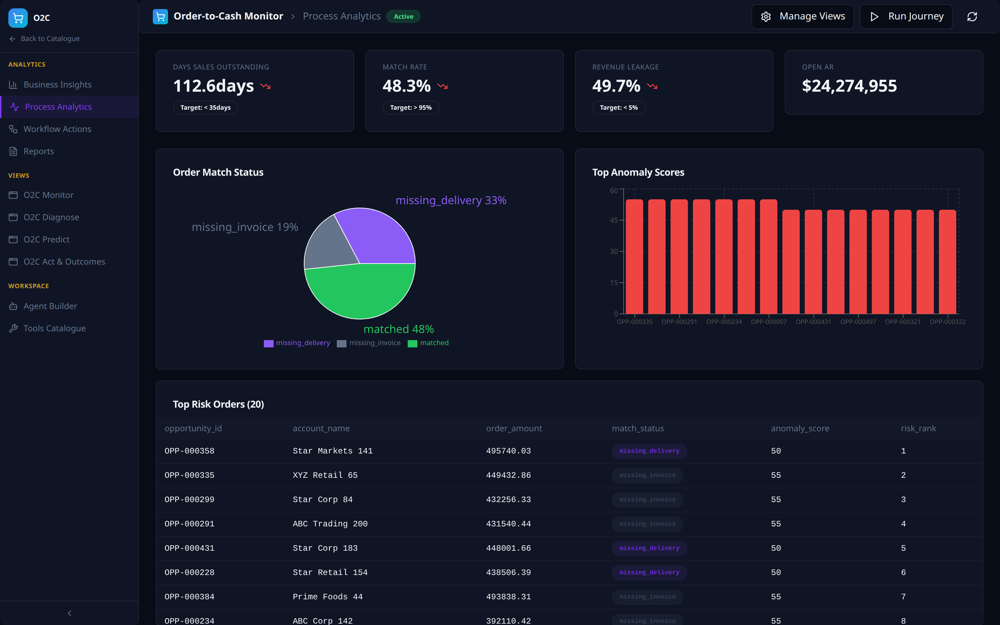

- KPI tiles with **actual** values, deltas, and target thresholds (e.g. *Days Sales Outstanding 112.6 days vs target < 35 days*).
- Composition charts (Order Match Status donut, Top Anomaly Scores bar) plus a Top Risk Orders drill-down table.

**Analytics -- Workflow Actions**

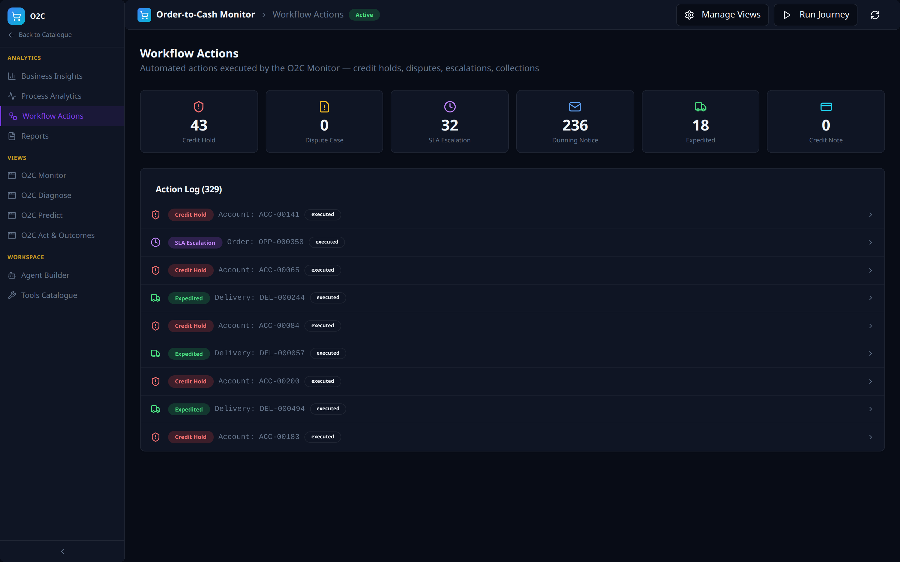

- Per-action-type counters (Credit Hold, Dispute Case, SLA Escalation, Dunning Notice, Expedited, Credit Note).
- Action Log feed of every executed action with type, target entity, and status.

**Analytics -- Reports**


- Severity counters (Critical / High / Medium / Low) and a scrollable alert feed.
- Each alert carries type, target order, deviation summary, and remediation action.

**Views -- the four-views framework, instantiated**

The four auto-seeded Views (`outcomes` / `predict` / `diagnose` / `monitor` from AI Analytics) appear as left-nav items: **O2C Monitor**, **O2C Diagnose**, **O2C Predict**, **O2C Act & Outcomes**. Each is a multi-tab dashboard composed of intent-specific panels against the same VDL.

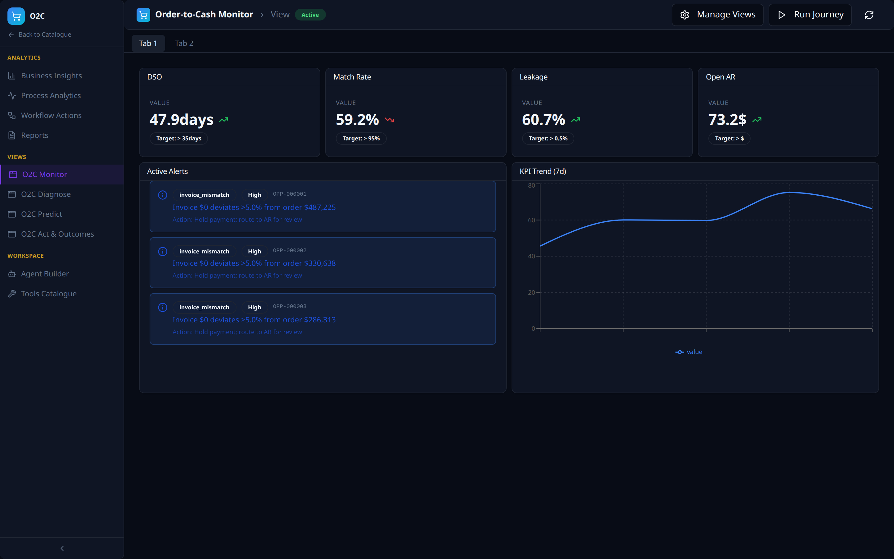

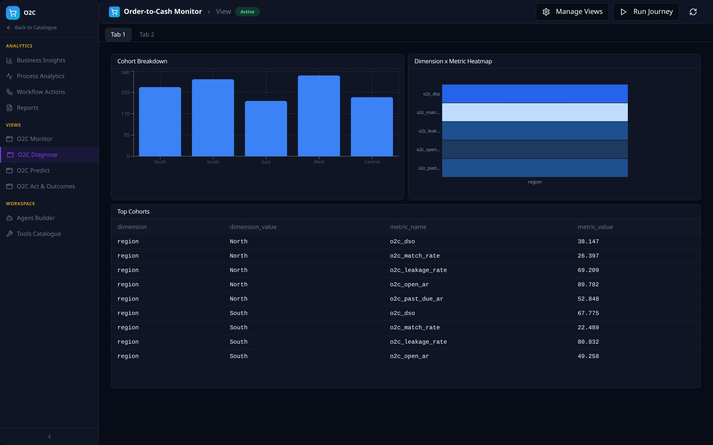

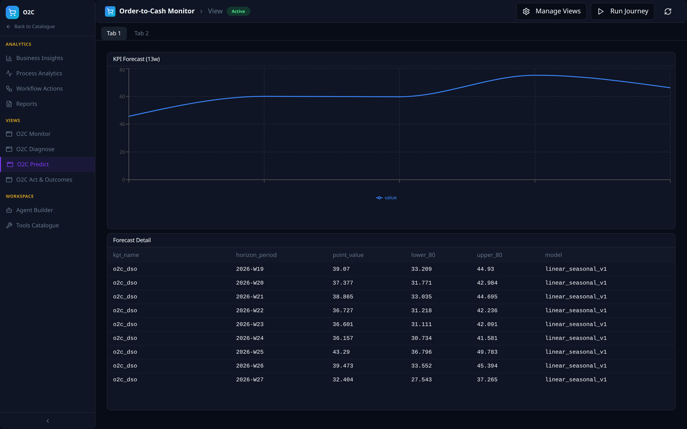

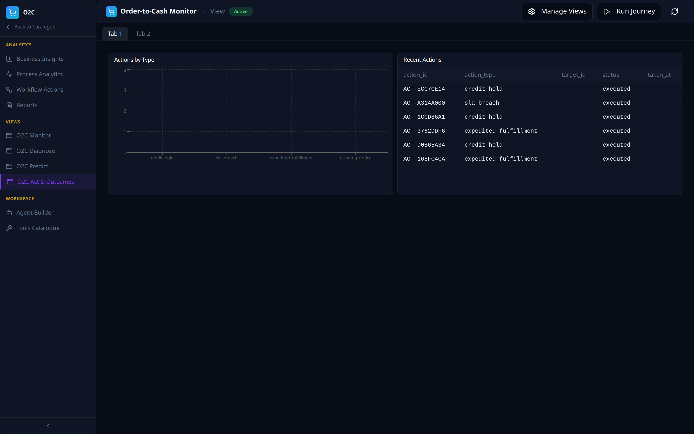

**Workspace -- Agent Builder**

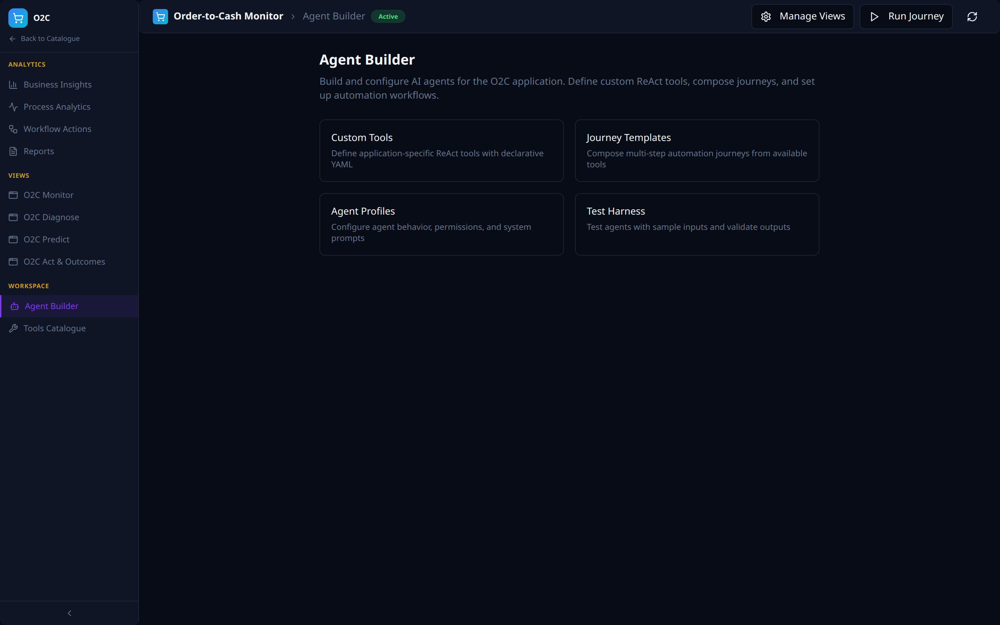

- **Custom Tools** (declare ReAct tools as YAML), **Journey Templates** (compose automations), **Agent Profiles** (behaviour, permissions, system prompts), **Test Harness** (sample-input validation).

**Workspace -- Tools Catalogue**

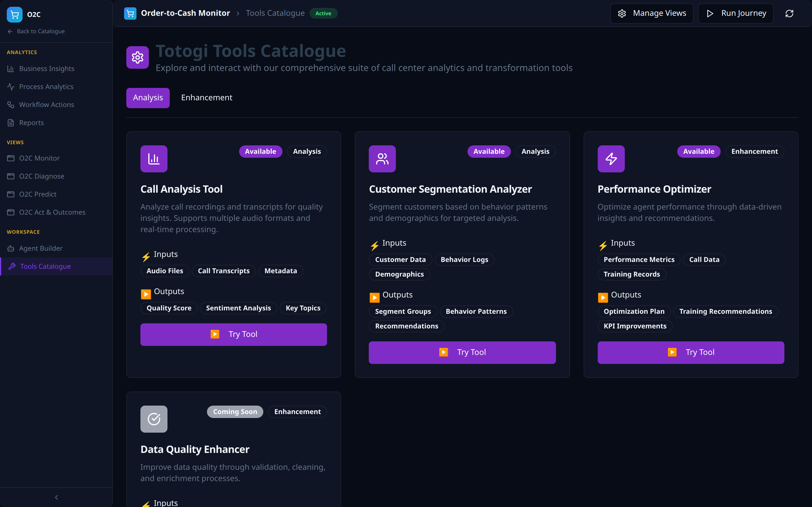

- Tool-type tabs (e.g. Analysis, Enhancement); each tool card shows Inputs, Outputs, availability (`Available` / `Coming Soon`), and a `Try Tool` action.

---

## AI Analytics

The AI Analytics layer is where the Virtual Data Layer is **turned into business insight**. It manages the lifecycle of dashboards and views -- the visual surfaces that consume ontology entities -- and binds them back to specific Solutions so each app gets its own purpose-built navigation.

### Capabilities

| Component | Description |
|-----------|------------|
| Dashboards | Multi-panel reports built on top of the VDL, classified by intent (Outcomes, Predict, Diagnose, Monitor) |
| Views | Reusable analytical surfaces -- the building blocks that get composed into Solution UIs |
| Four-Views Framework | Standard classification (Outcomes / Predict / Diagnose / Monitor) auto-seeded for every Solution |
| Solution Mapping | Bind Views to Solutions so each View shows up as a left-menu item in its Solution UI |
| Search & Tags | Free-text search plus typed tags (`four-views`, `outcomes`, `monitor`, `customer-360`, `esg-sustainability`, etc.) |

### AI Analytics Walkthrough

The AI Analytics workspace is exposed through three tabs in the NexusAI workspace -- covering browsing, authoring, and binding of dashboards and views -- plus a multi-step **Dashboard Builder** drill-down reached from the **+ New Dashboard** action on the Dashboards tab.

#### Dashboards


Card grid of every dashboard in the workspace.

- **Card metadata** -- name, one-line description, panel count, last-updated date.
- **Tags** -- classification (`outcomes` / `predict` / `diagnose` / `monitor`) plus the target Solution slug, so dashboards are searchable by intent and by Solution.
- **Author** -- `+ New Dashboard` opens the Dashboard Builder.

#### Views

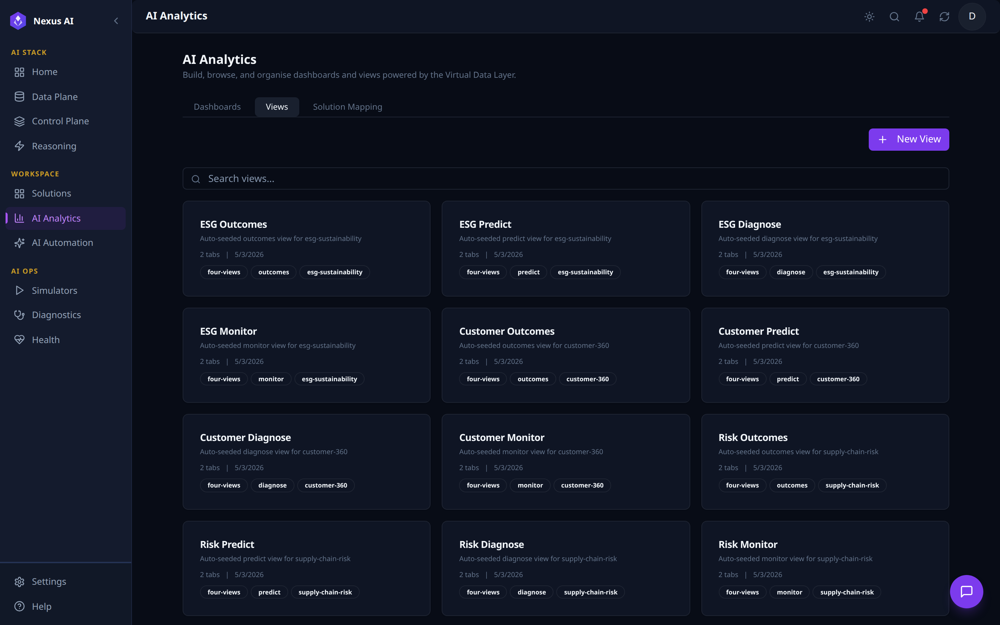

Catalogue of reusable **Views** -- the analytical building blocks that compose into Solution UIs.

- **Four-views framework** -- every Solution is auto-seeded with four Views: *Outcomes*, *Predict*, *Diagnose*, *Monitor*.
- **Card metadata** -- classification + solution tags, sub-tab count, last-updated date.
- **Author** -- `+ New View` for custom surfaces beyond the auto-seeded set.

#### Solution Mapping

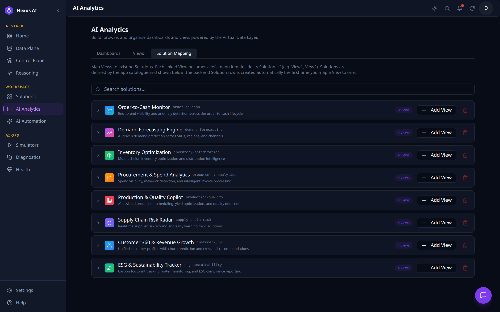

Editor for binding Views to Solutions -- each linked View becomes a left-menu item inside its Solution UI.

- **One row per catalogue Solution** with current view count and slug.
- **Per-row actions** -- `+ Add View` to bind another, trash icon to unmap all.
- **Auto-provisioning** -- the backend Solution row is created the first time a View is mapped to it.

#### Dashboard Builder

The Dashboard Builder is the multi-step canvas reached by clicking **+ New Dashboard** on the Dashboards tab. It walks the author through three stages: pick a panel type, wire up its data with the **AI Query Builder**, and watch the visualisation render against the Virtual Data Layer.

**1. Pick a panel type from the Add Panel catalogue.**

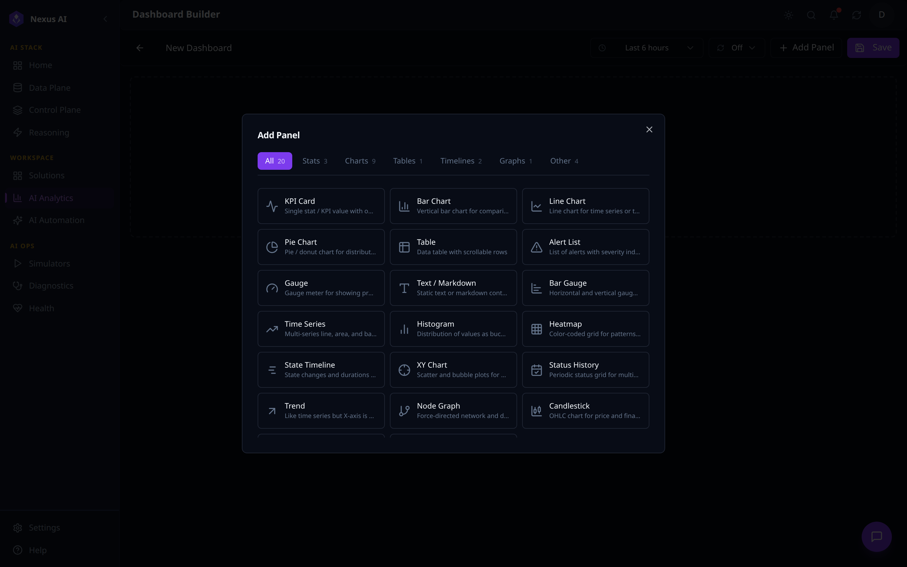

- **20 built-in panel types** across 7 categories (Stats, Charts, Tables, Timelines, Graphs, Other) -- KPI Card, Bar / Line / Pie Chart, Table, Gauge, Heatmap, Time Series, Histogram, Node Graph, etc.
- **Toolbar** -- dashboard title, time-range picker, auto-refresh, `+ Add Panel`, `Save`.

**2. Wire the panel up with the AI Query Builder.**

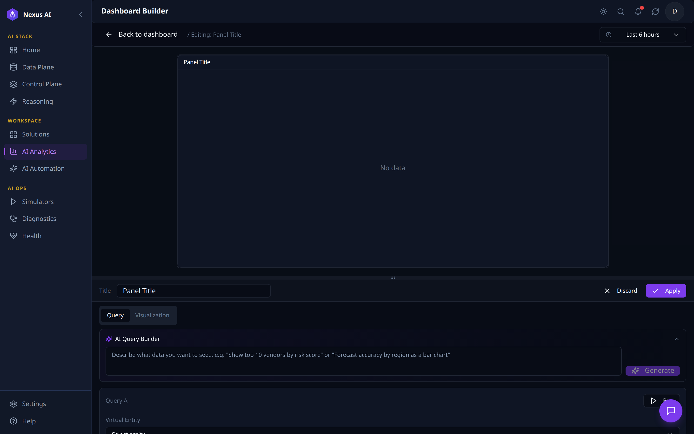

- **Two-pane editor** -- live preview canvas above, configuration pane below with `Query` / `Visualization` tabs.
- **AI Query Builder** -- natural-language prompt that generates a structured query.
- **Structured Query block** -- Virtual Entity selector, fields, filters; runs against the VDL whether authored by hand or via the AI Query Builder.

**3. Generate, run, and the visualisation renders live.**


- **Generate** -- the AI Query Builder fills the structured query, auto-titles the panel, and emits a one-line description of what was queried.
- **Live render** -- chart paints against the resolved Virtual Entity (e.g. `SCR_Vendor_Result`).
- **Persist** -- `Apply` adds the panel to the dashboard; `Visualization` tab refines axes / colours / thresholds.

---

## AI Automation

The AI Automation layer is the **journey engine** -- the runtime that turns reasoning into repeatable, scheduled, multi-step business operations. Where the Reasoning Plane handles ad-hoc agentic queries, AI Automation handles the **production workflows**: scheduled ETL, call processing, semantic RAG indexing, and per-Solution operational journeys.

### Capabilities

| Component | Description |
|-----------|------------|
| Journeys | Multi-step pipelines with persistent run history, success/failure metrics, and audit trail |
| Journey Templates | Pre-wired journey starters per Solution and per pipeline type (Call Processing, Semantic RAG, O2C, Demand Forecasting, Inventory Optimization, Procurement, Production & Quality, Supply Chain Risk, Customer 360, ESG) |
| AI Copilot Journey | Natural-language journey planner -- describe the goal, get a draft journey back |
| Journey Builder | Visual drag-and-drop builder with a typed Tool Palette, Step Editor, and validate/save/run controls |
| Triggers | Manual / Schedule / Webhook execution modes |
| Tool Palette | Categorised, searchable catalogue of registered tools (Core, Supply Chain, O2C, Write, ...) the journey can call |

### Journey Lifecycle

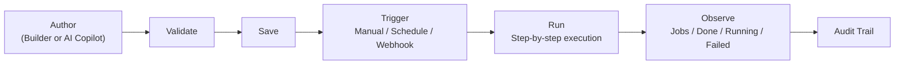

### AI Automation Walkthrough

The AI Automation workspace is exposed through three tabs in the NexusAI workspace -- covering operations, conversational authoring, and visual authoring -- plus a per-journey **Journey Studio** drill-down view reached from any Journey card.

#### Journeys

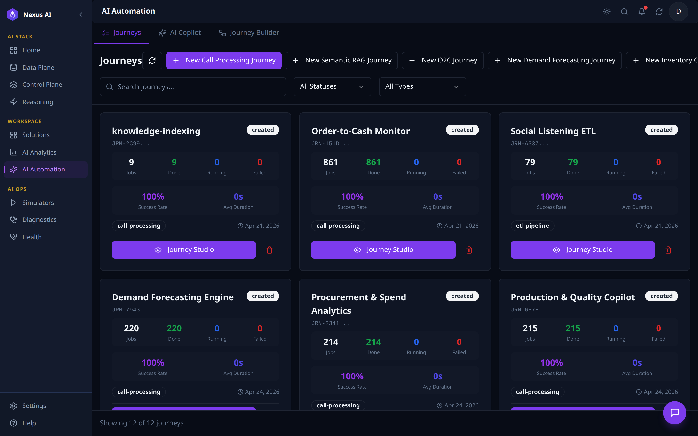

Operational dashboard for every journey running on the platform.

- **Templates** -- one `+ New … Journey` per pipeline type (Call Processing, Semantic RAG, plus one per Solution).
- **Filters** -- status, type, free-text search.
- **Card metadata** -- JRN-id, type chip, status badge, run counters (`Jobs / Done / Running / Failed`), `Success Rate`, `Avg Duration`.
- **Drill-in** -- `Journey Studio` opens the per-journey operations console.

#### AI Copilot

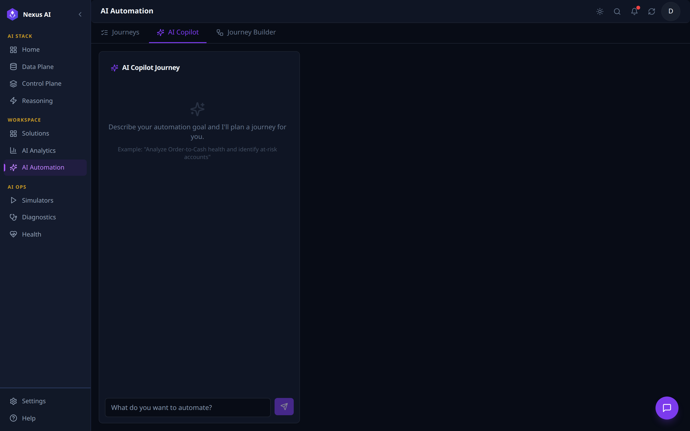

Conversational on-ramp to the journey runtime.

- **Natural-language input** -- *"Describe your automation goal and I'll plan a journey for you."*
- **Output** -- a draft journey of typed steps, ready for refinement in the Journey Builder before save / run.
- **Same tool registry** as the visual builder -- the Copilot is a planner, not a separate engine.

#### Journey Builder


Three-pane visual authoring surface for journeys.

- **Top toolbar** -- journey metadata, trigger type (`Manual` / `Schedule` / `Webhook`), and run controls (`AI Suggest`, `Validate`, `Save`, `Run`).
- **Tool Palette** (left) -- every registered tool grouped by category (CORE, SUPPLY CHAIN, O2C, WRITE, …) with per-category counts and free-text search.
- **Canvas** (centre) -- step graph; populated by clicking a tool or invoking `AI Suggest`.
- **Step Editor** (right) -- per-step configuration: inputs, outputs, policy settings.

#### Journey Studio


Per-journey operations console -- reached from the `Journey Studio` button on any Journey card.

- **Header** -- journey name, scope badge (Simulator / Production), journey id, last-updated, `Refresh`, `Back`.
- **KPI tiles** -- Calls Processed, Success Rate, Avg Duration, Total Jobs (with completed / failed breakdown).
- **Processing Stages** (left) -- one card per stage with status badge (`Pending` / `Running` / `Done`) and `Start Stage` action.
- **Stage detail** (centre) -- selected stage's description and run controls (`Start Processing`, `Schedule`, `View Report`, `View All Jobs`).
- **Stage Steps** -- ordered execution graph, each step with a `Logs (N)` drill-in for per-step trace.

---

## AI Ops

Cross-cutting operational capabilities that monitor and test the platform:

| Component | Purpose |
|-----------|---------|
| Simulators | Generate test data for WXCC (contact center), SFDC (CRM), Oracle ERP, SAP |
| Diagnostics | System health checks, FDW connection testing, API diagnostics |
| Health | Pod status, service health, infrastructure monitoring |

---

## Technology Stack

| Layer | Technologies |
|-------|-------------|
| Frontend | React + TypeScript, Vite, Tailwind CSS, shadcn/ui |
| Backend | Python 3.11+, FastAPI, MCP HTTP Gateway |
| Database | PostgreSQL with Apache AGE (graph) + pgvector (embeddings) |
| Data Integration | PostgreSQL FDW (Foreign Data Wrappers), ETL pipelines, Change Data Capture (CDC) |
| AI/LLM | OpenAI / Anthropic via ReAct agent loop |
| Infrastructure | AWS EKS, ECR, S3, CloudWatch, Cognito |
| Orchestration | Nexus Kubernetes Operator (NexusCapability CRD) |
| CI/CD | GitHub Actions, Docker, Helm |

---
