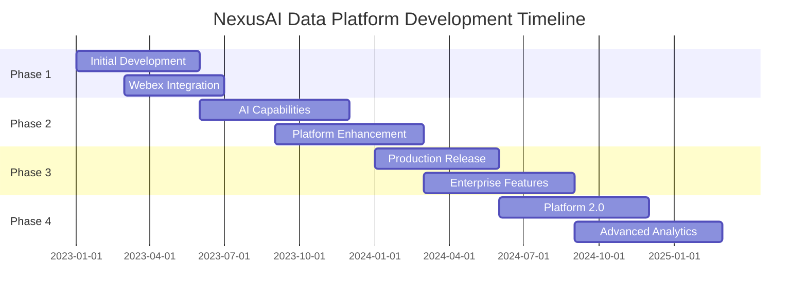

# Project Scope

This section contains project scope definitions, release notes, and project metadata tracking the evolution of the NexusAI Data Platform.

## Overview

The project scope documentation provides:

- **Release Notes** - Version history and changes
- **Project Metadata** - Project information and tracking
- **Scope Definitions** - What's included in each release
- **Roadmap** - Future development plans

## Available Documents

### Release Notes
Comprehensive release notes documenting all versions, features, bug fixes, and changes.

📄 [View Release Notes](releases/)

---

### Project Metadata
Detailed project information including timelines, milestones, and stakeholder information.

Note: Project notes are maintained in the project-notes repository.

---

## Current Version

**Version**: 0.0.1

## Version History

### Version 0.0.1 (Current)
- Initial production release
- Desktop application installer
- Call processing capability
- Webex CC integration
- AWS deployment automation
- Basic analytics features

## Project Timeline

## Scope Boundaries

### In Scope
- ✅ Webex Contact Center integration
- ✅ AI-powered call transcription
- ✅ Call analysis and insights
- ✅ Multi-stage journey processing
- ✅ Real-time analytics and reporting
- ✅ AWS cloud deployment
- ✅ Enterprise license management
- ✅ MCP tools integration

### Out of Scope
- ❌ Real-time call interception
- ❌ Outbound calling
- ❌ CRM integration (future release)
- ❌ Multi-tenant support (future release)
- ❌ Mobile applications (future release)

## Project Repositories

The NexusAI Data Platform project consists of multiple repositories:

| Repository | Purpose | Status |
|------------|---------|--------|
| **nexus-backend** | Backend services and API | ✅ Active |
| **nexus-ui** | React frontend application | ✅ Active |
| **nexus-deployer** | AWS deployment automation | ✅ Active |
| **nexus-docs** | Documentation site | ✅ Active |
| **project-notes** | Project metadata and notes | ✅ Active |

## Related Projects

The NexusAI Data Platform is part of a broader portfolio:

- **Econet** - Enterprise integration
- **Maxis** - Customer engagement platform
- **Movistar** - Contact center integration
- **Zain** - AI-powered analytics

---

[← Back to Home](../index.md) | [← Previous: Features & Capabilities](../features/index.md) | [Next: Technical Documentation →](../technical/index.md)
