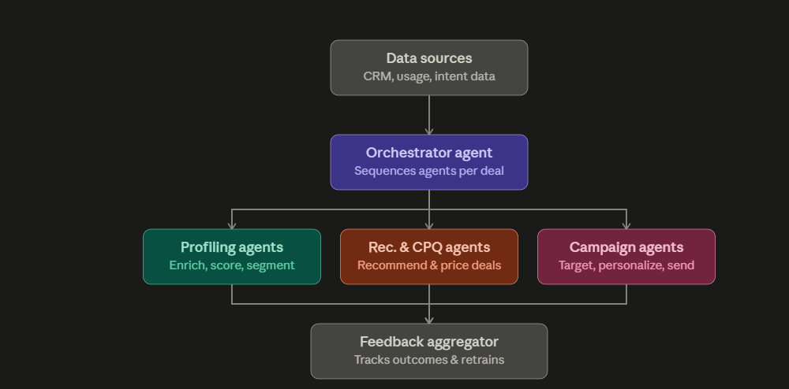
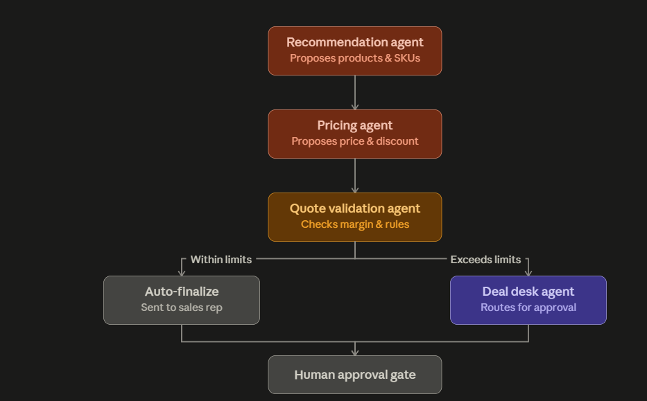
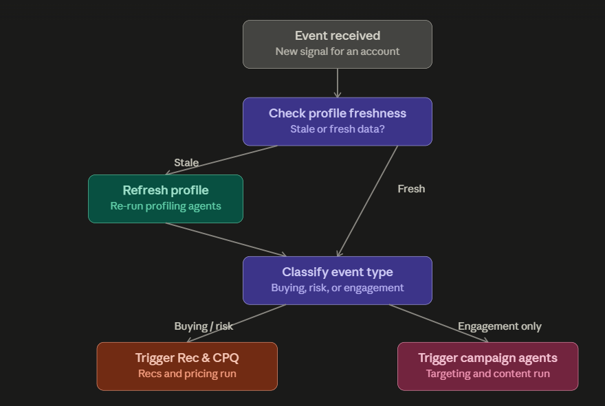

Here's a breakdown of agents you'd likely need across the three pillars, framed with the closed-loop lens we discussed (each agent should have a feedback signal, not just fire-and-forget).

## 1. Customer Profiling

**Data Enrichment Agent**
Pulls from CRM, intent data providers (6sense, Bombora), firmographic APIs, web scraping, support tickets. Loop: fetch → validate completeness/freshness → flag gaps → re-query alternate source if a field is stale or missing.

**Segmentation / Persona Agent**
Clusters accounts/contacts into segments (industry, size, buying stage, tech stack) using rules + ML. Loop closes on segment stability — if a customer keeps flip-flopping between segments on each run, that's a signal the feature set or thresholds need adjustment.

**Intent & Signal Scoring Agent**
Continuously scores accounts on buying intent (website visits, content downloads, hiring signals, funding news). This one is inherently closed-loop — it needs to re-score as new signals arrive, not just once.

**Account Health / Churn Risk Agent**
Monitors usage, support tickets, engagement decline for existing customers — feeds both upsell (recommendation) and retention campaigns. Loop: observe usage delta → update risk score → trigger downstream agent if threshold crossed.

## 2. Product Recommendation & CPQ

**Recommendation Agent**
Given a customer profile, suggests product/SKU combinations (next-best-product, cross-sell, upsell). Loop: recommend → observe (accepted/rejected/modified by sales rep or customer) → retrain/adjust ranking weights. This is your clearest reinforcement-style closed loop — rep or customer response is direct feedback.

**Pricing & Discount Optimization Agent**
Proposes price points/discount bands within approved guardrails, given deal size, competitive situation, customer tier. Loop: propose price → observe win/loss or negotiation outcome → adjust pricing model. **Important**: this agent should generate proposals for human approval, not auto-execute pricing — falls under your "actions are expensive/irreversible" case from earlier, so keep a human-in-the-loop gate here.

**Quote/Configuration Validation Agent**
Checks CPQ output for internal consistency — valid product combinations, contract terms, approval thresholds, margin floors. Loop: generate quote → validate against business rules engine → auto-correct or flag for approval if a rule is violated. This is a good candidate for a tight, fully automated loop since the feedback signal (rule violation) is unambiguous.

**Contract/Terms Agent**
Drafts contract language or redlines based on customer tier and negotiated terms, checks against legal-approved clause library. Loop: draft → compliance check → flag deviations for legal review.

**Deal Desk Approval Agent**
Routes non-standard quotes (heavy discount, custom terms) through the right approval chain, chases approvers, escalates on SLA breach. Loop: route → monitor approval status → escalate/remind if stalled.

## 3. Targeted Campaigns

**Campaign Targeting/Audience Builder Agent**
Takes segments + intent scores and builds the actual send list per campaign, applying suppression rules (do-not-contact, recent-contact fatigue, opted out). Loop: build list → check deliverability/compliance rules → filter → finalize.

**Content Personalization Agent**
Generates or selects messaging variants (subject lines, email body, ad copy) tailored to segment/persona. Loop: generate → A/B test → observe open/click/reply rates → update which variants it favors.

**Channel Orchestration Agent**
Decides sequencing/timing across email, LinkedIn, ads, SDR outreach — avoids channel fatigue, coordinates multi-touch sequences. Loop: execute sequence → observe engagement per channel → reorder/reweight channels.

**Campaign Performance / Attribution Agent**
Tracks campaign outcomes back to pipeline/revenue, feeds performance data back to targeting and content agents. This is the agent that actually **closes the loop for the whole campaign layer** — without it, your content and targeting agents have nothing to learn from.

**Compliance/Suppression Agent**
Enforces CAN-SPAM/GDPR/CCPA, frequency caps, do-not-contact lists across all outbound. Should run as a hard gate before any send agent executes, not as an afterthought.

## Cross-Cutting / Orchestration Agents

**Orchestrator Agent**
Sits above the three pillars — decides which agent acts on which account and when (e.g., "this account just moved into high-intent segment → trigger recommendation agent → then trigger campaign agent"). This is likely your main deliberative/planning layer since it's coordinating dependent, multi-step workflows across pillars — exactly the case from your last question where a loose plan beats pure reactivity.

**Feedback/Learning Aggregator Agent**
Collects outcomes across all three pillars (which recommendations converted, which campaigns worked, which segments were most profitable) and routes retraining signals back to the relevant model/agent. Without this, each pillar closes its own local loop but the system as a whole doesn't learn cross-functionally — e.g., campaign performance data should also inform the recommendation agent, not just the campaign agent.

**Guardrail/Policy Agent**
A cross-cutting agent (not domain-specific) that checks every other agent's proposed action against business rules, pricing floors, compliance, and brand guidelines before execution. Given you have pricing and contract terms in play, I'd treat this as non-negotiable infrastructure rather than optional.

---

A few design calls worth making early, given your earlier question about planning:

- **Recommendation and CPQ validation agents** are good candidates for tight, fully automated closed loops (clear feedback signal, low-risk actions).
- **Pricing and contract agents** should stay human-in-the-loop given the cost of getting it wrong — the agent proposes, a human approves.
- **The Orchestrator** is where you actually need planning/sequencing logic, since it's coordinating dependent steps across pillars (profile → recommend → campaign), not just reacting to a single feedback signal.

That's the core loop: **data → orchestrator → three agent groups → feedback aggregator → back into profiling and recommendation.** Here's how each connection actually works in practice.

**Data sources → Orchestrator**
Whenever a meaningful event fires — new lead, usage spike, contract renewal window, intent signal crossing a threshold — the orchestrator gets triggered for that account. This is your "plan" layer from earlier: it decides *which* agents to invoke and in what order, rather than every agent polling constantly.

**Orchestrator → Profiling agents**
For a new or updated account, the orchestrator first ensures the profile is current — enrichment, segmentation, intent scoring, health scoring — before letting anything downstream act on stale data. If the profile is already fresh (updated in the last N hours), the orchestrator can skip straight past this step.

**Orchestrator → Recommendation & CPQ agents**
Once profile data is current, the orchestrator triggers recommendation generation. This is where the sequencing matters most: recommendation needs the finished profile (segment + intent score + health score), and CPQ validation needs the finished recommendation. Get this ordering wrong and you'll generate quotes against stale product-fit data.

**Orchestrator → Campaign agents**
In parallel or downstream of CPQ (depending on whether it's a self-serve motion or a sales-assisted one), targeting and content agents build the actual outbound campaign using the same profile and recommendation output.

**Everything → Feedback aggregator**
This is the piece most teams under-build. It needs to capture: did the rep accept/reject the recommendation, did the deal close, did the campaign convert, did the pricing get renegotiated. That outcome data has to route back to two places specifically — the recommendation model (so ranking improves) and the profiling model (so segment/intent scoring calibrates against actual revenue outcomes, not just engagement proxies).

One implementation detail worth flagging: the **orchestrator and feedback aggregator are the two agents that need real state** — everything else can mostly be close to stateless (given profile + account ID, produce output). If you're prototyping, I'd build those two first with a simple event log / state store, then bolt the individual agents on, since retrofitting state management later is the painful part.

Recommendation agent
Input: customer profile (segment, intent score, existing products, usage patterns). Output: ranked list of product/SKU combinations — next-best-product, cross-sell, upsell candidates.

This is your clearest reinforcement-style loop. The feedback signal is direct and unambiguous: did the rep accept the recommendation as-is, modify it, or ignore it and pick something else? Did the deal close? That signal should retrain the ranking model over time. Concretely, you'd log something like (account_id, recommended_skus, rep_action, deal_outcome) and periodically retrain or reweight against it.

Pricing agent
Input: the recommended SKUs, deal size, customer tier, competitive context. Output: a proposed price/discount band — within pre-approved guardrails.

Deliberately not a fully autonomous loop. It proposes; it doesn't execute. The feedback signal here (win/loss, negotiation outcome) is noisier and slower than the recommendation signal — a rejected price could mean the price was wrong, or it could mean the rep undersold the value, or the competitor just had a better relationship. Because you can't cleanly attribute the outcome to the agent's decision, and because a bad autonomous pricing decision is expensive and hard to reverse (this is the "actions are costly/irreversible" case from earlier), this agent should always output a proposal, never a committed price.

Quote validation agent
This is the one I'd build as a genuinely tight, fully automated closed loop — the feedback signal is unambiguous (rule violated: yes/no). It checks: valid product combinations, margin floor, discount ceiling, contract term compliance. Two outcomes:

Within limits → auto-finalize, straight to the rep.
Exceeds limits → routes to deal desk.

Deal desk agent
Handles the non-standard cases: routes to the right approver based on deal size/discount depth, chases stalled approvals, escalates on SLA breach. This agent's loop is about process, not pricing judgment — it's observing "has this approval sat for 48 hours?" and nudging, not deciding whether the discount itself is right.

Human approval gate
Everything converges here regardless of path. This is intentional — even the "auto-finalize" path should surface the quote to the rep before it goes to the customer, not skip the human entirely. The rep is both the approver and the source of your feedback signal for the recommendation and pricing agents upstream.

That's the two-check gate the orchestrator runs on every event: freshness first, then intent.

**Check 1: Is the profile fresh?**

Before doing anything else, the orchestrator checks a simple timestamp/staleness condition — has this account's profile been updated within your acceptable window (say, 24-72 hours, or since the last major usage event)? This check exists purely to avoid wasted work: if ten events fire for the same account in an hour, you don't want to re-run enrichment and scoring ten times.

- **Stale** → block downstream agents, trigger the profiling agents synchronously, wait for completion.
- **Fresh** → skip straight to classification.

This is a cheap, deterministic check — no LLM needed, just a lookup against a `last_profiled_at` field.

**Check 2: What kind of event is this?**

Once the profile is current, the orchestrator classifies *why* it was triggered. This is the more interesting routing decision, and it typically comes down to three buckets:

- **Buying or risk signal** (pricing page visit, contract renewal approaching, usage spike, support escalation, champion left the company) → route to recommendation & CPQ. Something needs a concrete offer or intervention attached to it.
- **Engagement-only signal** (opened an email, downloaded a whitepaper, attended a webinar) → route to campaign agents only. Not yet warm enough to warrant a quote — needs nurturing, not a proposal.

**A detail worth calling out**: this classification step is where I'd actually use an LLM call (or a lightweight classifier model) rather than hardcoded rules, because "is this a buying signal" is genuinely fuzzy — a pricing page visit from a brand-new trial user means something different than the same visit from an account three renewals in. Hardcoded rules work for the obvious cases (renewal date within 30 days = always risk signal) but you'll want a model in the loop for the ambiguous middle.

**What's implicit in the diagram but worth stating**: the two output paths aren't fully independent. When the Rec & CPQ path finishes and a quote goes out, that itself becomes a new event ("quote sent") that typically re-triggers the orchestrator into the campaign path — e.g., to kick off a quote-follow-up nurture sequence. So in practice you'd model this less as "either/or" and more as a **queue of events per account**, where completing one agent's work can enqueue the next event rather than the orchestrator making one all-or-nothing decision per trigger.

One implementation note for a Python build: this argues for an event-driven architecture (a queue like SQS/Kafka/Celery, not a synchronous function-call chain) — since "agent A finishing spawns event B" is naturally a pub/sub pattern, and it also gives you retry/backoff for free when an individual agent call fails.

