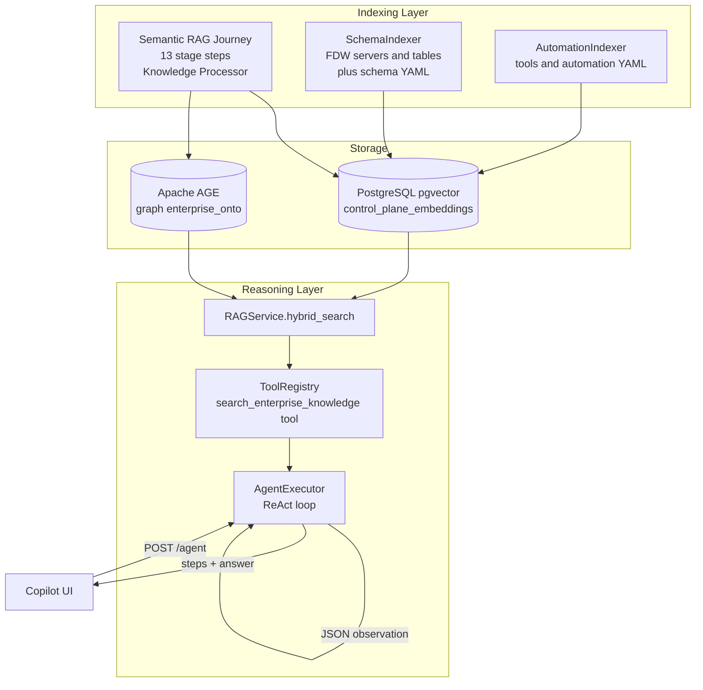
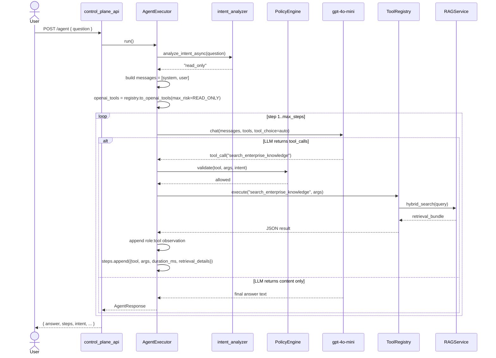
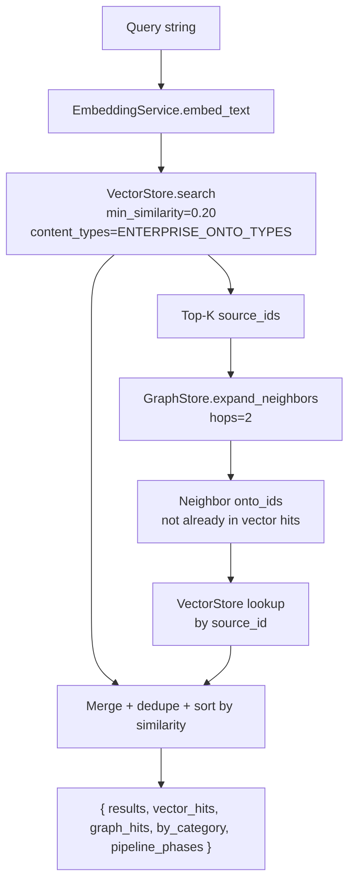

# Knowledge Indexing and Copilot Reasoning

How enterprise YAML and Markdown artefacts become searchable embeddings plus a typed knowledge graph, and how the AI Copilot's reasoning loop consumes them at query time.

For a deeper view of the indexing stages alone see [Semantic RAG Pipeline](semantic-rag-pipeline.md). For the ReAct loop framing see [AI Operating System / ReAct Layer](../ai-os/re-act-layer.md). For the retrieval-engineering principles see [Semantic RAG Overview](../ai-os/semantic-rag.md).

---

## 1. The Big Picture

There are **three independent indexing paths** that all write to the same `control_plane_embeddings` table (pgvector) plus an optional Apache AGE graph called `enterprise_onto`. The Copilot reaches the index through a single ReAct tool, `search_enterprise_knowledge`, which calls `RAGService.hybrid_search` — vector top-K, then a graph expansion, then a merge.



Two things to internalise before reading on:

1. The UI's **"Knowledge Processor"** journey with the 9 visible stages is the **`semantic_rag` journey** — defined in Python code, **not** a YAML in `enterprise-knowledge/automation/`. It has 13 backend steps in total.
2. The chat Copilot uses **`AgentExecutor`** (a true ReAct loop). There is also a separate **`CopilotEngine`** used by the Copilot Journey builder — same RAG infrastructure, different orchestration.

---

## 2. Part 1 — How Knowledge Indexing Is Done

### 2.1 Three indexing paths at a glance

| Path | Class / Entry | Trigger | Writes `content_type` values |
|------|---------------|---------|------------------------------|
| **Semantic RAG Journey** | `SemanticRagStage` / `SemanticRagProcessor` | Journey run (UI: "Knowledge Indexing") | `onto_schema`, `onto_policy`, `onto_workflow`, `onto_integration`, `nlq_exemplar`, `onto_graph_index` |
| **SchemaIndexer** | `SchemaIndexer.index_all()` | `POST /api/v1/control-plane/index` | `fdw_server`, `fdw_table`, `onto_schema` |
| **AutomationIndexer** | `AutomationIndexer.index_all()` | Startup + `POST /api/v1/automation/reindex` | `onto_tool`, `onto_use_case`, `onto_stage`, `onto_step`, `onto_tool_binding`, `onto_connector_api` |

All three share:

- **Embedding service** — [`embedding_service.py`](../../../nexus-backend/src/services/control_plane/embedding_service.py), model `text-embedding-3-small`, 1536 dimensions, OpenAI batch API.
- **Vector store** — [`vector_store.py`](../../../nexus-backend/src/services/control_plane/vector_store.py), table `control_plane_embeddings`, unique key `(content_type, source_id)`.
- **Graph store** — [`graph_store.py`](../../../nexus-backend/src/services/control_plane/graph_store.py), primary Apache AGE graph `enterprise_onto`, JSON-adjacency fallback row `onto_graph_index`.

### 2.2 The Semantic RAG Journey — 13 steps, the "Knowledge Processor"

Stage definition: [`semantic_rag_stage.py`](../../../nexus-backend/src/stages/semantic-rag/semantic_rag_stage.py).
Step dispatcher: [`semantic_rag_processor.py`](../../../nexus-backend/src/stages/semantic-rag/semantic_rag_processor.py).

```mermaid
flowchart LR
    A[1 extract_unified_schema] --> B[2 resolve_fdw_mapping]
    B --> C[3 extract_mapping_rules]
    C --> D[4 extract_policies]
    D --> E[5 extract_workflows]
    E --> F[6 extract_integrations]
    F --> G[7 normalize]
    G --> H[8 enrich LLM]
    H --> I[9 chunk_embed]
    I --> J[10 load_vector]
    J --> K[11 index_nlq_exemplars]
    K --> L[12 load_graph]
    L --> M[13 validate]
```



#### Step-by-step

| # | Step ID | What it does | Input | Output |
|---|---------|--------------|-------|--------|
| 1 | `extract_unified_schema` | `UnifiedSchemaExtractor` walks `enterprise-knowledge/*-schema.yaml` (e.g. `supply-chain-schema.yaml`, `result-objects-schema.yaml`). Each `domains[].tables[]` becomes an `OntoDocument` of category `schema`. | YAML files | `_extracted_docs["unified_schema"]` |
| 2 | `resolve_fdw_mapping` | `FDWMappingResolver` cross-references the discovery service plus loaded simulators. Stamps each schema doc with `fdw_mapping_status`: `mapped`, `virtual`, `unmapped`, `mapped_via_rule`. | Schema docs + `FDWDiscoveryService.list_foreign_tables()` + `fdw_api._simulators` | Same docs, enriched metadata |
| 3 | `extract_mapping_rules` | `MappingRuleExtractor` enriches schema docs with the active `MappingRuleService` rules (so the Copilot knows e.g. `Quote_Header` maps to `tpm_cpq.Quote_Header`). | Active rules from DynamoDB / PG | In-place enrichment |
| 4 | `extract_policies` | `PolicyExtractor` reads `enterprise-knowledge/policies/**/*.{md,txt,pdf}` (or the S3 `onto-data/policies/` mirror through `OntoDataService`). | Policy markdown | `_extracted_docs["policies"]` |
| 5 | `extract_workflows` | `WorkflowExtractor` walks `enterprise-knowledge/workflows/*.yaml`. Each YAML becomes an `OntoDocument` with steps, dependencies, triggers. | Workflow YAMLs | `_extracted_docs["workflows"]` |
| 6 | `extract_integrations` | `IntegrationExtractor` walks `enterprise-knowledge/integrations/*.yaml`. Captures field maps, conflict resolution. | Integration YAMLs | `_extracted_docs["integrations"]` |
| 7 | `normalize` | `Normalizer` merges all categories into a single canonical **`OntoBundle`** with deduplication. Optionally uploads `bundle.onto` to S3 at `onto-bundles/{job_id}/bundle.onto`. | All `_extracted_docs` | `self._bundle: OntoBundle` |
| 8 | `enrich` | `Enricher` calls `gpt-4o-mini` per non-schema doc to generate a semantic summary that improves retrieval. Schema docs are skipped (already structured). | OntoBundle, OpenAI | `doc.content` enriched |
| 9 | `chunk_embed` | `Chunker.chunk_and_embed()` produces 1536-d embeddings per chunk via `EmbeddingService.embed_batch`. Each chunk's `content_type` becomes `onto_{category}` (e.g. `onto_policy`). | OntoBundle | `self._embeddings` |
| 10 | `load_vector` | `VectorLoader` **TRUNCATEs** `control_plane_embeddings` then upserts every chunk. | Embeddings | PG rows |
| 11 | `index_nlq_exemplars` | `NLQExemplarGenerator` generates natural-language query exemplars from curated YAML plus schema templates, embeds them, upserts (no truncate). Drives the intent analyser and retrieval. | `nlq-exemplars.yaml` + schema | Rows with `content_type='nlq_exemplar'` |
| 12 | `load_graph` | `GraphLoader` issues `CREATE EXTENSION age` if needed, drops and recreates graph `enterprise_onto`, then `MERGE`s nodes and typed edges from `OntoDocument.relationships`. If AGE is unavailable, falls back to a JSON adjacency list row `(onto_graph_index, relationship_index)` in pgvector. | OntoBundle | AGE graph or PG fallback |
| 13 | `validate` | `SemanticRagValidator.run_tests()` — sample retrieval queries, vector count assertions, graph integrity checks. Writes a JSON report. | Indexed store | Validation report (optional S3) |

#### What an `OntoDocument` looks like

The model is defined in [`onto_model.py`](../../../nexus-backend/src/stages/semantic-rag/onto_model.py). Approximately:

```python
@dataclass
class OntoDocument:
    onto_id: str               # canonical key, e.g. "policy:credit-policy"
    category: str              # "schema" | "policy" | "workflow" | "integration"
    title: str
    content: str               # markdown / YAML rendered to text
    metadata: Dict[str, Any]   # system, sub_category, fdw_mapping_status, ...
    relationships: List[Dict]  # [{"type": "SYNCS_TO", "target_onto_id": "..."}]
```

The `relationships` list is what becomes graph edges in step 12.

### 2.3 SchemaIndexer (FDW + schema YAML)

File: [`schema_indexer.py`](../../../nexus-backend/src/services/control_plane/schema_indexer.py)

Three sub-steps inside `index_all()`:

1. **`_index_servers`** — for every foreign server from `FDWDiscoveryService.list_foreign_servers()`, emit one embedding row with `content_type=fdw_server`, `source_id=server_name`.
2. **`_index_tables`** — for every foreign table, embed the description plus column list (from `get_table_columns`). Row: `content_type=fdw_table`, `source_id={schema}.{table}`.
3. **`_index_virtual_entities`** — glob `enterprise-knowledge/*schema*.yaml`, parse `domains[].tables[]`. Row: `content_type=onto_schema`, `source_id=virtual:{system}:{fdw_table}`.

Endpoint: `POST /api/v1/control-plane/index`.

This indexer is independent of the semantic RAG journey. **Caveat**: if you re-run the semantic RAG journey afterwards, its `load_vector` TRUNCATE wipes the schema-indexer rows too — see Operational Notes below.

### 2.4 AutomationIndexer (tools + playbooks)

File: [`automation_indexer.py`](../../../nexus-backend/src/services/control_plane/automation_indexer.py)

Two phases:

- **Phase A — Tools**: walks `enterprise-knowledge/tools/**/*.yaml`, validates against `ToolDoc` (Pydantic in [`automation_models.py`](../../../nexus-backend/src/models/automation_models.py)), embeds. Each tool emits one `onto_tool` row plus metadata `relations` like `IN_GROUP`, `CALLS_API`, `READS`/`WRITES` entities.
- **Phase B — Use cases**: walks `enterprise-knowledge/automation/**/*.yaml`, validates against `UseCaseDoc`, embeds the use case plus each stage, step, and tool binding. Emits `onto_use_case`, `onto_stage`, `onto_step`, `onto_tool_binding`, `onto_connector_api` rows with `relations` like `HAS_STAGE`, `USES_TOOL`, `CONSUMES_ENTITY`.

Triggered at backend startup ([`mcp_http_gateway.py`](../../../nexus-backend/mcp_http_gateway.py) around L920) and manually via `POST /api/v1/automation/reindex`.

This is what populates the Copilot's understanding of available playbooks and tools when planning a journey.

### 2.5 Storage backends

#### Vector — pgvector

```sql
-- control_plane_embeddings
CREATE TABLE control_plane_embeddings (
  content_type TEXT,                 -- onto_policy, fdw_table, onto_tool, ...
  source_id TEXT,                    -- canonical key
  content TEXT,                      -- the indexed text
  embedding vector(1536),            -- text-embedding-3-small
  metadata JSONB,                    -- relations, system, etc.
  UNIQUE(content_type, source_id)
);
```

Cosine similarity is computed as `1 - (embedding <=> :query_embedding)` in `VectorStore.search`.

#### Graph — Apache AGE

Graph name: `enterprise_onto`. Nodes: `(:Entity {onto_id, system, entity_type, ...})`. Edges are typed from the original YAML `relationships` (e.g. `SYNCS_TO`, `TRIGGERS`, `CONSTRAINED_BY`, `DEPENDS_ON`, `VALIDATES`, `CONTAINS`).

If AGE is not installed, `GraphStore` reads the JSON adjacency from the pgvector fallback row.

---

## 3. Part 2 — How the Copilot Reasons

### 3.1 Two Copilots in this codebase

| Copilot | Class | Endpoint | Loop type |
|---------|-------|----------|-----------|
| **Chat Copilot** | `AgentExecutor` | `POST /api/v1/control-plane/agent` and `.../agent/stream` | Dynamic **ReAct** — LLM picks tools each step |
| **Journey Copilot** | `CopilotEngine` | `POST /api/v1/control-plane/copilot-journey/*` | LLM **plans once** (JSON steps), execution is deterministic |

Both share `LLMClient`, `ToolRegistry`, and `RAGService`. The "AI Copilot" chat panel in the Reasoning page is the first one — `AgentExecutor`.

### 3.2 The ReAct loop (chat Copilot)

File: [`agent_executor.py`](../../../nexus-backend/src/services/control_plane/agent_executor.py). Entry: `AgentExecutor.run(question, max_steps=10, ...)`.



#### What runs before the loop

1. **Cache lookup** — key is `question.strip().lower()`. Read-only intents cache for 300 s.
2. **Intent classification** — [`intent_analyzer.py`](../../../nexus-backend/src/services/control_plane/intent_analyzer.py). A fast heuristic on the question text first (`find`, `show`, `what` → `read_only`); only ambiguous cases call the LLM. Categories: `read_only`, `low_risk_write`, `high_risk_write`, `cross_system`.
3. **Tool gating** — intent → `max_risk` → `ToolRegistry.to_openai_tools(max_risk=...)` filters out tools above that risk. Write tools never appear in OpenAI's function list for a read-only question.
4. **Policy context** — `PolicyContext(intent_risk=intent, max_steps=...)` is the object every tool call is validated against in `PolicyEngine.validate()`.
5. **Audit session** — `AuditLogger.start_session()` mints a `session_id` written to a DynamoDB audit table. Every tool call is logged with `duration_ms`, args (redacted), preview, policy events.

#### Inside each loop iteration

```python
# pseudo from agent_executor.py
for step_num in range(1, max_steps + 1):
    resp = await llm.achat(messages, tools=openai_tools, temperature=0.1, max_tokens=2048)
    if resp.tool_calls:
        messages.append(assistant_with_tool_calls(resp))
        for tc in resp.tool_calls:
            args = json.loads(tc.function.arguments)
            PolicyEngine.validate(tc.function.name, args, policy_ctx)
            t0 = time.monotonic()
            tool_result = await tool_registry.execute(tc.function.name, args)
            duration_ms = (time.monotonic() - t0) * 1000
            preview = json.dumps(tool_result)[:8000]   # observation cap
            messages.append({"role": "tool", "content": preview, "tool_call_id": tc.id})
            steps.append({
                "step": step_num, "tool": tc.function.name, "args": args,
                "result_preview": preview[:200], "duration_ms": round(duration_ms, 1),
                "retrieval_details": _extract_retrieval_details(tc.function.name, tool_result),
            })
    else:
        return AgentResponse(answer=resp.content, steps=steps, ...)
```

- **Max iterations**: `MAX_STEPS = 10` (default), capped at 20 via the request.
- **Observation cap**: tool JSON is truncated to **8000 characters** before being fed back to the LLM.
- **Loop termination**: any LLM response without `tool_calls` is treated as final. If the loop hits `max_steps` without a final answer, one forced "please summarise now" call is made.

### 3.3 Tool selection mechanism

There is **no custom ReAct parser**. We use **OpenAI native function calling**:

```python
# tool_registry.py
def to_openai_tools(self, max_risk=None):
    for tool in self._tools.values():
        if risk_order.index(tool.risk_level) <= max_idx:
            defs.append({
                "type": "function",
                "function": {
                    "name": tool.name,
                    "description": tool.description,
                    "parameters": tool.parameters,    # JSON Schema
                },
            })
```

The LLM sees the tool catalogue via OpenAI's `tools` array, with `tool_choice: "auto"`. It returns structured `tool_calls` — no text parsing needed.

### 3.4 The system prompt

Defined as `AGENT_SYSTEM_PROMPT` (top of [`agent_executor.py`](../../../nexus-backend/src/services/control_plane/agent_executor.py)). Key sections the LLM sees:

- A description of the **Virtual Data Layer** and the **systems** (Salesforce, SAP, Oracle, etc.).
- The **knowledge base contents** (schemas, policies, workflows, integrations) — telling the LLM which categories exist.
- **Tool selection strategy** — an explicit instruction such as: *"For questions about policies, rules, or workflows, call `search_enterprise_knowledge` first. For data queries, call `query_virtual_entity`."*
- **Answer-structure requirements** — cite source-of-truth tables, SCOR processes, related policies and workflows.

The tool list is **not** embedded in the system prompt. Tools arrive separately as the OpenAI `tools` parameter.

No pre-retrieved RAG context is injected into the system prompt for the `/agent` path. The agent **must** call `search_enterprise_knowledge` if it needs the knowledge base. (The single-shot `/ask` endpoint, by contrast, pre-retrieves and inlines context.)

---

## 4. Part 3 — How They Connect: `search_enterprise_knowledge` → `hybrid_search`

### 4.1 The tool

File: [`rag_tools.py`](../../../nexus-backend/src/services/control_plane/tools/rag_tools.py). Registered only when `RAGService` is provided to `register_rag_tools`.

```python
# simplified
async def _hybrid_rag_search(rag_service, query, content_type=None, limit=15):
    result = await rag_service.hybrid_search(query=query, content_type=content_type, limit=limit)
    bundle = {"schemas": [], "policies": [], "workflows": [], "integrations": []}
    for r in result["results"]:
        category = r["content_type"].replace("onto_", "")   # onto_policy -> policy
        if category + "s" in bundle:
            bundle[category + "s"].append({
                "source_id": r["source_id"],
                "content": r["content"][:800],
                "similarity": r["similarity"],
                "via_graph": r.get("via_graph", False),
                "relation_type": r.get("relation_type"),
            })
    return {
        "retrieval_bundle": bundle,
        "total": result["total"],
        "vector_hits": result["vector_hits"],
        "graph_hits": result["graph_hits"],
        "pipeline_phases": result["pipeline_phases"],
        "summary": f"Found {len(bundle['schemas'])} schemas (... via graph), "
                   f"{len(bundle['policies'])} policies (... via graph), ...",
    }
```

This is exactly the `"Found 4 schemas (4 via graph), 10 policies (6 via graph), 1 workflows, 0 integrations"` text the Copilot UI shows in the agent trace.

### 4.2 `RAGService.hybrid_search` — vector + graph

File: [`rag_service.py`](../../../nexus-backend/src/services/control_plane/rag_service.py).



Detailed phases:

| Phase | What it does | Source |
|-------|--------------|--------|
| Embed | Single OpenAI embedding call on the query | `EmbeddingService.embed_text(query)` |
| Vector | `SELECT ... 1 - (embedding <=> :emb) AS similarity FROM control_plane_embeddings WHERE content_type IN (...) AND similarity > 0.20 ORDER BY similarity DESC LIMIT :n` | pgvector |
| Graph | From top 10 vector seeds, traverse 2 hops in `enterprise_onto`. Collect neighbour `onto_id`s. | Apache AGE (or JSON fallback) |
| Hydrate | For each neighbour not in vector hits, `SELECT` one row by `source_id` to attach `content` plus `similarity` (recomputed or 0). | pgvector |
| Merge | Dedupe by `source_id`, sort by similarity, cap at `limit`. | in memory |

Constants of interest:

- `ENTERPRISE_ONTO_TYPES = ("onto_schema", "onto_policy", "onto_workflow", "onto_integration")`.
- `min_similarity = 0.20` for `hybrid_search`, `0.25` for `ask()`.
- `graph_hops = 2` by default.

### 4.3 What the LLM actually reads

The tool result is `json.dumps(...)` and inserted as a `role: tool` message capped at **8000 chars**. Sample shape:

```json
{
  "retrieval_bundle": {
    "schemas": [
      { "source_id": "virtual:Salesforce:Account", "content": "...", "similarity": 0.78, "via_graph": false },
      { "source_id": "virtual:Oracle:AR_Customer", "content": "...", "similarity": 0.55, "via_graph": true, "relation_type": "SYNCS_TO" }
    ],
    "policies": [
      { "source_id": "credit-policy", "content": "...", "similarity": 0.82, "via_graph": false }
    ],
    "workflows": [],
    "integrations": []
  },
  "vector_hits": 12,
  "graph_hits": 3,
  "summary": "Found 4 schemas (1 via graph), 10 policies (6 via graph), 1 workflows, 0 integrations | Graph traversal CONSTRAINED_BY(1), CONTAINS(5), DEPENDS_ON(3), SYNCS_TO(1)",
  "pipeline_phases": [...]
}
```

The LLM ingests this and decides whether it has enough to answer (terminate the loop) or whether to call another tool (e.g. `query_virtual_entity` to fetch live rows).

### 4.4 Sample end-to-end trace: "Find policies about credit limits"

```
1) POST /api/v1/control-plane/agent  { question: "Find policies about credit limits", max_steps: 10 }
2) analyze_intent_async -> "read_only" (heuristic on "find")
3) openai_tools = registry.to_openai_tools(max_risk=READ_ONLY)  -- ~30 read-only tools

Step 1 [search_enterprise_knowledge, 830ms]
   LLM picks tool_call: search_enterprise_knowledge(query="credit limit policies")
   Tool calls RAGService.hybrid_search(query, limit=15)
     Vector phase: 15 hits, min_similarity=0.20
     Graph phase: expand 2 hops, AGE graph enterprise_onto
       CONSTRAINED_BY(1), CONTAINS(5), DEPENDS_ON(3), SYNCS_TO(1)
     Merge -> retrieval_bundle:
       schemas: 4 (4 via graph)
       policies: 10 (6 via graph)
       workflows: 1
       integrations: 0
   Observation (JSON, 8000-char cap) appended to messages

Step 2 [no tool call]
   LLM produces final prose answer citing credit-policy, credit_limit_policy_md_*
   Loop terminates.

Response:
{
  "answer": "Credit limits are governed by two policies: ...",
  "intent": "read_only",
  "total_steps": 2,
  "steps": [
    { "step": 1, "tool": "search_enterprise_knowledge", "duration_ms": 830.2, "retrieval_details": {...} },
    { "step": 2, "tool": null, "action": "final_answer" }
  ],
  "total_tokens": 1842,
  "policy_violations": []
}
```

The UI's `2 agent steps` chip is `steps.length`. The `search_enterprise_knowledge 830ms` line is `steps[0].duration_ms`.

---

## 5. Part 4 — API and UI Surface

### 5.1 REST contracts

#### `POST /api/v1/control-plane/agent` (chat Copilot — sync)

Request:

```json
{ "question": "...", "max_steps": 10, "skip_cache": false }
```

Response:

```json
{
  "answer": "...",
  "intent": "read_only|low_risk_write|high_risk_write|cross_system",
  "session_id": "audit-uuid",
  "steps": [{"step":1,"tool":"...","args":{},"result_preview":"...","duration_ms":830.2,"retrieval_details":{}}],
  "total_steps": 2,
  "total_tokens": 1842,
  "policy_violations": [],
  "max_steps_exhausted": false
}
```

#### `POST /api/v1/control-plane/agent/stream` (chat Copilot — streaming)

Server-Sent Events. Event types:

| Event | Payload |
|-------|---------|
| `status` | `{ message }` |
| `intent` | `{ intent }` |
| `step_start` | `{ step, max_steps }` |
| `tool_call` | `{ step, tool, args }` |
| `tool_result` | `{ step, tool, duration_ms, preview }` |
| `tool_blocked` | `{ step, tool, reason }` (policy denial) |
| `answer` | `{ data: <full AgentResponse> }` |
| `error` | `{ message }` |

#### `POST /api/v1/control-plane/ask` (single-shot RAG, no tool loop)

For lightweight "give me a quick answer based on the knowledge base" calls. Internally `RAGService.ask()` — pre-retrieves docs (min_similarity 0.25) and calls the LLM once with the docs inlined. No tool loop, no agent steps.

#### `POST /api/v1/control-plane/copilot-journey/*` (Journey Copilot)

Different flow — `CopilotEngine.plan(goal)` returns a JSON plan; `execute_plan(session_id)` runs the steps deterministically; `approve_step` resumes after an approval gate. Uses the same `RAGService.hybrid_search` for planning context.

### 5.2 UI trace surfacing

| UI page | File | Endpoint | What it shows |
|---------|------|----------|---------------|
| Copilot (Home page chatbot) | [`CopilotPage.tsx`](../../../nexus-ui/src/pages/CopilotPage.tsx) | `/agent` sync | "N agent steps" expandable card with tool name + `duration_ms` |
| Reasoning page Copilot tab | [`ReasoningPage.tsx`](../../../nexus-ui/src/pages/ai-stack/ReasoningPage.tsx) | `/agent/stream` | Live step-by-step progress + `RetrievalPanel` for hybrid_search results (vector vs graph hit badges, the policy/schema lists you see in the agent steps card) |
| Copilot Journey | [`CopilotJourney.tsx`](../../../nexus-ui/src/components/CopilotJourney.tsx) | `/copilot-journey/*` | Plan steps + per-step status, durations, approval gates |

The "Show pipeline steps" link in the Reasoning Copilot opens the `pipeline_phases` payload — the vector + graph phase metadata returned by `hybrid_search`.

---

## 6. Operational Notes

1. **`load_vector` truncates** `control_plane_embeddings`. If you re-run the semantic RAG journey, the rows from `SchemaIndexer` and `AutomationIndexer` are wiped. Re-run them (or call `POST /api/v1/automation/reindex`) after every semantic RAG run.
2. **AGE optional**: if Apache AGE is not loaded in your Postgres instance, the system falls back to a JSON adjacency row at `(content_type=onto_graph_index, source_id=relationship_index)`. Graph hits still work but are less efficient.
3. **Observation truncation**: tool outputs are capped at 8000 chars before the LLM sees them. Large RAG bundles are bucketed and per-doc content trimmed to 800 chars by `_hybrid_rag_search` so the model gets diverse snippets rather than one giant document.
4. **Intent vs tool risk**: the intent gates the visible tool set. A `read_only` question can never see write tools — this is a defence in depth on top of `PolicyEngine.validate`.
5. **Audit is independent of UI traces**: the UI sees `steps[]` from the response payload. Compliance auditing goes through `AuditLogger` to a separate DynamoDB table — this records args (with redaction), policy events, durations, and result previews regardless of what the UI displays.

---

## 7. File Index

**Backend — indexing**

- Semantic RAG stage: [`semantic_rag_stage.py`](../../../nexus-backend/src/stages/semantic-rag/semantic_rag_stage.py), [`semantic_rag_processor.py`](../../../nexus-backend/src/stages/semantic-rag/semantic_rag_processor.py)
- OntoBundle model: [`onto_model.py`](../../../nexus-backend/src/stages/semantic-rag/onto_model.py)
- Extractors directory: [`semantic-rag/extractors/`](../../../nexus-backend/src/stages/semantic-rag/extractors/) (unified schema, FDW mapping, mapping rule, policy, workflow, integration)
- Pipeline glue: [`normalizer.py`](../../../nexus-backend/src/stages/semantic-rag/normalizer.py), [`enricher.py`](../../../nexus-backend/src/stages/semantic-rag/enricher.py), [`chunker.py`](../../../nexus-backend/src/stages/semantic-rag/chunker.py), [`vector_loader.py`](../../../nexus-backend/src/stages/semantic-rag/vector_loader.py), [`graph_loader.py`](../../../nexus-backend/src/stages/semantic-rag/graph_loader.py), [`validator.py`](../../../nexus-backend/src/stages/semantic-rag/validator.py)
- Schema indexer: [`schema_indexer.py`](../../../nexus-backend/src/services/control_plane/schema_indexer.py)
- Automation indexer: [`automation_indexer.py`](../../../nexus-backend/src/services/control_plane/automation_indexer.py)

**Backend — storage**

- Vector store: [`vector_store.py`](../../../nexus-backend/src/services/control_plane/vector_store.py)
- Graph store: [`graph_store.py`](../../../nexus-backend/src/services/control_plane/graph_store.py)
- Embedding service: [`embedding_service.py`](../../../nexus-backend/src/services/control_plane/embedding_service.py)

**Backend — reasoning**

- Agent executor: [`agent_executor.py`](../../../nexus-backend/src/services/control_plane/agent_executor.py)
- Intent analyser: [`intent_analyzer.py`](../../../nexus-backend/src/services/control_plane/intent_analyzer.py)
- Tool registry: [`tool_registry.py`](../../../nexus-backend/src/services/control_plane/tool_registry.py)
- Policy engine: [`policy_engine.py`](../../../nexus-backend/src/services/control_plane/policy_engine.py)
- LLM client: [`llm_client.py`](../../../nexus-backend/src/services/control_plane/llm_client.py)
- RAG service: [`rag_service.py`](../../../nexus-backend/src/services/control_plane/rag_service.py)
- Search tool: [`rag_tools.py`](../../../nexus-backend/src/services/control_plane/tools/rag_tools.py)
- Copilot Engine: [`copilot_engine.py`](../../../nexus-backend/src/services/control_plane/copilot_engine.py)
- Audit logger: [`audit_logger.py`](../../../nexus-backend/src/services/control_plane/audit_logger.py)

**Backend — REST**

- Chat agent endpoints: [`control_plane_api.py`](../../../nexus-backend/src/apis/control_plane_api.py)
- Journey Copilot endpoints: [`copilot_journey_api.py`](../../../nexus-backend/src/apis/copilot_journey_api.py)
- Automation reindex: [`automation_api.py`](../../../nexus-backend/src/apis/automation_api.py)

**Models**

- Tool / use case schemas: [`automation_models.py`](../../../nexus-backend/src/models/automation_models.py)

**UI**

- Copilot chat: [`CopilotPage.tsx`](../../../nexus-ui/src/pages/CopilotPage.tsx), [`ReasoningPage.tsx`](../../../nexus-ui/src/pages/ai-stack/ReasoningPage.tsx)
- Knowledge journey dialog: [`CreateSemanticRagDialog.tsx`](../../../nexus-ui/src/components/journeys/CreateSemanticRagDialog.tsx)

**Enterprise data**

- Knowledge artefacts: [`nexus-backend/enterprise-knowledge/`](../../../nexus-backend/enterprise-knowledge/) (schemas, policies, workflows, integrations, tools, automation, nlq-exemplars, report-schemas)

---

## Related References

- [Semantic RAG Overview](../ai-os/semantic-rag.md) — retrieval engineering principles.
- [Semantic RAG Pipeline](semantic-rag-pipeline.md) — indexing pipeline alone, deeper view.
- [ReAct Layer](../ai-os/re-act-layer.md) — loop mechanics, policy gating, failure modes.
- [Implementation Guide](../ai-os/implementation-guide.md) — production code mapping.
- [Reasoning Plane](../planes/reasoning-plane.md) — console drill-down of the agent loop.
- [Control Plane](../planes/control-plane.md) — the ontology + knowledge graph layer the indexers feed.
