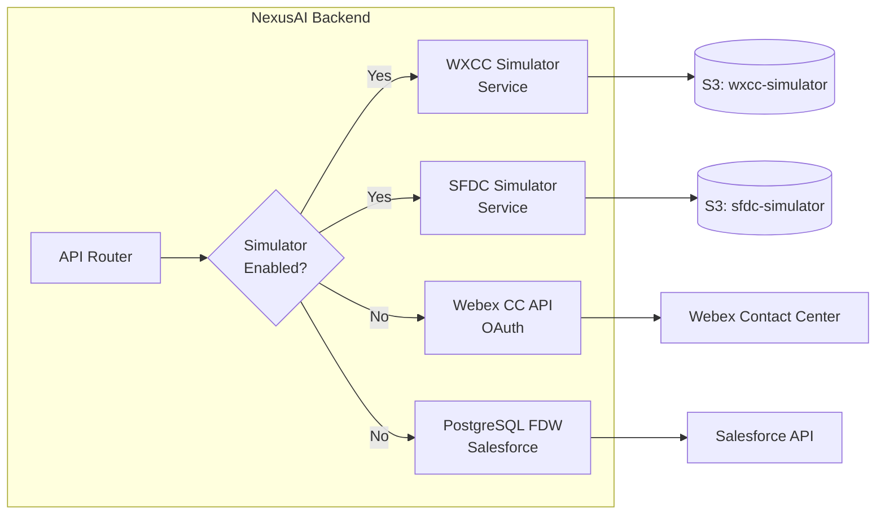

# Enterprise Data Simulators

---

## Overview

The NexusAI platform includes two built-in simulators that allow development and QA teams to test the full data-processing and analytics pipeline without connecting to live external systems. Both simulators can be managed through the **Simulators** page in the application UI (accessible at `/operations/simulators`) or via REST APIs and CLI scripts.

| Aspect | WXCC Simulator | SFDC Simulator |
|--------|---------------|----------------|
| **Purpose** | Mock the Webex Contact Center (WXCC) API for tasks and recordings | Mock the Salesforce Foreign Data Wrapper (FDW) for CRM table data |
| **Replaces** | Real Webex CC Graph API (OAuth-based) | Real PostgreSQL FDW connected to Salesforce |
| **Storage** | S3 bucket (`nexus-ai-{env}-wxcc-simulator`) | S3 bucket (`nexus-ai-{env}-sfdc-simulator`) |
| **Data Format** | `data.json` (tasks/recordings metadata) + audio files in S3 | JSON dumps per table: `servers.json`, `tables.json`, `columns/`, `data/` |
| **Data Source** | Seeded synthetically (random tasks) with real or generated audio | Dumped from a live FDW runtime connected to a real Salesforce org |
| **In-Memory Cache** | LRU cache for sample recordings (50 MB, 20 files max) | Full table data loaded into Python dicts |
| **Mode Switch** | Global via SSM or per-journey (`simulator` / `real` / `inherit_global`) | Global via SSM + Config API (`/api/v1/config/sfdc-mode`) |
| **Key Env Var** | `WXCC_SIMULATOR_ENABLED` | `SFDC_SIMULATOR_ENABLED` |
| **UI Tab** | "WXCC Simulator" | "Salesforce Simulator" |

---

## High-Level Architecture

When a simulator is **enabled**, the backend transparently routes API calls to the in-process simulator service instead of the real external system. No code changes are needed in consuming services -- the swap happens at the service-provider level.



---

## Accessing the Simulators

1. Log in to the NexusAI application as an admin user.
2. Navigate to **Operations > Simulators** in the sidebar (or go directly to `/operations/simulators`).
3. The page shows two tabs: **WXCC Simulator** and **Salesforce Simulator**.

---

## Guides

- [Contact Center Simulator (WXCC)](wxcc/index.md) -- Webex Contact Center task and recording simulation
- [CRM Simulator (Salesforce)](sfdc/index.md) -- Salesforce FDW data simulation

---

## Capturing Screenshots

A Playwright-based script is provided to automatically capture screenshots of both simulator tabs for documentation purposes:

```bash
cd nexus-docs/docs/simulators
python3 capture-simulator-screenshots.py

# With custom credentials
python3 capture-simulator-screenshots.py \
  --url https://your-env.elb.amazonaws.com \
  --email admin@nexus.ai \
  --password YourPassword
```

Screenshots are saved to `wxcc/images/` and `sfdc/images/`.
