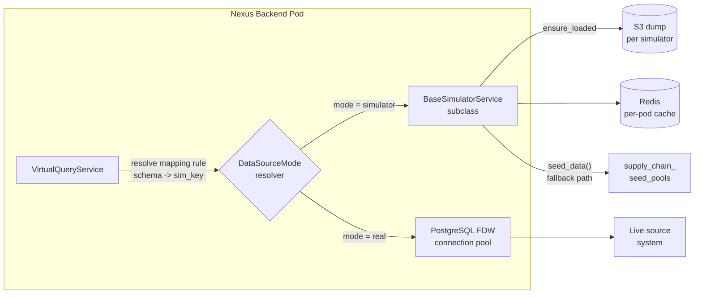
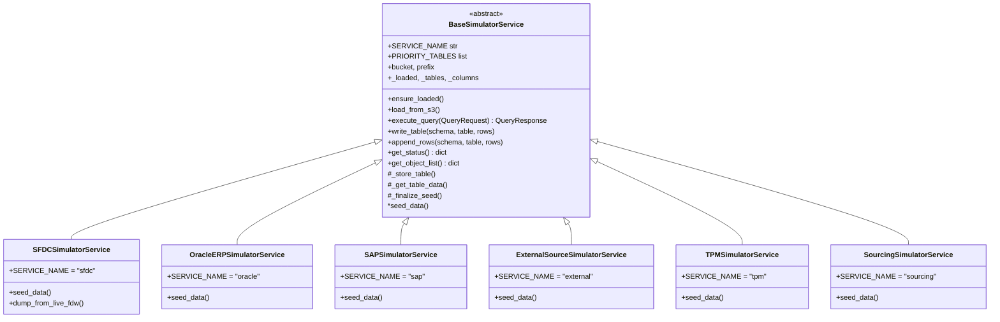
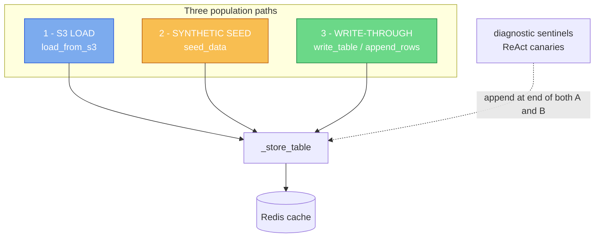
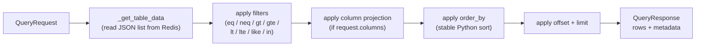
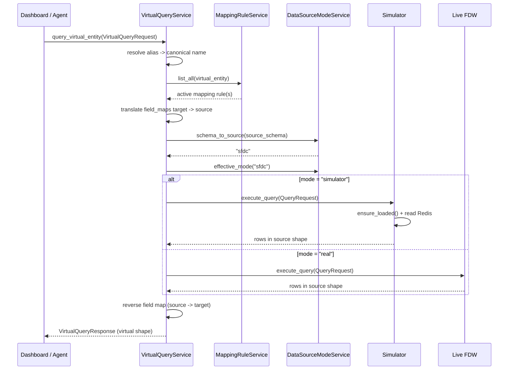

# Enterprise Data Simulators

Built-in in-memory replicas of the source systems the Nexus AI platform
integrates with. They let development, QA, demo, and CI environments
exercise the full Data Plane, Virtual Data Layer (VDL), and Reasoning
Plane without ever touching a live Salesforce, Oracle ERP, SAP, or
external-data tenant.

The simulators are **FDW-compatible**: they implement the exact same
`FDWDiscoveryService` / `FDWQueryService` contract as the live
PostgreSQL Foreign Data Wrappers, so consuming services (`VirtualQueryService`,
the agent ReAct tools, dashboards, journeys) are completely unaware of
whether they're talking to a simulator or to a real source system. A
runtime toggle (per-source, persisted in SSM) flips the entire backend
between modes without code changes.

## Simulator inventory

| Simulator | Service class | Schema | Backed by S3? | Source system |
|---|---|---|---|---|
| **SFDC** | `SFDCSimulatorService` | `sfdc_itxp2dev` | yes | Salesforce CRM |
| **Oracle ERP** | `OracleERPSimulatorService` | `oracle_erp` | yes | Oracle E-Business Suite Finance |
| **SAP S/4HANA** | `SAPSimulatorService` | `sap_s4hana` | yes | SAP supply-chain / production |
| **WxCC** | `WXCCSimulatorService` (legacy) | `wxcc` | yes | WebEx Contact Center (legacy) |
| **External Sources** | `ExternalSourceSimulatorService` | `external_sources` | yes | Google Drive + Social Listening + File Uploads + Reference Data + Plant Metering |
| **TPM** (Trade CPQ) | `TPMSimulatorService` | `tpm_cpq` | **no** — synthetic/Redis-only | Sell-Side Commercial CPQ |
| **Sourcing** (Buy CPQ) | `SourcingSimulatorService` | `sourcing_cpq` | **no** — synthetic/Redis-only | Buy-Side Sourcing CPQ |

The two synthetic-only simulators (TPM, Sourcing) regenerate their
catalog deterministically from `random.seed(42)` on every pod boot.
They are intentionally **not** backed up by the
[`simulator_backup.py`](../../../../nexus-deployer/backup-restore/simulator_backup.py)
tool — there's nothing persistent to back up.

---

## How a simulator works — end-to-end picture



When `mode == "simulator"`:
1. `VirtualQueryService` looks up the active mapping rule for the
   virtual entity, translates the request into a source-shape
   `QueryRequest`, picks the simulator via the `SCHEMA_TO_SIMULATOR`
   map, and calls `sim.execute_query(request)`.
2. The simulator's first call to `ensure_loaded()` hydrates Redis from
   the per-simulator S3 dump (manifest → tables → columns → data).
   Subsequent calls return immediately.
3. `execute_query` reads rows from Redis, applies the request's
   filters / column projection / order-by / pagination in-process, and
   returns a `QueryResponse`.

When `mode == "real"`, the simulator is bypassed entirely and the
request flows through the FDW connection pool to PostgreSQL → the
live tenant. Same `QueryRequest` shape; same `QueryResponse`. The
toggle is invisible to consumers.

---

## Code layout

| File | Role |
|---|---|
| [`src/services/base_simulator_service.py`](https://github.com/nexusdataai/nexus-backend/blob/dev/src/services/base_simulator_service.py) | Abstract base. Owns storage (Redis), FDW-compatible APIs, S3 load, query execution, diagnostic sentinels. ~570 lines. |
| [`src/services/sfdc_simulator_service.py`](https://github.com/nexusdataai/nexus-backend/blob/dev/src/services/sfdc_simulator_service.py) | SFDC `seed_data()` + live-FDW dump-to-S3 admin path. |
| [`src/services/oracle_erp_simulator_service.py`](https://github.com/nexusdataai/nexus-backend/blob/dev/src/services/oracle_erp_simulator_service.py) | Oracle Finance / O2C / P2P / GL seed + load. |
| [`src/services/sap_simulator_service.py`](https://github.com/nexusdataai/nexus-backend/blob/dev/src/services/sap_simulator_service.py) | SAP supply-chain / production master + transactional data. |
| [`src/services/external_source_simulator_service.py`](https://github.com/nexusdataai/nexus-backend/blob/dev/src/services/external_source_simulator_service.py) | Google Drive + Social Listening + File Uploads + ESG/sustainability + plant metering. |
| [`src/services/tpm_simulator_service.py`](https://github.com/nexusdataai/nexus-backend/blob/dev/src/services/tpm_simulator_service.py) | Trade CPQ (offerings, price books, quotes, promos) — synthetic only. |
| [`src/services/sourcing_simulator_service.py`](https://github.com/nexusdataai/nexus-backend/blob/dev/src/services/sourcing_simulator_service.py) | Sourcing CPQ (RFx, supplier responses, awards) — synthetic only. |
| [`src/services/supply_chain_seed_pools.py`](https://github.com/nexusdataai/nexus-backend/blob/dev/src/services/supply_chain_seed_pools.py) | Shared deterministic ID pools so an `ACC-00001` in SFDC matches the `Customer_ID = ACC-00001` row in Oracle, etc. |
| [`src/services/virtual_query_service.py`](https://github.com/nexusdataai/nexus-backend/blob/dev/src/services/virtual_query_service.py) | The VDL → simulator routing logic. |
| [`src/apis/*_simulator_api.py`](https://github.com/nexusdataai/nexus-backend/tree/dev/src/apis) | Admin REST endpoints (`/load`, `/load/status`, `/dump`, `/objects`, `/reset`) per simulator. |

---

## Class hierarchy



`BaseSimulatorService` is intentionally complete. A new simulator only
needs to:

1. Set `SERVICE_NAME` and `PRIORITY_TABLES`.
2. Implement `seed_data()` — generate rows and call `self._store_table(schema, table, rows)`,
   then call `await self._finalize_seed(schema, server, data_map)` at the end.
3. (Optional) Override `__init__` to resolve `self.bucket` / `self.prefix` from
   config or environment.

Everything else — Redis I/O, FDW discovery APIs, query execution,
status endpoints, S3 load, diagnostic-sentinel injection — is inherited.

---

## Storage model — Redis as the live cache

All row data lives in Redis, keyed per simulator + schema + table. The
backend pod's Python process holds only **catalog** metadata (the
`_tables`, `_columns`, `_manifest` attributes); no row payloads.

| Redis key | Type | Holds |
|---|---|---|
| `sim:{SERVICE_NAME}:{schema}.{table}` | JSON list | All rows of the table (single value, deserialized via `redis_client.get_json`) |
| `sim:{SERVICE_NAME}:count:{schema}.{table}` | String | Row count (cheap O(1) read for the FDW-Objects UI) |
| `sim:{SERVICE_NAME}:meta:{kind}` | (reserved) | Reserved for future per-table metadata |

A typical key for the Oracle simulator's customer master table:

```text
sim:oracle:oracle_erp.AR_Customer
sim:oracle:count:oracle_erp.AR_Customer
```

The choice to store entire tables as a single JSON value (rather than
per-row keys) keeps reads O(1) for the bulk read path that
`execute_query` needs. Filter / order / paginate happens in Python after
the round-trip. This is acceptable because:

- Simulator tables are bounded (10 to 10000 rows; nothing close to a
  real OLAP workload).
- The cluster's Redis is sized for the worst-case dump (currently
  SFDC's `~70 MB / 1900 tables / ~135k rows`).
- The simulator is intended for development / demo, not production
  query throughput.

For very large simulator dumps (e.g. a future SFDC full-tenant pull),
the `_store_table` / `_get_table_data` indirection lets us switch to
per-row Redis hashes without touching consumers.

### Why Redis at all? — multi-pod cache coherence

The backend deployment runs ≥ 2 replicas behind a Kubernetes Service.
A Python-process-local dict would mean each replica has to load the S3
dump independently and the FDW-Objects UI would show different row
counts depending on which pod served the request. Redis is the
single source of truth across all replicas of a given environment.

A pod whose Redis got flushed / evicted re-hydrates lazily via the
`ensure_loaded()` spot-check (line 75-83 of `base_simulator_service.py`):
if `_loaded == True` but the sample table's row count is now 0, the
pod re-runs `load_from_s3()`.

---

## S3 dump format

Each S3-backed simulator has a dedicated bucket provisioned by the
operator (the operator's `S3Provisioner.BUCKET_PURPOSES` list pins this).
Bucket naming convention:

```text
{capability}-{env}-{suffix}-{account_id}
```

For example, on the `nexus-ai-dev` cluster (account `654654554404`),
the SFDC simulator bucket is:

```text
nexus-ai-dev-sfdc-simulator-654654554404
```

Inside the bucket, the layout is identical across all S3-backed simulators:

```text
{prefix}/
  manifest.json                       # top-level metadata
  servers.json                        # foreign-server definitions
  tables.json                         # all foreign tables
  columns/
    {schema}.{table}.json             # one column-list per table
    ...
  data/
    {schema}.{table}.json             # one rows-array per table
    ...
  _dump_status.json                   # live-dump progress (cross-pod)
```

### `manifest.json`

```json
{
  "dump_timestamp": "2026-04-04T17:31:16+00:00",
  "source_url": "https://nexus-ai-prod.example.com",
  "schema": "sfdc_itxp2dev",
  "total_tables": 245,
  "tables_with_columns": 245,
  "tables_with_data": 245,
  "total_rows_dumped": 134913,
  "data_tables": { "Account": 201, "Lead": 50, ... },
  "elapsed_seconds": 312.4
}
```

### `tables.json`

```json
[
  { "schemaName": "sfdc_itxp2dev",
    "tableName": "Account",
    "serverName": "sfdc_simulator",
    "columnCount": 9 },
  ...
]
```

### `columns/{schema}.{table}.json`

```json
[
  { "columnName": "Account_ID",
    "dataType": "ID",
    "isNullable": false,
    "ordinalPosition": 1 },
  ...
]
```

### `data/{schema}.{table}.json`

Either a top-level JSON array of row dicts, or `{"rows": [...]}` — the
loader accepts both shapes. Each row's keys match the column list.

---

## Lifecycle — how data gets into the simulator

There are three independent paths that populate the Redis cache. They
share `_store_table()` as the final hop.



### Path 1 — S3 load (`load_from_s3`)

The default population path on a fresh pod. Triggered by:

- `POST /api/v1/{simulator}/load` (UI's "Load Data" button)
- First call to any read endpoint that triggers `ensure_loaded()`

Steps inside `BaseSimulatorService.load_from_s3()` (line 207-344):

1. Read `manifest.json`. Bail out if absent (the bucket is empty).
2. Read `servers.json` → populate `self._servers`.
3. Read `tables.json` → populate `self._tables`.
4. Paginated list of `columns/` → populate `self._columns`.
5. Paginated list of `data/` → for each `{schema}.{table}.json` file,
   read the rows array and call `self._store_table(schema, table, rows)`.
   This writes one Redis key + one count key.
6. Apply diagnostic sentinels (see below).
7. Set `self._loaded = True`, record `_loaded_at`, populate
   `_tables_with_data` and `_total_rows`.

Progress is captured in `self._load_status` (a list of step dicts) and
exposed via `GET /api/v1/{simulator}/load/status` — the Simulators UI
polls this to drive the progress display.

### Path 2 — Synthetic seed (`seed_data`)

The fallback path when the bucket is unset (e.g. on a brand-new
cluster before any S3 dump exists), and the only path for the
TPM / Sourcing simulators (which never have an S3 bucket).

Each concrete simulator implements `seed_data()` and:

1. Calls `random.seed(42)` for deterministic output.
2. Imports shared ID pools from
   [`supply_chain_seed_pools.py`](https://github.com/nexusdataai/nexus-backend/blob/dev/src/services/supply_chain_seed_pools.py).
3. Builds a `data_map: Dict[str, List[dict]]` of table-name → rows.
4. Calls `await self._finalize_seed(SCHEMA, SERVER, data_map)`.

`_finalize_seed` walks the map, writes each table via `_store_table`,
populates the catalog (`_servers`, `_tables`, `_columns` — column
types auto-inferred from the first row), and sets `_loaded = True`.

### Path 3 — Write-through (`write_table`, `append_rows`)

Runtime writes performed by `ResultSink` and journey processors when
a job produces a result table (e.g. an O2C analytics run writes
`O2C_Outcome_Tracker` into the SFDC simulator so subsequent dashboards
can query it).

These calls also auto-register the table in the catalog if it's not
already there — so the FDW-Objects UI reflects runtime-produced tables
without a redeploy.

### Diagnostic sentinels

`_apply_diagnostic_sentinels()` (line 346-391 of
`base_simulator_service.py`) injects a small set of "canary" rows
defined in `src/services/control_plane/_diagnostic_seed.py`. These
back the ReAct-tool diagnostic test suite — the agent can issue a
deterministic `query_virtual_entity` call with `CANARY_PARAMS` and
expect a known row back, proving the entire VDL → mapping rule →
simulator → Redis path is healthy.

Sentinels are idempotent: if the sentinel PK is already present, the
row is left untouched.

---

## Data generation — determinism and cross-system consistency

Every simulator that generates synthetic data does so from a single
shared module: [`supply_chain_seed_pools.py`](https://github.com/nexusdataai/nexus-backend/blob/dev/src/services/supply_chain_seed_pools.py).

The reason: cross-system referential integrity matters. When the
agent answers *"What's the open AR for our top-10 SFDC accounts?"*, it
needs:

- SFDC's `Account.Account_ID = ACC-00007`
- to match Oracle's `AR_Customer.Customer_ID = ACC-00007`

The seed pools enforce this:

```python
# supply_chain_seed_pools.py
account_ids = _ids("ACC-", 200)        # "ACC-00001" ... "ACC-00200"
contact_ids = _ids("CON-", 400)
opportunity_ids = _ids("OPP-", 500)
material_ids = _ids("MAT-", 300)
po_ids = _ids("PO-", 500)
...
```

The same `account_ids` list is then imported by:

- `SFDCSimulatorService.seed_data` → populates `Account.Account_ID`
- `OracleERPSimulatorService.seed_data` → populates `AR_Customer.Customer_ID`
- `SAPSimulatorService.seed_data` → populates `Customer_Master.Customer_ID`

…and so on for materials (SFDC opportunity line items / SAP material
master / Oracle AP invoice), POs (Oracle PO header / SAP goods receipt),
plants (SAP / Oracle cost accounting), etc.

`random.seed(42)` at the top of every `seed_data()` makes the random
choices reproducible across pods, restarts, environments, and even
across two Nexus installations on different AWS accounts — handy for
side-by-side debugging.

### Categorical pools

The seed module also exposes shared categorical lists so the
simulators agree on enum values:

```python
REGIONS = ["North", "South", "East", "West", "Central"]
COUNTRIES = ["Singapore", "Malaysia", "Thailand", "Indonesia", ...]
TIERS = ["Platinum", "Gold", "Silver", "Bronze"]
OPP_STAGES = ["Prospect", "Negotiation", "Closed_Won", "Closed_Lost", ...]
ACCOUNT_STATUSES = ["Active", "Active", "Active", "Active", "Inactive", "Suspended"]
```

Note the deliberate weighting in `ACCOUNT_STATUSES` — `pick()` returns
a uniform random element, so duplicating "Active" four times gives the
simulator a ~67% Active / 17% Inactive / 17% Suspended distribution.
Same trick is used for `OPP_STAGES` to bias toward "Closed_Won" so
downstream analytics look realistic.

### Per-simulator extras

Each simulator adds its own specialist pools:

- **TPM**: `offering_ids`, `quote_ids`, `price_book_ids`, `OFFERING_TYPES`,
  `OFFERING_COMPONENT_ROLES`, `QUOTE_STATUSES`, `PROMO_MECHANICS`.
- **Sourcing**: RFx IDs, supplier IDs, sourcing-event statuses.
- **External**: ESG initiatives, sustainability KPIs, social-listening
  sentiment scores, commodity prices.

---

## Query path — how `execute_query` works

The simulator implements the same `FDWQueryService` contract as the
real Postgres FDW path, so consumers can be agnostic. Signature:

```python
async def execute_query(self, request: QueryRequest) -> QueryResponse: ...
```

`QueryRequest` (from `src/models/fdw_models.py`) carries:

```python
class QueryRequest:
    schema_name: str
    table: str
    columns: Optional[List[str]]      # projection; None means *
    filters: Optional[List[QueryFilter]]   # WHERE clauses
    order_by: Optional[List[OrderClause]]  # ORDER BY
    limit: Optional[int]
    offset: Optional[int]
```

Inside `BaseSimulatorService.execute_query` (line 448-484):



Filter operators are listed in the `_match_filter` static method:
`eq`, `neq`, `gt`, `gte`, `lt`, `lte`, `like` (case-insensitive
substring match — `%` wildcards are stripped), `in`. Anything outside
this set returns `False`, mirroring SQL's three-valued logic.

`QueryResponse.metadata` carries:

```python
QueryMetadata(
    duration_ms=...,            # python-side, includes redis I/O
    table_queried="{schema}.{table}",
    row_count=len(rows_after_pagination),
)
```

Consumers (the VDL, the FDW-Objects UI, the data-preview panel) use
`metadata.duration_ms` to display per-query latency.

---

## VDL integration — how the Virtual Data Layer reaches a simulator

The Virtual Data Layer (VDL) is the layer above this. It models
**virtual entities** that journeys, dashboards, and the Copilot agent
think in (e.g. `Customer`, `Invoice`, `O2C_Outcome_Tracker`). Each
virtual entity is backed by one **mapping rule** that tells VDL where
the actual data lives.

A mapping rule has:

```text
virtual_entity:  "Customer"                       # what the consumer asks for
source_type:     "FDW"                            # or "MIMIR" / "ATHENA"
source_system:   "sfdc"                           # informational
source_schema:   "sfdc_itxp2dev"                  # FDW schema
source_table:    "Account"                        # FDW table
field_maps:                                       # source -> virtual
  - source_field: "Account_ID"     target_field: "id"
  - source_field: "Account_Name"   target_field: "name"
  - source_field: "Credit_Limit"   target_field: "credit_limit"
status:          "active"
```

[`VirtualQueryService.query_virtual_entity()`](https://github.com/nexusdataai/nexus-backend/blob/dev/src/services/virtual_query_service.py)
orchestrates the full path:



### Schema-to-simulator routing

The hard-coded map at the top of `virtual_query_service.py` translates
the rule's `source_schema` to a simulator key:

```python
SCHEMA_TO_SIMULATOR: Dict[str, str] = {
    "oracle_erp":     "oracle",
    "sap_s4hana":     "sap",
    "sfdc_itxp2dev":  "simulator",   # SFDC's key is historically "simulator"
    "external_sources":"external",
    "tpm_cpq":        "tpm",
    "sourcing_cpq":   "sourcing",
}
```

The corresponding key is looked up in the `self._simulators` dict
that's wired into `VirtualQueryService` at backend startup (see
`mcp_http_gateway.py:837-858`).

### Per-source mode resolution

[`DataSourceModeService`](https://github.com/nexusdataai/nexus-backend/blob/dev/src/services/data_source_mode_service.py)
is the single source of truth for "should this source run in simulator
or in real mode?". The choice is persisted in AWS SSM at
`/{capability}/{env}/data-source-mode/{source}` and exposed at
`GET /api/v1/data-source-mode`. The write surface is *Settings →
System → Data Source Mode* in the UI.

`VirtualQueryService` consults it on every query:

```python
mode = "simulator"
if self._mode_service is not None:
    source = self._mode_service.schema_to_source(rule.source_schema)
    mode = self._mode_service.effective_mode(source) if source else "real"
```

If `mode == "simulator"` and the simulator isn't loaded, the query
**hard-errors** rather than silently falling through to FDW — the
operator wanted explicit modes, so a "load it" message is more useful
than a misleading 404.

### Field-map translation (source ↔ virtual)

Mapping rules express the schema in **both directions**:

- **Outgoing** (caller's virtual fields → simulator's columns) so the
  caller can use canonical names (`id`, `name`, `credit_limit`) without
  knowing about SFDC's `Account_ID`, `Account_Name`, `Credit_Limit`.
- **Incoming** (simulator's columns → virtual fields) so the response
  rows are in the canonical shape the caller expects.

`VirtualQueryService` builds both maps from the rule's `field_maps`
list and applies them around the simulator/FDW call.

### Filter operator translation

A `VirtualFilter` is structurally identical to a `QueryFilter`
(`column`, `operator`, `value`), so translation is just a field-name
swap. The simulator and the real FDW share the same operator
vocabulary (`eq`, `neq`, `gt`, `gte`, `lt`, `lte`, `like`, `in`).

---

## Admin REST endpoints (per simulator)

Each S3-backed simulator exposes a consistent admin surface under
`/api/v1/{simulator-name}`:

| Method + path | Purpose |
|---|---|
| `GET /status` | Service state: `enabled`, `loaded`, `bucket`, `prefix`, table count, total rows, dump timestamp |
| `GET /health` | Liveness + mode (`simulator` vs `real`) |
| `POST /load` | Hydrate Redis from the S3 dump (returns immediately; runs in background) |
| `GET /load/status` | Poll the in-memory load progress |
| `POST /reset` | Flush Redis prefix + re-run `load_from_s3` (or `seed_data` if no bucket) |
| `GET /objects` | Tables + row counts for the FDW-Objects UI panel |
| `GET /objects/{schema}/{table}` | Paged rows (`limit` + `offset`) |
| `GET /objects/{schema}/{table}/columns` | Column metadata |
| `POST /dump` | (SFDC only today) Dump a live FDW runtime's data into the S3 bucket — used for staging-to-dev refreshes |
| `GET /dump/status` | Poll the live-dump progress (stored in S3 itself for cross-pod consistency) |
| `POST /restart-pods` | Trigger a Kubernetes rolling restart of the backend deployment (uses in-cluster K8s API + the pod's IRSA role) |

When the simulator is **disabled** (i.e. `mode == "real"`) but the
service is still instantiated, the API endpoints transparently
delegate to the live FDW services — so the UI never has to know about
mode.

---

## How simulators connect to the rest of the platform

### At backend startup

[`mcp_http_gateway.py:lifespan()`](https://github.com/nexusdataai/nexus-backend/blob/dev/mcp_http_gateway.py)
constructs the simulator services and registers them with the FDW
router:

```python
# Pseudo-code; see the real file for the exact order:
sfdc_sim   = SFDCSimulatorService()
oracle_sim = OracleERPSimulatorService()
sap_sim    = SAPSimulatorService()
ext_sim    = ExternalSourceSimulatorService()
tpm_sim    = TPMSimulatorService()
src_sim    = SourcingSimulatorService()

# Wire them into the FDW API's simulator dict
configure_simulator(sfdc_sim,   name="simulator")  # historically "simulator"
configure_simulator(oracle_sim, name="oracle")
configure_simulator(sap_sim,    name="sap")
configure_simulator(ext_sim,    name="external")
configure_simulator(tpm_sim,    name="tpm")
configure_simulator(src_sim,    name="sourcing")

# Pass that same dict into VirtualQueryService
_virtual_query_service = VirtualQueryService(
    _mapping_rule_service,
    _vq_fdw_query, _vq_fdw_discovery,
    simulators=_vq_simulators,
    mode_service=_data_source_mode_service,
    ...
)
```

The simulator instances are *not* loaded yet at this point — that's
deferred to `ensure_loaded()` on first use. Startup stays fast.

### ResultSink write-through (journeys → simulators)

When a journey processor produces a result table (e.g. an
inventory-optimization run produces `IO_Stock_Health` rows), it calls
`ResultSink.write_results()` which in turn calls the simulator's
`write_table()`. The simulator stores the rows in Redis under the
simulator's schema (`external_sources` for these analytics outputs)
and registers the new `(schema, table)` in the catalog so the
FDW-Objects UI immediately surfaces it.

This means journey-produced data shows up in the simulator's
`/objects` listing without a redeploy — the same way live FDW tables
appear.

---

## Backup and restore

### S3 dumps

The S3 dumps of the 4-5 active S3-backed simulators are the canonical
backup target. The dedicated tool is
[`simulator_backup.py`](https://github.com/nexusdataai/nexus-deployer/blob/main/backup-restore/simulator_backup.py)
in `nexus-deployer/backup-restore/`. It tarballs all 7 simulator
buckets (skipping the absent ones gracefully — TPM/Sourcing simply
record `bucket: null, key_count: 0` in the manifest).

After restoring across accounts, run the `hydrate` subcommand to fire
`POST /api/v1/{sim}/load` on each S3-backed simulator and poll until
the new pod's Redis is populated.

### Pod restart caveats

The in-memory `_loaded` flag is sticky for the lifetime of the pod.
If you restore S3 data while the pods are already running, they won't
re-check the bucket — `ensure_loaded` only auto-reloads if Redis has
been flushed in the meantime. The `hydrate` subcommand fires
`/load` explicitly to force the re-read.

This is the same class of "first-call cache" bug we documented for
the OpenAI client (see the
`refactor(backend): VDL canonical entities + OpenAI key hot-reload`
commit). The simulators historically pre-date that fix and intentionally
preserve their `_loaded` flag so concurrent requests don't all trigger
parallel S3 reads.

---

## Operational reference

### Tuning

- `redis_client` connection pool: managed centrally. Each simulator
  shares the same Redis client.
- Concurrent loads: each `load_from_s3()` paginates serially through
  the data files. The S3 reads themselves are not parallelized
  in-process (boto3's default threading model is sufficient for the
  dump sizes we see). If the dataset grows, switch
  `_store_table` calls to a `ThreadPoolExecutor` and use
  `redis_client.pipeline()`.
- Diagnostic sentinels add a constant ~10-30 rows per simulator at
  load completion.

### Common questions

> *"Why are my SFDC simulator stats showing 0 tables loaded right
> after restore?"*

Pods that were running before the restore have `_loaded = True` with
the pre-restore (empty) catalog cached. Either click *Load Data* in
the UI or `kubectl rollout restart deployment/{capability}-{env}-backend`.

> *"Can I add a new simulator?"*

1. Pick a `SERVICE_NAME` and `SCHEMA` value.
2. Subclass `BaseSimulatorService`; implement `seed_data`.
3. Add the simulator to `mcp_http_gateway.py:lifespan()`.
4. Add the schema to `SCHEMA_TO_SIMULATOR` in `virtual_query_service.py`.
5. Add the simulator's bucket suffix to
   `kube-operator/src/nexus_operator/resources/s3.py:BUCKET_PURPOSES`.
6. (Optional) Add an admin REST router in `src/apis/`.
7. (Optional) Add the simulator to `SIMULATORS` in `simulator_backup.py`.

> *"Why is TPM showing no S3 bucket?"*

By design. TPM and Sourcing simulators have purely synthetic data
generated from `random.seed(42)` on every pod boot — nothing to
persist to S3. See the operator's `BUCKET_PURPOSES` list: TPM /
Sourcing buckets are intentionally absent.

### See also

- [SFDC / CRM Simulator](sfdc/index.md) — earlier SFDC-only walkthrough,
  preserved for historical context.
- [Data Plane](../planes/data-plane.md) — the Virtual Data Layer (VDL)
  abstraction that sits above the simulators.
- [Semantic RAG Pipeline](../semantic-layer/semantic-rag-pipeline.md) —
  how the knowledge indexer consumes simulator data to build the
  agent's RAG corpus.
- [Knowledge Indexing and Copilot Reasoning](../semantic-layer/knowledge-indexing-and-copilot-reasoning.md)
  — how the Copilot agent queries simulator-backed virtual entities
  during ReAct steps.
